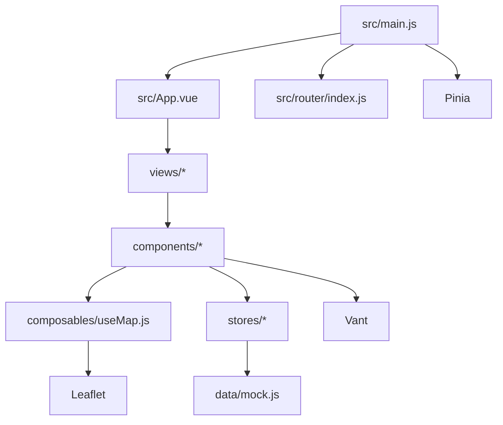
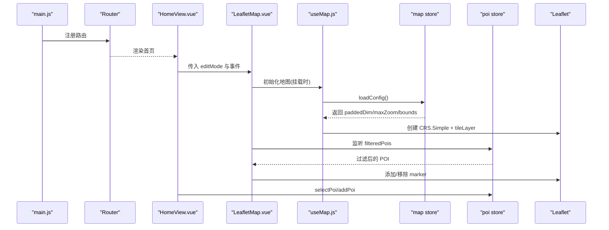
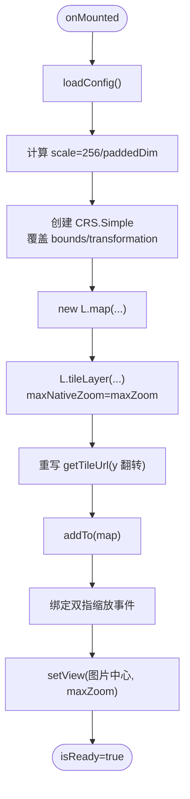
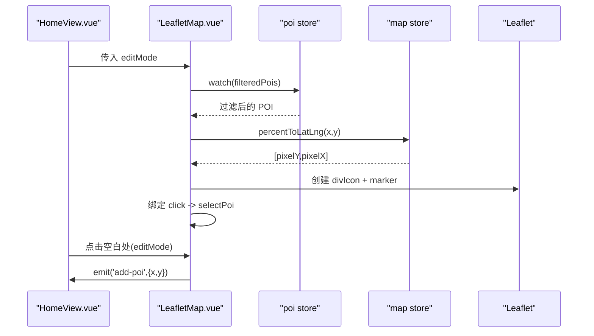
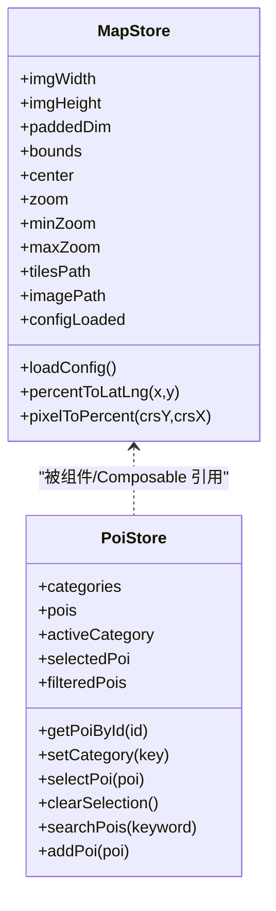
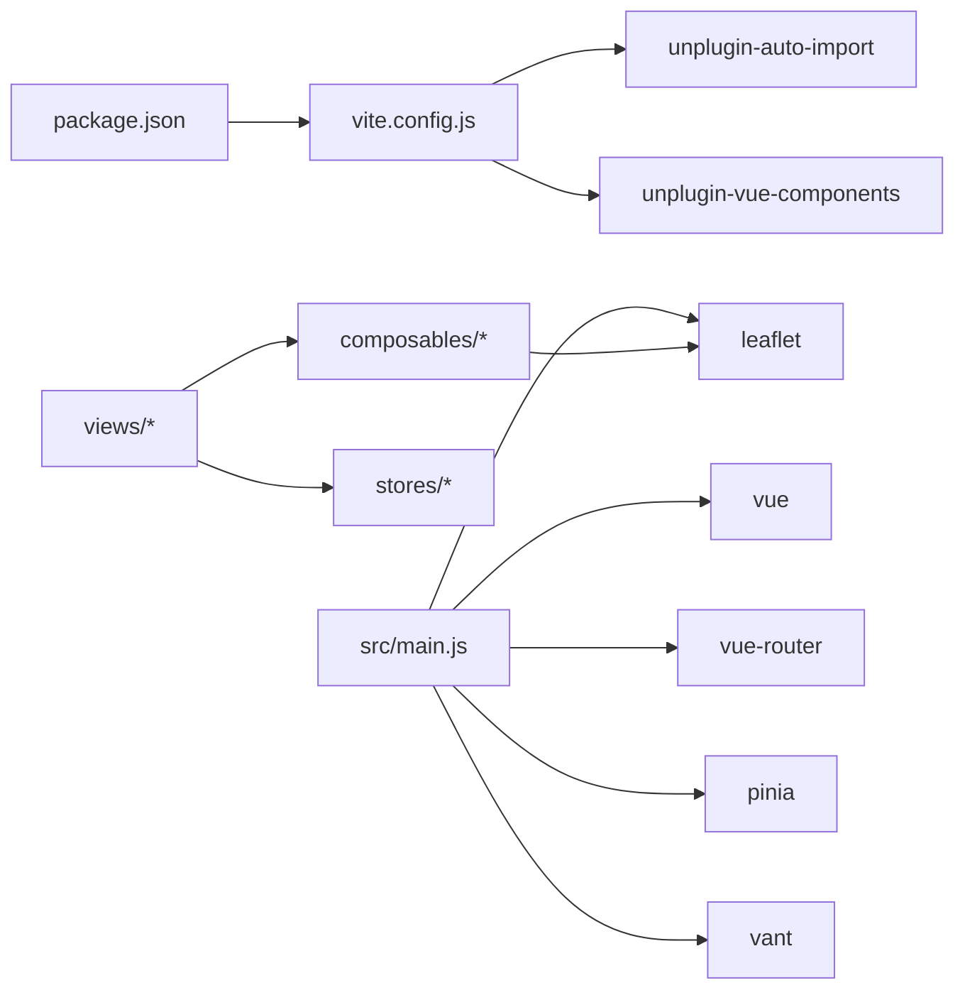

# 开发指南

<cite>
**本文引用的文件**
- [package.json](file://package.json)
- [README.md](file://README.md)
- [vite.config.js](file://vite.config.js)
- [src/main.js](file://src/main.js)
- [src/App.vue](file://src/App.vue)
- [src/router/index.js](file://src/router/index.js)
- [src/stores/poi.js](file://src/stores/poi.js)
- [src/stores/map.js](file://src/stores/map.js)
- [src/composables/useMap.js](file://src/composables/useMap.js)
- [src/components/map/LeafletMap.vue](file://src/components/map/LeafletMap.vue)
- [src/views/HomeView.vue](file://src/views/HomeView.vue)
- [src/data/mock.js](file://src/data/mock.js)
- [public/map/config.json](file://public/map/config.json)
</cite>

## 目录
1. [简介](#简介)
2. [项目结构](#项目结构)
3. [核心组件](#核心组件)
4. [架构总览](#架构总览)
5. [详细组件分析](#详细组件分析)
6. [依赖关系分析](#依赖关系分析)
7. [性能优化建议](#性能优化建议)
8. [调试与开发工具](#调试与开发工具)
9. [测试策略](#测试策略)
10. [贡献代码流程与规范](#贡献代码流程与规范)
11. [常见问题排查](#常见问题排查)
12. [结论](#结论)

## 简介
FunMapUI 是基于 Vue 3 + Vite 的移动端手绘地图导览应用，使用 Leaflet 自定义像素坐标系渲染手绘地图瓦片，提供 POI 标注、分类筛选、搜索、语音讲解、视频播放与 360° 全景查看等功能。项目采用 Pinia 进行状态管理，Vue Router 进行路由管理，Vant 作为 UI 组件库，并通过自动导入减少样板代码。

## 项目结构
- 构建与脚本：通过 package.json 定义 dev/build/preview 命令；Vite 配置启用 Vue、自动导入与组件解析，并设置 @ 路径别名与开发服务器 host。
- 入口与根组件：main.js 初始化 Vue 应用、注册 Pinia 与 Router，引入全局样式与第三方样式；App.vue 提供全局重置与标记样式。
- 路由：按页面划分懒加载路由，包含首页、POI 详情、搜索、全景页。
- 状态管理：map store 负责地图尺寸、CRS bounds、坐标转换；poi store 负责 POI 数据、分类、搜索与选中态；audio store 用于音频播放状态（当前未在本节展开）。
- 组合式函数：useMap 封装 Leaflet 地图初始化、CRS.Simple 配置、双指缩放、瓦片 y 翻转等逻辑。
- 组件：地图主体、控件、分类标签、POI 编辑弹窗、通用组件（搜索栏、底部面板、播放器等）。
- 数据与资源：mock.js 提供示例 POI；public/map 下存放地图原图、瓦片与配置文件。

图表来源
- [src/main.js:1-21](file://src/main.js#L1-L21)
- [src/router/index.js:1-32](file://src/router/index.js#L1-L32)
- [src/components/map/LeafletMap.vue:1-141](file://src/components/map/LeafletMap.vue#L1-L141)
- [src/composables/useMap.js:1-174](file://src/composables/useMap.js#L1-L174)
- [src/stores/poi.js:1-84](file://src/stores/poi.js#L1-L84)
- [src/stores/map.js:1-122](file://src/stores/map.js#L1-L122)

章节来源
- [package.json:1-28](file://package.json#L1-L28)
- [vite.config.js:1-27](file://vite.config.js#L1-L27)
- [src/main.js:1-21](file://src/main.js#L1-L21)
- [src/App.vue:1-59](file://src/App.vue#L1-L59)
- [src/router/index.js:1-32](file://src/router/index.js#L1-L32)

## 核心组件
- 地图容器与交互：LeafletMap.vue 负责监听 POI 变化更新标记、处理点击事件与编辑模式切换，并通过 useMap composable 获取地图实例与方法。
- 地图初始化与坐标系统：useMap.js 创建 CRS.Simple 实例，覆盖投影边界与变换，设置瓦片层与 y 翻转，实现无级缩放与双指缩放阈值控制。
- 状态管理：map store 维护图片尺寸、paddedDim、bounds、中心点、缩放范围与瓦片路径；poi store 维护分类、POI 列表、过滤结果、选中项与搜索方法。
- 视图编排：HomeView.vue 组合地图、控件、分类 Tab、搜索栏、底部面板与编辑器弹窗，协调编辑模式与新增 POI 流程。

章节来源
- [src/components/map/LeafletMap.vue:1-141](file://src/components/map/LeafletMap.vue#L1-L141)
- [src/composables/useMap.js:1-174](file://src/composables/useMap.js#L1-L174)
- [src/stores/map.js:1-122](file://src/stores/map.js#L1-L122)
- [src/stores/poi.js:1-84](file://src/stores/poi.js#L1-L84)
- [src/views/HomeView.vue:1-136](file://src/views/HomeView.vue#L1-L136)

## 架构总览
下图展示了从入口到视图、状态与地图引擎的数据流与控制流。

图表来源
- [src/main.js:1-21](file://src/main.js#L1-L21)
- [src/router/index.js:1-32](file://src/router/index.js#L1-L32)
- [src/views/HomeView.vue:1-136](file://src/views/HomeView.vue#L1-L136)
- [src/components/map/LeafletMap.vue:1-141](file://src/components/map/LeafletMap.vue#L1-L141)
- [src/composables/useMap.js:1-174](file://src/composables/useMap.js#L1-L174)
- [src/stores/map.js:1-122](file://src/stores/map.js#L1-L122)
- [src/stores/poi.js:1-84](file://src/stores/poi.js#L1-L84)

## 详细组件分析

### 地图初始化与瓦片坐标系统（useMap）
- 目标：基于 Leaflet 的 CRS.Simple 建立像素坐标系，适配手绘地图原图尺寸，生成瓦片金字塔并按约定路径请求。
- 关键点：
  - 计算 scale = 256 / paddedDim，确保瓦片尺寸与像素坐标一致。
  - 覆盖 projection.bounds 为 [0,0] 到 [paddedDim,paddedDim]，避免经纬度语义干扰。
  - 自定义 getTileUrl 对 y 坐标翻转以匹配瓦片存储约定。
  - 开启 zoomSnap: 0 支持无级缩放，zoomDelta 控制按钮步进。
  - 禁用内置 touchZoom，改用自定义双指手势，超过阈值才触发整级缩放，提升体验一致性。
  - 在 zoomend 输出调试信息，便于定位瓦片加载问题。

图表来源
- [src/composables/useMap.js:14-129](file://src/composables/useMap.js#L14-L129)

章节来源
- [src/composables/useMap.js:1-174](file://src/composables/useMap.js#L1-L174)
- [src/stores/map.js:40-85](file://src/stores/map.js#L40-L85)

### POI 标记与交互（LeafletMap.vue）
- 目标：根据 POI 数据动态渲染标记，支持点击选择与编辑模式下点击添加。
- 关键点：
  - 使用 Canvas measureText 测量文字宽度，自适应标记容器大小。
  - 将百分比坐标转换为像素坐标后放置标记。
  - 监听 poiStore.filteredPois 变化，增删标记。
  - 编辑模式下绑定地图 click，发射 add-poi 事件给父组件。

图表来源
- [src/components/map/LeafletMap.vue:31-129](file://src/components/map/LeafletMap.vue#L31-L129)
- [src/stores/map.js:87-103](file://src/stores/map.js#L87-L103)
- [src/stores/poi.js:27-63](file://src/stores/poi.js#L27-L63)

章节来源
- [src/components/map/LeafletMap.vue:1-141](file://src/components/map/LeafletMap.vue#L1-L141)
- [src/views/HomeView.vue:66-96](file://src/views/HomeView.vue#L66-L96)

### 状态管理设计（map store 与 poi store）
- map store：
  - 负责加载地图配置与图片尺寸，计算 paddedDim、bounds、center、maxZoom。
  - 提供百分比与像素坐标互转方法，供标记定位与编辑落点使用。
- poi store：
  - 维护分类、POI 列表、当前分类与选中项。
  - 提供过滤、搜索、添加 POI 等方法，驱动 UI 更新。

图表来源
- [src/stores/map.js:1-122](file://src/stores/map.js#L1-L122)
- [src/stores/poi.js:1-84](file://src/stores/poi.js#L1-L84)

章节来源
- [src/stores/map.js:1-122](file://src/stores/map.js#L1-L122)
- [src/stores/poi.js:1-84](file://src/stores/poi.js#L1-L84)

### 路由与页面组织
- 路由采用懒加载，降低首屏体积。
- 页面职责清晰：首页承载地图与交互，详情页展示 POI 完整信息，搜索页提供关键词检索，全景页承载 360° 查看。

章节来源
- [src/router/index.js:1-32](file://src/router/index.js#L1-L32)

## 依赖关系分析
- 运行时依赖：Vue 3、Vue Router、Pinia、Leaflet、Vant、@photo-sphere-viewer/core。
- 构建期依赖：Vite、@vitejs/plugin-vue、unplugin-auto-import、unplugin-vue-components、@vant/auto-import-resolver、sharp（脚本用）。
- 自动导入：通过 unplugin-auto-import 与 VantResolver 实现 API 与组件按需自动导入，减少显式 import。

图表来源
- [package.json:1-28](file://package.json#L1-L28)
- [vite.config.js:1-27](file://vite.config.js#L1-L27)
- [src/main.js:1-21](file://src/main.js#L1-L21)

章节来源
- [package.json:1-28](file://package.json#L1-L28)
- [vite.config.js:1-27](file://vite.config.js#L1-L27)

## 性能优化建议
- 组件懒加载
  - 路由已采用异步 import，进一步可按需拆分大组件（如全景、视频、地图控件），减少首屏包体。
- 图片与瓦片优化
  - 瓦片尺寸固定 256px，合理设置 maxNativeZoom，超出级别由 CSS 放大，避免重复生成过多瓦片。
  - 使用 WebP/AVIF 替代 PNG/JPG（需确认浏览器兼容），结合 CDN 缓存与压缩。
  - 对大图进行分块加载与延迟加载，仅在可视区域或用户交互时加载。
- 内存管理
  - 地图销毁：组件卸载时调用 map.remove()，避免内存泄漏（已在 useMap 中处理）。
  - 标记清理：更新 POI 前移除旧 marker，防止 DOM 节点堆积。
  - 事件解绑：编辑模式切换时及时 off 事件监听。
- 渲染优化
  - 使用 computed 派生 filteredPois，减少重复计算。
  - 文本宽度测量复用 Canvas 实例，避免频繁创建。
- 网络与缓存
  - 瓦片与静态资源开启强缓存与版本化文件名。
  - 使用 HTTP/2 与 CDN 加速静态资源分发。

[本节为通用指导，不直接分析具体文件]

## 调试与开发工具
- 开发服务器
  - 启动：npm run dev；访问 http://localhost:5173。
  - 主机绑定：vite.config.js 中 server.host 设置为 0.0.0.0，便于局域网访问。
- Vue DevTools
  - 安装浏览器插件 Vue DevTools，可在开发环境下查看组件树、状态与事件。
  - 配合 Pinia 插件查看 store 状态变更与 actions 调用。
- 浏览器调试
  - 控制台日志：useMap 在 zoomend 输出瓦片加载统计，便于定位瓦片缺失或失败。
  - Network 面板：检查瓦片请求路径与响应码，确认 tilesPath 与 y 翻转是否正确。
  - Performance 面板：录制交互过程，分析重排重绘与长任务。
- 常见问题快速定位
  - 瓦片不显示：检查 public/map/config.json 的 tilesPath 与实际目录是否一致；确认 getTileUrl 的 y 翻转逻辑。
  - 标记位置偏移：核对 mock.js 中的百分比坐标与 mapStore.percentToLatLng 的转换逻辑。
  - 触摸缩放异常：确认自定义双指缩放事件未被其他事件拦截。

章节来源
- [vite.config.js:23-25](file://vite.config.js#L23-L25)
- [src/composables/useMap.js:113-120](file://src/composables/useMap.js#L113-L120)
- [public/map/config.json:1-5](file://public/map/config.json#L1-L5)

## 测试策略
- 单元测试
  - 针对纯函数与可复用的逻辑编写测试，例如：
    - map store 的 percentToLatLng 与 pixelToPercent 转换正确性。
    - poi store 的 searchPois 与 filteredPois 过滤逻辑。
  - 推荐工具：Vitest（与 Vite 生态集成良好）。
- 组件测试
  - 对 LeafletMap.vue 的关键交互（点击添加 POI、编辑模式切换）进行断言。
  - 模拟 Leaflet 实例与 DOM 环境，验证标记增删与事件触发。
- 端到端测试
  - 使用 Playwright/Cypress 模拟用户操作，验证路由跳转、搜索与全景加载流程。
- 持续集成
  - 在 CI 中执行 lint、test、build，保证代码质量与构建稳定性。

[本节为通用指导，不直接分析具体文件]

## 贡献代码流程与规范
- 分支策略
  - main：稳定分支，仅接受合并通过的 PR。
  - feature/*：功能分支，完成功能后提交 PR。
  - fix/*：修复分支，修复问题后提交 PR。
- 提交规范
  - 使用约定式提交（feat/fix/docs/style/refactor/test/chore），描述简洁明确。
- 代码风格
  - 遵循 Vue 官方风格指南与 ESLint 规则（可通过 VS Code 插件或 IDE 集成）。
  - 组件命名：文件 PascalCase，组件名与文件名一致。
  - 变量命名：camelCase；常量 UPPER_SNAKE_CASE。
  - 注释：公共 API 与复杂逻辑添加 JSDoc 或行内注释，说明输入输出与副作用。
- Pull Request 要求
  - 关联 Issue 或需求编号。
  - 包含必要测试用例与自测说明。
  - 保持 diff 最小化，避免无关改动。
  - 通过 CI 检查（lint/test/build）。

[本节为通用指导，不直接分析具体文件]

## 常见问题排查
- 瓦片无法加载
  - 检查 public/map/config.json 的 image 与 tilesPath 是否与真实资源路径一致。
  - 确认 generate-tiles-leaflet.js 生成的瓦片目录结构与 z/x/y.png 约定一致。
  - 在控制台查看 zoomend 日志，确认 maxNativeZoom 与实际瓦片层级匹配。
- 标记位置不正确
  - 核对 mock.js 中 x/y 是否为百分比坐标，且 mapStore.imgWidth/imgHeight 已正确加载。
  - 检查 percentToLatLng 与 pixelToPercent 的转换方向与精度。
- 触摸缩放不灵敏或误触
  - 调整 PINCH_THRESHOLD 或 zoomDelta，平衡灵敏度与误触概率。
  - 确认 touchmove 事件未被父容器拦截。
- 内存占用过高
  - 检查是否在每次更新 POI 时移除旧 marker。
  - 确认地图实例在组件卸载时被正确销毁。
- 构建产物过大
  - 使用路由懒加载与组件按需引入。
  - 检查是否引入了不必要的第三方库或全量样式。

章节来源
- [public/map/config.json:1-5](file://public/map/config.json#L1-L5)
- [src/composables/useMap.js:72-120](file://src/composables/useMap.js#L72-L120)
- [src/components/map/LeafletMap.vue:61-95](file://src/components/map/LeafletMap.vue#L61-L95)
- [src/stores/map.js:40-85](file://src/stores/map.js#L40-L85)

## 结论
本指南围绕 FunMapUI 的环境搭建、项目结构、核心组件、架构设计、性能优化、调试与测试、贡献流程与故障排查进行了系统化说明。建议在开发过程中严格遵循组件与状态管理规范，充分利用 Vite 与自动导入提升效率，结合调试手段与测试保障质量。通过合理的瓦片策略与资源优化，可获得流畅的地图浏览与交互体验。