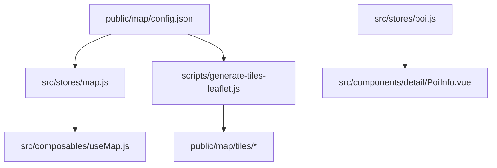
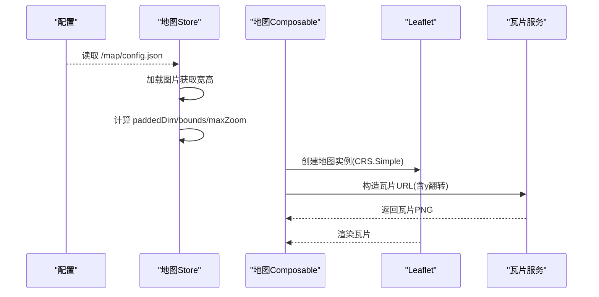
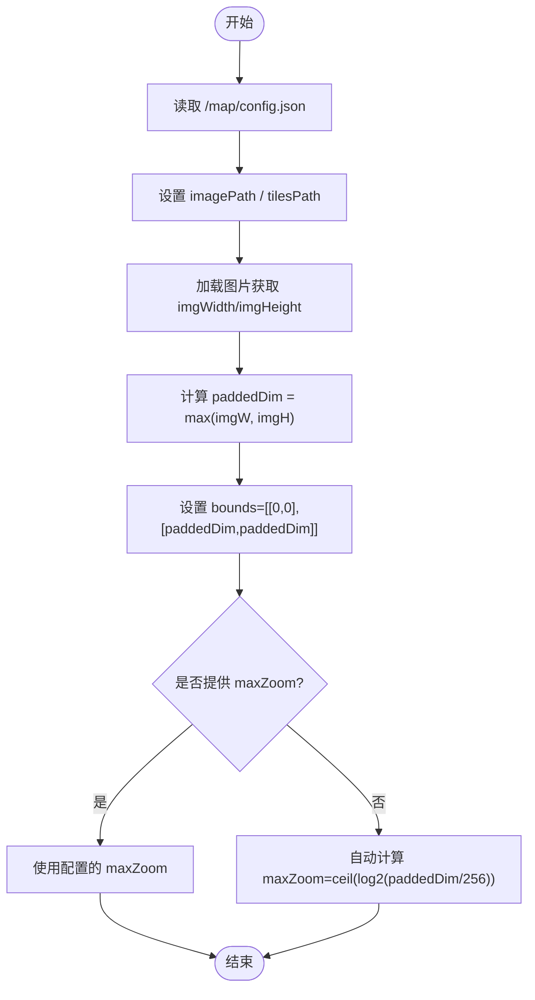
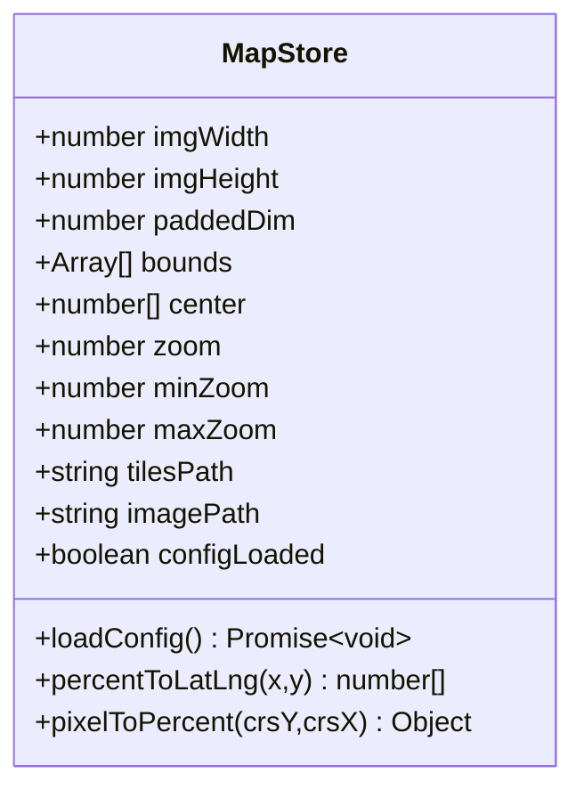
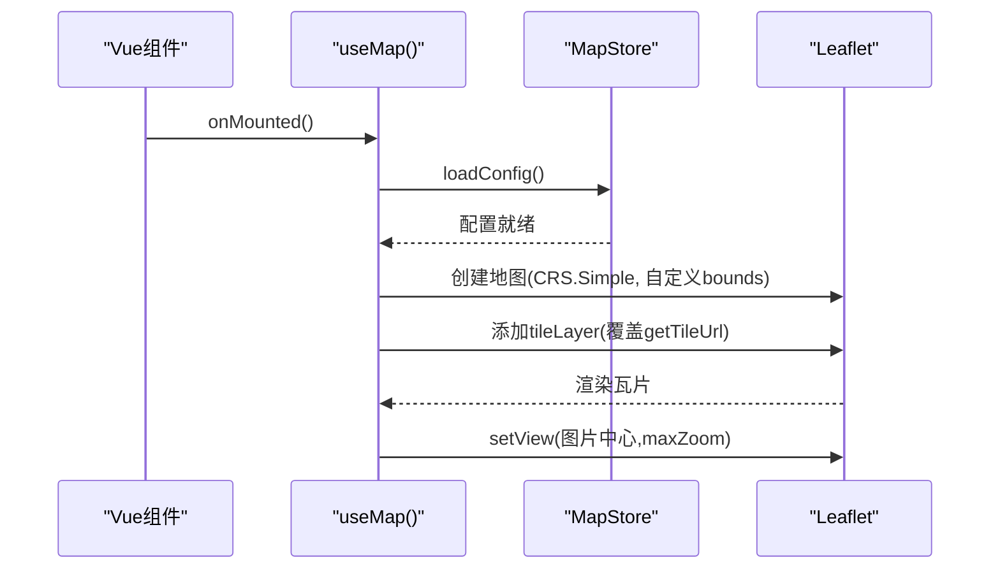
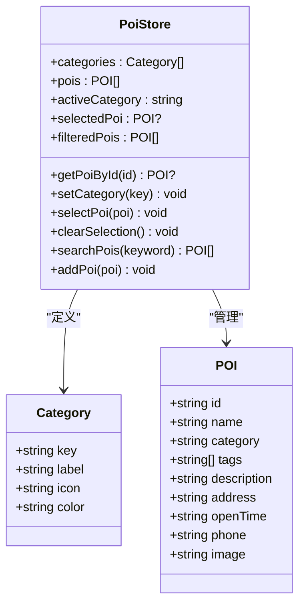
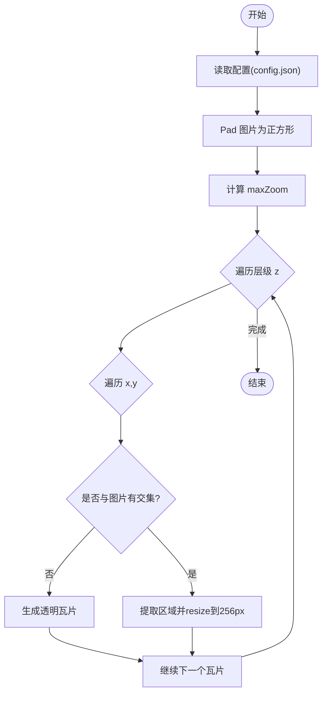
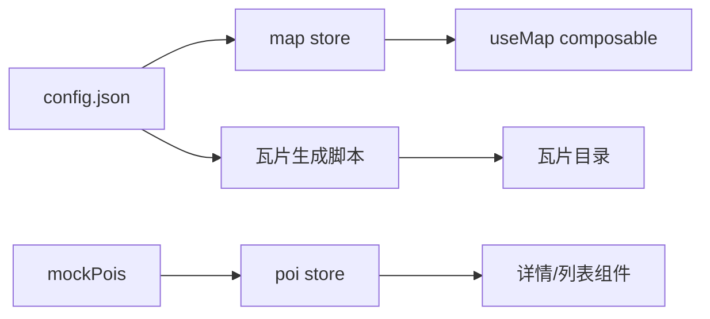

# 数据模型

<cite>
**本文引用的文件**
- [public/map/config.json](file://public/map/config.json)
- [src/stores/map.js](file://src/stores/map.js)
- [src/composables/useMap.js](file://src/composables/useMap.js)
- [src/stores/poi.js](file://src/stores/poi.js)
- [scripts/generate-tiles-leaflet.js](file://scripts/generate-tiles-leaflet.js)
- [package.json](file://package.json)
</cite>

## 目录
1. [简介](#简介)
2. [项目结构](#项目结构)
3. [核心组件](#核心组件)
4. [架构总览](#架构总览)
5. [详细组件分析](#详细组件分析)
6. [依赖关系分析](#依赖关系分析)
7. [性能考虑](#性能考虑)
8. [故障排查指南](#故障排查指南)
9. [结论](#结论)
10. [附录](#附录)

## 简介
本文件为 FunMapUI 的数据模型文档，聚焦以下方面：
- POI 数据模型与分类体系
- 地图配置模型（瓦片路径、最大缩放级别、图片尺寸）
- 全景图片映射与坐标转换
- Mock 数据的组织方式与测试数据格式
- 数据验证规则与约束条件
- 数据持久化策略与本地存储方案
- 数据迁移方法与版本管理策略
- 数据导入导出工具与脚本使用方法

## 项目结构
本项目采用“功能域 + 状态管理”的组织方式：
- 地图配置与运行时状态集中在 Pinia Store（map store），并在 composable 中初始化 Leaflet 地图实例。
- POI 数据通过 Pinia Store（poi store）集中管理，并基于 Mock 数据驱动 UI。
- 瓦片生成脚本读取公共配置文件，按标准金字塔结构输出瓦片。

图表来源
- [public/map/config.json:1-5](file://public/map/config.json#L1-L5)
- [src/stores/map.js:1-122](file://src/stores/map.js#L1-L122)
- [src/composables/useMap.js:1-174](file://src/composables/useMap.js#L1-L174)
- [src/stores/poi.js:1-84](file://src/stores/poi.js#L1-L84)
- [scripts/generate-tiles-leaflet.js:1-128](file://scripts/generate-tiles-leaflet.js#L1-L128)

章节来源
- [public/map/config.json:1-5](file://public/map/config.json#L1-L5)
- [src/stores/map.js:1-122](file://src/stores/map.js#L1-L122)
- [src/composables/useMap.js:1-174](file://src/composables/useMap.js#L1-L174)
- [src/stores/poi.js:1-84](file://src/stores/poi.js#L1-L84)
- [scripts/generate-tiles-leaflet.js:1-128](file://scripts/generate-tiles-leaflet.js#L1-L128)

## 核心组件
- 地图配置模型（Map Config Model）
  - 字段：image（手绘图路径）、tilesPath（瓦片根路径）、maxZoom（可选的最大原生缩放级别）。
  - 作用：决定前端加载的图片、瓦片目录以及自动计算的 maxZoom。
- 地图运行时模型（Map Runtime Model）
  - 字段：imgWidth/imgHeight（图片像素尺寸）、paddedDim（填充后正方形边长）、bounds（CRS.Simple 边界）、center（中心像素坐标）、zoom/minZoom/maxZoom（缩放范围）、tilesPath/imagePath（运行时路径）、configLoaded（配置加载完成标志）。
  - 能力：加载配置、计算 paddedDim 与 bounds、设置初始视图、百分比坐标与像素坐标互转。
- POI 数据模型（POI Model）
  - 字段（由详情组件推断）：id、name、category、tags、description、address、openTime、phone、image。
  - 能力：分类过滤、按 ID 查询、搜索（名称/描述/标签）、新增（仅内存）。
- 瓦片生成模型（Tile Generation Model）
  - 输入：public/map/config.json。
  - 处理：将原图 pad 成正方形，按标准金字塔切分，y 轴翻转以匹配 CRS.Simple 约定，输出到 tilesPath。
  - 输出：public/map/tiles/{z}/{x}/{y}.png。

章节来源
- [public/map/config.json:1-5](file://public/map/config.json#L1-L5)
- [src/stores/map.js:1-122](file://src/stores/map.js#L1-L122)
- [src/stores/poi.js:1-84](file://src/stores/poi.js#L1-L84)
- [scripts/generate-tiles-leaflet.js:1-128](file://scripts/generate-tiles-leaflet.js#L1-L128)

## 架构总览
下图展示了从配置到渲染的完整数据流：配置加载 → 图片尺寸获取 → 瓦片路径与缩放计算 → Leaflet 地图初始化 → 瓦片请求与 y 翻转 → 展示。

图表来源
- [src/stores/map.js:40-85](file://src/stores/map.js#L40-L85)
- [src/composables/useMap.js:14-70](file://src/composables/useMap.js#L14-L70)
- [public/map/config.json:1-5](file://public/map/config.json#L1-L5)

## 详细组件分析

### 地图配置模型（Map Config）
- 字段说明
  - image：手绘地图图片路径（相对或绝对均可，示例使用相对路径）。
  - tilesPath：瓦片根目录路径（用于构建 {z}/{x}/{y}.png）。
  - maxZoom：可选；若为空则根据 paddedDim 自动计算。
- 行为说明
  - 前端在启动时读取该配置，动态设置图片路径、瓦片路径与最大缩放级别。
  - 若未提供 maxZoom，则按 paddedDim 与 256px 瓦片尺寸自动推导。

图表来源
- [src/stores/map.js:40-85](file://src/stores/map.js#L40-L85)
- [public/map/config.json:1-5](file://public/map/config.json#L1-L5)

章节来源
- [public/map/config.json:1-5](file://public/map/config.json#L1-L5)
- [src/stores/map.js:40-85](file://src/stores/map.js#L40-L85)

### 地图运行时模型（Map Runtime）
- 关键状态
  - 图片尺寸：imgWidth、imgHeight（运行时从图片加载获得）。
  - 坐标系：paddedDim、bounds（CRS.Simple 像素边界）。
  - 视图：center（像素坐标）、zoom/minZoom/maxZoom。
  - 资源：tilesPath、imagePath、configLoaded。
- 核心方法
  - loadConfig：异步加载配置与图片，计算 paddedDim、bounds、maxZoom，并设置初始视图。
  - percentToLatLng：将百分比坐标转换为像素坐标 [crsY, crsX]。
  - pixelToPercent：将像素坐标转换为百分比坐标。

图表来源
- [src/stores/map.js:1-122](file://src/stores/map.js#L1-L122)

章节来源
- [src/stores/map.js:1-122](file://src/stores/map.js#L1-L122)

### 地图初始化与瓦片加载流程（Composable）
- 初始化步骤
  - 先调用 mapStore.loadConfig() 确保配置就绪。
  - 自定义 CRS.Simple：设置 projection bounds 为 paddedDim，Transformation 无 y-flip。
  - 添加 tileLayer，覆盖 getTileUrl 实现 y 翻转，使瓦片文件顺序与 Leaflet 一致。
  - 设置初始视图为图片中心与 maxZoom。
- 交互增强
  - 禁用默认 touchZoom，实现双指手势固定级数缩放。
  - 监听 zoomend 输出调试信息（当前缩放、瓦片加载情况）。

图表来源
- [src/composables/useMap.js:14-127](file://src/composables/useMap.js#L14-L127)
- [src/stores/map.js:40-85](file://src/stores/map.js#L40-L85)

章节来源
- [src/composables/useMap.js:1-174](file://src/composables/useMap.js#L1-L174)

### POI 数据模型与分类
- 分类体系
  - 内置分类键值：all、scenic、food、hotel、shopping、toilet、parking、service。
  - 每个分类包含 label、icon、color 等元信息。
- POI 数据结构（由详情组件推断）
  - 标识：id（唯一）
  - 基础信息：name、description、image
  - 位置与联系：address、openTime、phone
  - 扩展：category（对应分类键）、tags（字符串数组）
- 常用操作
  - 过滤：按 activeCategory 筛选 pois。
  - 查询：getPoiById(id)。
  - 搜索：searchPois(keyword)，支持名称/描述/标签模糊匹配。
  - 新增：addPoi(poi)（仅内存，未持久化）。

图表来源
- [src/stores/poi.js:1-84](file://src/stores/poi.js#L1-L84)

章节来源
- [src/stores/poi.js:1-84](file://src/stores/poi.js#L1-L84)

### 瓦片生成与图片映射
- 生成逻辑
  - 读取 public/map/config.json，确定源图片与输出目录。
  - 将图片 pad 成正方形，计算 maxZoom（可配置或自动）。
  - 按标准金字塔 z/x/y 输出 PNG 瓦片，y 轴翻转以匹配 CRS.Simple 约定。
  - 对与原图无交集的区域输出透明瓦片，避免显示空白块。
- 运行方式
  - 使用 Node.js 执行脚本：node scripts/generate-tiles-leaflet.js。
  - 依赖 sharp 进行图像处理。

图表来源
- [scripts/generate-tiles-leaflet.js:21-122](file://scripts/generate-tiles-leaflet.js#L21-L122)
- [public/map/config.json:1-5](file://public/map/config.json#L1-L5)

章节来源
- [scripts/generate-tiles-leaflet.js:1-128](file://scripts/generate-tiles-leaflet.js#L1-L128)
- [public/map/config.json:1-5](file://public/map/config.json#L1-L5)

### Mock 数据组织与测试数据格式
- 数据来源
  - POI Store 从 @/data/mock 引入 mockPois 作为初始数据源。
- 数据格式
  - 建议遵循 POI 模型字段：id、name、category、tags、description、address、openTime、phone、image。
  - 分类需与内置 categories 保持一致，以确保过滤与展示正确。
- 使用方式
  - 开发阶段直接替换 mockPois 内容即可切换测试数据。
  - 后续接入真实数据时，可将 mockPois 替换为 API 拉取的数据。

章节来源
- [src/stores/poi.js:1-84](file://src/stores/poi.js#L1-L84)

### 数据验证规则与约束条件
- 地图配置
  - image：必须存在且可访问，否则无法获取图片尺寸。
  - tilesPath：必须指向有效的瓦片目录，否则瓦片请求失败。
  - maxZoom：可选；若缺失，将根据 paddedDim 自动计算。
- 瓦片命名与层级
  - 瓦片路径必须符合 {z}/{x}/{y}.png，且 y 轴已翻转。
  - 超出 maxZoom 的层级不会生成瓦片，前端通过 CSS 放大显示。
- POI 数据
  - category：必须属于内置分类集合之一。
  - tags：可选，字符串数组。
  - 其他字段：建议非空以保证详情展示完整性。

章节来源
- [src/stores/map.js:40-85](file://src/stores/map.js#L40-L85)
- [src/stores/poi.js:1-84](file://src/stores/poi.js#L1-L84)
- [scripts/generate-tiles-leaflet.js:21-122](file://scripts/generate-tiles-leaflet.js#L21-L122)

### 数据持久化策略与本地存储方案
- 当前实现
  - POI 新增为内存操作（addPoi），未实现本地持久化。
  - 地图配置与瓦片为静态资源，无需持久化。
- 建议方案
  - 浏览器端：可使用 localStorage/sessionStorage 缓存用户编辑的 POI 列表或偏好设置。
  - 服务端：可通过 REST API 持久化 POI 数据，前端在应用启动时拉取最新数据。
  - 离线场景：结合 Service Worker 缓存瓦片与配置，提升首屏体验。

[本节为通用建议，不直接分析具体文件]

### 数据迁移方法与版本管理策略
- 配置版本
  - 建议在 public/map/config.json 中加入 version 字段，便于前端检测升级。
- 数据迁移
  - 当 POI 模型变更时，可在应用启动时执行迁移脚本，将旧格式数据转换为新格式。
  - 迁移过程应幂等，避免重复迁移导致数据异常。
- 回滚策略
  - 保留历史版本的瓦片与配置快照，出现问题时可快速回退。

[本节为通用建议，不直接分析具体文件]

### 数据导入导出工具与脚本使用方法
- 瓦片生成
  - 命令：node scripts/generate-tiles-leaflet.js
  - 依赖：sharp（已在 devDependencies 中声明）
  - 输出：public/map/tiles 目录下的金字塔瓦片
- 数据导出
  - 可从 poi store 导出当前内存中的 pois 列表，序列化为 JSON 供外部使用。
- 数据导入
  - 可将外部 JSON 数据合并到 mockPois，或在启动时通过 API 注入。

章节来源
- [package.json:1-28](file://package.json#L1-L28)
- [scripts/generate-tiles-leaflet.js:1-128](file://scripts/generate-tiles-leaflet.js#L1-L128)

## 依赖关系分析
- 模块耦合
  - useMap 依赖 map store 的配置与运行时状态。
  - poi store 依赖 mock 数据与分类定义。
  - 瓦片生成脚本依赖配置与 sharp。
- 外部依赖
  - Leaflet：地图渲染与瓦片加载。
  - Sharp：瓦片图像处理与裁剪。
  - Vant/Vue：UI 组件与框架。

图表来源
- [src/stores/map.js:1-122](file://src/stores/map.js#L1-L122)
- [src/composables/useMap.js:1-174](file://src/composables/useMap.js#L1-L174)
- [src/stores/poi.js:1-84](file://src/stores/poi.js#L1-L84)
- [scripts/generate-tiles-leaflet.js:1-128](file://scripts/generate-tiles-leaflet.js#L1-L128)
- [public/map/config.json:1-5](file://public/map/config.json#L1-L5)

章节来源
- [src/stores/map.js:1-122](file://src/stores/map.js#L1-L122)
- [src/composables/useMap.js:1-174](file://src/composables/useMap.js#L1-L174)
- [src/stores/poi.js:1-84](file://src/stores/poi.js#L1-L84)
- [scripts/generate-tiles-leaflet.js:1-128](file://scripts/generate-tiles-leaflet.js#L1-L128)
- [public/map/config.json:1-5](file://public/map/config.json#L1-L5)

## 性能考虑
- 瓦片层级
  - 合理设置 maxZoom，避免生成过多瓦片导致体积过大。
  - 超出 maxNativeZoom 的层级通过 CSS 放大，减少网络请求。
- 图片尺寸
  - 大图会显著增加瓦片数量与内存占用，建议控制原图尺寸。
- 坐标转换
  - 百分比与像素坐标转换应在必要时执行，避免频繁计算。
- 触摸缩放
  - 自定义双指缩放阈值可减少误触与过度缩放带来的重绘开销。

[本节为通用建议，不直接分析具体文件]

## 故障排查指南
- 瓦片加载失败
  - 检查 tilesPath 是否正确，确认瓦片目录结构与命名符合 {z}/{x}/{y}.png。
  - 确认 getTileUrl 的 y 翻转逻辑与生成脚本一致。
- 图片尺寸异常
  - 确认 image 路径可访问，且图片能成功加载。
  - 若 paddedDim 为 0，检查图片加载是否完成再计算。
- 缩放级别异常
  - 若 maxZoom 未配置，确认 paddedDim 计算正确。
  - 若手动设置 maxZoom，确保与瓦片层级匹配。
- POI 搜索无结果
  - 检查关键词大小写与字段是否存在（name/description/tags）。
  - 确认 activeCategory 是否为 all 或有效分类键。

章节来源
- [src/composables/useMap.js:60-70](file://src/composables/useMap.js#L60-L70)
- [src/stores/map.js:40-85](file://src/stores/map.js#L40-L85)
- [src/stores/poi.js:54-63](file://src/stores/poi.js#L54-L63)

## 结论
FunMapUI 的数据模型围绕“配置驱动 + 运行时状态 + 内存数据”展开：
- 地图配置决定图片与瓦片路径，运行时计算坐标系与缩放范围。
- POI 数据通过 Store 统一管理，支持分类、搜索与新增。
- 瓦片生成脚本保证前后端坐标一致，简化渲染复杂度。
- 当前未实现持久化，建议按需引入本地存储或服务端接口。

[本节为总结性内容，不直接分析具体文件]

## 附录
- 常用命令
  - 开发：npm run dev
  - 构建：npm run build
  - 预览：npm run preview
  - 生成瓦片：node scripts/generate-tiles-leaflet.js
- 关键路径
  - 配置：public/map/config.json
  - 瓦片：public/map/tiles
  - 地图状态：src/stores/map.js
  - 地图初始化：src/composables/useMap.js
  - POI 状态：src/stores/poi.js

章节来源
- [package.json:1-28](file://package.json#L1-L28)
- [public/map/config.json:1-5](file://public/map/config.json#L1-L5)
- [src/stores/map.js:1-122](file://src/stores/map.js#L1-L122)
- [src/composables/useMap.js:1-174](file://src/composables/useMap.js#L1-L174)
- [src/stores/poi.js:1-84](file://src/stores/poi.js#L1-L84)
- [scripts/generate-tiles-leaflet.js:1-128](file://scripts/generate-tiles-leaflet.js#L1-L128)