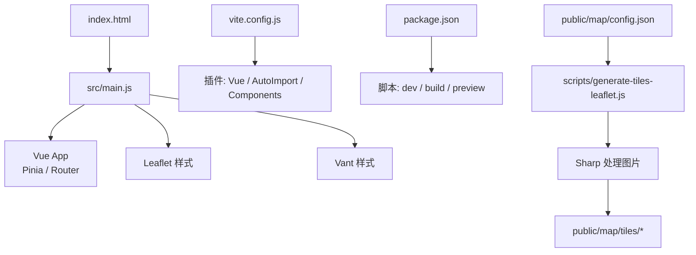
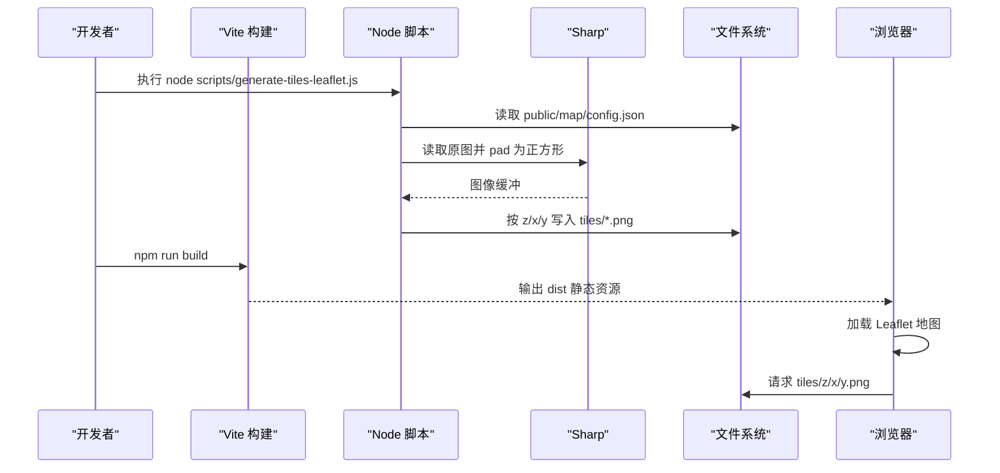
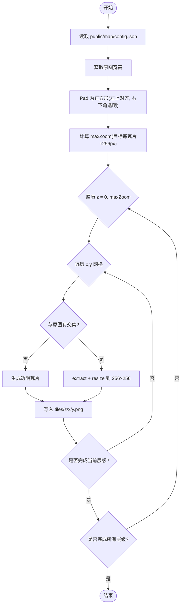
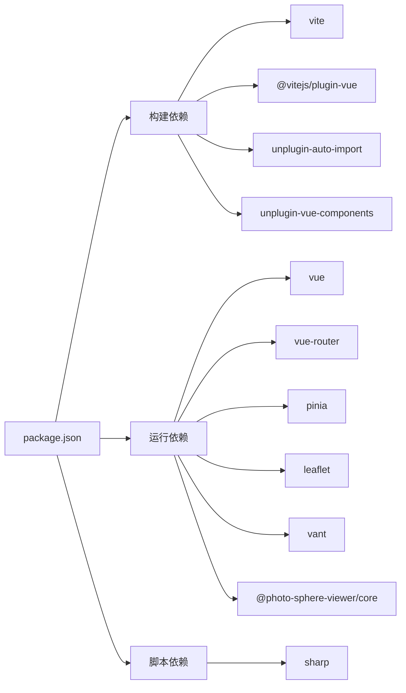

# 构建与部署

<cite>
**本文引用的文件**
- [vite.config.js](file://vite.config.js)
- [package.json](file://package.json)
- [scripts/generate-tiles-leaflet.js](file://scripts/generate-tiles-leaflet.js)
- [public/map/config.json](file://public/map/config.json)
- [README.md](file://README.md)
- [index.html](file://index.html)
- [src/main.js](file://src/main.js)
</cite>

## 目录
1. [简介](#简介)
2. [项目结构](#项目结构)
3. [核心组件](#核心组件)
4. [架构总览](#架构总览)
5. [详细组件分析](#详细组件分析)
6. [依赖分析](#依赖分析)
7. [性能考虑](#性能考虑)
8. [故障排查指南](#故障排查指南)
9. [结论](#结论)
10. [附录](#附录)

## 简介
本文件面向 FunMapUI 的构建与部署，覆盖以下主题：
- Vite 构建配置：插件、别名、开发服务器设置
- 瓦片生成脚本：Sharp 配置、金字塔生成流程与使用方式
- 开发与生产构建差异说明
- 资源优化策略：图片压缩、代码分割、缓存策略
- 部署指南：静态站点部署与 CDN 配置
- 环境变量与环境切换方法
- 性能监控与错误收集方案（建议）

## 项目结构
FunMapUI 基于 Vite + Vue 3 的单页应用，地图瓦片通过 Node 脚本在构建前或独立运行生成，最终产物为静态资源，可直接部署到任意静态托管服务。

图表来源
- [index.html:1-17](file://index.html#L1-L17)
- [src/main.js:1-21](file://src/main.js#L1-L21)
- [vite.config.js:1-27](file://vite.config.js#L1-L27)
- [package.json:1-28](file://package.json#L1-L28)
- [scripts/generate-tiles-leaflet.js:1-128](file://scripts/generate-tiles-leaflet.js#L1-L128)
- [public/map/config.json:1-5](file://public/map/config.json#L1-L5)

章节来源
- [README.md:42-99](file://README.md#L42-L99)
- [package.json:6-10](file://package.json#L6-L10)
- [vite.config.js:8-26](file://vite.config.js#L8-L26)

## 核心组件
- 构建工具链：Vite 8，配合 @vitejs/plugin-vue 与自动导入/组件解析插件
- 地图与瓦片：Leaflet CRS.Simple 像素坐标系；瓦片由 Sharp 按金字塔切割并输出 PNG
- 状态与路由：Pinia 管理地图与 POI 状态；Vue Router 管理页面路由
- 入口与 HTML：index.html 提供基础元信息与挂载点；main.js 初始化应用

章节来源
- [vite.config.js:1-27](file://vite.config.js#L1-L27)
- [scripts/generate-tiles-leaflet.js:1-128](file://scripts/generate-tiles-leaflet.js#L1-L128)
- [src/main.js:1-21](file://src/main.js#L1-L21)
- [index.html:1-17](file://index.html#L1-L17)
- [package.json:11-26](file://package.json#L11-L26)

## 架构总览
下图展示了从源码到静态产物的构建与瓦片生成关系，以及前端加载瓦片的调用路径。

图表来源
- [scripts/generate-tiles-leaflet.js:21-122](file://scripts/generate-tiles-leaflet.js#L21-L122)
- [public/map/config.json:1-5](file://public/map/config.json#L1-L5)
- [package.json:6-10](file://package.json#L6-L10)
- [vite.config.js:8-26](file://vite.config.js#L8-L26)

## 详细组件分析

### Vite 构建配置
- 插件
  - @vitejs/plugin-vue：启用 Vue SFC 支持
  - unplugin-auto-import：自动导入 API（结合 VantResolver）
  - unplugin-vue-components：按需自动注册组件（结合 VantResolver）
- 别名
  - @ 指向 src 目录，便于模块引用
- 开发服务器
  - host 设置为 0.0.0.0，便于局域网访问
- 构建产物
  - 默认输出至 dist（Vite 默认），可通过命令预览

章节来源
- [vite.config.js:1-27](file://vite.config.js#L1-L27)
- [package.json:6-10](file://package.json#L6-L10)

### 瓦片生成脚本（Sharp + 金字塔）
- 输入配置
  - 读取 public/map/config.json 中的 image、tilesPath、maxZoom
- 处理流程
  - 读取原图尺寸，pad 为正方形（边长取 max(width, height)）
  - 计算最大缩放级别：使每片瓦片约 256px
  - 清理旧瓦片目录后，按标准金字塔 z=0..maxZoom 遍历
  - 对每个瓦片区域进行提取与 resize 到 256×256，输出 PNG
  - 无交集区域生成透明瓦片，避免显示空白块
- 坐标约定
  - 遵循 Leaflet CRS.Simple 的 y-flip 约定：文件 ty=0 对应图像底部
- 输出
  - 生成 public/map/tiles/{z}/{x}/{y}.png

图表来源
- [scripts/generate-tiles-leaflet.js:21-122](file://scripts/generate-tiles-leaflet.js#L21-L122)
- [public/map/config.json:1-5](file://public/map/config.json#L1-L5)

章节来源
- [scripts/generate-tiles-leaflet.js:1-128](file://scripts/generate-tiles-leaflet.js#L1-L128)
- [public/map/config.json:1-5](file://public/map/config.json#L1-L5)

### 开发与生产环境差异
- 开发环境
  - 使用 vite 启动本地热更新服务器，host 绑定 0.0.0.0
  - 不启用生产级压缩与分包优化
- 生产环境
  - 使用 vite build 生成静态资源（默认 dist）
  - 瓦片需提前通过脚本生成并随静态资源一起部署
  - 如需自定义构建行为（如 base、sourcemap、chunk 拆分等），可在 vite.config.js 中扩展

章节来源
- [vite.config.js:23-26](file://vite.config.js#L23-L26)
- [package.json:6-10](file://package.json#L6-L10)
- [README.md:110-137](file://README.md#L110-L137)

### 资源优化策略
- 图片压缩
  - 瓦片统一输出 PNG，适合无损展示手绘地图细节；若追求体积可评估 WebP/AVIF 转换（需调整脚本输出格式）
- 代码分割
  - 当前未显式配置 chunk 拆分；可按需引入大型库或使用动态 import 实现路由级/功能级拆分
- 缓存策略
  - 静态资源文件名含内容哈希（Vite 默认），利于长期缓存
  - 建议在 CDN/服务器层为静态资源设置强缓存（如一年），HTML 不缓存或短缓存
- 首屏优化
  - 仅引入必要样式与组件；地图相关资源按需加载

[本节为通用指导，不直接分析具体文件]

### 环境变量与环境切换
- 当前仓库未包含 .env 文件或 Vite 环境变量配置
- 推荐实践
  - 创建 .env.development/.env.production 存放不同环境的变量
  - 通过 import.meta.env.* 在运行时读取
  - 将 API 地址、CDN 域名、功能开关等放入环境变量
- 注意
  - 仅在构建时注入的变量会被打包进产物；运行时变量需通过服务端注入或外部配置中心

[本节为通用指导，不直接分析具体文件]

### 部署指南
- 静态站点部署
  - 先运行瓦片生成脚本，确保 public/map/tiles 存在
  - 执行构建命令生成 dist
  - 将 dist 与 public 下静态资源一并部署到静态托管平台（如 GitHub Pages、Netlify、Vercel、Nginx 等）
- CDN 配置
  - 将静态资源（dist、tiles、panorama 等）上传至 CDN
  - 开启 HTTP/2、Gzip/Brotli、静态资源长期缓存
  - 针对 HTML 设置较短缓存或 no-cache，以便及时更新
- 路径与 Base
  - 若部署在非根路径，需在构建时设置 base 并在瓦片 URL 拼接中保持一致

章节来源
- [README.md:126-137](file://README.md#L126-L137)
- [package.json:6-10](file://package.json#L6-L10)
- [vite.config.js:8-26](file://vite.config.js#L8-L26)

### 性能监控与错误收集（建议）
- 前端性能指标
  - 采集 LCP、FID/INP、CLS 等指标，上报至监控平台
- 错误收集
  - 全局捕获未处理异常与 Promise 拒绝
  - 捕获异步错误与第三方 SDK 错误
- 日志与埋点
  - 关键用户操作与业务事件埋点
  - 区分环境与版本信息，便于定位问题

[本节为通用指导，不直接分析具体文件]

## 依赖分析
- 构建期依赖
  - vite、@vitejs/plugin-vue、unplugin-auto-import、unplugin-vue-components、@vant/auto-import-resolver
- 运行期依赖
  - vue、vue-router、pinia、leaflet、vant、@photo-sphere-viewer/core
- 脚本依赖
  - sharp（用于瓦片生成）

图表来源
- [package.json:11-26](file://package.json#L11-L26)

章节来源
- [package.json:11-26](file://package.json#L11-L26)

## 性能考虑
- 瓦片粒度
  - 保持每瓦片约 256px，平衡清晰度与网络请求数
- 图片格式
  - 若允许轻微失真，可尝试 WebP/AVIF 以进一步减小体积
- 缓存
  - 利用 Vite 内容哈希与 CDN 缓存策略，减少重复下载
- 首屏
  - 延迟加载非关键资源（如全景查看器、视频播放器）
- 并发
  - 合理控制并发请求数量，避免拥塞

[本节为通用指导，不直接分析具体文件]

## 故障排查指南
- 瓦片不显示或出现灰色方块
  - 检查瓦片目录结构与命名是否符合 z/x/y.png
  - 确认 config.json 中 image 与 tilesPath 路径正确
  - 重新运行瓦片生成脚本
- 瓦片错位或翻转
  - 确认脚本遵循 CRS.Simple 的 y-flip 约定，且前端 getTileUrl 与脚本一致
- 构建失败
  - 检查 Node 版本要求（>=20.9.0）
  - 清理 node_modules 后重装依赖
- 开发服务器无法局域网访问
  - 确认 vite.config.js 中 host 已设置为 0.0.0.0

章节来源
- [scripts/generate-tiles-leaflet.js:21-122](file://scripts/generate-tiles-leaflet.js#L21-L122)
- [public/map/config.json:1-5](file://public/map/config.json#L1-L5)
- [vite.config.js:23-26](file://vite.config.js#L23-L26)
- [package-lock.json:152-155](file://package-lock.json#L152-L155)

## 结论
FunMapUI 采用 Vite + Vue 3 的现代前端工程化方案，配合 Sharp 脚本生成 Leaflet 兼容的瓦片金字塔，满足手绘地图的高清缩放需求。通过合理的资源组织与缓存策略，可实现良好的首屏与交互体验。建议在生产环境中完善环境变量管理、CDN 缓存策略与性能监控，进一步提升稳定性与可观测性。

## 附录

### 常用命令
- 安装依赖：npm install
- 启动开发服务器：npm run dev
- 构建生产包：npm run build
- 预览构建产物：npm run preview
- 生成瓦片：node scripts/generate-tiles-leaflet.js

章节来源
- [package.json:6-10](file://package.json#L6-L10)
- [README.md:110-137](file://README.md#L110-L137)

### 瓦片生成步骤要点
- 准备原图与配置：编辑 public/map/config.json
- 运行脚本生成瓦片：node scripts/generate-tiles-leaflet.js
- 验证输出：检查 public/map/tiles 下的 z/x/y.png 结构
- 构建并部署：npm run build，将 dist 与静态资源部署到目标环境

章节来源
- [scripts/generate-tiles-leaflet.js:21-122](file://scripts/generate-tiles-leaflet.js#L21-L122)
- [public/map/config.json:1-5](file://public/map/config.json#L1-L5)
- [README.md:126-137](file://README.md#L126-L137)