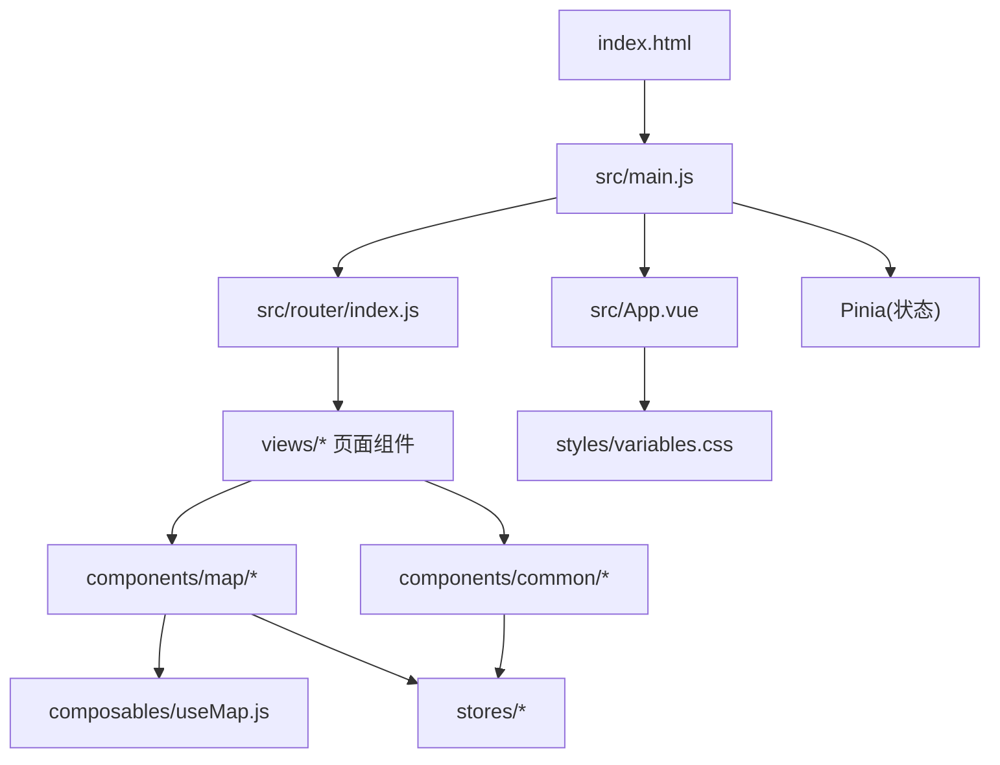
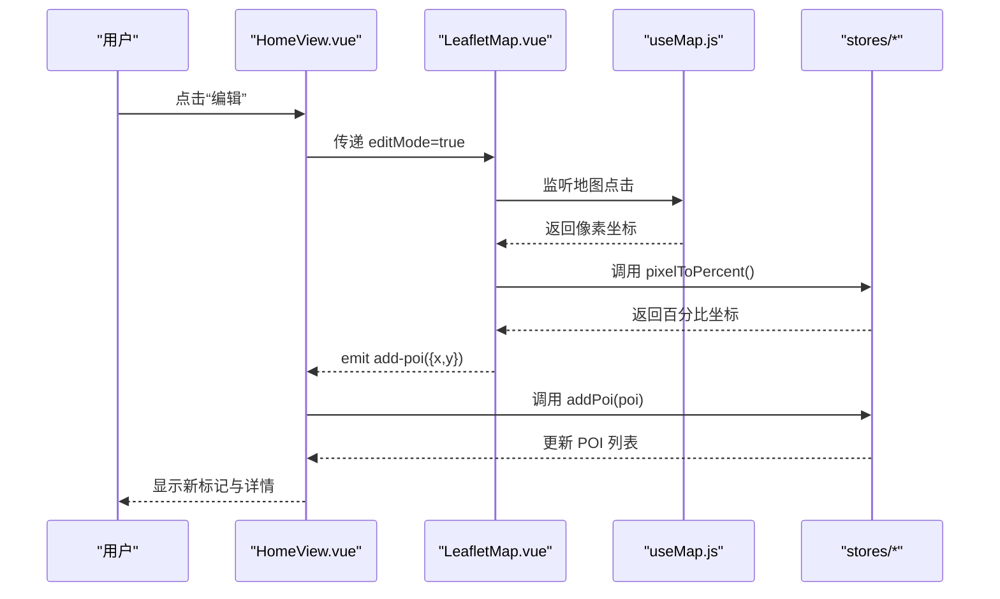
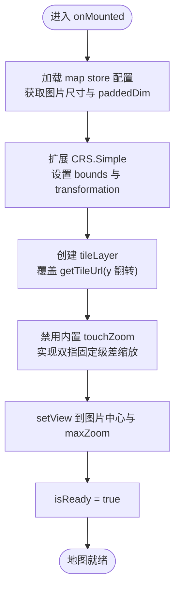
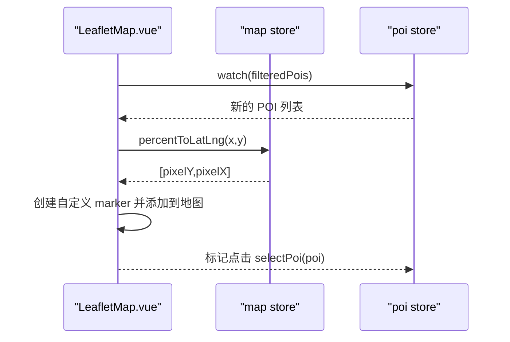
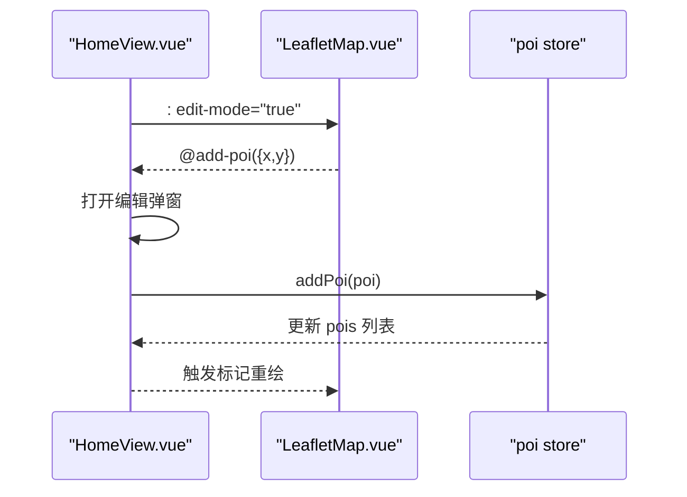
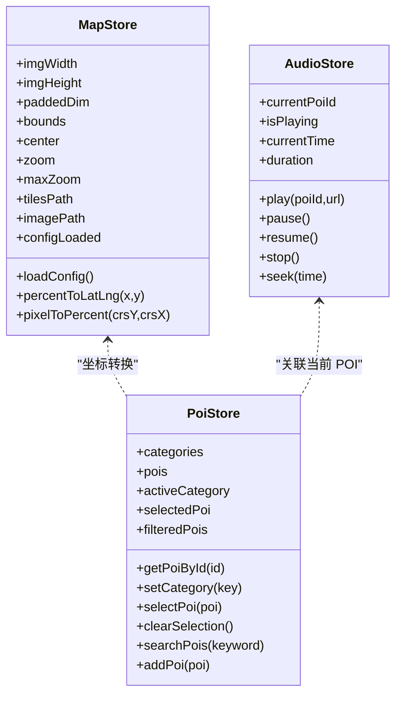
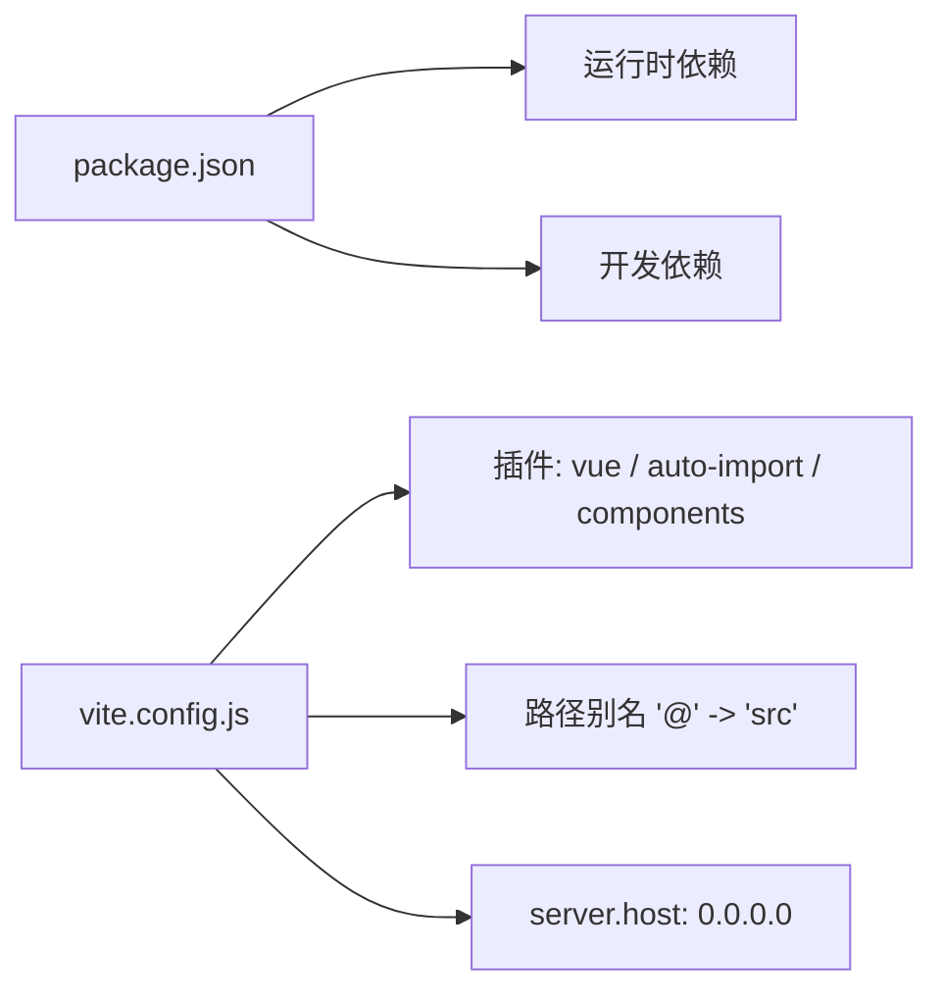

# 整体架构概览

<cite>
**本文引用的文件**
- [package.json](file://package.json)
- [vite.config.js](file://vite.config.js)
- [index.html](file://index.html)
- [src/main.js](file://src/main.js)
- [src/App.vue](file://src/App.vue)
- [src/router/index.js](file://src/router/index.js)
- [src/stores/map.js](file://src/stores/map.js)
- [src/stores/poi.js](file://src/stores/poi.js)
- [src/stores/audio.js](file://src/stores/audio.js)
- [src/composables/useMap.js](file://src/composables/useMap.js)
- [src/components/map/LeafletMap.vue](file://src/components/map/LeafletMap.vue)
- [src/views/HomeView.vue](file://src/views/HomeView.vue)
- [src/styles/variables.css](file://src/styles/variables.css)
</cite>

## 目录
1. [简介](#简介)
2. [项目结构](#项目结构)
3. [核心组件](#核心组件)
4. [架构总览](#架构总览)
5. [详细组件分析](#详细组件分析)
6. [依赖关系分析](#依赖关系分析)
7. [性能考量](#性能考量)
8. [故障排查指南](#故障排查指南)
9. [结论](#结论)
10. [附录](#附录)

## 简介
FunMapUI 是基于 Vue 3 + Vite 的移动端单页应用，采用 MVVM 设计模式与组件化架构，围绕手绘地图、POI 标注、详情查看、语音讲解与全景浏览等能力构建。应用通过 Pinia 管理全局状态，Vue Router 管理页面路由，Leaflet 作为地图引擎，Vant 提供移动端 UI 组件，并配合自动导入与按需解析提升开发体验。

## 项目结构
- 入口与初始化
  - index.html：定义视口、安全区域与根节点，加载模块入口 main.js。
  - src/main.js：创建 Vue 应用实例，挂载 Pinia 与 Router，引入全局样式（Vant、Leaflet、主题变量）。
  - src/App.vue：根组件仅渲染路由视图，并提供全局重置与基础样式。
- 路由
  - src/router/index.js：使用 createWebHistory 配置懒加载的路由表，映射到 views 下的页面组件。
- 状态管理
  - src/stores：基于 Pinia 的模块化 store，分别负责地图配置与坐标转换、POI 数据与筛选、音频播放控制。
- 组合式函数
  - src/composables/useMap.js：封装 Leaflet 地图初始化、CRS.Simple 像素坐标系、瓦片层、触摸缩放与工具方法。
- 组件
  - src/components：按职责划分为 common、detail、map 三类子目录，承载通用 UI、详情页片段与地图相关交互。
- 视图
  - src/views：页面级组件，聚合多个业务组件完成完整页面逻辑。
- 样式
  - src/styles/variables.css：集中定义主题色、间距、圆角、阴影与层级变量，供全局与组件复用。
- 构建与脚本
  - vite.config.js：启用 Vue 插件、自动导入与组件解析、路径别名、开发服务器配置。
  - package.json：声明运行脚本、生产与开发依赖。

图表来源
- [index.html:1-17](file://index.html#L1-L17)
- [src/main.js:1-21](file://src/main.js#L1-L21)
- [src/App.vue:1-59](file://src/App.vue#L1-L59)
- [src/router/index.js:1-32](file://src/router/index.js#L1-L32)
- [src/composables/useMap.js:1-174](file://src/composables/useMap.js#L1-L174)
- [src/styles/variables.css:1-52](file://src/styles/variables.css#L1-L52)

章节来源
- [index.html:1-17](file://index.html#L1-L17)
- [src/main.js:1-21](file://src/main.js#L1-L21)
- [src/App.vue:1-59](file://src/App.vue#L1-L59)
- [src/router/index.js:1-32](file://src/router/index.js#L1-L32)
- [src/styles/variables.css:1-52](file://src/styles/variables.css#L1-L52)

## 核心组件
- 地图主体 LeafletMap.vue
  - 职责：初始化地图容器、监听 POI 变化更新标记、处理编辑模式点击添加 POI、暴露 getMap 给父组件调用。
  - 关键流程：通过 useMap composable 获取地图实例；从 map store 进行百分比坐标与像素坐标互转；根据分类颜色生成自定义标记；在编辑模式下绑定地图点击事件以触发新增 POI。
- 首页 HomeView.vue
  - 职责：组织顶部搜索栏与访客计数、地图区域、控件、底部弹窗、分类标签与全局播放器；协调编辑模式与路由跳转。
  - 关键流程：通过 ref 获取地图实例执行缩放；将新增 POI 提交至 poi store；切换编辑模式时向地图组件传递 props。
- 地图 Composable useMap.js
  - 职责：封装 Leaflet 初始化、CRS.Simple 像素坐标系、瓦片层、触摸双指缩放、flyTo/zoomBy 等工具方法。
  - 关键流程：读取 map store 的配置与尺寸，设置 bounds 与变换；覆盖瓦片 URL 的 y 坐标翻转；禁用默认 touchZoom 并实现固定级差的触控缩放；生命周期结束时销毁地图实例。
- Store 模块
  - map store：维护图片尺寸、paddedDim、bounds、中心点、缩放范围、瓦片路径与配置加载；提供百分比与像素坐标转换。
  - poi store：维护分类、POI 列表、当前选中项、过滤结果与搜索；提供增删改查与选择操作。
  - audio store：维护当前 POI、播放状态、进度与时长；封装 play/pause/resume/stop/seek 等方法。

章节来源
- [src/components/map/LeafletMap.vue:1-141](file://src/components/map/LeafletMap.vue#L1-L141)
- [src/views/HomeView.vue:1-136](file://src/views/HomeView.vue#L1-L136)
- [src/composables/useMap.js:1-174](file://src/composables/useMap.js#L1-L174)
- [src/stores/map.js:1-122](file://src/stores/map.js#L1-L122)
- [src/stores/poi.js:1-84](file://src/stores/poi.js#L1-L84)
- [src/stores/audio.js:1-111](file://src/stores/audio.js#L1-L111)

## 架构总览
本应用遵循 MVVM 模式：
- Model：Pinia stores 中的响应式数据（地图配置、POI 数据、音频状态）。
- View：Vue 组件模板与样式（views、components、App.vue）。
- ViewModel：组件逻辑与组合式函数（useMap 等），连接视图与模型，驱动数据流与用户交互。

数据流向：
- 数据源（mock 或配置）→ store → 组件订阅（watch/computed）→ 视图更新。
- 用户交互（点击、输入、手势）→ 组件事件 → store 变更 → 视图响应。

图表来源
- [src/views/HomeView.vue:1-136](file://src/views/HomeView.vue#L1-L136)
- [src/components/map/LeafletMap.vue:1-141](file://src/components/map/LeafletMap.vue#L1-L141)
- [src/composables/useMap.js:1-174](file://src/composables/useMap.js#L1-L174)
- [src/stores/map.js:1-122](file://src/stores/map.js#L1-L122)
- [src/stores/poi.js:1-84](file://src/stores/poi.js#L1-L84)

## 详细组件分析

### 地图初始化与瓦片渲染（useMap.js）
- 初始化流程
  - 加载 map store 配置与图片尺寸，计算 paddedDim 与 bounds。
  - 扩展 CRS.Simple，设置 projection bounds 与 Transformation，关闭无限平铺。
  - 创建 tileLayer，覆盖 getTileUrl 以翻转 y 坐标匹配瓦片存储约定。
  - 配置无级缩放、滚轮灵敏度、禁用内置 touchZoom，实现固定级差的双指缩放。
  - 设置初始视图为图片中心与最大原生缩放级别。
- 资源与性能
  - maxNativeZoom 限制瓦片请求级别，超出级别由 CSS 放大，减少网络请求。
  - 监听 zoomend 输出调试信息便于定位瓦片加载问题。

图表来源
- [src/composables/useMap.js:14-129](file://src/composables/useMap.js#L14-L129)

章节来源
- [src/composables/useMap.js:1-174](file://src/composables/useMap.js#L1-L174)

### POI 标记更新与交互（LeafletMap.vue）
- 标记更新
  - 监听 poi store 的 filteredPois 变化，清除旧标记并重新绘制。
  - 使用 map store 的 percentToLatLng 将百分比坐标转为像素坐标。
  - 根据文字宽度自适应标记容器大小，并按分类着色。
- 交互
  - 标记点击：选中 POI，触发详情展示。
  - 编辑模式：地图点击获取像素坐标，转换为百分比后向上抛出事件，由父组件弹出编辑对话框并提交新增 POI。

图表来源
- [src/components/map/LeafletMap.vue:31-95](file://src/components/map/LeafletMap.vue#L31-L95)
- [src/stores/map.js:87-103](file://src/stores/map.js#L87-L103)
- [src/stores/poi.js:27-46](file://src/stores/poi.js#L27-L46)

章节来源
- [src/components/map/LeafletMap.vue:1-141](file://src/components/map/LeafletMap.vue#L1-L141)
- [src/stores/map.js:1-122](file://src/stores/map.js#L1-L122)
- [src/stores/poi.js:1-84](file://src/stores/poi.js#L1-L84)

### 首页编排与编辑流程（HomeView.vue）
- 编排职责
  - 聚合地图、控件、弹窗、播放器与分类标签。
  - 管理编辑模式开关与新增 POI 的临时数据。
- 编辑流程
  - 切换编辑模式后，向地图组件传递 editMode。
  - 接收地图组件抛出的 add-poi 事件，打开编辑对话框。
  - 确认后将新 POI 写入 poi store，刷新标记与详情。

图表来源
- [src/views/HomeView.vue:49-96](file://src/views/HomeView.vue#L49-L96)
- [src/components/map/LeafletMap.vue:108-129](file://src/components/map/LeafletMap.vue#L108-L129)
- [src/stores/poi.js:65-68](file://src/stores/poi.js#L65-L68)

章节来源
- [src/views/HomeView.vue:1-136](file://src/views/HomeView.vue#L1-L136)
- [src/stores/poi.js:1-84](file://src/stores/poi.js#L1-L84)

### 状态管理与数据流（stores/*）
- map store
  - 负责地图配置加载、图片尺寸与 paddedDim 计算、CRS bounds 设置、坐标转换。
- poi store
  - 维护分类、POI 列表、选中项与搜索；提供 computed 过滤结果与常用操作方法。
- audio store
  - 封装 Audio API 的生命周期与状态同步，支持多 POI 切换播放与进度更新。

图表来源
- [src/stores/map.js:1-122](file://src/stores/map.js#L1-L122)
- [src/stores/poi.js:1-84](file://src/stores/poi.js#L1-L84)
- [src/stores/audio.js:1-111](file://src/stores/audio.js#L1-L111)

章节来源
- [src/stores/map.js:1-122](file://src/stores/map.js#L1-L122)
- [src/stores/poi.js:1-84](file://src/stores/poi.js#L1-L84)
- [src/stores/audio.js:1-111](file://src/stores/audio.js#L1-L111)

## 依赖关系分析
- 运行时依赖
  - Vue 3、Vue Router、Pinia、Leaflet、Vant、@photo-sphere-viewer/core。
- 构建期依赖
  - Vite、@vitejs/plugin-vue、unplugin-auto-import、unplugin-vue-components、@vant/auto-import-resolver、sharp。
- 插件与优化
  - 自动导入与组件解析：减少样板代码，按需引入 Vant 组件。
  - 路径别名：简化模块引用。
  - 开发服务器：host 设置为 0.0.0.0 便于局域网访问。

图表来源
- [package.json:1-28](file://package.json#L1-L28)
- [vite.config.js:1-27](file://vite.config.js#L1-L27)

章节来源
- [package.json:1-28](file://package.json#L1-L28)
- [vite.config.js:1-27](file://vite.config.js#L1-L27)

## 性能考量
- 瓦片策略
  - 使用 maxNativeZoom 限制瓦片请求级别，超出级别通过 CSS 放大，降低带宽与渲染压力。
  - 自定义 getTileUrl 翻转 y 坐标，确保瓦片正确加载。
- 缩放体验
  - 开启 zoomSnap: 0 支持无级缩放；按钮缩放步长 0.5；滚轮灵敏度可调。
  - 禁用内置 touchZoom，实现固定级差的双指缩放，避免滑动误触。
- 资源加载
  - 地图配置与图片异步加载，仅在就绪后初始化地图与标记。
  - 调试日志输出瓦片加载状态，便于定位失败与缺失。
- 构建优化
  - 自动导入与组件解析减少打包体积。
  - 使用 sharp 在开发脚本中处理瓦片图片，提升生成效率。

[本节为通用性能建议，不直接分析具体文件]

## 故障排查指南
- 地图未显示或瓦片空白
  - 检查 map store 配置加载是否成功，确认 tilesPath 与图片路径正确。
  - 查看控制台调试日志，确认 maxZoom、maxNativeZoom 与实际瓦片层级一致。
  - 验证 getTileUrl 的 y 坐标翻转逻辑是否与瓦片命名一致。
- 标记不更新
  - 确认 poi store 的 filteredPois 是否正确变化。
  - 检查 percentToLatLng 转换是否基于正确的 imgWidth/imgHeight。
- 音频无法播放
  - 浏览器策略可能阻止自动播放，需用户交互后调用 play。
  - 检查音频 URL 可访问性与 MIME 类型。
- 路由跳转异常
  - 确认 router 已注册且对应 view 组件存在。
  - 检查懒加载路径与别名 '@' 是否正确指向 src。

章节来源
- [src/composables/useMap.js:113-120](file://src/composables/useMap.js#L113-L120)
- [src/stores/map.js:40-85](file://src/stores/map.js#L40-L85)
- [src/stores/poi.js:27-63](file://src/stores/poi.js#L27-L63)
- [src/stores/audio.js:20-58](file://src/stores/audio.js#L20-L58)
- [src/router/index.js:1-32](file://src/router/index.js#L1-L32)

## 结论
FunMapUI 以 Vue 3 + Vite 为基础，结合 Pinia、Vue Router、Leaflet 与 Vant，构建了清晰的分层架构与可复用的组件体系。通过 composable 封装地图能力、store 管理全局状态、组件聚焦视图与交互，实现了高内聚低耦合的代码组织。构建期借助自动导入与按需解析提升开发效率，运行时通过瓦片策略与缩放优化保障移动端体验。整体方案具备良好的可扩展性与可维护性，适合持续迭代与功能扩展。

[本节为总结性内容，不直接分析具体文件]

## 附录
- 快速开始
  - 安装依赖：npm install
  - 启动开发服务器：npm run dev
  - 访问地址：http://localhost:5173
- 瓦片生成
  - 执行脚本 node scripts/generate-tiles-leaflet.js，读取 public/map/config.json 自动生成瓦片金字塔。
- 替换全景图
  - 将全景图片放入 public/panorama/，并在 PanoramaView 中配置映射。

章节来源
- [README.md:110-148](file://README.md#L110-L148)