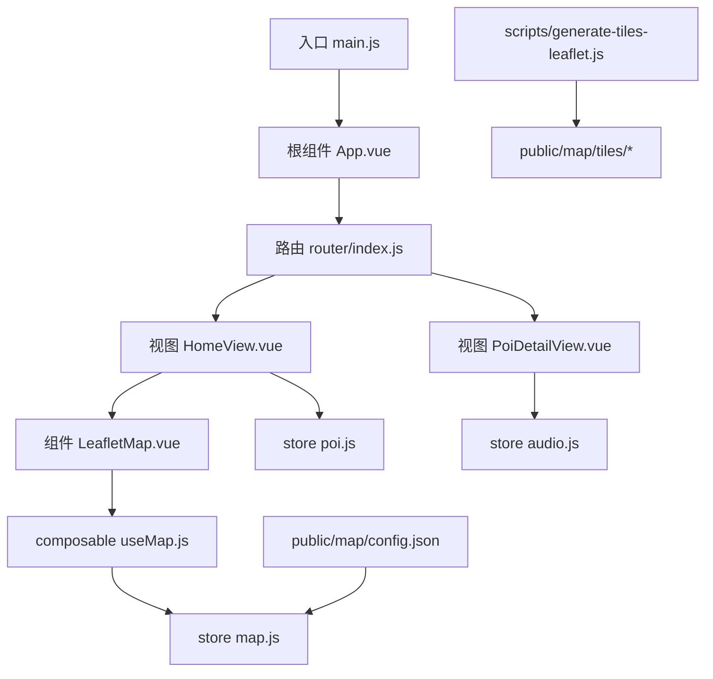
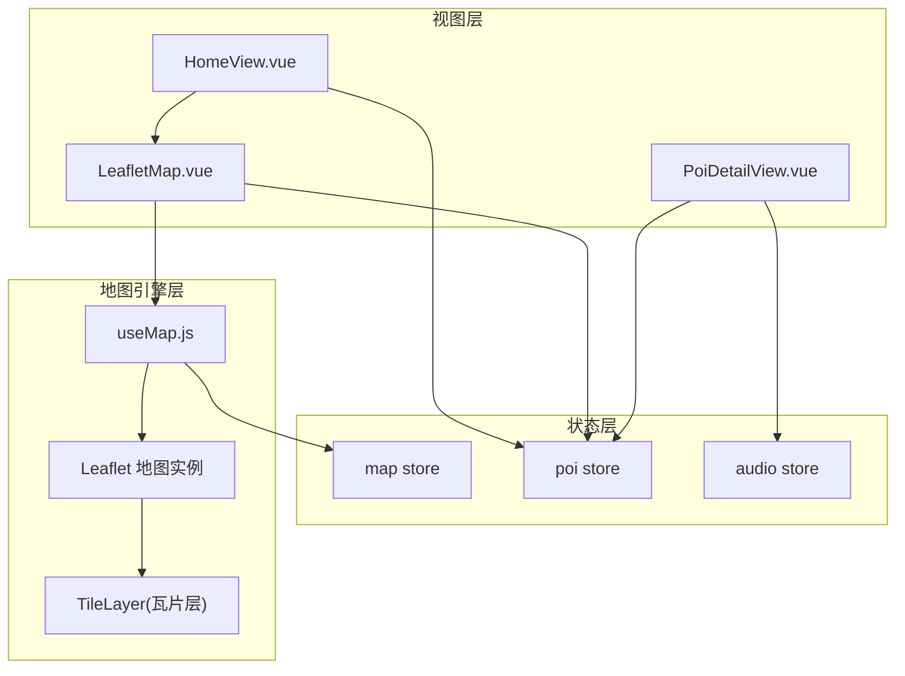
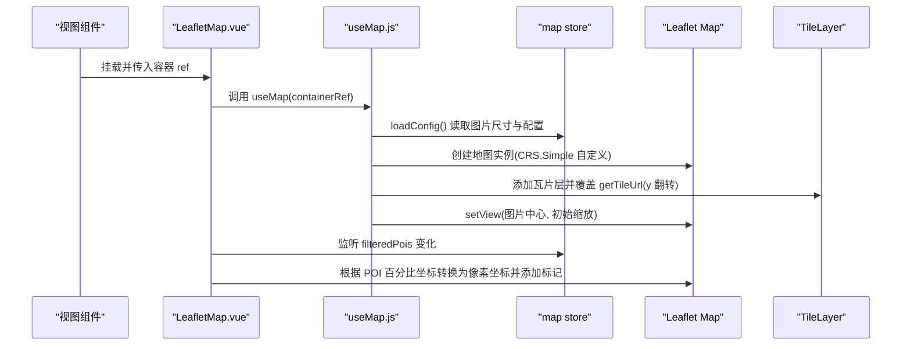
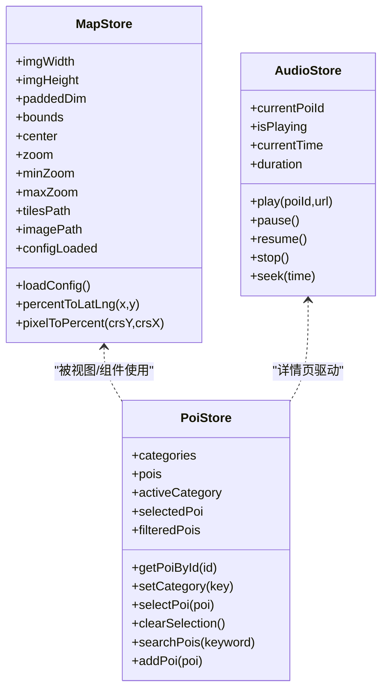
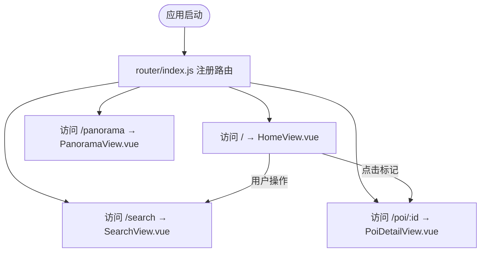
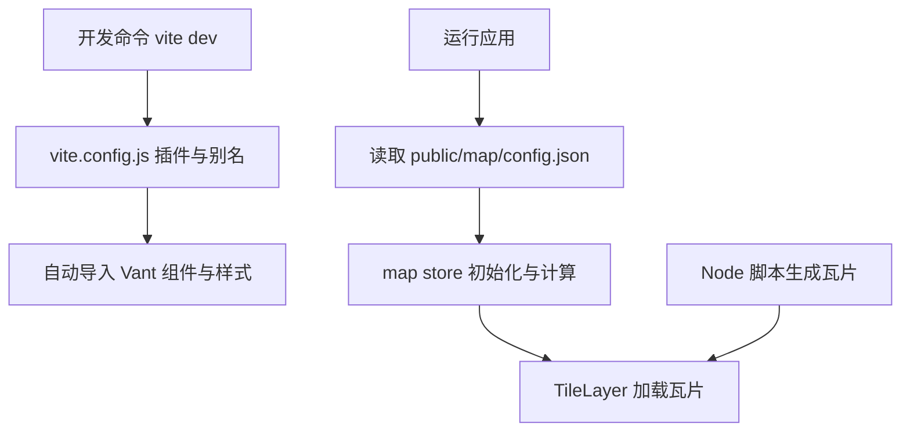
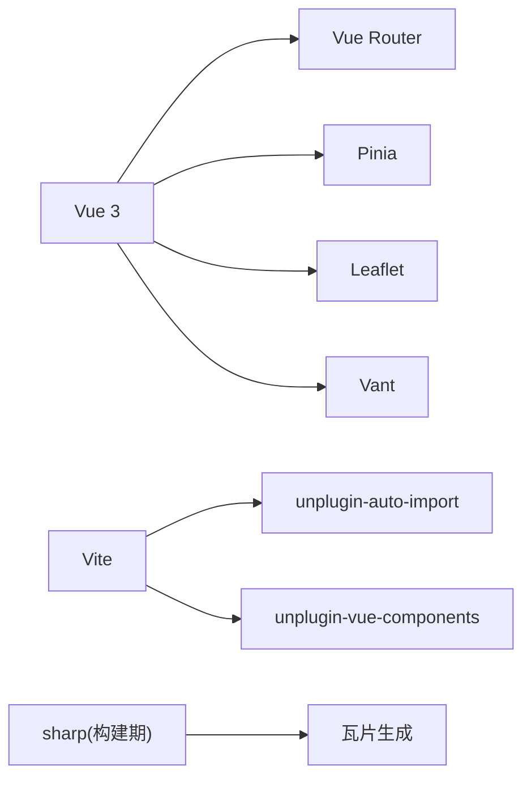
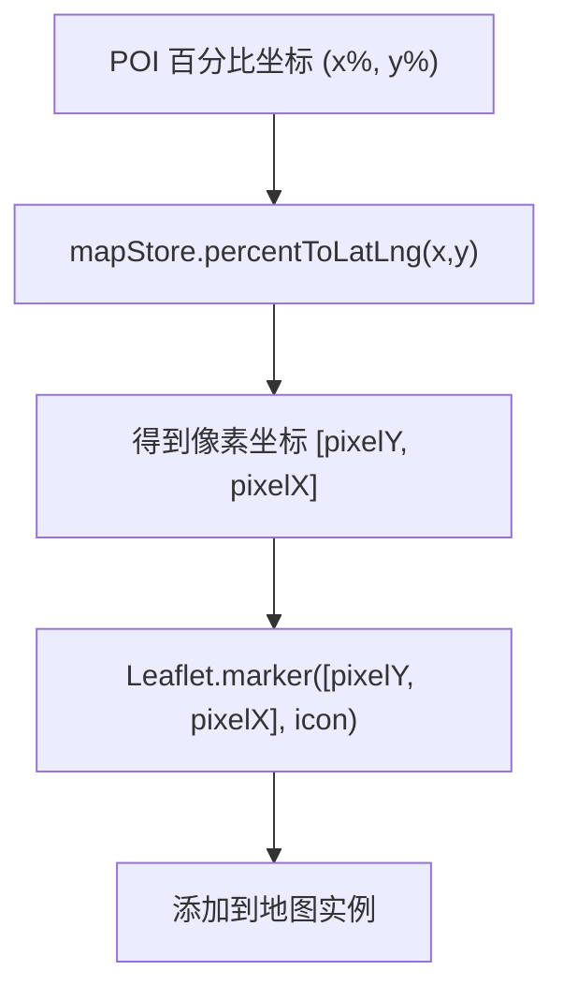

# 架构设计

<cite>
**本文引用的文件**
- [package.json](file://package.json)
- [vite.config.js](file://vite.config.js)
- [index.html](file://index.html)
- [src/main.js](file://src/main.js)
- [src/App.vue](file://src/App.vue)
- [src/router/index.js](file://src/router/index.js)
- [src/stores/map.js](file://src/stores/map.js)
- [src/stores/poi.js](file://src/stores/poi.js)
- [src/stores/audio.js](file://src/stores/audio.js)
- [src/composables/useMap.js](file://src/composables/useMap.js)
- [src/components/map/LeafletMap.vue](file://src/components/map/LeafletMap.vue)
- [src/views/HomeView.vue](file://src/views/HomeView.vue)
- [src/views/PoiDetailView.vue](file://src/views/PoiDetailView.vue)
- [public/map/config.json](file://public/map/config.json)
- [scripts/generate-tiles-leaflet.js](file://scripts/generate-tiles-leaflet.js)
</cite>

## 目录
1. [简介](#简介)
2. [项目结构](#项目结构)
3. [核心组件](#核心组件)
4. [架构总览](#架构总览)
5. [详细组件分析](#详细组件分析)
6. [依赖关系分析](#依赖关系分析)
7. [性能考虑](#性能考虑)
8. [故障排查指南](#故障排查指南)
9. [结论](#结论)
10. [附录](#附录)

## 简介
本架构设计文档面向 FunMapUI 项目，基于 Vue 3 + Vite 的单页应用模式，围绕“手绘地图 + 瓦片坐标系统”的核心能力进行系统化说明。文档重点阐述：
- 组件化设计与模块化组织原则
- 状态管理方案（Pinia store）与数据流
- 路由系统与页面导航逻辑
- 基于 Leaflet CRS.Simple 的自定义像素坐标系与瓦片加载机制
- 组件间通信与数据传递方式
- 构建配置与优化策略（Vite 插件、资源处理）
- 架构图表与组件关系图，帮助开发者快速理解整体结构

## 项目结构
FunMapUI 采用按功能域划分的模块化目录组织：
- src/components：可复用 UI 组件（通用组件 common、地图相关 map、详情 detail）
- src/views：页面级视图（首页、搜索、全景、POI 详情）
- src/stores：Pinia 状态管理（地图、POI、音频）
- src/composables：组合式函数封装（地图初始化、地理定位、音频控制）
- src/router：Vue Router 路由配置
- public：静态资源（地图瓦片、全景资源、配置文件）
- scripts：构建期脚本（瓦片生成）

图表来源
- [src/main.js:1-21](file://src/main.js#L1-L21)
- [src/App.vue:1-59](file://src/App.vue#L1-L59)
- [src/router/index.js:1-32](file://src/router/index.js#L1-L32)
- [src/views/HomeView.vue:1-136](file://src/views/HomeView.vue#L1-L136)
- [src/views/PoiDetailView.vue:1-136](file://src/views/PoiDetailView.vue#L1-L136)
- [src/components/map/LeafletMap.vue:1-141](file://src/components/map/LeafletMap.vue#L1-L141)
- [src/composables/useMap.js:1-174](file://src/composables/useMap.js#L1-L174)
- [src/stores/map.js:1-122](file://src/stores/map.js#L1-L122)
- [src/stores/poi.js:1-84](file://src/stores/poi.js#L1-L84)
- [src/stores/audio.js:1-111](file://src/stores/audio.js#L1-L111)
- [public/map/config.json:1-5](file://public/map/config.json#L1-L5)
- [scripts/generate-tiles-leaflet.js:1-128](file://scripts/generate-tiles-leaflet.js#L1-L128)

章节来源
- [package.json:1-28](file://package.json#L1-L28)
- [vite.config.js:1-27](file://vite.config.js#L1-L27)
- [src/main.js:1-21](file://src/main.js#L1-L21)
- [src/App.vue:1-59](file://src/App.vue#L1-L59)
- [src/router/index.js:1-32](file://src/router/index.js#L1-L32)

## 核心组件
- 地图容器组件 LeafletMap.vue：负责创建 Leaflet 地图实例、监听 POI 变化渲染标记、处理编辑模式点击添加 POI、暴露地图实例方法给父组件。
- 地图 composable useMap.js：封装地图生命周期、CRS.Simple 自定义像素坐标系、瓦片层配置、双指缩放交互、初始视图设置等。
- 状态管理：
  - map store：维护图片尺寸、pad 后正方形边长、CRS bounds、中心点、缩放范围、瓦片路径、图片路径、配置加载状态及坐标转换工具。
  - poi store：维护分类、POI 列表、当前选中项、过滤与搜索能力。
  - audio store：统一管理音频播放、暂停、跳转、进度同步。
- 视图组件：HomeView.vue 聚合地图、控件、弹窗、底部 Tab；PoiDetailView.vue 展示 POI 详情并驱动音频播放。

章节来源
- [src/components/map/LeafletMap.vue:1-141](file://src/components/map/LeafletMap.vue#L1-L141)
- [src/composables/useMap.js:1-174](file://src/composables/useMap.js#L1-L174)
- [src/stores/map.js:1-122](file://src/stores/map.js#L1-L122)
- [src/stores/poi.js:1-84](file://src/stores/poi.js#L1-L84)
- [src/stores/audio.js:1-111](file://src/stores/audio.js#L1-L111)
- [src/views/HomeView.vue:1-136](file://src/views/HomeView.vue#L1-L136)
- [src/views/PoiDetailView.vue:1-136](file://src/views/PoiDetailView.vue#L1-L136)

## 架构总览
FunMapUI 采用“视图层 → 状态层 → 地图引擎层”的分层架构：
- 视图层（Vue 组件）：通过 props/emits 与组合式函数调用，消费 Pinia store 的状态与方法。
- 状态层（Pinia）：集中管理地图配置、POI 数据、音频播放状态，提供响应式数据与业务方法。
- 地图引擎层（Leaflet）：使用 CRS.Simple 自定义像素坐标系，配合瓦片层显示手绘地图，支持无级缩放与触摸手势。

图表来源
- [src/views/HomeView.vue:1-136](file://src/views/HomeView.vue#L1-L136)
- [src/views/PoiDetailView.vue:1-136](file://src/views/PoiDetailView.vue#L1-L136)
- [src/components/map/LeafletMap.vue:1-141](file://src/components/map/LeafletMap.vue#L1-L141)
- [src/composables/useMap.js:1-174](file://src/composables/useMap.js#L1-L174)
- [src/stores/map.js:1-122](file://src/stores/map.js#L1-L122)
- [src/stores/poi.js:1-84](file://src/stores/poi.js#L1-L84)
- [src/stores/audio.js:1-111](file://src/stores/audio.js#L1-L111)

## 详细组件分析

### 地图与瓦片坐标系统（Leaflet CRS.Simple）
- 自定义 CRS：在 useMap.js 中扩展 L.CRS.Simple，设置 projection bounds 为 pad 后的正方形尺寸，并使用 Transformation(scale, 0, scale, 0) 实现像素到屏幕坐标的线性映射，关闭 y-flip。
- 瓦片层：TileLayer 使用标准 URL 模板 {z}/{x}/{y}.png，并通过覆盖 getTileUrl 将 Leaflet 计算的 y 翻转为瓦片文件的 y（匹配瓦片生成时的 y-flip 约定）。
- 缩放与视图：允许无级缩放（zoomSnap: 0），设置 maxZoom+4 以支持超出原生级别的 CSS 放大；初始视图以实际图片中心为准。
- 触摸交互：禁用内置 touchZoom，改用自定义双指张合阈值触发整级缩放，提升移动端体验。

图表来源
- [src/components/map/LeafletMap.vue:1-141](file://src/components/map/LeafletMap.vue#L1-L141)
- [src/composables/useMap.js:1-174](file://src/composables/useMap.js#L1-L174)
- [src/stores/map.js:1-122](file://src/stores/map.js#L1-L122)

章节来源
- [src/composables/useMap.js:1-174](file://src/composables/useMap.js#L1-L174)
- [src/components/map/LeafletMap.vue:1-141](file://src/components/map/LeafletMap.vue#L1-L141)
- [src/stores/map.js:1-122](file://src/stores/map.js#L1-L122)
- [public/map/config.json:1-5](file://public/map/config.json#L1-L5)
- [scripts/generate-tiles-leaflet.js:1-128](file://scripts/generate-tiles-leaflet.js#L1-L128)

### 状态管理（Pinia Store）
- map store：负责地图配置加载、图片尺寸获取、pad 后尺寸计算、CRS bounds 设置、中心点与缩放范围、瓦片路径与图片路径、坐标转换工具（百分比↔像素）。
- poi store：维护分类定义、POI 列表、当前选中项、过滤与搜索、新增 POI 能力。
- audio store：统一音频实例生命周期管理，提供播放、暂停、恢复、停止、跳转等方法，并同步播放进度与时长。

图表来源
- [src/stores/map.js:1-122](file://src/stores/map.js#L1-L122)
- [src/stores/poi.js:1-84](file://src/stores/poi.js#L1-L84)
- [src/stores/audio.js:1-111](file://src/stores/audio.js#L1-L111)

章节来源
- [src/stores/map.js:1-122](file://src/stores/map.js#L1-L122)
- [src/stores/poi.js:1-84](file://src/stores/poi.js#L1-L84)
- [src/stores/audio.js:1-111](file://src/stores/audio.js#L1-L111)

### 路由系统
- 路由配置：使用 createWebHistory 模式，定义首页、POI 详情、搜索、全景四个页面路由，采用懒加载按需引入视图组件。
- 导航逻辑：HomeView 通过 useRouter.push 跳转到搜索页；PoiDetailView 通过 route.params.id 从 poi store 获取对应 POI 数据。

图表来源
- [src/router/index.js:1-32](file://src/router/index.js#L1-L32)
- [src/views/HomeView.vue:1-136](file://src/views/HomeView.vue#L1-L136)
- [src/views/PoiDetailView.vue:1-136](file://src/views/PoiDetailView.vue#L1-L136)

章节来源
- [src/router/index.js:1-32](file://src/router/index.js#L1-L32)
- [src/views/HomeView.vue:1-136](file://src/views/HomeView.vue#L1-L136)
- [src/views/PoiDetailView.vue:1-136](file://src/views/PoiDetailView.vue#L1-L136)

### 组件通信与数据传递
- 父子通信：HomeView 通过 props 向 LeafletMap 传递 editMode，并通过 emits 接收 add-poi 事件；LeafletMap 通过 defineExpose 暴露 getMap 供父组件调用。
- 跨组件共享：通过 Pinia store 共享地图配置、POI 数据、音频状态；组件通过 composables 或 store 直接消费。
- 数据流向：POI 百分比坐标经 map store 转换为像素坐标，再用于 Leaflet 标记定位；点击标记更新 poi store 的 selectedPoi，驱动详情与底部弹窗。

章节来源
- [src/components/map/LeafletMap.vue:1-141](file://src/components/map/LeafletMap.vue#L1-L141)
- [src/views/HomeView.vue:1-136](file://src/views/HomeView.vue#L1-L136)
- [src/stores/poi.js:1-84](file://src/stores/poi.js#L1-L84)
- [src/stores/map.js:1-122](file://src/stores/map.js#L1-L122)

### 构建配置与优化策略
- Vite 插件：启用 @vitejs/plugin-vue；集成 unplugin-auto-import 与 unplugin-vue-components，结合 @vant/auto-import-resolver 实现 Vant 组件自动导入与样式注入。
- 别名与开发服务器：配置 @ 指向 src 目录；开发服务器 host 设置为 0.0.0.0 便于局域网访问。
- 资源处理：瓦片由 Node 脚本 generate-tiles-leaflet.js 生成，使用 sharp 对源图进行 pad 与切片，输出至 public/map/tiles；前端通过 TileLayer 按需加载。
- 运行时配置：public/map/config.json 提供图片路径、瓦片路径与最大缩放级别，map store 在运行时读取并动态计算 bounds 与 maxZoom。

图表来源
- [vite.config.js:1-27](file://vite.config.js#L1-L27)
- [package.json:1-28](file://package.json#L1-L28)
- [public/map/config.json:1-5](file://public/map/config.json#L1-L5)
- [scripts/generate-tiles-leaflet.js:1-128](file://scripts/generate-tiles-leaflet.js#L1-L128)

章节来源
- [vite.config.js:1-27](file://vite.config.js#L1-L27)
- [package.json:1-28](file://package.json#L1-L28)
- [public/map/config.json:1-5](file://public/map/config.json#L1-L5)
- [scripts/generate-tiles-leaflet.js:1-128](file://scripts/generate-tiles-leaflet.js#L1-L128)

## 依赖关系分析
- 外部依赖：Vue 3、Vue Router、Leaflet、Pinia、Vant 及其自动导入插件、Sharp（构建期）、Vite。
- 模块耦合：
  - 视图层依赖 stores 与 composables，低耦合于具体实现。
  - 地图 composable 依赖 map store 与 Leaflet API，屏蔽底层细节。
  - 瓦片生成脚本与前端配置解耦，通过 config.json 桥接。
- 潜在循环依赖：未发现明显循环引用；store 之间相互独立，通过视图层协调。

图表来源
- [package.json:1-28](file://package.json#L1-L28)
- [vite.config.js:1-27](file://vite.config.js#L1-L27)
- [scripts/generate-tiles-leaflet.js:1-128](file://scripts/generate-tiles-leaflet.js#L1-L128)

章节来源
- [package.json:1-28](file://package.json#L1-L28)
- [vite.config.js:1-27](file://vite.config.js#L1-L27)

## 性能考虑
- 瓦片层级与放大：maxNativeZoom 限制原生瓦片级别，超出级别通过 CSS 放大减少请求量；合理设置 zoomDelta 与 wheelPxPerZoomLevel 提升交互流畅度。
- 触摸缩放：自定义双指缩放避免频繁重绘，阈值触发整级缩放降低计算开销。
- 标记渲染：根据文本宽度动态计算容器尺寸，减少不必要的 DOM 重排；及时移除旧标记避免内存泄漏。
- 资源加载：瓦片按需加载，透明瓦片避免空白区域；配置驱动的图片与瓦片路径便于缓存与 CDN 部署。

[本节为通用指导，不直接分析具体文件]

## 故障排查指南
- 瓦片未加载或显示异常：
  - 检查 public/map/config.json 中的 image 与 tilesPath 是否正确。
  - 确认瓦片生成脚本已执行且输出目录结构与 Leaflet 期望一致（{z}/{x}/{y}.png）。
  - 查看控制台调试日志（zoomend 事件输出瓦片数量与失败数）。
- 地图坐标错位：
  - 确认 map store 的 paddedDim 与 bounds 设置正确，确保 CRS bounds 与实际图片尺寸匹配。
  - 检查 getTileUrl 的 y 翻转逻辑是否与瓦片生成脚本一致。
- 音频无法播放：
  - 浏览器自动播放策略限制，需在用户交互后触发 play。
  - 检查音频 URL 是否有效，以及 store 的播放状态同步是否正常。

章节来源
- [src/composables/useMap.js:1-174](file://src/composables/useMap.js#L1-L174)
- [src/stores/map.js:1-122](file://src/stores/map.js#L1-L122)
- [scripts/generate-tiles-leaflet.js:1-128](file://scripts/generate-tiles-leaflet.js#L1-L128)
- [src/stores/audio.js:1-111](file://src/stores/audio.js#L1-L111)

## 结论
FunMapUI 通过 Vue 3 + Vite 的组合，结合 Pinia 状态管理与 Leaflet 的 CRS.Simple 自定义像素坐标系，实现了高效、可扩展的手绘地图单页应用。其清晰的模块化组织、合理的状态分层与灵活的构建流程，为后续功能扩展与维护提供了坚实基础。建议在后续迭代中持续优化瓦片层级策略、增强错误边界与监控，以提升用户体验与系统稳定性。

## 附录
- 关键流程图：坐标转换与标记渲染

图表来源
- [src/stores/map.js:1-122](file://src/stores/map.js#L1-L122)
- [src/components/map/LeafletMap.vue:1-141](file://src/components/map/LeafletMap.vue#L1-L141)