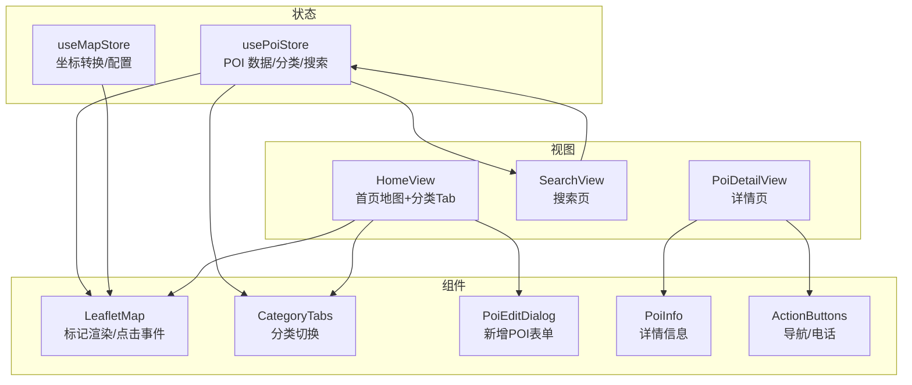
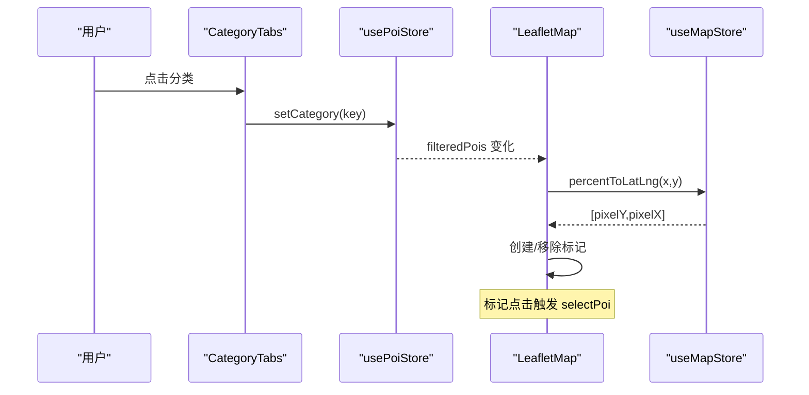
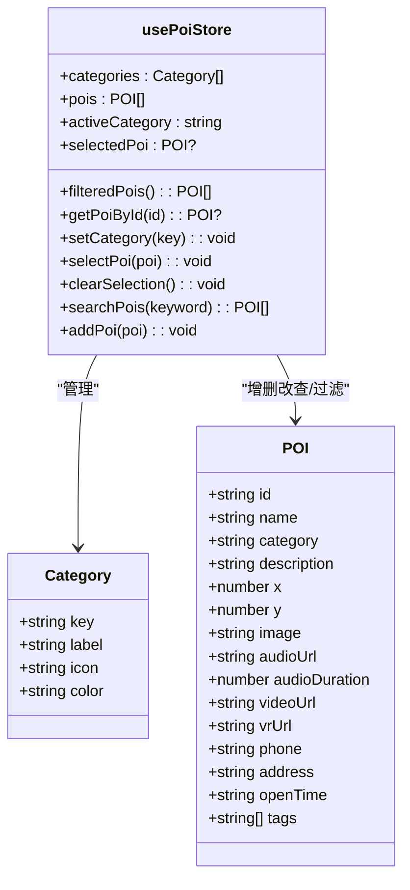
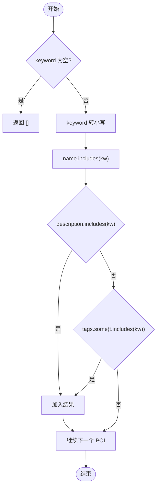
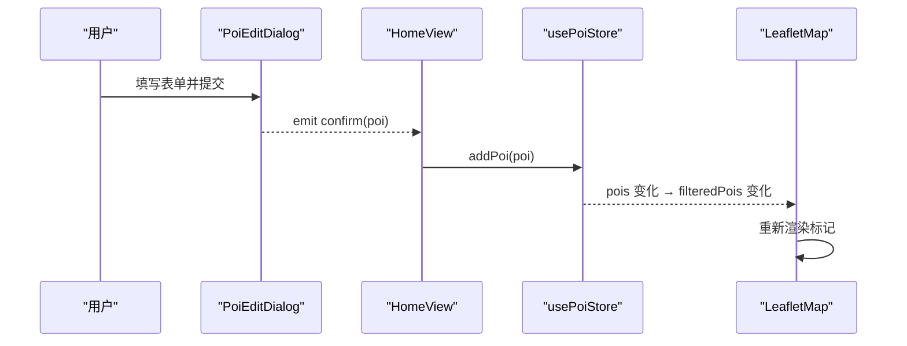
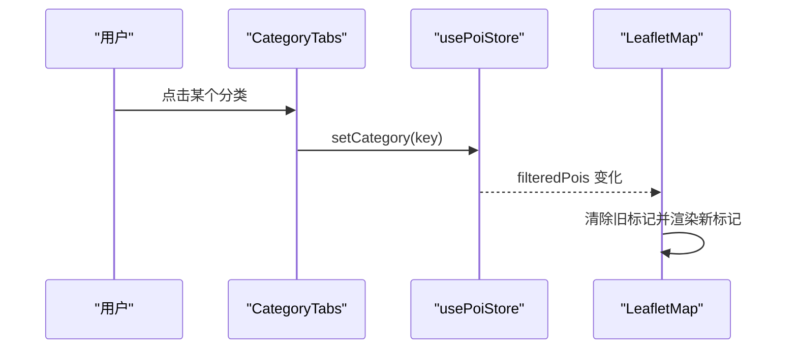
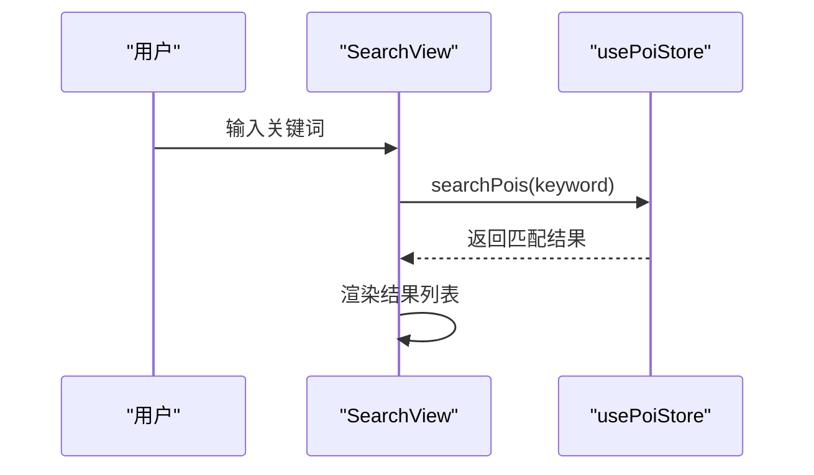
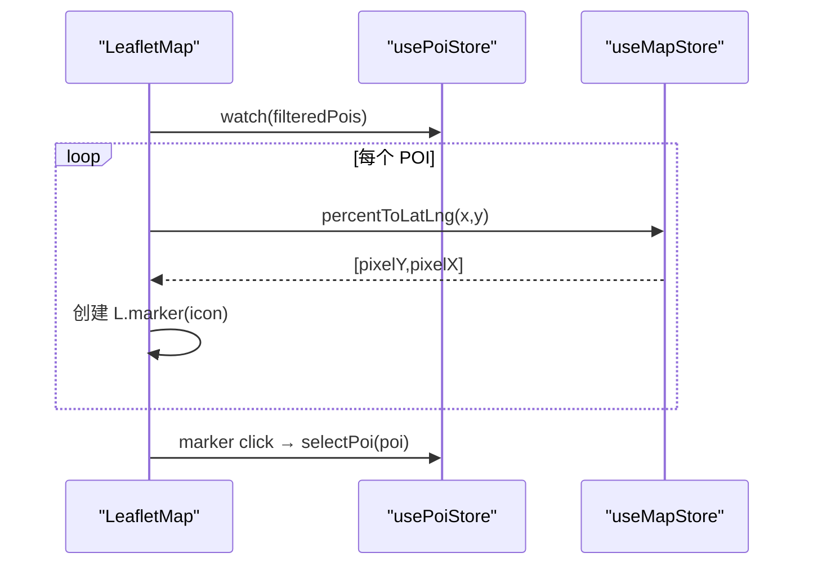
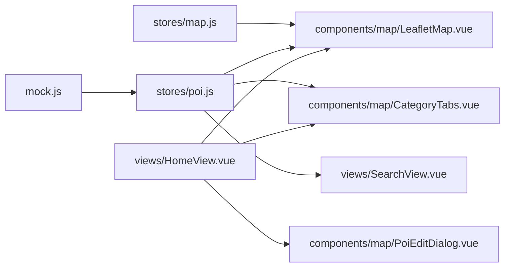

# POI数据管理 (poi.js)

<cite>
**本文引用的文件**
- [src/stores/poi.js](file://src/stores/poi.js)
- [src/data/mock.js](file://src/data/mock.js)
- [src/components/map/LeafletMap.vue](file://src/components/map/LeafletMap.vue)
- [src/components/map/CategoryTabs.vue](file://src/components/map/CategoryTabs.vue)
- [src/views/SearchView.vue](file://src/views/SearchView.vue)
- [src/components/common/SearchBar.vue](file://src/components/common/SearchBar.vue)
- [src/components/detail/PoiInfo.vue](file://src/components/detail/PoiInfo.vue)
- [src/components/detail/ActionButtons.vue](file://src/components/detail/ActionButtons.vue)
- [src/components/map/PoiEditDialog.vue](file://src/components/map/PoiEditDialog.vue)
- [src/stores/map.js](file://src/stores/map.js)
- [src/views/HomeView.vue](file://src/views/HomeView.vue)
</cite>

## 目录
1. [简介](#简介)
2. [项目结构](#项目结构)
3. [核心组件](#核心组件)
4. [架构总览](#架构总览)
5. [详细组件分析](#详细组件分析)
6. [依赖关系分析](#依赖关系分析)
7. [性能考量](#性能考量)
8. [故障排查指南](#故障排查指南)
9. [结论](#结论)
10. [附录：API 参考与使用示例](#附录api-参考与使用示例)

## 简介
本模块围绕 usePoiStore 构建 POI（兴趣点）数据管理能力，涵盖数据模型、分类管理、搜索筛选、CRUD 操作、地图标记绑定与同步、以及详情展示与交互。整体采用 Pinia 状态管理 + Vue 组件驱动，结合 Leaflet 地图实现可视化呈现。

## 项目结构
- 状态层：stores/poi.js 提供 POI 数据、分类、选中项、过滤与搜索等能力；stores/map.js 提供坐标转换与地图配置。
- 视图层：views/HomeView.vue 承载地图与分类 Tab；views/SearchView.vue 提供搜索界面；views/PoiDetailView.vue 展示详情。
- 组件层：components/map/* 负责地图渲染、标记、编辑弹窗；components/detail/* 负责详情信息展示；components/common/* 提供通用 UI。
- 数据层：data/mock.js 提供初始 POI 数据。

图表来源
- [src/stores/poi.js:5-83](file://src/stores/poi.js#L5-L83)
- [src/stores/map.js:4-122](file://src/stores/map.js#L4-L122)
- [src/components/map/LeafletMap.vue:1-141](file://src/components/map/LeafletMap.vue#L1-L141)
- [src/components/map/CategoryTabs.vue:1-59](file://src/components/map/CategoryTabs.vue#L1-L59)
- [src/views/SearchView.vue:1-215](file://src/views/SearchView.vue#L1-L215)
- [src/views/HomeView.vue:44-96](file://src/views/HomeView.vue#L44-L96)

章节来源
- [src/stores/poi.js:5-83](file://src/stores/poi.js#L5-L83)
- [src/stores/map.js:4-122](file://src/stores/map.js#L4-L122)
- [src/components/map/LeafletMap.vue:1-141](file://src/components/map/LeafletMap.vue#L1-L141)
- [src/components/map/CategoryTabs.vue:1-59](file://src/components/map/CategoryTabs.vue#L1-L59)
- [src/views/SearchView.vue:1-215](file://src/views/SearchView.vue#L1-L215)
- [src/views/HomeView.vue:44-96](file://src/views/HomeView.vue#L44-L96)

## 核心组件
- usePoiStore：集中管理 POI 数据、分类定义、当前分类、选中 POI、过滤结果、搜索与添加等操作。
- LeafletMap：监听 filteredPois 变化，将 POI 渲染为地图标记，并处理点击选择。
- CategoryTabs：根据 store 的分类列表渲染 Tab，点击触发分类切换。
- SearchView：用户输入关键词，调用 store 的搜索方法获取结果并展示。
- PoiEditDialog：新增 POI 的表单弹窗，校验后通过父组件调用 store 的 addPoi。
- PoiInfo/ActionButtons：详情展示与操作按钮。

章节来源
- [src/stores/poi.js:5-83](file://src/stores/poi.js#L5-L83)
- [src/components/map/LeafletMap.vue:31-95](file://src/components/map/LeafletMap.vue#L31-L95)
- [src/components/map/CategoryTabs.vue:1-59](file://src/components/map/CategoryTabs.vue#L1-L59)
- [src/views/SearchView.vue:65-101](file://src/views/SearchView.vue#L65-L101)
- [src/components/map/PoiEditDialog.vue:69-159](file://src/components/map/PoiEditDialog.vue#L69-L159)
- [src/components/detail/PoiInfo.vue:1-130](file://src/components/detail/PoiInfo.vue#L1-L130)
- [src/components/detail/ActionButtons.vue:1-79](file://src/components/detail/ActionButtons.vue#L1-L79)

## 架构总览
- 数据流：mockPois 初始化 → usePoiStore.pois → computed.filteredPois → LeafletMap 渲染标记。
- 交互流：CategoryTabs 切换 activeCategory → filteredPois 更新 → 标记重绘；SearchView 输入关键词 → searchPois → 结果列表；LeafletMap 标记点击 → selectPoi → 底部弹窗/详情页。
- 坐标系统：POI 以百分比坐标存储，LeafletMap 通过 mapStore.percentToLatLng 转换为像素坐标用于标记定位。

图表来源
- [src/components/map/CategoryTabs.vue:1-59](file://src/components/map/CategoryTabs.vue#L1-L59)
- [src/stores/poi.js:27-41](file://src/stores/poi.js#L27-L41)
- [src/components/map/LeafletMap.vue:31-95](file://src/components/map/LeafletMap.vue#L31-L95)
- [src/stores/map.js:87-103](file://src/stores/map.js#L87-L103)

## 详细组件分析

### POI 数据模型与分类管理
- 数据模型：每个 POI 包含 id、name、category、description、x、y、image、audioUrl、audioDuration、videoUrl、vrUrl、phone、address、openTime、tags 等字段。
- 分类定义：store 中维护 categories 数组，包含 key、label、icon、color，支持“全部”与多个业务分类。
- 分类切换：activeCategory 控制 filteredPois 的计算，all 时返回全部，否则按 category 过滤。

图表来源
- [src/stores/poi.js:5-83](file://src/stores/poi.js#L5-L83)
- [src/data/mock.js:5-349](file://src/data/mock.js#L5-L349)

章节来源
- [src/stores/poi.js:5-83](file://src/stores/poi.js#L5-L83)
- [src/data/mock.js:5-349](file://src/data/mock.js#L5-L349)

### 搜索与筛选算法
- 分类筛选：computed.filteredPois 基于 activeCategory 对 pois 进行精确匹配过滤。
- 关键词搜索：searchPois 对 name、description、tags 进行大小写不敏感的部分匹配（includes）。
- 结果高亮：当前实现未对搜索结果进行文本高亮，可在展示层扩展。

图表来源
- [src/stores/poi.js:53-63](file://src/stores/poi.js#L53-L63)

章节来源
- [src/stores/poi.js:27-63](file://src/stores/poi.js#L27-L63)
- [src/views/SearchView.vue:81-83](file://src/views/SearchView.vue#L81-L83)

### CRUD 操作实现
- 新增（Add）：PoiEditDialog 收集表单数据，校验通过后 emit confirm，HomeView 调用 poiStore.addPoi 将新 POI 推入内存数组。
- 删除（Delete）：当前 store 未暴露 deletePoi，可扩展在 store 中增加删除逻辑并在 UI 中调用。
- 更新（Update）：当前 store 未暴露 updatePoi，可扩展在 store 中增加更新逻辑并通过 getPoiById 定位对象进行修改。
- 读取（Read）：getPoiById 通过 id 查找 POI；filteredPois 提供分类过滤后的列表；searchPois 提供关键词检索。

图表来源
- [src/components/map/PoiEditDialog.vue:127-154](file://src/components/map/PoiEditDialog.vue#L127-L154)
- [src/views/HomeView.vue:88-96](file://src/views/HomeView.vue#L88-L96)
- [src/stores/poi.js:65-68](file://src/stores/poi.js#L65-L68)
- [src/components/map/LeafletMap.vue:31-39](file://src/components/map/LeafletMap.vue#L31-L39)

章节来源
- [src/components/map/PoiEditDialog.vue:69-159](file://src/components/map/PoiEditDialog.vue#L69-L159)
- [src/views/HomeView.vue:88-96](file://src/views/HomeView.vue#L88-L96)
- [src/stores/poi.js:65-68](file://src/stores/poi.js#L65-L68)

### 多类别管理与数据过滤
- 分类切换：CategoryTabs 遍历 store.categories，点击调用 setCategory，更新 activeCategory。
- 数据过滤：filteredPois 计算属性根据 activeCategory 返回全量或按类别过滤的结果。
- 排序功能：当前未实现排序，可在 store 中增加排序方法并按名称、距离等维度排序。

图表来源
- [src/components/map/CategoryTabs.vue:1-59](file://src/components/map/CategoryTabs.vue#L1-L59)
- [src/stores/poi.js:27-41](file://src/stores/poi.js#L27-L41)
- [src/components/map/LeafletMap.vue:31-95](file://src/components/map/LeafletMap.vue#L31-L95)

章节来源
- [src/components/map/CategoryTabs.vue:1-59](file://src/components/map/CategoryTabs.vue#L1-L59)
- [src/stores/poi.js:27-41](file://src/stores/poi.js#L27-L41)

### 搜索功能的实现原理
- 关键词匹配：searchPois 对 name、description、tags 进行 includes 模糊匹配。
- 结果展示：SearchView 监听 input 变化，调用 searchPois 并渲染结果列表。
- 结果高亮：当前未实现高亮，可在展示层对匹配片段进行包裹高亮。

图表来源
- [src/views/SearchView.vue:81-83](file://src/views/SearchView.vue#L81-L83)
- [src/stores/poi.js:53-63](file://src/stores/poi.js#L53-L63)

章节来源
- [src/views/SearchView.vue:65-101](file://src/views/SearchView.vue#L65-L101)
- [src/stores/poi.js:53-63](file://src/stores/poi.js#L53-L63)

### POI 与地图标记点的绑定与同步
- 绑定：LeafletMap 监听 filteredPois 变化，将每个 POI 的百分比坐标转换为像素坐标，创建自定义 divIcon 标记。
- 同步：当分类切换或新增 POI 时，filteredPois 变化触发标记重绘；点击标记调用 selectPoi 更新选中态。
- 坐标转换：mapStore.percentToLatLng 将百分比坐标转为像素坐标；onMapClick 在编辑模式下将像素坐标转回百分比坐标用于新增 POI。

图表来源
- [src/components/map/LeafletMap.vue:31-95](file://src/components/map/LeafletMap.vue#L31-L95)
- [src/stores/map.js:87-103](file://src/stores/map.js#L87-L103)
- [src/stores/poi.js:43-51](file://src/stores/poi.js#L43-L51)

章节来源
- [src/components/map/LeafletMap.vue:31-95](file://src/components/map/LeafletMap.vue#L31-L95)
- [src/stores/map.js:87-103](file://src/stores/map.js#L87-L103)
- [src/stores/poi.js:43-51](file://src/stores/poi.js#L43-L51)

### 数据验证规则与错误处理策略
- 表单验证：PoiEditDialog 使用 van-field 的 rules 对必填字段进行校验，提交前检查 name 非空。
- 标签解析：tags 支持逗号分隔，自动去除空白与空值。
- 错误处理：地图配置加载失败时记录错误日志；搜索无结果时显示空状态提示。
- 建议增强：为删除/更新操作增加确认与异常捕获；为搜索增加防抖与边界条件处理。

章节来源
- [src/components/map/PoiEditDialog.vue:10-50](file://src/components/map/PoiEditDialog.vue#L10-L50)
- [src/components/map/PoiEditDialog.vue:127-154](file://src/components/map/PoiEditDialog.vue#L127-L154)
- [src/stores/map.js:40-85](file://src/stores/map.js#L40-L85)
- [src/views/SearchView.vue:24-36](file://src/views/SearchView.vue#L24-L36)

### 性能优化方案
- 计算缓存：filteredPois 使用 computed 避免重复计算。
- 标记批量更新：watch 一次性清空旧标记并重建，减少 DOM 操作次数。
- 文本宽度测量：measureTextWidth 复用 canvas 实例，避免重复创建开销。
- 建议优化：搜索输入可加防抖；大数据集时可考虑虚拟列表或分页；标记过多时可启用聚合或按需渲染。

章节来源
- [src/stores/poi.js:27-31](file://src/stores/poi.js#L27-L31)
- [src/components/map/LeafletMap.vue:51-56](file://src/components/map/LeafletMap.vue#L51-L56)
- [src/components/map/LeafletMap.vue:61-95](file://src/components/map/LeafletMap.vue#L61-L95)

## 依赖关系分析
- usePoiStore 依赖 data/mock.js 提供初始数据。
- LeafletMap 依赖 useMapStore 进行坐标转换，依赖 usePoiStore 获取数据与选中态。
- CategoryTabs 依赖 usePoiStore 获取分类与当前分类。
- SearchView 依赖 usePoiStore 执行搜索。
- HomeView 协调 LeafletMap、CategoryTabs、PoiEditDialog 与 usePoiStore。

图表来源
- [src/data/mock.js:5-349](file://src/data/mock.js#L5-L349)
- [src/stores/poi.js:5-83](file://src/stores/poi.js#L5-L83)
- [src/stores/map.js:4-122](file://src/stores/map.js#L4-L122)
- [src/components/map/LeafletMap.vue:1-141](file://src/components/map/LeafletMap.vue#L1-L141)
- [src/components/map/CategoryTabs.vue:1-59](file://src/components/map/CategoryTabs.vue#L1-L59)
- [src/views/SearchView.vue:1-215](file://src/views/SearchView.vue#L1-L215)
- [src/views/HomeView.vue:44-96](file://src/views/HomeView.vue#L44-L96)

章节来源
- [src/stores/poi.js:5-83](file://src/stores/poi.js#L5-L83)
- [src/stores/map.js:4-122](file://src/stores/map.js#L4-L122)
- [src/components/map/LeafletMap.vue:1-141](file://src/components/map/LeafletMap.vue#L1-L141)
- [src/components/map/CategoryTabs.vue:1-59](file://src/components/map/CategoryTabs.vue#L1-L59)
- [src/views/SearchView.vue:1-215](file://src/views/SearchView.vue#L1-L215)
- [src/views/HomeView.vue:44-96](file://src/views/HomeView.vue#L44-L96)

## 性能考量
- 使用 computed 缓存过滤结果，避免频繁 re-render。
- 标记重建时先移除旧标记再统一添加，降低中间状态抖动。
- 文本测量复用 canvas，减少内存分配。
- 建议在大数据场景下引入分页、懒加载与标记聚合。

[本节为通用性能建议，无需特定文件引用]

## 故障排查指南
- 地图标记不显示：检查 isReady 是否为真；确认 filteredPois 是否变化；验证 percentToLatLng 返回值是否正确。
- 搜索无结果：确认 keyword 非空；检查 name/description/tags 是否存在；必要时增加调试日志。
- 新增 POI 不生效：确认表单校验通过；确认 addPoi 被调用；检查 pois 数组是否更新。
- 分类切换无效：确认 activeCategory 已更新；检查 filteredPois 计算是否正确。

章节来源
- [src/components/map/LeafletMap.vue:31-46](file://src/components/map/LeafletMap.vue#L31-L46)
- [src/stores/poi.js:27-41](file://src/stores/poi.js#L27-L41)
- [src/stores/poi.js:53-68](file://src/stores/poi.js#L53-L68)

## 结论
usePoiStore 作为 POI 数据管理的核心，提供了清晰的数据模型、分类管理与搜索能力，并与 Leaflet 地图紧密集成，实现了从数据到可视化的完整链路。当前版本已具备基础的 CRUD 中的新增与读取，删除与更新可扩展完善。建议在大数据场景下进一步优化性能与用户体验。

[本节为总结性内容，无需特定文件引用]

## 附录：API 参考与使用示例

### usePoiStore API
- 状态
  - categories：分类定义数组
  - pois：全部 POI 数据数组
  - activeCategory：当前选中的分类键
  - selectedPoi：当前选中的 POI 对象
  - filteredPois：根据 activeCategory 过滤后的 POI 列表（计算属性）
- 方法
  - getPoiById(id)：按 ID 获取 POI
  - setCategory(key)：设置当前分类
  - selectPoi(poi)：选中 POI
  - clearSelection()：清除选中
  - searchPois(keyword)：关键词搜索，返回匹配 POI 列表
  - addPoi(poi)：新增 POI（仅内存）

章节来源
- [src/stores/poi.js:5-83](file://src/stores/poi.js#L5-L83)

### 使用示例
- 分类切换
  - 在 CategoryTabs 中遍历 categories，点击调用 setCategory(key)。
- 搜索
  - 在 SearchView 中监听输入变化，调用 searchPois(keyword) 并渲染结果。
- 新增 POI
  - 在 PoiEditDialog 中完成表单校验后 emit confirm，HomeView 调用 addPoi(poi)。
- 地图标记
  - LeafletMap 监听 filteredPois 变化，使用 percentToLatLng 转换坐标并创建标记；点击标记调用 selectPoi。

章节来源
- [src/components/map/CategoryTabs.vue:1-59](file://src/components/map/CategoryTabs.vue#L1-L59)
- [src/views/SearchView.vue:81-83](file://src/views/SearchView.vue#L81-L83)
- [src/components/map/PoiEditDialog.vue:127-154](file://src/components/map/PoiEditDialog.vue#L127-L154)
- [src/views/HomeView.vue:88-96](file://src/views/HomeView.vue#L88-L96)
- [src/components/map/LeafletMap.vue:31-95](file://src/components/map/LeafletMap.vue#L31-L95)