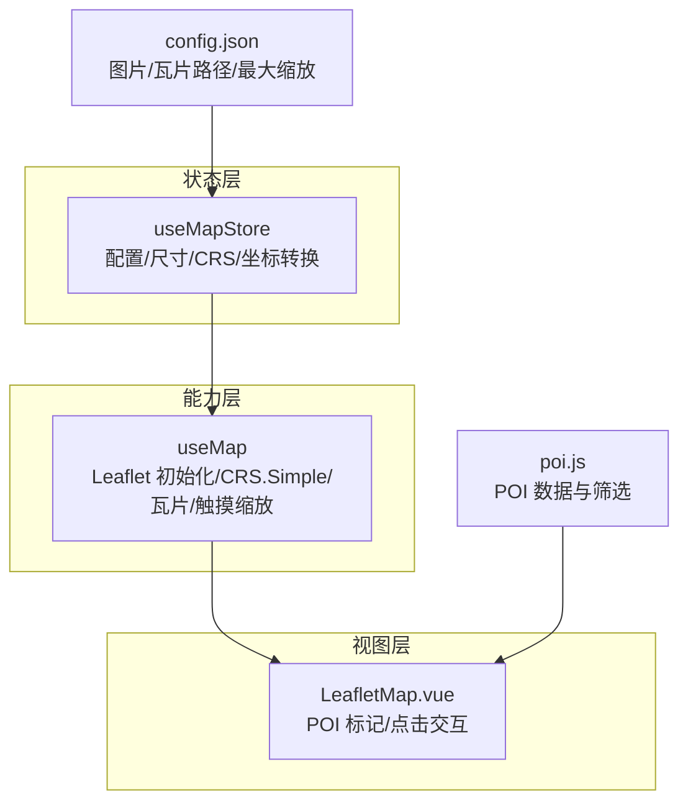
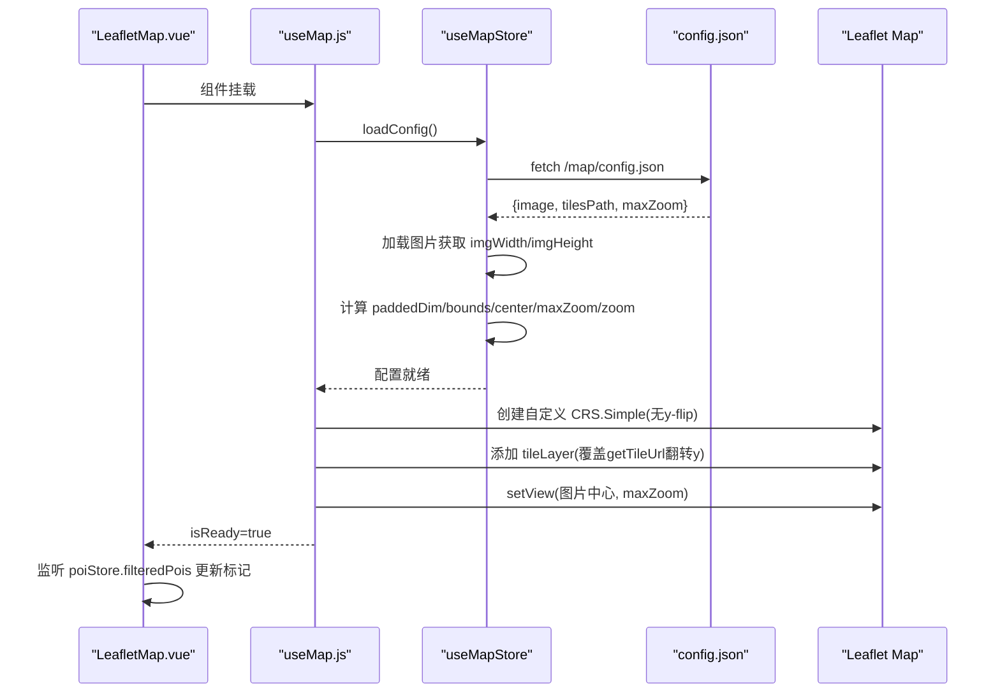
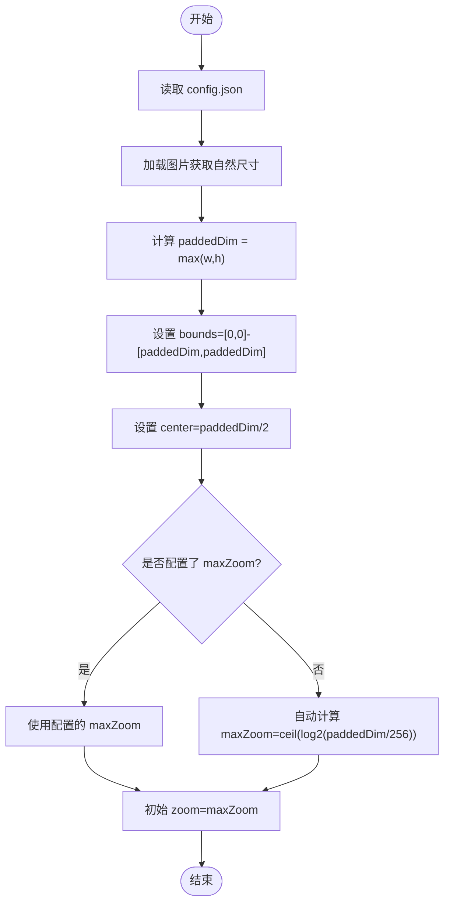
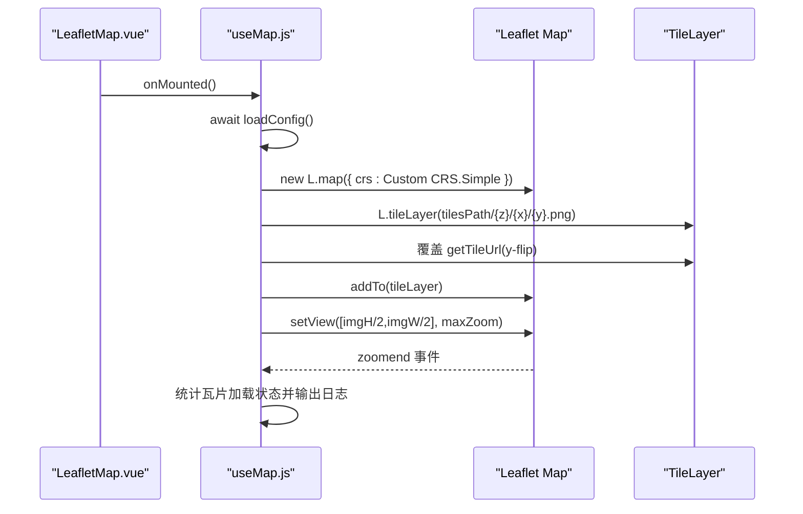
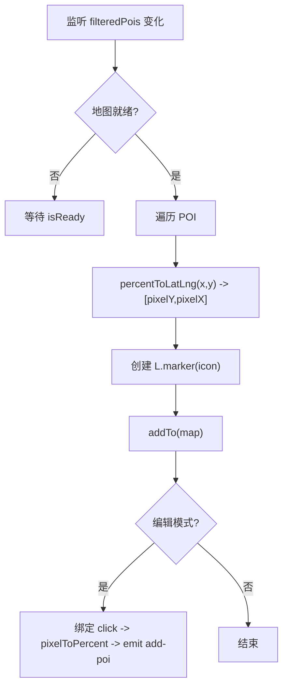
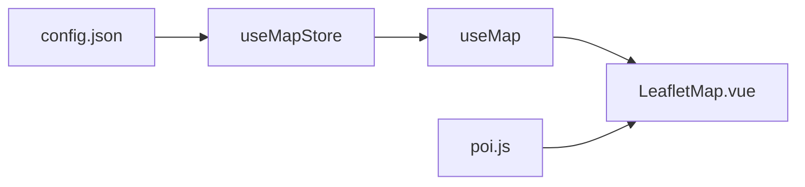

# 地图状态管理 (map.js)

<cite>
**本文引用的文件**
- [src/stores/map.js](file://src/stores/map.js)
- [src/composables/useMap.js](file://src/composables/useMap.js)
- [src/components/map/LeafletMap.vue](file://src/components/map/LeafletMap.vue)
- [public/map/config.json](file://public/map/config.json)
- [src/stores/poi.js](file://src/stores/poi.js)
</cite>

## 目录
1. [简介](#简介)
2. [项目结构](#项目结构)
3. [核心组件](#核心组件)
4. [架构总览](#架构总览)
5. [详细组件分析](#详细组件分析)
6. [依赖关系分析](#依赖关系分析)
7. [性能考量](#性能考量)
8. [故障排查指南](#故障排查指南)
9. [结论](#结论)
10. [附录：使用示例与最佳实践](#附录使用示例与最佳实践)

## 简介
本模块基于 Leaflet 的 CRS.Simple 像素坐标系，实现手绘地图的瓦片化展示与交互。核心通过 Pinia store 集中管理地图配置、图片尺寸、CRS bounds、缩放范围等全局状态，并提供百分比坐标与像素坐标之间的转换函数；composable 封装地图实例初始化、瓦片路径覆盖、触摸双指缩放、初始视图设置等逻辑；Vue 组件负责 POI 标记渲染与点击交互。整体设计将“数据（store）—能力（composable）—视图（component）”解耦，便于扩展与维护。

## 项目结构
- 状态层：stores/map.js 提供地图配置加载、图片尺寸计算、CRS bounds、坐标转换等能力。
- 能力层：composables/useMap.js 封装 Leaflet 地图实例生命周期、自定义 CRS、瓦片 URL 翻转、触摸缩放、调试输出等。
- 视图层：components/map/LeafletMap.vue 监听 POI 变化并渲染标记，处理编辑模式下的地图点击事件。
- 配置资源：public/map/config.json 定义图片路径、瓦片路径、最大缩放级别等。
- 关联状态：stores/poi.js 提供 POI 数据与筛选，配合地图标记渲染。

图表来源
- [src/stores/map.js:1-122](file://src/stores/map.js#L1-L122)
- [src/composables/useMap.js:1-174](file://src/composables/useMap.js#L1-L174)
- [src/components/map/LeafletMap.vue:1-141](file://src/components/map/LeafletMap.vue#L1-L141)
- [public/map/config.json:1-5](file://public/map/config.json#L1-L5)
- [src/stores/poi.js:1-84](file://src/stores/poi.js#L1-L84)

章节来源
- [src/stores/map.js:1-122](file://src/stores/map.js#L1-L122)
- [src/composables/useMap.js:1-174](file://src/composables/useMap.js#L1-L174)
- [src/components/map/LeafletMap.vue:1-141](file://src/components/map/LeafletMap.vue#L1-L141)
- [public/map/config.json:1-5](file://public/map/config.json#L1-L5)
- [src/stores/poi.js:1-84](file://src/stores/poi.js#L1-L84)

## 核心组件
- useMapStore（Pinia Store）
  - 职责：加载配置、获取图片尺寸、计算 paddedDim、设置 CRS bounds、维护中心点与缩放范围、提供坐标转换方法。
  - 关键状态：imgWidth/imgHeight、paddedDim、bounds、center、zoom/minZoom/maxZoom、tilesPath/imagePath、configLoaded。
  - 关键方法：loadConfig()、percentToLatLng(x,y)、pixelToPercent(crsY,crsX)。
- useMap（Composable）
  - 职责：在容器挂载后加载配置、创建自定义 CRS.Simple、添加瓦片层、覆盖 getTileUrl 以匹配 y-flip、实现双指缩放、设置初始视图、暴露 zoomBy/flyTo/getMap。
- LeafletMap.vue（组件）
  - 职责：监听 POI 变化更新标记、根据分类颜色生成标记样式、在编辑模式下响应地图点击并将像素坐标转为百分比坐标上报父组件。

章节来源
- [src/stores/map.js:1-122](file://src/stores/map.js#L1-L122)
- [src/composables/useMap.js:1-174](file://src/composables/useMap.js#L1-L174)
- [src/components/map/LeafletMap.vue:1-141](file://src/components/map/LeafletMap.vue#L1-L141)

## 架构总览
下图展示了从配置加载到地图渲染与交互的整体流程，包括 CRSSimple 坐标系统、瓦片路径与 y-flip 处理、以及百分比与像素坐标的转换。

图表来源
- [src/composables/useMap.js:14-129](file://src/composables/useMap.js#L14-L129)
- [src/stores/map.js:40-85](file://src/stores/map.js#L40-L85)
- [public/map/config.json:1-5](file://public/map/config.json#L1-L5)
- [src/components/map/LeafletMap.vue:31-46](file://src/components/map/LeafletMap.vue#L31-L46)

## 详细组件分析

### useMapStore：地图配置加载机制、图片尺寸处理、CRS.Simple 坐标系统配置
- 配置加载
  - 通过 fetch 读取 public/map/config.json，解析 image、tilesPath、maxZoom。
  - 动态加载图片以获取 naturalWidth/naturalHeight，用于后续计算。
- 图片尺寸与 paddedDim
  - paddedDim = max(imgWidth, imgHeight)，确保 CRS.bounds 为正方形，避免 Leaflet 瓦片坐标异常。
  - bounds 设置为 [[0,0],[paddedDim,paddedDim]]，center 设为 paddedDim/2。
- 缩放范围
  - 若配置未指定 maxZoom，则按 Math.ceil(log2(paddedDim/256)) 自动计算；否则使用配置值。
  - 初始 zoom 设为 maxZoom，保证首次加载显示完整图片（每瓦片约 256px）。
- 坐标转换
  - percentToLatLng(x,y)：将百分比坐标转换为 CRS.Simple 像素坐标 [pixelY, pixelX]。
  - pixelToPercent(crsY,crsX)：将像素坐标反算为百分比坐标，保留两位小数。

图表来源
- [src/stores/map.js:40-85](file://src/stores/map.js#L40-L85)

章节来源
- [src/stores/map.js:1-122](file://src/stores/map.js#L1-L122)

### useMap：地图实例状态管理与瓦片路径管理
- 自定义 CRS.Simple
  - 覆盖 projection.bounds 为 paddedDim×paddedDim，设置 transformation 为 scale=256/paddedDim，无 y-flip。
  - 关闭无限平铺 infinite=false，限制地图边界。
- 瓦片层与 y-flip
  - 使用 L.tileLayer 加载瓦片，noWrap=true，tileSize=256。
  - 覆盖 getTileUrl：根据当前层级 z 计算 tilesPerSide=2^z，将 Leaflet 计算的 y 翻转为 tilesPath/{z}/{x}/{flippedY}.png，匹配瓦片生成时的 y-flip。
- 触摸双指缩放
  - 禁用内置 touchZoom，监听 touchstart/touchmove/touchend，当两指距离变化超过阈值（15%）时触发 zoomIn/zoomOut 一级。
- 初始视图与调试
  - setView 使用图片实际中心 [imgHeight/2, imgWidth/2] 与 maxZoom。
  - 监听 zoomend 输出当前缩放、瓦片总数、已加载数、失败数，便于定位问题。

图表来源
- [src/composables/useMap.js:14-129](file://src/composables/useMap.js#L14-L129)

章节来源
- [src/composables/useMap.js:1-174](file://src/composables/useMap.js#L1-L174)

### LeafletMap.vue：POI 标记渲染与坐标转换使用
- 标记渲染
  - 监听 poiStore.filteredPois，地图就绪后调用 updateMarkers。
  - 对每个 POI，使用 mapStore.percentToLatLng 将百分比坐标转为像素坐标 [pixelY, pixelX]，创建 L.marker 并添加到地图。
  - 根据 POI 名称长度自适应标记容器宽度，提升可读性。
- 点击交互
  - 编辑模式下绑定地图 click 事件，获取 e.latlng（像素坐标），通过 mapStore.pixelToPercent 转为百分比坐标，并通过 emit('add-poi') 上报父组件。

图表来源
- [src/components/map/LeafletMap.vue:31-129](file://src/components/map/LeafletMap.vue#L31-L129)
- [src/stores/map.js:93-103](file://src/stores/map.js#L93-L103)

章节来源
- [src/components/map/LeafletMap.vue:1-141](file://src/components/map/LeafletMap.vue#L1-L141)
- [src/stores/map.js:93-103](file://src/stores/map.js#L93-L103)

### 坐标转换函数：percentToLatLng 与 pixelToPercent
- percentToLatLng(x, y)
  - 输入：百分比坐标 x∈[0,100], y∈[0,100]（y=0 为顶部）。
  - 输出：CRS.Simple 像素坐标 [pixelY, pixelX]。
  - 用途：将 POI 的百分比位置映射到地图像素坐标，用于放置 marker。
- pixelToPercent(crsY, crsX)
  - 输入：CRS.Simple 像素坐标。
  - 输出：百分比坐标 {x, y}，保留两位小数。
  - 用途：在编辑模式下将用户点击的像素位置转换为百分比坐标，便于持久化或业务处理。

章节来源
- [src/stores/map.js:93-103](file://src/stores/map.js#L93-L103)
- [src/components/map/LeafletMap.vue:108-116](file://src/components/map/LeafletMap.vue#L108-L116)

## 依赖关系分析
- useMapStore 依赖 Vue 响应式 ref 与 Pinia defineStore，外部仅依赖浏览器 Image API 与 fetch。
- useMap 依赖 Leaflet（L）、useMapStore，负责地图实例生命周期与事件绑定。
- LeafletMap.vue 依赖 useMap、usePoiStore、useMapStore，负责 UI 渲染与交互。
- 配置资源 config.json 由 useMapStore 在运行时加载，支持动态切换图片与瓦片路径。

图表来源
- [src/stores/map.js:1-122](file://src/stores/map.js#L1-L122)
- [src/composables/useMap.js:1-174](file://src/composables/useMap.js#L1-L174)
- [src/components/map/LeafletMap.vue:1-141](file://src/components/map/LeafletMap.vue#L1-L141)
- [src/stores/poi.js:1-84](file://src/stores/poi.js#L1-L84)
- [public/map/config.json:1-5](file://public/map/config.json#L1-L5)

章节来源
- [src/stores/map.js:1-122](file://src/stores/map.js#L1-L122)
- [src/composables/useMap.js:1-174](file://src/composables/useMap.js#L1-L174)
- [src/components/map/LeafletMap.vue:1-141](file://src/components/map/LeafletMap.vue#L1-L141)
- [src/stores/poi.js:1-84](file://src/stores/poi.js#L1-L84)
- [public/map/config.json:1-5](file://public/map/config.json#L1-L5)

## 性能考量
- 瓦片层级控制
  - 使用 maxNativeZoom 限制原生瓦片层级，超出部分通过 CSS 放大，减少不必要的瓦片请求。
  - 合理设置 maxZoom，避免过高的缩放导致瓦片数量爆炸。
- 瓦片路径优化
  - 通过 tilesPath 配置集中管理，便于 CDN 或静态资源服务部署。
  - 覆盖 getTileUrl 仅做必要翻转，避免额外计算开销。
- 缩放体验
  - 启用 zoomSnap=0 与 zoomDelta=0.5，提供更平滑的缩放体验。
  - 调整 wheelPxPerZoomLevel 控制滚轮灵敏度，平衡易用性与精度。
- 内存与生命周期
  - 组件卸载时移除地图实例，防止内存泄漏。
  - 标记数组清理后再重建，避免重复 DOM 节点。
- 调试与监控
  - 监听 zoomend 输出瓦片加载统计，快速定位资源缺失或网络问题。

[本节为通用性能建议，不直接分析具体代码行]

## 故障排查指南
- 配置加载失败
  - 现象：控制台报错，地图无法初始化。
  - 排查：检查 /map/config.json 是否存在且可访问；确认图片路径正确；确保服务器允许跨域（如需要）。
  - 参考：配置加载 try/catch 与错误日志输出。
- 瓦片 404 或空白
  - 现象：地图区域出现空白或大量失败瓦片。
  - 排查：确认 tilesPath 与瓦片目录结构一致；检查 getTileUrl 的 y-flip 是否正确；查看 zoomend 日志中的 failed 计数。
  - 参考：getTileUrl 覆盖逻辑与调试输出。
- 触摸缩放无效
  - 现象：双指缩放不生效。
  - 排查：确认 touchZoom 已禁用并使用自定义 handler；检查事件监听是否被其他元素拦截。
  - 参考：touchstart/touchmove/touchend 监听与阈值判断。
- 标记位置偏移
  - 现象：POI 标记不在预期位置。
  - 排查：确认 percentToLatLng 使用的 imgWidth/imgHeight 已正确加载；检查 POI 的百分比坐标是否在有效范围内。
  - 参考：percentToLatLng 与标记渲染逻辑。

章节来源
- [src/stores/map.js:40-85](file://src/stores/map.js#L40-L85)
- [src/composables/useMap.js:60-120](file://src/composables/useMap.js#L60-L120)
- [src/components/map/LeafletMap.vue:68-94](file://src/components/map/LeafletMap.vue#L68-L94)

## 结论
该地图状态管理模块通过清晰的层次划分与职责分离，实现了手绘地图的瓦片化展示与交互。useMapStore 负责配置与坐标转换，useMap 封装地图实例与交互细节，LeafletMap.vue 专注 UI 与事件处理。结合 CRS.Simple 与 y-flip 的瓦片策略，既保证了坐标一致性，又提升了渲染性能。通过合理的缩放策略与调试手段，可在复杂场景下稳定运行。

[本节为总结性内容，不直接分析具体代码行]

## 附录：使用示例与最佳实践
- 基本用法
  - 在页面中引入 LeafletMap.vue，并确保容器尺寸可用。
  - 准备 public/map/config.json，配置 image、tilesPath、maxZoom。
  - 启动应用后，地图将自动加载配置并渲染瓦片。
- 动态加载配置
  - 修改 config.json 即可切换图片与瓦片路径，无需改动代码。
  - 建议在构建阶段将 config.json 纳入版本管理，便于回滚与追踪。
- 坐标转换最佳实践
  - 存储 POI 时使用百分比坐标，便于适配不同分辨率的图片。
  - 在编辑模式下，使用 pixelToPercent 将用户点击位置转为百分比坐标进行保存。
- 性能优化建议
  - 合理设置 maxZoom，避免过度缩放导致瓦片过多。
  - 使用 CDN 托管瓦片与图片，降低首屏加载时间。
  - 按需加载 POI 数据，减少初始渲染压力。
- 错误处理建议
  - 在 loadConfig 中添加重试与降级策略（例如默认图片与路径）。
  - 对瓦片加载失败进行统计与告警，便于线上监控。

[本节为通用指导，不直接分析具体代码行]