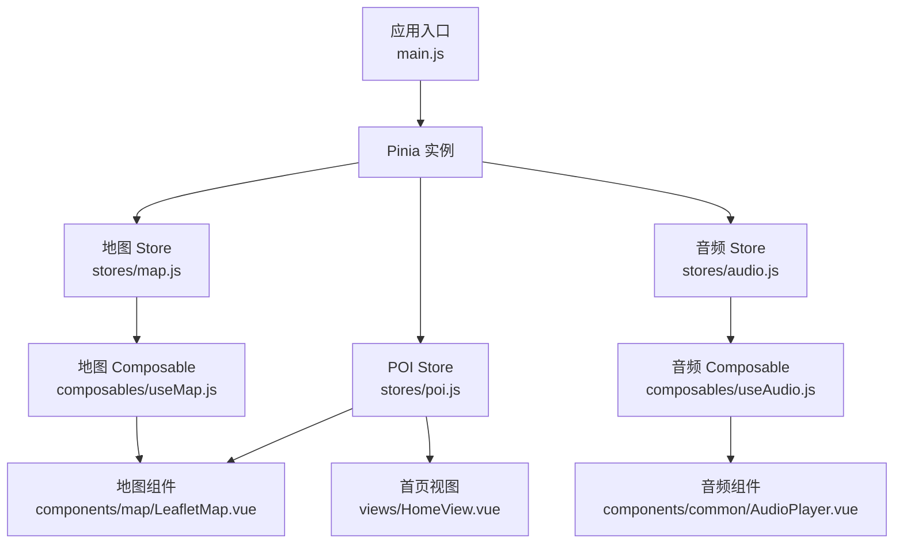
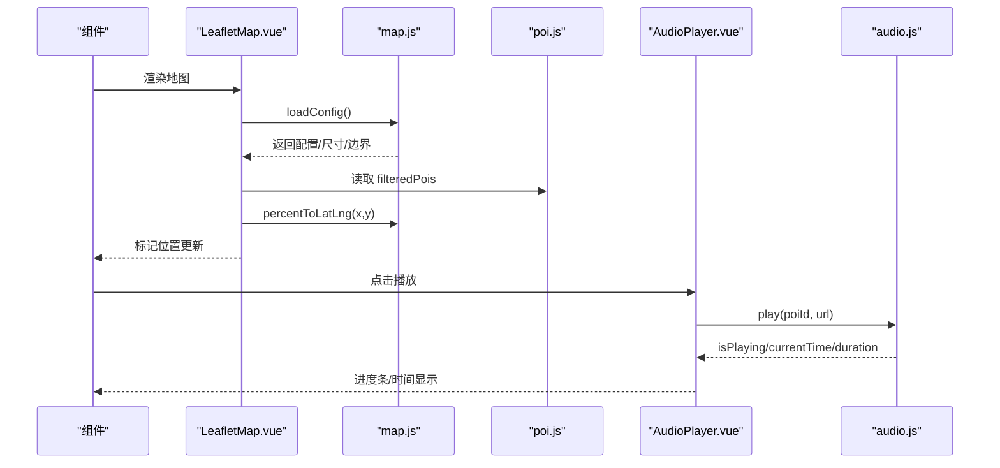
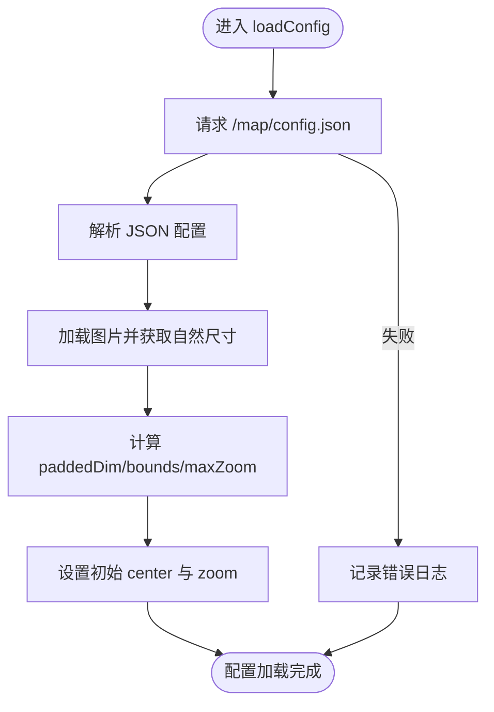
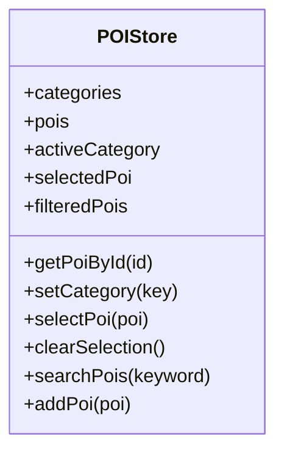
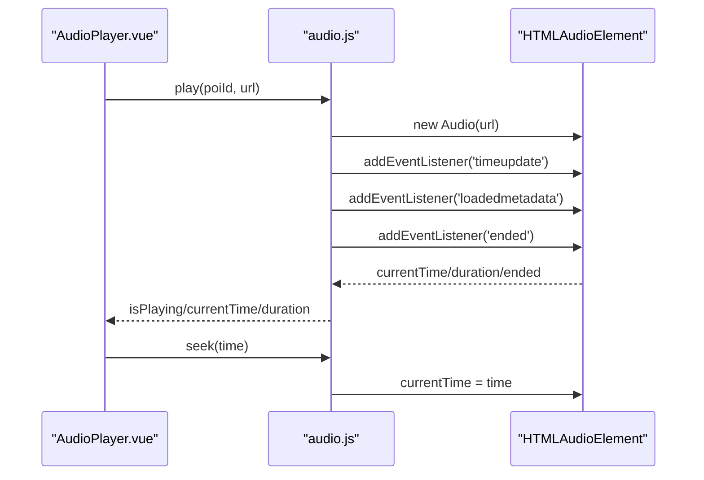
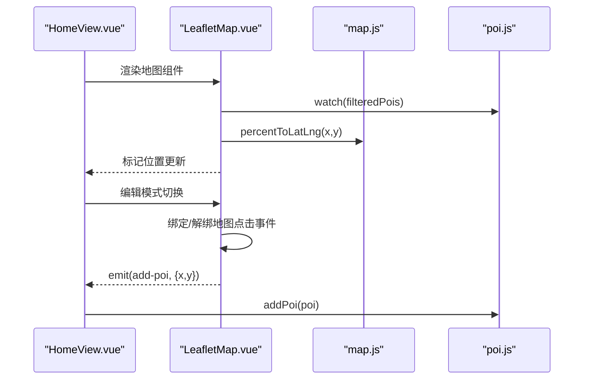
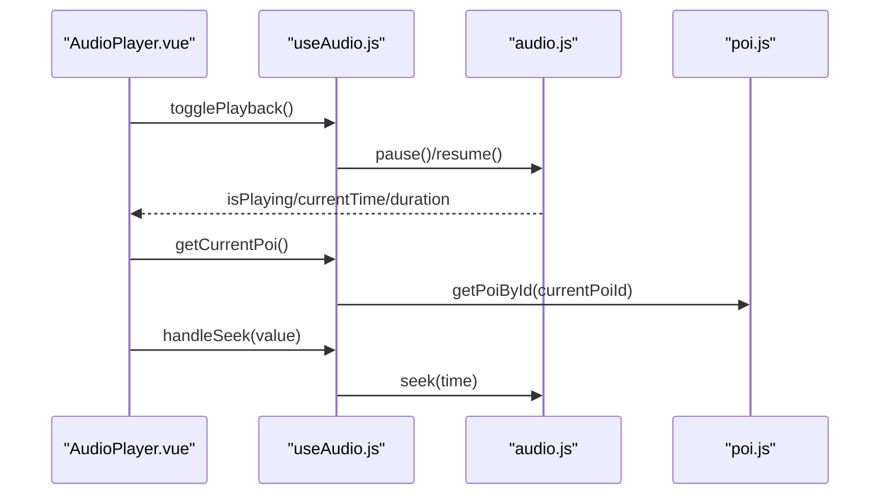
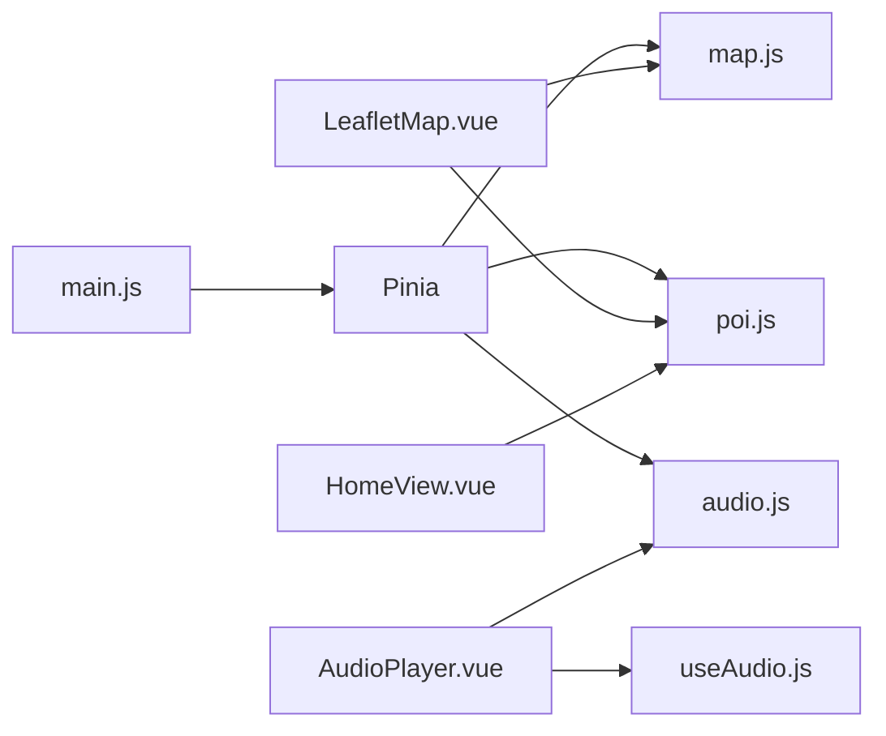

# 状态管理架构

<cite>
**本文引用的文件**
- [main.js](file://src/main.js)
- [package.json](file://package.json)
- [map.js](file://src/stores/map.js)
- [poi.js](file://src/stores/poi.js)
- [audio.js](file://src/stores/audio.js)
- [useMap.js](file://src/composables/useMap.js)
- [useAudio.js](file://src/composables/useAudio.js)
- [LeafletMap.vue](file://src/components/map/LeafletMap.vue)
- [AudioPlayer.vue](file://src/components/common/AudioPlayer.vue)
- [HomeView.vue](file://src/views/HomeView.vue)
</cite>

## 目录
1. [简介](#简介)
2. [项目结构](#项目结构)
3. [核心组件](#核心组件)
4. [架构总览](#架构总览)
5. [详细组件分析](#详细组件分析)
6. [依赖关系分析](#依赖关系分析)
7. [性能考量](#性能考量)
8. [故障排查指南](#故障排查指南)
9. [结论](#结论)
10. [附录](#附录)

## 简介
本文件面向 FunMapUI 项目的状态管理架构，聚焦基于 Pinia 的状态管理模式与组织方式。文档围绕三大 store 展开：地图状态（map.js）、兴趣点数据（poi.js）、音频播放（audio.js），并结合 composable 与视图组件说明状态同步、跨组件通信、错误处理与可扩展性设计。文末提供状态流转图与交互示例，帮助读者快速理解并扩展系统。

## 项目结构
- 应用入口在 main.js 中创建 Vue 应用并挂载 Pinia 实例，确保全局状态可用。
- 状态按领域拆分到 stores 目录：map、poi、audio，职责清晰、内聚度高。
- 业务逻辑通过 composables 封装：useMap 负责 Leaflet 地图初始化与交互；useAudio 封装播放控制与格式化等便捷方法。
- 视图与组件通过组合式 API 调用 store 与 composable，实现单向数据流与响应式更新。

图表来源
- [main.js:1-21](file://src/main.js#L1-L21)
- [map.js:1-122](file://src/stores/map.js#L1-L122)
- [poi.js:1-84](file://src/stores/poi.js#L1-L84)
- [audio.js:1-111](file://src/stores/audio.js#L1-L111)
- [useMap.js:1-174](file://src/composables/useMap.js#L1-L174)
- [useAudio.js:1-59](file://src/composables/useAudio.js#L1-L59)
- [LeafletMap.vue:1-141](file://src/components/map/LeafletMap.vue#L1-L141)
- [AudioPlayer.vue:1-104](file://src/components/common/AudioPlayer.vue#L1-L104)
- [HomeView.vue:1-136](file://src/views/HomeView.vue#L1-L136)

章节来源
- [main.js:1-21](file://src/main.js#L1-L21)
- [package.json:1-28](file://package.json#L1-L28)

## 核心组件
- 地图 Store（map.js）
  - 职责：维护图片尺寸、CRS.Simple 边界、中心点、缩放级别、瓦片路径、配置加载与坐标转换。
  - 关键能力：异步加载配置与图片尺寸、计算 paddedDim 与 maxZoom、百分比坐标与像素坐标互转。
- POI Store（poi.js）
  - 职责：维护分类定义、全部 POI 列表、当前选中项、过滤结果与搜索能力。
  - 关键能力：按分类过滤、按 ID 查询、选择/清除选中、关键词搜索、内存级新增。
- 音频 Store（audio.js）
  - 职责：维护当前 POI、播放状态、进度与时长，封装播放/暂停/恢复/停止/跳转。
  - 关键能力：单例 Audio 实例管理、事件监听更新进度、自动结束重置、异常捕获。

章节来源
- [map.js:1-122](file://src/stores/map.js#L1-L122)
- [poi.js:1-84](file://src/stores/poi.js#L1-L84)
- [audio.js:1-111](file://src/stores/audio.js#L1-L111)

## 架构总览
下图展示从组件到 store 再到外部资源的数据流向与控制流，体现“组件只读状态、通过方法修改”的单向数据流模式。

图表来源
- [LeafletMap.vue:1-141](file://src/components/map/LeafletMap.vue#L1-L141)
- [map.js:1-122](file://src/stores/map.js#L1-L122)
- [poi.js:1-84](file://src/stores/poi.js#L1-L84)
- [AudioPlayer.vue:1-104](file://src/components/common/AudioPlayer.vue#L1-L104)
- [audio.js:1-111](file://src/stores/audio.js#L1-L111)

## 详细组件分析

### 地图状态管理（map.js）
- 设计原则
  - 单一职责：仅负责地图相关配置与坐标转换，不直接操作 DOM。
  - 可配置化：通过远程配置动态设置瓦片路径、图片路径与最大缩放。
  - 坐标系统：使用 CRS.Simple，以像素为单位的二维坐标系，保证瓦片与图片对齐。
- 关键数据结构
  - 图片尺寸与 paddedDim：用于构建正方形边界，避免坐标越界。
  - bounds：CRS.Simple 的边界范围。
  - center/zoom：视图中心与缩放级别。
  - tilesPath/imagePath：运行时配置。
  - configLoaded：配置加载完成标志。
- 核心流程
  - 配置加载：获取 JSON 配置，加载图片并计算尺寸，推导 paddedDim、bounds、maxZoom，设置初始 zoom 与 center。
  - 坐标转换：percentToLatLng 将百分比坐标转为像素坐标；pixelToPercent 反向转换。
- 复杂度与优化
  - 配置加载为 O(1) 网络请求 + 图片解析；坐标转换 O(1)。
  - 建议：对大图片场景可考虑懒加载或分块渲染策略。

图表来源
- [map.js:37-85](file://src/stores/map.js#L37-L85)

章节来源
- [map.js:1-122](file://src/stores/map.js#L1-L122)

### POI 数据管理（poi.js）
- 设计原则
  - 数据与视图解耦：store 仅维护数据与筛选逻辑，UI 通过 computed 派生视图所需数据。
  - 分类驱动：通过 activeCategory 控制过滤，支持“全部”与具体类别。
  - 轻量 CRUD：提供按 ID 查询、选择/清除、搜索与新增（内存）。
- 关键数据结构
  - categories：分类元数据（键、标签、图标、颜色）。
  - pois：全部 POI 列表。
  - activeCategory：当前激活分类。
  - selectedPoi：当前选中的 POI。
  - filteredPois：根据分类过滤后的 POI 列表（computed）。
- 核心逻辑
  - 过滤：当 activeCategory 变化时，filteredPois 自动更新。
  - 搜索：searchPois 支持名称、描述与标签的多字段模糊匹配。
  - 选择：selectPoi/clearSelection 管理选中态。
  - 新增：addPoi 向内存数组追加新 POI。
- 复杂度与优化
  - 过滤与搜索均为 O(n)，n 为 POI 数量；对于大数据量可考虑索引或分页。

图表来源
- [poi.js:1-84](file://src/stores/poi.js#L1-L84)

章节来源
- [poi.js:1-84](file://src/stores/poi.js#L1-L84)

### 音频状态管理（audio.js）
- 设计原则
  - 单实例管理：同一时刻仅一个 Audio 实例，避免多音轨冲突。
  - 事件驱动：通过 timeupdate/loadedmetadata/ended 事件同步进度与状态。
  - 健壮性：play 失败时回退状态，避免 UI 不一致。
- 关键数据结构
  - currentPoiId：当前播放的 POI ID。
  - isPlaying：播放状态。
  - currentTime/duration：播放进度与总时长。
  - audioInstance：原生 Audio 对象引用。
- 核心流程
  - 播放：若正在播放同一音频则暂停；否则创建新实例并绑定事件，设置播放状态。
  - 控制：pause/resume/stop/seek 统一变更状态与实例行为。
  - 结束：音频结束时重置状态。
- 复杂度与优化
  - 事件监听开销低；建议在组件卸载时清理事件以避免内存泄漏（当前由 store 管理实例生命周期）。

图表来源
- [audio.js:20-97](file://src/stores/audio.js#L20-L97)
- [AudioPlayer.vue:28-45](file://src/components/common/AudioPlayer.vue#L28-L45)

章节来源
- [audio.js:1-111](file://src/stores/audio.js#L1-L111)
- [AudioPlayer.vue:1-104](file://src/components/common/AudioPlayer.vue#L1-L104)

### 地图与 POI 的交互（LeafletMap.vue）
- 职责
  - 监听 POI 列表变化，动态添加/移除标记。
  - 使用 mapStore 进行坐标转换，将百分比坐标映射到像素坐标。
  - 在编辑模式下监听地图点击，触发新增 POI 流程。
- 关键点
  - 标记更新：watch filteredPois，立即且持续同步。
  - 坐标转换：percentToLatLng 将 POI 的 x/y（百分比）转换为 Leaflet 像素坐标。
  - 用户交互：点击标记设置选中 POI；地图点击在编辑模式下产出待添加坐标。

图表来源
- [LeafletMap.vue:1-141](file://src/components/map/LeafletMap.vue#L1-L141)
- [map.js:87-103](file://src/stores/map.js#L87-L103)
- [poi.js:65-68](file://src/stores/poi.js#L65-L68)
- [HomeView.vue:84-96](file://src/views/HomeView.vue#L84-L96)

章节来源
- [LeafletMap.vue:1-141](file://src/components/map/LeafletMap.vue#L1-L141)
- [HomeView.vue:1-136](file://src/views/HomeView.vue#L1-L136)

### 音频播放流程（useAudio.js + AudioPlayer.vue）
- 职责
  - useAudio 封装播放、暂停、恢复、获取当前 POI、时间格式化等便捷方法。
  - AudioPlayer 负责 UI 展示与用户交互（进度条、播放/暂停、关闭）。
- 关键点
  - 播放切换：togglePlayback 根据 isPlaying 决定 pause 或 resume。
  - 进度条：handleSeek 将滑块值换算为秒并调用 seek。
  - 当前 POI：getCurrentPoi 通过 currentPoiId 从 poiStore 获取详情。

图表来源
- [useAudio.js:1-59](file://src/composables/useAudio.js#L1-L59)
- [AudioPlayer.vue:28-45](file://src/components/common/AudioPlayer.vue#L28-L45)
- [audio.js:20-97](file://src/stores/audio.js#L20-L97)
- [poi.js:33-36](file://src/stores/poi.js#L33-L36)

章节来源
- [useAudio.js:1-59](file://src/composables/useAudio.js#L1-L59)
- [AudioPlayer.vue:1-104](file://src/components/common/AudioPlayer.vue#L1-L104)

## 依赖关系分析
- 应用层依赖
  - main.js 引入并安装 Pinia，使所有组件可通过组合式 API 访问 store。
  - package.json 声明了 vue、pinia、leaflet、vant 等依赖，支撑地图与 UI。
- 模块间依赖
  - LeafletMap.vue 依赖 map.js（坐标与配置）与 poi.js（数据源）。
  - AudioPlayer.vue 依赖 audio.js（播放控制）与 useAudio.js（便捷方法）。
  - HomeView.vue 协调地图与 POI 的新增流程，调用 poi.js 的 addPoi。
- 潜在耦合点
  - 地图组件与 map.js 的坐标约定（百分比 vs 像素）需保持一致。
  - 音频组件与 audio.js 的事件模型需保持同步（如 ended 事件）。

图表来源
- [main.js:1-21](file://src/main.js#L1-L21)
- [LeafletMap.vue:1-141](file://src/components/map/LeafletMap.vue#L1-L141)
- [AudioPlayer.vue:1-104](file://src/components/common/AudioPlayer.vue#L1-L104)
- [HomeView.vue:1-136](file://src/views/HomeView.vue#L1-L136)

章节来源
- [package.json:1-28](file://package.json#L1-L28)
- [main.js:1-21](file://src/main.js#L1-L21)

## 性能考量
- 地图渲染
  - 使用 CRS.Simple 与自定义 Transformation，减少坐标换算开销。
  - 瓦片层级限制：maxNativeZoom 控制原生瓦片级别，超出级别通过 CSS 放大，降低网络请求。
  - 双指缩放阈值控制，避免频繁缩放导致的重绘。
- POI 列表
  - 过滤与搜索为 O(n)，适合中小规模数据；大数据时可引入索引或虚拟滚动。
- 音频播放
  - 单实例管理避免重复创建；事件监听仅在必要时绑定。
  - 播放失败时及时回退状态，避免 UI 卡死。

[本节为通用指导，不直接分析具体文件]

## 故障排查指南
- 地图配置加载失败
  - 现象：无法显示地图或瓦片。
  - 排查：检查 /map/config.json 是否可达；确认图片路径正确；查看控制台错误日志。
  - 参考：loadConfig 的错误分支会记录错误信息。
- 瓦片坐标错位
  - 现象：地图偏移或瓦片重叠。
  - 排查：确认 paddedDim 与 bounds 计算正确；检查 getTileUrl 的 y 翻转逻辑是否与瓦片生成一致。
- 音频播放无响应
  - 现象：点击播放无效或状态不同步。
  - 排查：检查浏览器自动播放策略；确认 URL 有效；查看 play 的 catch 分支是否被触发。
- POI 不更新
  - 现象：新增或筛选后标记未刷新。
  - 排查：确认 filteredPois 是否正确响应；检查 LeafletMap 的 watch 是否生效；验证坐标转换函数返回值。

章节来源
- [map.js:37-85](file://src/stores/map.js#L37-L85)
- [useMap.js:47-68](file://src/composables/useMap.js#L47-L68)
- [audio.js:50-57](file://src/stores/audio.js#L50-L57)
- [LeafletMap.vue:31-46](file://src/components/map/LeafletMap.vue#L31-L46)

## 结论
FunMapUI 采用基于 Pinia 的分域状态管理，将地图、POI、音频三类状态解耦，配合 composable 封装复杂逻辑，形成清晰的单向数据流与响应式更新机制。该架构具备良好的可读性与可扩展性，便于后续引入持久化、缓存与更复杂的交互。

[本节为总结性内容，不直接分析具体文件]

## 附录

### 状态持久化策略（建议）
- 地图配置与视图状态
  - 可将 tilesPath、imagePath、center、zoom 等写入 localStorage，并在应用启动时恢复。
- POI 数据
  - 将 pois 列表持久化至 IndexedDB 或后端接口，支持离线与共享。
- 音频状态
  - 可记录 currentPoiId 与 currentTime，以便页面刷新后恢复播放位置。

[本节为概念性建议，不直接分析具体文件]

### 错误处理策略（建议）
- 网络请求
  - 对 fetch 配置超时与重试；失败时降级显示默认地图与提示。
- 音频播放
  - 捕获 autoplay 限制与资源加载失败；提供用户手动重试入口。
- 地图交互
  - 对非法坐标进行校验；对异常事件进行兜底处理。

[本节为概念性建议，不直接分析具体文件]