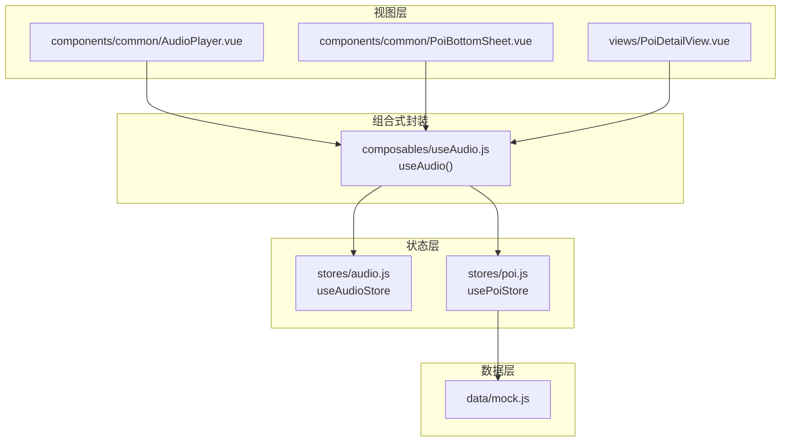
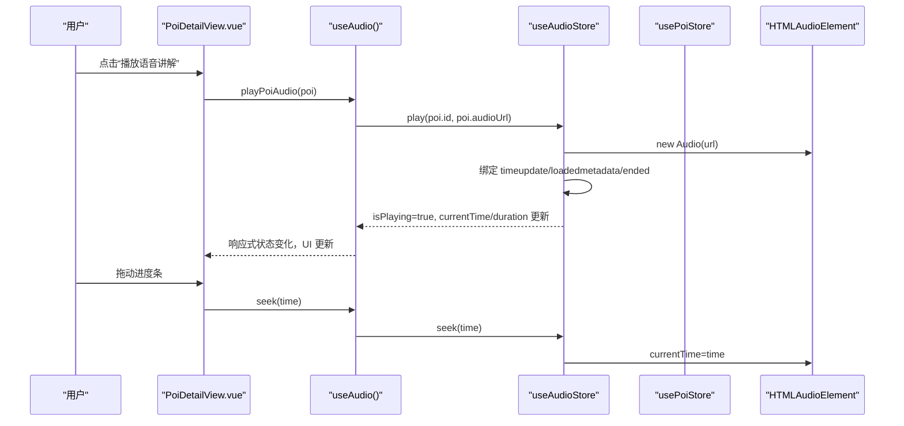
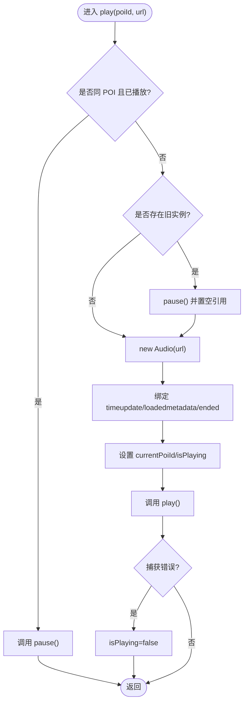
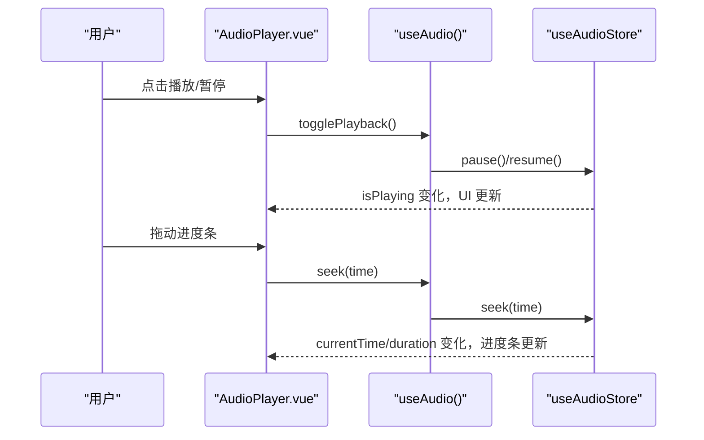
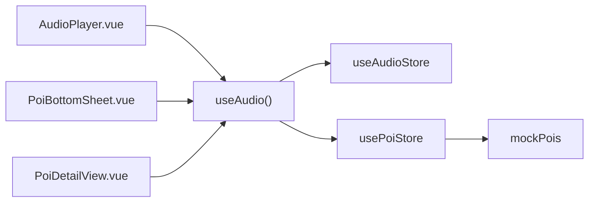

# 音频状态管理 (audio.js)

<cite>
**本文引用的文件**
- [src/stores/audio.js](file://src/stores/audio.js)
- [src/composables/useAudio.js](file://src/composables/useAudio.js)
- [src/components/common/AudioPlayer.vue](file://src/components/common/AudioPlayer.vue)
- [src/stores/poi.js](file://src/stores/poi.js)
- [src/data/mock.js](file://src/data/mock.js)
- [src/components/common/PoiBottomSheet.vue](file://src/components/common/PoiBottomSheet.vue)
- [src/views/PoiDetailView.vue](file://src/views/PoiDetailView.vue)
</cite>

## 目录
1. [简介](#简介)
2. [项目结构](#项目结构)
3. [核心组件](#核心组件)
4. [架构总览](#架构总览)
5. [详细组件分析](#详细组件分析)
6. [依赖关系分析](#依赖关系分析)
7. [性能与内存管理](#性能与内存管理)
8. [故障排查指南](#故障排查指南)
9. [结论](#结论)
10. [附录：API 接口与使用示例](#附录api-接口与使用示例)

## 简介
本模块基于 Pinia 的 useAudioStore 实现全局音频状态管理，结合 Vue 组合式函数 useAudio 提供便捷 API，并在 UI 层通过 AudioPlayer、PoiBottomSheet、PoiDetailView 等组件完成交互。该设计实现了“单一真实数据源 + 集中式状态”的模式，确保多组件共享一致的播放状态、进度与当前 POI 信息。

## 项目结构
围绕音频能力的相关文件组织如下：
- 状态层：stores/audio.js（Pinia store）
- 组合式封装：composables/useAudio.js（对外暴露便捷方法）
- 视图层：components/common/AudioPlayer.vue（播放器控件）、PoiBottomSheet.vue（底部弹窗中的语音控制）、views/PoiDetailView.vue（详情页语音入口）
- 数据层：stores/poi.js（POI 数据与查询）、data/mock.js（POI 样例数据）

图表来源
- [src/stores/audio.js:1-111](file://src/stores/audio.js#L1-L111)
- [src/composables/useAudio.js:1-59](file://src/composables/useAudio.js#L1-L59)
- [src/components/common/AudioPlayer.vue:1-104](file://src/components/common/AudioPlayer.vue#L1-L104)
- [src/components/common/PoiBottomSheet.vue:1-190](file://src/components/common/PoiBottomSheet.vue#L1-L190)
- [src/views/PoiDetailView.vue:1-136](file://src/views/PoiDetailView.vue#L1-L136)
- [src/stores/poi.js:1-84](file://src/stores/poi.js#L1-L84)
- [src/data/mock.js:1-349](file://src/data/mock.js#L1-L349)

章节来源
- [src/stores/audio.js:1-111](file://src/stores/audio.js#L1-L111)
- [src/composables/useAudio.js:1-59](file://src/composables/useAudio.js#L1-L59)
- [src/components/common/AudioPlayer.vue:1-104](file://src/components/common/AudioPlayer.vue#L1-L104)
- [src/stores/poi.js:1-84](file://src/stores/poi.js#L1-L84)
- [src/data/mock.js:1-349](file://src/data/mock.js#L1-L349)

## 核心组件
- useAudioStore（Pinia Store）
  - 职责：维护当前 POI ID、播放状态、播放进度、总时长；封装原生 Audio 实例的生命周期管理（创建、事件监听、销毁）。
  - 关键状态与方法：currentPoiId、isPlaying、currentTime、duration；play、pause、resume、stop、seek。
- useAudio（组合式函数）
  - 职责：对 useAudioStore 进行二次封装，提供 playPoiAudio、togglePlayback、getCurrentPoi、formatTime 等更贴近业务场景的方法。
- AudioPlayer（UI 组件）
  - 职责：展示当前 POI 名称、播放/暂停按钮、进度条、关闭按钮；将用户操作映射到 audioStore 的 seek、stop、togglePlayback。
- PoiBottomSheet / PoiDetailView
  - 职责：在 POI 列表底部弹窗和详情页中触发语音播放，并显示当前是否正在播放对应 POI。

章节来源
- [src/stores/audio.js:1-111](file://src/stores/audio.js#L1-L111)
- [src/composables/useAudio.js:1-59](file://src/composables/useAudio.js#L1-L59)
- [src/components/common/AudioPlayer.vue:1-104](file://src/components/common/AudioPlayer.vue#L1-L104)
- [src/components/common/PoiBottomSheet.vue:1-190](file://src/components/common/PoiBottomSheet.vue#L1-L190)
- [src/views/PoiDetailView.vue:1-136](file://src/views/PoiDetailView.vue#L1-L136)

## 架构总览
整体采用“Store 集中状态 + Composable 业务封装 + 组件驱动 UI”的分层架构。Store 负责最小化的状态与行为，Composable 聚合 Store 与 POI 数据，组件仅关注渲染与用户交互。

图表来源
- [src/views/PoiDetailView.vue:51-79](file://src/views/PoiDetailView.vue#L51-L79)
- [src/composables/useAudio.js:1-59](file://src/composables/useAudio.js#L1-L59)
- [src/stores/audio.js:1-111](file://src/stores/audio.js#L1-L111)

## 详细组件分析

### 状态与生命周期管理（useAudioStore）
- 状态字段
  - currentPoiId：当前播放的 POI 标识
  - isPlaying：是否正在播放
  - currentTime：当前播放时间（秒）
  - duration：音频总时长（秒）
- 生命周期
  - 加载：调用 play(poiId, url) 时创建 HTMLAudioElement，绑定 timeupdate、loadedmetadata、ended 事件，设置 isPlaying=true
  - 播放：调用 play().catch(...) 处理浏览器自动播放策略限制
  - 暂停：pause() 停止播放并将 isPlaying 置为 false
  - 恢复：resume() 再次调用 play() 并更新 isPlaying
  - 跳转：seek(time) 直接修改 currentTime 并同步状态
  - 停止：stop() 释放 audioInstance，重置所有状态
- 事件与进度
  - timeupdate：实时更新 currentTime
  - loadedmetadata：获取 duration
  - ended：播放结束重置 isPlaying 与 currentTime

图表来源
- [src/stores/audio.js:25-58](file://src/stores/audio.js#L25-L58)

章节来源
- [src/stores/audio.js:1-111](file://src/stores/audio.js#L1-L111)

### 组合式封装（useAudio）
- playPoiAudio(poi)：校验 poi.audioUrl 存在后调用 store.play
- togglePlayback()：根据 isPlaying 切换 pause/resume
- getCurrentPoi()：通过 currentPoiId 从 poiStore 获取 POI 对象
- formatTime(seconds)：将秒格式化为 mm:ss

章节来源
- [src/composables/useAudio.js:1-59](file://src/composables/useAudio.js#L1-L59)

### UI 组件与交互

#### AudioPlayer.vue
- 展示当前 POI 名称、播放/暂停图标、时间进度
- 进度条：计算 progress = currentTime/duration * 100，拖动时调用 seek
- 关闭：调用 stop 释放资源并重置状态

图表来源
- [src/components/common/AudioPlayer.vue:1-104](file://src/components/common/AudioPlayer.vue#L1-L104)
- [src/composables/useAudio.js:1-59](file://src/composables/useAudio.js#L1-L59)
- [src/stores/audio.js:1-111](file://src/stores/audio.js#L1-L111)

章节来源
- [src/components/common/AudioPlayer.vue:1-104](file://src/components/common/AudioPlayer.vue#L1-L104)

#### PoiBottomSheet.vue 与 PoiDetailView.vue
- 底部弹窗与详情页均提供“语音讲解”入口，点击后调用 playPoiAudio(poi)
- 通过 isPlaying && currentPoiId === poi.id 判断当前是否在播放该 POI，以切换图标文案

章节来源
- [src/components/common/PoiBottomSheet.vue:56-103](file://src/components/common/PoiBottomSheet.vue#L56-L103)
- [src/views/PoiDetailView.vue:51-79](file://src/views/PoiDetailView.vue#L51-L79)

## 依赖关系分析
- useAudioStore 依赖 Vue 响应式 ref 与 Pinia defineStore
- useAudio 依赖 useAudioStore 与 usePoiStore
- 组件依赖 useAudio 提供的便捷方法
- POI 数据由 mockPois 提供，store 提供按 id 查询能力

图表来源
- [src/components/common/AudioPlayer.vue:28-46](file://src/components/common/AudioPlayer.vue#L28-L46)
- [src/components/common/PoiBottomSheet.vue:56-103](file://src/components/common/PoiBottomSheet.vue#L56-L103)
- [src/views/PoiDetailView.vue:51-79](file://src/views/PoiDetailView.vue#L51-L79)
- [src/composables/useAudio.js:1-59](file://src/composables/useAudio.js#L1-L59)
- [src/stores/audio.js:1-111](file://src/stores/audio.js#L1-L111)
- [src/stores/poi.js:1-84](file://src/stores/poi.js#L1-L84)
- [src/data/mock.js:1-349](file://src/data/mock.js#L1-L349)

章节来源
- [src/stores/audio.js:1-111](file://src/stores/audio.js#L1-L111)
- [src/composables/useAudio.js:1-59](file://src/composables/useAudio.js#L1-L59)
- [src/stores/poi.js:1-84](file://src/stores/poi.js#L1-L84)
- [src/data/mock.js:1-349](file://src/data/mock.js#L1-L349)

## 性能与内存管理
- 单例 Audio 实例：store 内仅维护一个 audioInstance，切换或停止时及时释放，避免多实例导致的内存泄漏
- 事件监听：仅在创建新实例时绑定 timeupdate/loadedmetadata/ended，停止时通过释放实例解除监听
- 进度更新：timeupdate 高频触发，但仅更新响应式变量，开销较小
- 预加载策略：当前未实现显式预加载；可在后续扩展中增加 preload 属性或预创建 Audio 实例缓存
- 循环播放：当前未实现；可在 ended 事件中根据配置决定是否重新播放
- 音量与倍速：当前未暴露相关 API；可在 store 中增加 volume/playbackRate 状态与方法

[本节为通用建议，不直接分析具体代码]

## 故障排查指南
- 自动播放被阻止
  - 现象：调用 play() 失败，isPlaying 被置为 false
  - 原因：浏览器策略限制（需用户手势触发）
  - 处理：确保由用户点击触发播放；必要时提示用户允许自动播放
  - 参考位置
    - [src/stores/audio.js:55-57](file://src/stores/audio.js#L55-L57)
- 音频 URL 为空
  - 现象：无法播放
  - 处理：在 useAudio.playPoiAudio 中校验 poi.audioUrl 后再调用 store.play
  - 参考位置
    - [src/composables/useAudio.js:16-19](file://src/composables/useAudio.js#L16-L19)
- 进度条异常
  - 现象：duration 为 0 导致进度计算异常
  - 处理：在组件中当 duration 为 0 时返回 0，等待 loadedmetadata 后再计算
  - 参考位置
    - [src/components/common/AudioPlayer.vue:37-40](file://src/components/common/AudioPlayer.vue#L37-L40)
- 播放结束后状态未重置
  - 现象：isPlaying 仍为 true
  - 处理：确保 ended 事件回调重置 isPlaying 与 currentTime
  - 参考位置
    - [src/stores/audio.js:50-53](file://src/stores/audio.js#L50-L53)

章节来源
- [src/stores/audio.js:50-57](file://src/stores/audio.js#L50-L57)
- [src/composables/useAudio.js:16-19](file://src/composables/useAudio.js#L16-L19)
- [src/components/common/AudioPlayer.vue:37-40](file://src/components/common/AudioPlayer.vue#L37-L40)

## 结论
本模块通过 Pinia store 统一管理音频状态，结合组合式函数简化业务调用，组件层专注交互与展示。当前实现了基础的播放、暂停、恢复、跳转与停止流程，以及与 POI 数据的关联。未来可在此基础上扩展音量、倍速、循环、预加载与错误上报等高级能力。

[本节为总结性内容，不直接分析具体代码]

## 附录：API 接口与使用示例

### useAudioStore API
- 状态
  - currentPoiId：当前播放 POI 的 id
  - isPlaying：是否正在播放
  - currentTime：当前播放时间（秒）
  - duration：音频总时长（秒）
- 方法
  - play(poiId, url)：开始播放指定 POI 的音频
  - pause()：暂停播放
  - resume()：恢复播放
  - stop()：停止并释放资源
  - seek(time)：跳转到指定时间（秒）

章节来源
- [src/stores/audio.js:25-97](file://src/stores/audio.js#L25-L97)

### useAudio 组合式 API
- playPoiAudio(poi)：播放指定 POI 的语音讲解（若存在 audioUrl）
- togglePlayback()：切换播放/暂停
- getCurrentPoi()：获取当前正在播放的 POI 对象
- formatTime(seconds)：格式化时间为 mm:ss

章节来源
- [src/composables/useAudio.js:16-56](file://src/composables/useAudio.js#L16-L56)

### 组件使用示例
- 在详情页触发播放
  - 点击“语音讲解”卡片调用 playPoiAudio(poi)
  - 参考位置
    - [src/views/PoiDetailView.vue:72-75](file://src/views/PoiDetailView.vue#L72-L75)
- 在底部弹窗触发播放
  - 点击“语音讲解”按钮调用 playPoiAudio(poi)
  - 参考位置
    - [src/components/common/PoiBottomSheet.vue:88-91](file://src/components/common/PoiBottomSheet.vue#L88-L91)
- 播放器控件
  - 播放/暂停：togglePlayback()
  - 拖动进度：seek(time)
  - 关闭：stop()
  - 参考位置
    - [src/components/common/AudioPlayer.vue:32-45](file://src/components/common/AudioPlayer.vue#L32-L45)

章节来源
- [src/views/PoiDetailView.vue:51-79](file://src/views/PoiDetailView.vue#L51-L79)
- [src/components/common/PoiBottomSheet.vue:56-103](file://src/components/common/PoiBottomSheet.vue#L56-L103)
- [src/components/common/AudioPlayer.vue:28-46](file://src/components/common/AudioPlayer.vue#L28-L46)

### POI 数据与音频关联
- POI 数据结构包含 audioUrl 与 audioDuration 字段，用于指示是否有语音及预计时长
- 通过 usePoiStore.getPoiById 获取 POI 详情，配合 useAudio.getCurrentPoi 实现“当前播放 POI”的读取
- 参考位置
  - [src/data/mock.js:5-24](file://src/data/mock.js#L5-L24)
  - [src/stores/poi.js:33-36](file://src/stores/poi.js#L33-L36)

章节来源
- [src/data/mock.js:5-24](file://src/data/mock.js#L5-L24)
- [src/stores/poi.js:33-36](file://src/stores/poi.js#L33-L36)