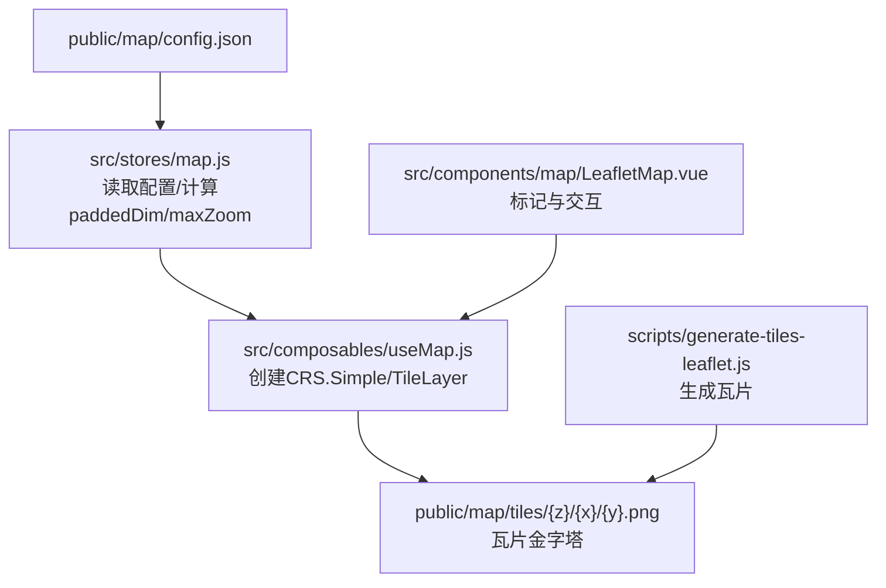
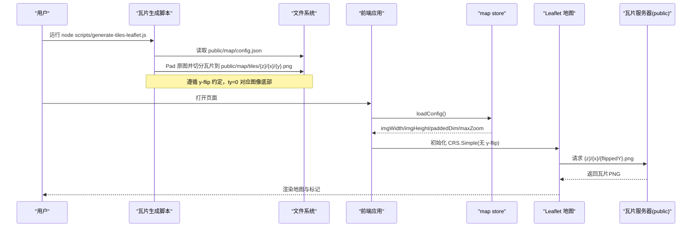
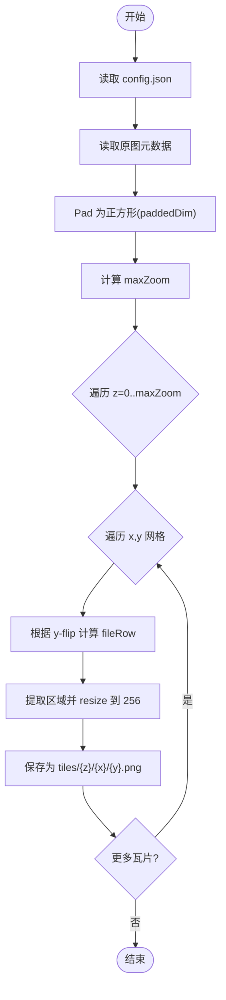
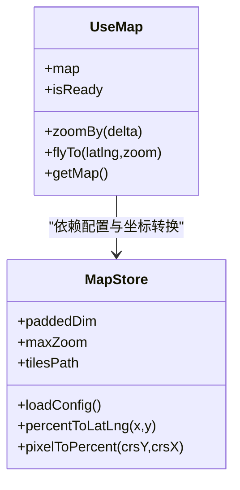
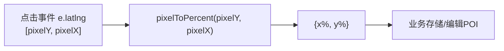
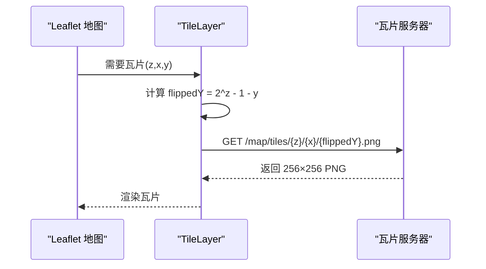
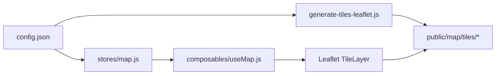

# 瓦片坐标系统

<cite>
**本文引用的文件**
- [public/map/config.json](file://public/map/config.json)
- [scripts/generate-tiles-leaflet.js](file://scripts/generate-tiles-leaflet.js)
- [src/composables/useMap.js](file://src/composables/useMap.js)
- [src/stores/map.js](file://src/stores/map.js)
- [src/components/map/LeafletMap.vue](file://src/components/map/LeafletMap.vue)
- [README.md](file://README.md)
</cite>

## 目录
1. [简介](#简介)
2. [项目结构](#项目结构)
3. [核心组件](#核心组件)
4. [架构总览](#架构总览)
5. [详细组件分析](#详细组件分析)
6. [依赖关系分析](#依赖关系分析)
7. [性能考量](#性能考量)
8. [故障排查指南](#故障排查指南)
9. [结论](#结论)
10. [附录](#附录)

## 简介
本文件聚焦 FunMapUI 项目的“瓦片坐标系统”，基于 Leaflet 的 CRS.Simple 实现自定义像素坐标系，完成手绘地图的瓦片生成、加载与渲染。文档将解释：
- 瓦片系统的技术架构（生成、加载、渲染）
- 坐标转换算法（屏幕坐标与地图坐标互转）
- 瓦片配置文件 config.json 的结构与作用
- 瓦片生成脚本的工作原理与使用方法
- 缩放级别与瓦片层级管理策略
- 坐标计算示例与性能优化建议
- 常见问题排查与调试技巧

## 项目结构
本项目采用前后端分离的前端工程结构，地图资源位于 public/map，瓦片金字塔输出到 public/map/tiles；前端通过 Vue + Leaflet 初始化地图并加载瓦片层；脚本层提供 Node.js 瓦片生成工具。

图表来源
- [public/map/config.json:1-5](file://public/map/config.json#L1-L5)
- [src/stores/map.js:40-85](file://src/stores/map.js#L40-L85)
- [src/composables/useMap.js:20-70](file://src/composables/useMap.js#L20-L70)
- [scripts/generate-tiles-leaflet.js:21-122](file://scripts/generate-tiles-leaflet.js#L21-L122)

章节来源
- [README.md:42-99](file://README.md#L42-L99)

## 核心组件
- 瓦片配置：public/map/config.json，定义源图片路径、瓦片输出路径与最大原生缩放级别。
- 状态管理：src/stores/map.js，负责加载配置、计算 paddedDim、bounds、maxZoom，并提供百分比与像素坐标互转。
- 地图初始化：src/composables/useMap.js，构建自定义 CRS.Simple、设置 TileLayer、覆盖 getTileUrl 以匹配 y-flip 约定、处理触摸双指缩放与初始视图。
- 地图交互：src/components/map/LeafletMap.vue，在地图上添加 POI 标记、处理点击事件并将屏幕坐标转换为百分比坐标。
- 瓦片生成：scripts/generate-tiles-leaflet.js，读取配置，Pad 为正方形，按标准瓦片金字塔切割并输出 256×256 PNG。

章节来源
- [public/map/config.json:1-5](file://public/map/config.json#L1-L5)
- [src/stores/map.js:40-103](file://src/stores/map.js#L40-L103)
- [src/composables/useMap.js:20-70](file://src/composables/useMap.js#L20-L70)
- [src/components/map/LeafletMap.vue:61-116](file://src/components/map/LeafletMap.vue#L61-L116)
- [scripts/generate-tiles-leaflet.js:21-122](file://scripts/generate-tiles-leaflet.js#L21-L122)

## 架构总览
整体流程分为“离线生成”和“在线加载”两条主线：
- 离线生成：Node.js 脚本读取配置，Pad 原图为正方形，按 z/x/y 金字塔切分 256px 瓦片，遵循 CRS.Simple 的 y-flip 约定（ty=0 对应图像底部）。
- 在线加载：Vue 应用启动后加载配置，计算 paddedDim 与 maxZoom，创建自定义 CRS.Simple（无 y-flip），使用 TileLayer 加载瓦片并在 getTileUrl 中翻转 y 坐标以匹配文件存储顺序。

图表来源
- [scripts/generate-tiles-leaflet.js:21-122](file://scripts/generate-tiles-leaflet.js#L21-L122)
- [src/stores/map.js:40-85](file://src/stores/map.js#L40-L85)
- [src/composables/useMap.js:20-70](file://src/composables/useMap.js#L20-L70)

## 详细组件分析

### 瓦片生成脚本（scripts/generate-tiles-leaflet.js）
- 读取配置：从 public/map/config.json 获取 image、tilesPath、maxZoom。
- 计算尺寸与层级：读取原图宽高，Pad 为正方形边长 paddedDim = max(imgW, imgH)，计算 maxZoom 使每片约 256px。
- 生成瓦片：对每个 z，按 2^z × 2^z 网格遍历，依据 y-flip 将 ty=0 映射到图像底部行，提取区域并 resize 到 256×256 输出 PNG。若瓦片与原图无交集则输出透明瓦片避免灰块。
- 输出日志：打印每级有效瓦片数、最终总数、maxNativeZoom 与 paddedDim。

图表来源
- [scripts/generate-tiles-leaflet.js:21-122](file://scripts/generate-tiles-leaflet.js#L21-L122)

章节来源
- [scripts/generate-tiles-leaflet.js:1-128](file://scripts/generate-tiles-leaflet.js#L1-L128)

### 地图初始化与坐标系统（src/composables/useMap.js）
- 自定义 CRS：继承 L.CRS.Simple，设置 projection.bounds 为 [0,0]→[paddedDim,paddedDim]，transformation 使用 (scale,0,scale,0) 且无 y-flip，infinite=false。
- TileLayer：使用模板 URL /map/tiles/{z}/{x}/{y}.png，设置 tileSize=256，noWrap=true，maxNativeZoom=maxZoom（超出由 CSS 放大）。
- 覆盖 getTileUrl：将 Leaflet 计算的 coords.y 翻转为 tilesPath 中的 y（因为脚本按 y-flip 存储），即 flippedY = 2^z - 1 - coords.y。
- 触摸缩放：禁用内置 touchZoom，自定义双指手势，超过阈值触发 zoomIn/zoomOut 一级。
- 初始视图：setView 到原图中心（imgHeight/2, imgWidth/2），zoom=maxZoom。

图表来源
- [src/composables/useMap.js:20-70](file://src/composables/useMap.js#L20-L70)
- [src/stores/map.js:40-103](file://src/stores/map.js#L40-L103)

章节来源
- [src/composables/useMap.js:1-174](file://src/composables/useMap.js#L1-L174)

### 瓦片配置文件（public/map/config.json）
- image：源图片相对路径，用于脚本与前端加载。
- tilesPath：瓦片输出目录前缀，脚本写入该路径，前端 TileLayer 从此路径加载。
- maxZoom：可选的最大原生缩放级别；未设置时由脚本与前端自动计算（基于 paddedDim 与 256px 瓦片尺寸）。

章节来源
- [public/map/config.json:1-5](file://public/map/config.json#L1-L5)

### 坐标转换算法
- 百分比 → 像素坐标：store.percentToLatLng(x%, y%) 返回 [pixelY, pixelX]，其中 pixelY = (y%/100)*imgHeight，pixelX = (x%/100)*imgWidth。
- 像素 → 百分比：store.pixelToPercent(crsY, crsX) 返回 {x%, y%}，分别除以 imgWidth/imgHeight 再乘以 100。
- 屏幕坐标 → 地图坐标：LeafletMap 中点击事件 e.latlng 即为 CRS.Simple 下的像素坐标 [pixelY, pixelX]，调用 pixelToPercent 得到百分比坐标用于业务存储或编辑。

图表来源
- [src/components/map/LeafletMap.vue:108-116](file://src/components/map/LeafletMap.vue#L108-L116)
- [src/stores/map.js:93-103](file://src/stores/map.js#L93-L103)

章节来源
- [src/components/map/LeafletMap.vue:61-116](file://src/components/map/LeafletMap.vue#L61-L116)
- [src/stores/map.js:87-103](file://src/stores/map.js#L87-L103)

### 瓦片加载与渲染机制
- TileLayer 模板：/map/tiles/{z}/{x}/{y}.png，但实际通过覆盖 getTileUrl 将 coords.y 翻转为文件 y，确保与脚本生成的 y-flip 一致。
- 缩放限制：maxNativeZoom 限制瓦片请求级别，超出级别由 Leaflet 通过 CSS 放大显示，避免额外请求。
- 瓦片可见性：noWrap=true 防止横向重复拼接；tileSize=256 与脚本输出一致。

图表来源
- [src/composables/useMap.js:47-68](file://src/composables/useMap.js#L47-L68)

章节来源
- [src/composables/useMap.js:47-70](file://src/composables/useMap.js#L47-L70)

### 缩放级别与瓦片层级管理策略
- 最大原生缩放：脚本与前端均基于 paddedDim 与 256px 瓦片尺寸计算 maxZoom，保证在 maxZoom 时每片瓦片约 256px。
- 前端扩展：useMap 中将 maxZoom+4 作为可交互上限，超出部分由 CSS 放大，减少瓦片数量同时保持视觉细节。
- 无级缩放：zoomSnap=0，zoomDelta=0.5，滚轮 wheelPxPerZoomLevel=60，提供更平滑的缩放体验。
- 触摸缩放：自定义双指手势，超过阈值触发整级缩放，提升移动端操作一致性。

章节来源
- [scripts/generate-tiles-leaflet.js:37-43](file://scripts/generate-tiles-leaflet.js#L37-L43)
- [src/composables/useMap.js:34-45](file://src/composables/useMap.js#L34-L45)
- [src/composables/useMap.js:72-111](file://src/composables/useMap.js#L72-L111)
- [src/stores/map.js:70-78](file://src/stores/map.js#L70-L78)

### 坐标计算示例
- 示例一：将 POI 的百分比坐标 (x=25%, y=60%) 转换为像素坐标
  - pixelX = 0.25 * imgWidth
  - pixelY = 0.60 * imgHeight
  - 返回 [pixelY, pixelX] 用于 Leaflet marker 定位
- 示例二：点击地图空白处获得像素坐标 [pixelY, pixelX]，转换为百分比
  - x% = (pixelX / imgWidth) * 100
  - y% = (pixelY / imgHeight) * 100
  - 用于编辑模式新增 POI

章节来源
- [src/stores/map.js:93-103](file://src/stores/map.js#L93-L103)
- [src/components/map/LeafletMap.vue:108-116](file://src/components/map/LeafletMap.vue#L108-L116)

## 依赖关系分析
- 脚本依赖 sharp 进行图像处理，Node fs/path 模块进行文件读写。
- 前端依赖 Leaflet 地图引擎与 Pinia 状态管理。
- 配置驱动：config.json 统一控制源图片、瓦片路径与缩放上限，前后端保持一致。

图表来源
- [scripts/generate-tiles-leaflet.js:12-27](file://scripts/generate-tiles-leaflet.js#L12-L27)
- [src/stores/map.js:40-85](file://src/stores/map.js#L40-L85)
- [src/composables/useMap.js:47-70](file://src/composables/useMap.js#L47-L70)

章节来源
- [scripts/generate-tiles-leaflet.js:12-27](file://scripts/generate-tiles-leaflet.js#L12-L27)
- [src/stores/map.js:40-85](file://src/stores/map.js#L40-L85)
- [src/composables/useMap.js:47-70](file://src/composables/useMap.js#L47-L70)

## 性能考量
- 瓦片尺寸与层级：固定 256px 瓦片，合理设置 maxZoom 避免过多小瓦片导致网络与内存压力。
- 超出级别放大：maxNativeZoom 限制瓦片请求，超出级别由 CSS 放大，减少请求量。
- 透明瓦片：脚本对无交集瓦片输出透明 PNG，避免灰色占位影响渲染。
- 触摸缩放优化：禁用默认 touchZoom，自定义手势减少抖动与误触。
- 滚动灵敏度：wheelPxPerZoomLevel 调整缩放速度，平衡精度与效率。

## 故障排查指南
- 瓦片不显示或显示灰色
  - 检查 config.json 的 image 与 tilesPath 是否正确
  - 确认脚本已执行并生成 tiles/{z}/{x}/{y}.png
  - 查看浏览器控制台是否有瓦片请求失败
- 瓦片错位或上下颠倒
  - 确认 getTileUrl 中 y 坐标翻转逻辑与脚本 y-flip 一致
  - 核对 paddedDim 与 bounds 是否与实际图片尺寸匹配
- 缩放异常或无法继续放大
  - 检查 maxZoom 与 maxNativeZoom 设置
  - 确认 useMap 中 zoomSnap、zoomDelta、wheelPxPerZoomLevel 配置
- 调试技巧
  - 监听 zoomend 事件输出当前缩放、瓦片总数、成功与失败数量
  - 检查 console 日志中的 [MapDebug] 信息，定位问题层级

章节来源
- [src/composables/useMap.js:113-120](file://src/composables/useMap.js#L113-L120)
- [scripts/generate-tiles-leaflet.js:86-101](file://scripts/generate-tiles-leaflet.js#L86-L101)
- [src/stores/map.js:40-85](file://src/stores/map.js#L40-L85)

## 结论
FunMapUI 的瓦片坐标系统通过 Leaflet CRS.Simple 实现了精确的像素坐标系，结合脚本化的瓦片生成与前端 TileLayer 的 y-flip 适配，形成了稳定高效的地图渲染方案。通过配置驱动的缩放管理与坐标转换，系统在移动端具备良好的交互体验与可扩展性。建议在后续迭代中持续监控瓦片请求与渲染性能，并根据实际图片尺寸与业务需求优化 maxZoom 与缩放策略。

## 附录
- 快速开始
  - 安装依赖：npm install
  - 启动开发服务器：npm run dev
  - 生成瓦片：node scripts/generate-tiles-leaflet.js
- 替换全景图
  - 将全景图片放入 public/panorama/，并在 PanoramaView 中配置映射

章节来源
- [README.md:110-148](file://README.md#L110-L148)