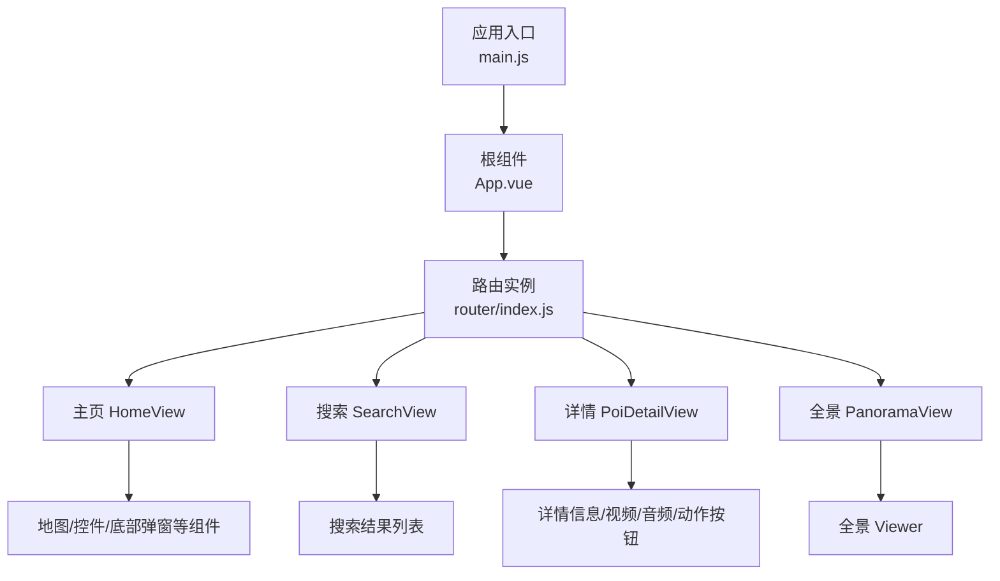
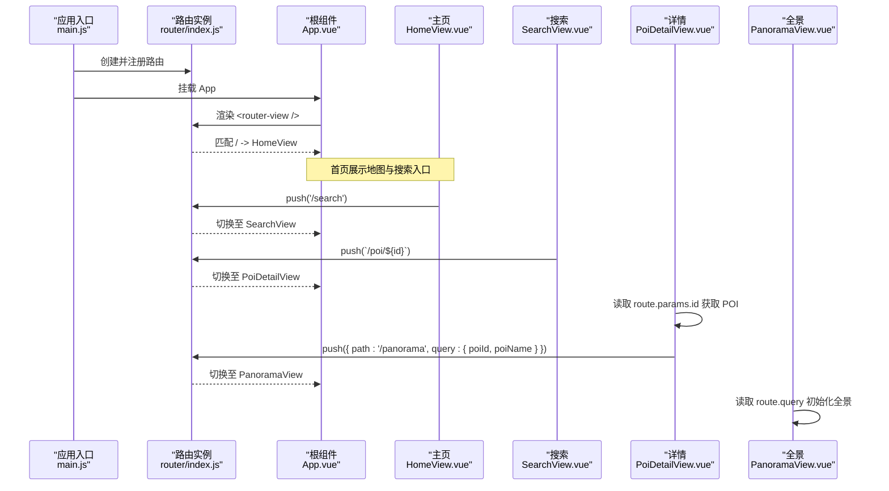
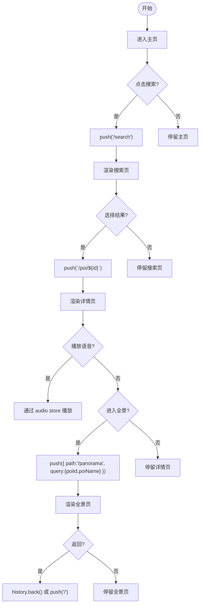
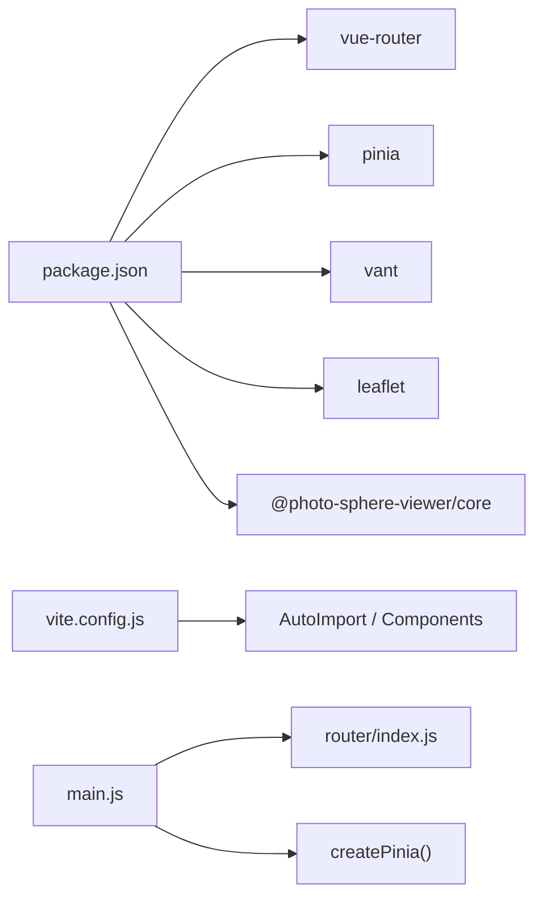

# 路由系统设计

<cite>
**本文引用的文件**
- [src/router/index.js](file://src/router/index.js)
- [src/main.js](file://src/main.js)
- [src/App.vue](file://src/App.vue)
- [src/views/HomeView.vue](file://src/views/HomeView.vue)
- [src/views/PoiDetailView.vue](file://src/views/PoiDetailView.vue)
- [src/views/SearchView.vue](file://src/views/SearchView.vue)
- [src/views/PanoramaView.vue](file://src/views/PanoramaView.vue)
- [src/stores/poi.js](file://src/stores/poi.js)
- [src/stores/audio.js](file://src/stores/audio.js)
- [vite.config.js](file://vite.config.js)
- [package.json](file://package.json)
</cite>

## 目录
1. [简介](#简介)
2. [项目结构](#项目结构)
3. [核心组件](#核心组件)
4. [架构总览](#架构总览)
5. [详细组件分析](#详细组件分析)
6. [依赖关系分析](#依赖关系分析)
7. [性能考虑](#性能考虑)
8. [故障排查指南](#故障排查指南)
9. [结论](#结论)
10. [附录](#附录)

## 简介
本文件面向 FunMapUI 项目的路由系统，基于 Vue Router 4 与 Vite 构建。文档聚焦以下目标：
- 页面路由定义与导航逻辑（主页、详情页、搜索页、全景页）
- 动态路由参数传递与处理（POI 详情 id）
- 路由守卫与权限控制现状与建议
- 路由懒加载与代码分割策略
- 页面间数据传递与状态保持机制
- 路由流程图与导航示例
- 路由性能优化与 SEO 建议

## 项目结构
本项目采用按功能划分的目录组织方式：
- src/router：路由配置入口
- src/views：页面级视图组件
- src/components：可复用业务组件
- src/stores：Pinia 全局状态
- src/composables：组合式函数
- vite.config.js：Vite 构建与插件配置
- package.json：依赖声明（含 vue-router、pinia 等）

图表来源
- [src/main.js:1-21](file://src/main.js#L1-L21)
- [src/App.vue:1-5](file://src/App.vue#L1-L5)
- [src/router/index.js:1-32](file://src/router/index.js#L1-L32)

章节来源
- [src/main.js:1-21](file://src/main.js#L1-L21)
- [src/App.vue:1-5](file://src/App.vue#L1-L5)
- [src/router/index.js:1-32](file://src/router/index.js#L1-L32)

## 核心组件
- 路由配置：使用 createWebHistory 模式，集中定义四个页面路由，并采用动态导入实现懒加载。
- 应用挂载：在 main.js 中创建 Pinia 和 Router 实例并安装到应用中。
- 根视图：App.vue 仅包含 router-view，用于渲染当前路由对应的页面。

关键要点
- 路由历史模式：createWebHistory 提供干净的 URL（无 #）。
- 懒加载：每个路由的 component 通过 () => import(...) 按需加载，减少首屏体积。
- 动态路由：/poi/:id 用于 POI 详情，id 通过 route.params.id 获取。
- 查询参数：全景页通过 route.query.poiId、route.query.poiName 接收参数。

章节来源
- [src/router/index.js:1-32](file://src/router/index.js#L1-L32)
- [src/main.js:1-21](file://src/main.js#L1-L21)
- [src/App.vue:1-5](file://src/App.vue#L1-L5)

## 架构总览
下图展示了从应用启动到页面渲染的路由流程，以及页面间的导航关系。

图表来源
- [src/main.js:1-21](file://src/main.js#L1-L21)
- [src/App.vue:1-5](file://src/App.vue#L1-L5)
- [src/router/index.js:1-32](file://src/router/index.js#L1-L32)
- [src/views/HomeView.vue:50-82](file://src/views/HomeView.vue#L50-L82)
- [src/views/SearchView.vue:65-92](file://src/views/SearchView.vue#L65-L92)
- [src/views/PoiDetailView.vue:51-79](file://src/views/PoiDetailView.vue#L51-L79)
- [src/views/PanoramaView.vue:25-60](file://src/views/PanoramaView.vue#L25-L60)

## 详细组件分析

### 路由定义与懒加载
- 路由表集中管理，路径与名称清晰：
  - 主页：/
  - 搜索：/search
  - 详情：/poi/:id
  - 全景：/panorama
- 懒加载：所有路由组件均采用动态 import，配合 Vite 自动进行代码分割，提升首屏性能。

章节来源
- [src/router/index.js:1-32](file://src/router/index.js#L1-L32)
- [vite.config.js:1-27](file://vite.config.js#L1-L27)
- [package.json:11-21](file://package.json#L11-L21)

### 主页（HomeView）
- 导航行为：点击搜索栏触发 goSearch，调用 router.push('/search') 进入搜索页。
- 与地图交互：通过 ref 获取地图实例进行缩放等操作；编辑模式下弹出 POI 编辑对话框。
- 状态共享：通过 Pinia store 添加新 POI，便于其他页面检索与展示。

章节来源
- [src/views/HomeView.vue:49-96](file://src/views/HomeView.vue#L49-L96)
- [src/stores/poi.js:65-68](file://src/stores/poi.js#L65-L68)

### 搜索页（SearchView）
- 搜索逻辑：监听输入变化，调用 store.searchPois 过滤结果。
- 导航行为：点击某条结果，router.push(`/poi/${poi.id}`) 跳转到详情页，携带动态 id。
- 空态与提示：根据关键词与结果集显示不同 UI。

章节来源
- [src/views/SearchView.vue:65-100](file://src/views/SearchView.vue#L65-L100)
- [src/stores/poi.js:53-63](file://src/stores/poi.js#L53-L63)

### 详情页（PoiDetailView）
- 动态参数：通过 useRoute().params.id 获取 POI id，并使用 store.getPoiById(id) 获取详情数据。
- 媒体播放：集成视频与音频播放，音频状态通过 Pinia 的 audio store 跨页面共享。
- 导航返回：顶部导航栏左侧箭头调用 router.back()。

章节来源
- [src/views/PoiDetailView.vue:51-79](file://src/views/PoiDetailView.vue#L51-L79)
- [src/stores/audio.js:1-111](file://src/stores/audio.js#L1-L111)

### 全景页（PanoramaView）
- 参数获取：通过 route.query.poiId 与 route.query.poiName 获取全景资源与标题。
- 初始化：在 onMounted 中创建全景 Viewer，并在 onUnmounted 销毁实例，避免内存泄漏。
- 返回逻辑：优先使用 history.back()，若无可回退则跳转至主页。

章节来源
- [src/views/PanoramaView.vue:25-95](file://src/views/PanoramaView.vue#L25-L95)

### 页面间数据传递与状态保持
- 路由参数：
  - 动态段：/poi/:id → route.params.id
  - 查询串：/panorama?poiId=...&poiName=... → route.query
- 全局状态（Pinia）：
  - POI 数据与分类、搜索能力集中在 poi store，供多页面共享。
  - 音频播放状态集中在 audio store，支持跨页面播放控制。
- 组件内局部状态：如搜索关键词、全屏提示等，随组件生命周期存在。

章节来源
- [src/stores/poi.js:1-84](file://src/stores/poi.js#L1-L84)
- [src/stores/audio.js:1-111](file://src/stores/audio.js#L1-L111)
- [src/views/SearchView.vue:65-100](file://src/views/SearchView.vue#L65-L100)
- [src/views/PoiDetailView.vue:51-79](file://src/views/PoiDetailView.vue#L51-L79)
- [src/views/PanoramaView.vue:25-60](file://src/views/PanoramaView.vue#L25-L60)

### 路由守卫与权限控制
- 现状：当前路由配置未定义全局或独享守卫，也没有权限校验逻辑。
- 建议方案：
  - 全局前置守卫：在 router/index.js 中使用 router.beforeEach 进行登录态检查、角色校验、白名单放行。
  - 元信息：为路由添加 meta 字段（如 requiresAuth、roles），在守卫中统一判断。
  - 重定向：未授权时重定向至登录页或错误页。
  - 异步守卫：结合 store 的异步方法完成用户信息预取。

[本节为通用实践建议，不直接分析具体文件]

### 路由懒加载与代码分割
- 动态 import：每个路由组件以函数形式引入，Vite 会将其拆分为独立 chunk。
- 优势：降低首屏包体，按需加载页面，提升首次渲染速度。
- 注意事项：确保静态资源（图片、音频、全景图）正确打包与缓存策略。

章节来源
- [src/router/index.js:1-32](file://src/router/index.js#L1-L32)
- [vite.config.js:1-27](file://vite.config.js#L1-L27)

### 导航流程图与示例

图表来源
- [src/views/HomeView.vue:50-82](file://src/views/HomeView.vue#L50-L82)
- [src/views/SearchView.vue:65-92](file://src/views/SearchView.vue#L65-L92)
- [src/views/PoiDetailView.vue:51-79](file://src/views/PoiDetailView.vue#L51-L79)
- [src/views/PanoramaView.vue:25-60](file://src/views/PanoramaView.vue#L25-L60)

## 依赖关系分析
- 运行时依赖：vue、vue-router、pinia、vant、leaflet、@photo-sphere-viewer/core。
- 构建工具：vite 与 @vitejs/plugin-vue。
- 自动导入：unplugin-auto-import 与 unplugin-vue-components 简化组件与 API 使用。

图表来源
- [package.json:11-21](file://package.json#L11-L21)
- [vite.config.js:1-27](file://vite.config.js#L1-L27)
- [src/main.js:1-21](file://src/main.js#L1-L21)
- [src/router/index.js:1-32](file://src/router/index.js#L1-L32)

章节来源
- [package.json:11-21](file://package.json#L11-L21)
- [vite.config.js:1-27](file://vite.config.js#L1-L27)
- [src/main.js:1-21](file://src/main.js#L1-L21)

## 性能考虑
- 路由懒加载：已对页面组件使用动态 import，减少首屏体积。
- 资源加载：
  - 全景图片与音视频建议使用 CDN 与合适的缓存头。
  - 地图瓦片与图标资源按需加载，避免阻塞。
- 组件拆分：将大组件（如地图、全景）进一步拆分为子组件，配合 Suspense 或占位骨架屏提升感知性能。
- 路由历史模式：createWebHistory 利于 SEO 与分享链接可读性。
- 构建优化：开启 gzip/brotli 压缩，合理分包与缓存策略。

[本节为通用优化建议，不直接分析具体文件]

## 故障排查指南
- 动态参数为空：
  - 现象：详情页无法获取 POI 数据。
  - 排查：确认路由跳转是否携带正确的 id，检查 route.params.id 是否存在。
- 全景页参数丢失：
  - 现象：标题或全景资源不正确。
  - 排查：检查跳转时 query 是否正确传递，确认 route.query.poiId 与 route.query.poiName。
- 音频跨页中断：
  - 现象：切换页面后音频停止或状态不一致。
  - 排查：确认 audio store 的状态更新与事件绑定，确保在组件卸载时清理。
- 路由跳转无效：
  - 现象：router.push 无响应。
  - 排查：确认是否在组件 setup 中正确使用 useRouter/useRoute，检查路由配置是否一致。

章节来源
- [src/views/PoiDetailView.vue:51-79](file://src/views/PoiDetailView.vue#L51-L79)
- [src/views/PanoramaView.vue:25-60](file://src/views/PanoramaView.vue#L25-L60)
- [src/stores/audio.js:1-111](file://src/stores/audio.js#L1-L111)

## 结论
FunMapUI 的路由系统基于 Vue Router 4 实现了清晰的页面划分与懒加载策略，并通过 Pinia 实现了跨页面的状态共享。当前未实现路由守卫与权限控制，建议在后续迭代中补充全局前置守卫与元信息校验。结合 Vite 的代码分割与合理的资源管理，可在保证体验的同时持续优化性能与可维护性。

## 附录
- 常用导航示例（路径引用）
  - 主页跳转搜索：参考 [src/views/HomeView.vue:80-82](file://src/views/HomeView.vue#L80-L82)
  - 搜索跳转详情：参考 [src/views/SearchView.vue:90-92](file://src/views/SearchView.vue#L90-L92)
  - 详情返回上一页：参考 [src/views/PoiDetailView.vue:4-11](file://src/views/PoiDetailView.vue#L4-L11)
  - 全景返回逻辑：参考 [src/views/PanoramaView.vue:54-60](file://src/views/PanoramaView.vue#L54-L60)
- 路由配置位置：[src/router/index.js:1-32](file://src/router/index.js#L1-L32)
- 应用挂载与插件安装：[src/main.js:1-21](file://src/main.js#L1-L21)