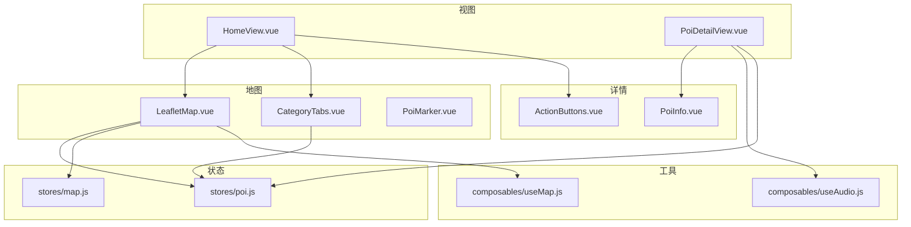
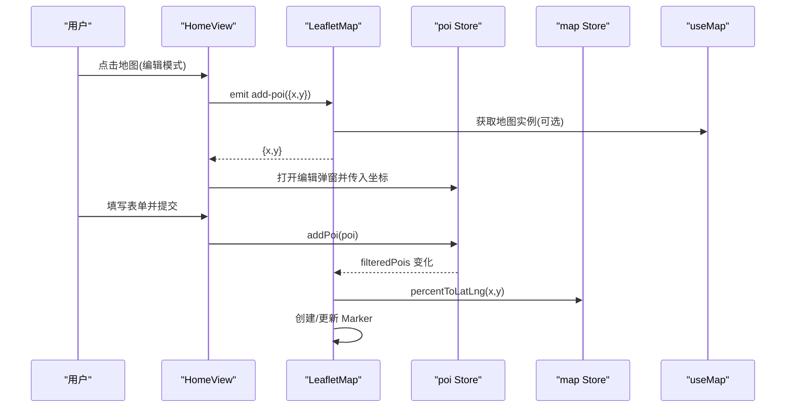
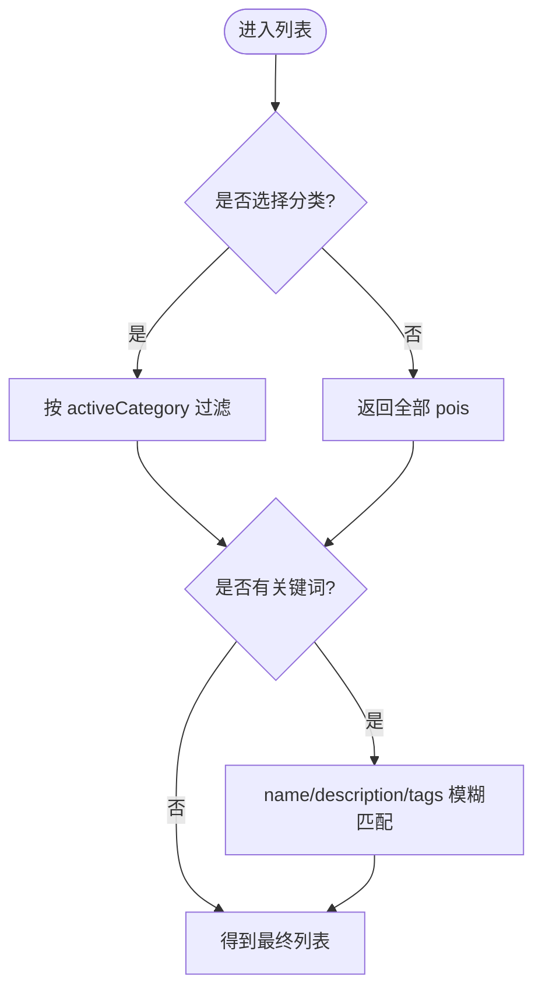
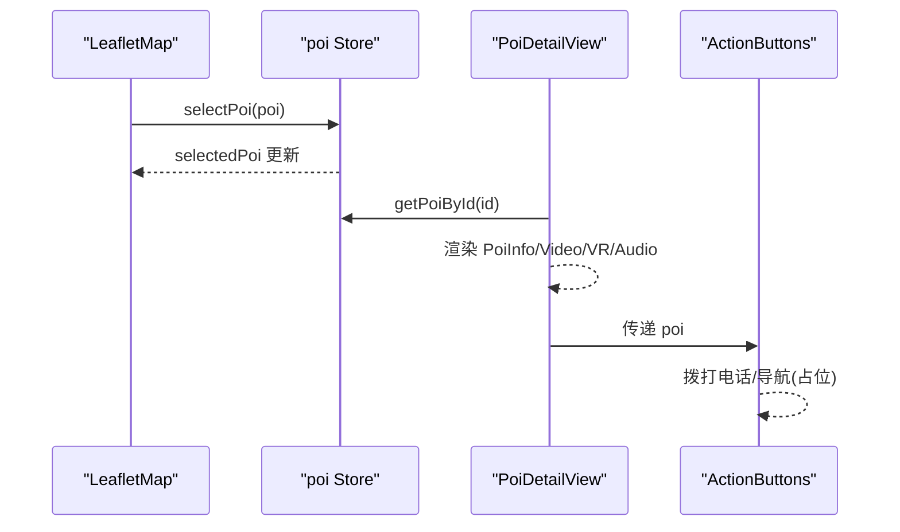
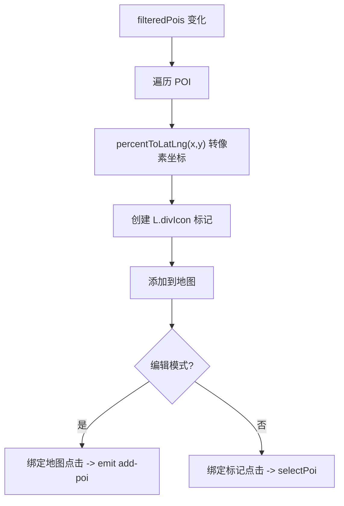
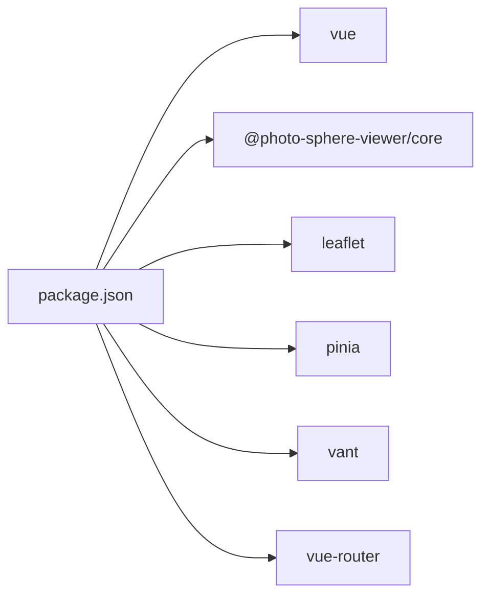

# POI 管理系统

<cite>
**本文引用的文件**
- [src/stores/poi.js](file://src/stores/poi.js)
- [src/data/mock.js](file://src/data/mock.js)
- [src/components/map/LeafletMap.vue](file://src/components/map/LeafletMap.vue)
- [src/components/map/PoiMarker.vue](file://src/components/map/PoiMarker.vue)
- [src/components/map/PoiEditDialog.vue](file://src/components/map/PoiEditDialog.vue)
- [src/components/map/CategoryTabs.vue](file://src/components/map/CategoryTabs.vue)
- [src/components/detail/PoiInfo.vue](file://src/components/detail/PoiInfo.vue)
- [src/components/detail/ActionButtons.vue](file://src/components/detail/ActionButtons.vue)
- [src/views/HomeView.vue](file://src/views/HomeView.vue)
- [src/views/PoiDetailView.vue](file://src/views/PoiDetailView.vue)
- [src/composables/useMap.js](file://src/composables/useMap.js)
- [src/stores/map.js](file://src/stores/map.js)
- [src/composables/useAudio.js](file://src/composables/useAudio.js)
- [package.json](file://package.json)
</cite>

## 目录
1. [简介](#简介)
2. [项目结构](#项目结构)
3. [核心组件](#核心组件)
4. [架构总览](#架构总览)
5. [详细组件分析](#详细组件分析)
6. [依赖关系分析](#依赖关系分析)
7. [性能考虑](#性能考虑)
8. [故障排查指南](#故障排查指南)
9. [结论](#结论)
10. [附录](#附录)

## 简介
本系统基于 Vue 3 + Pinia + Leaflet 构建，提供手绘地图上的 POI（兴趣点）管理功能。支持按分类筛选、关键词搜索、地图标记展示与点击交互、详情查看、编辑新增、语音播放等能力。POI 数据采用内存存储（可替换为后端持久化），坐标使用百分比坐标并通过 MapStore 转换为 Leaflet 像素坐标进行渲染。

## 项目结构
- 状态管理：Pinia Store（poi、map、audio）
- 视图层：HomeView、PoiDetailView、SearchView、PanoramaView
- 组件层：地图容器与标记、分类 Tab、搜索栏、详情信息、编辑弹窗、操作按钮
- 组合式函数：useMap（Leaflet 初始化与交互）、useAudio（音频播放封装）
- 数据层：mock POI 数据与地图配置

图表来源
- [src/views/HomeView.vue:1-136](file://src/views/HomeView.vue#L1-L136)
- [src/components/map/LeafletMap.vue:1-141](file://src/components/map/LeafletMap.vue#L1-L141)
- [src/components/map/CategoryTabs.vue:1-59](file://src/components/map/CategoryTabs.vue#L1-L59)
- [src/components/detail/PoiInfo.vue:1-130](file://src/components/detail/PoiInfo.vue#L1-L130)
- [src/components/detail/ActionButtons.vue:1-79](file://src/components/detail/ActionButtons.vue#L1-L79)
- [src/stores/poi.js:1-84](file://src/stores/poi.js#L1-L84)
- [src/stores/map.js:1-122](file://src/stores/map.js#L1-L122)
- [src/composables/useMap.js:1-174](file://src/composables/useMap.js#L1-L174)
- [src/composables/useAudio.js:1-59](file://src/composables/useAudio.js#L1-L59)

章节来源
- [src/views/HomeView.vue:1-136](file://src/views/HomeView.vue#L1-L136)
- [src/stores/poi.js:1-84](file://src/stores/poi.js#L1-L84)
- [src/stores/map.js:1-122](file://src/stores/map.js#L1-L122)
- [src/composables/useMap.js:1-174](file://src/composables/useMap.js#L1-L174)

## 核心组件
- POI 状态与业务逻辑：分类定义、过滤、选中、搜索、新增
- 地图渲染：Leaflet 自定义 CRS.Simple、瓦片加载、标记更新、点击交互
- 详情展示：封面图、标签、描述、地址、电话、视频、VR、语音
- 编辑新增：表单校验、分类选择、坐标回填、提交到 Store
- 分类筛选：底部 Tab 切换，联动 Store 的过滤结果
- 搜索入口：跳转搜索页（当前实现占位）

章节来源
- [src/stores/poi.js:1-84](file://src/stores/poi.js#L1-L84)
- [src/components/map/LeafletMap.vue:1-141](file://src/components/map/LeafletMap.vue#L1-L141)
- [src/components/detail/PoiInfo.vue:1-130](file://src/components/detail/PoiInfo.vue#L1-L130)
- [src/components/map/PoiEditDialog.vue:1-173](file://src/components/map/PoiEditDialog.vue#L1-L173)
- [src/components/map/CategoryTabs.vue:1-59](file://src/components/map/CategoryTabs.vue#L1-L59)
- [src/views/HomeView.vue:1-136](file://src/views/HomeView.vue#L1-L136)

## 架构总览
系统以 Pinia Store 为中心，视图通过 Composable 与 Store 协作完成数据流与 UI 更新。地图层基于 Leaflet 的 CRS.Simple 坐标系，将 POI 的百分比坐标转换为像素坐标进行渲染；详情页面聚合多媒体内容与操作按钮。

图表来源
- [src/views/HomeView.vue:88-96](file://src/views/HomeView.vue#L88-L96)
- [src/components/map/LeafletMap.vue:108-129](file://src/components/map/LeafletMap.vue#L108-L129)
- [src/stores/poi.js:65-68](file://src/stores/poi.js#L65-L68)
- [src/stores/map.js:93-103](file://src/stores/map.js#L93-L103)
- [src/composables/useMap.js:14-45](file://src/composables/useMap.js#L14-L45)

## 详细组件分析

### POI 数据结构与分类体系
- 字段说明
  - id：唯一标识
  - name：名称
  - category：分类键值（如 scenic、food、hotel、shopping、toilet、parking、service）
  - description：描述
  - x、y：百分比坐标（0-100）
  - image：封面图 URL
  - audioUrl、audioDuration：语音讲解地址与时长
  - videoUrl：视频地址
  - vrUrl：VR 全景地址
  - phone、address、openTime：联系方式、地址、营业时间
  - tags：标签数组
- 分类系统
  - 在 Store 中集中维护，包含 key、label、icon、color
  - 支持“全部”与具体分类切换
- 数据验证规则
  - 名称必填（编辑弹窗内置校验）
  - 分类必填（编辑弹窗内置校验）
  - 标签支持逗号分隔输入，自动去空白与空项
  - 其他字段可选

章节来源
- [src/data/mock.js:1-349](file://src/data/mock.js#L1-L349)
- [src/stores/poi.js:6-16](file://src/stores/poi.js#L6-L16)
- [src/components/map/PoiEditDialog.vue:10-50](file://src/components/map/PoiEditDialog.vue#L10-L50)
- [src/components/map/PoiEditDialog.vue:127-154](file://src/components/map/PoiEditDialog.vue#L127-L154)

### 增删改查与筛选搜索
- 查询
  - 分类筛选：computed 根据 activeCategory 过滤 pois
  - 关键词搜索：searchPois 对 name、description、tags 进行模糊匹配
  - 按 ID 获取：getPoiById 用于详情页定位
- 新增
  - 编辑弹窗收集表单数据，生成新 POI 对象，emit 回父组件后调用 addPoi 写入 Store
- 删除/修改
  - 当前未实现删除与批量修改接口，可在 Store 扩展相应方法
- 排序
  - 当前无地理位置排序实现；可按需基于经纬度计算距离排序

图表来源
- [src/stores/poi.js:27-63](file://src/stores/poi.js#L27-L63)

章节来源
- [src/stores/poi.js:27-63](file://src/stores/poi.js#L27-L63)

### 状态管理与选中/编辑模式
- 选中状态
  - selectedPoi 保存当前选中的 POI，供底部弹窗或详情页使用
- 编辑模式
  - HomeView 控制 editMode，切换时给 LeafletMap 绑定/解绑地图点击事件
  - 编辑模式下点击地图触发 onAddPoi，弹出 PoiEditDialog 并传入坐标
- 批量操作
  - 当前未实现批量选择与批量编辑，可扩展多选与批量提交

章节来源
- [src/stores/poi.js:24-51](file://src/stores/poi.js#L24-L51)
- [src/views/HomeView.vue:66-96](file://src/views/HomeView.vue#L66-L96)
- [src/components/map/LeafletMap.vue:108-129](file://src/components/map/LeafletMap.vue#L108-L129)

### 地图标记双向绑定与详情展示
- 双向绑定
  - 监听 filteredPois 变化，统一更新地图标记
  - 点击标记调用 selectPoi，更新选中状态
  - 坐标转换由 mapStore.percentToLatLng 完成
- 详情展示
  - PoiDetailView 通过路由参数获取 POI，渲染基本信息、视频、VR、语音
  - ActionButtons 提供导航与电话拨打（当前导航为占位提示）

图表来源
- [src/components/map/LeafletMap.vue:88-94](file://src/components/map/LeafletMap.vue#L88-L94)
- [src/stores/poi.js:43-51](file://src/stores/poi.js#L43-L51)
- [src/views/PoiDetailView.vue:51-79](file://src/views/PoiDetailView.vue#L51-L79)
- [src/components/detail/ActionButtons.vue:21-39](file://src/components/detail/ActionButtons.vue#L21-L39)

章节来源
- [src/components/map/LeafletMap.vue:31-94](file://src/components/map/LeafletMap.vue#L31-L94)
- [src/views/PoiDetailView.vue:1-136](file://src/views/PoiDetailView.vue#L1-L136)
- [src/components/detail/PoiInfo.vue:1-130](file://src/components/detail/PoiInfo.vue#L1-L130)
- [src/components/detail/ActionButtons.vue:1-79](file://src/components/detail/ActionButtons.vue#L1-L79)

### 地图坐标系统与渲染流程
- 坐标系统
  - POI 使用百分比坐标 (x, y)，通过 mapStore.percentToLatLng 转为 Leaflet 像素坐标
  - 地图使用 CRS.Simple，bounds 基于图片尺寸 pad 成正方形
- 渲染流程
  - 监听 filteredPois，遍历 POI 计算像素坐标，创建 L.divIcon 自定义标记
  - 标记点击触发选中，编辑模式点击地图触发新增
- 缩放与触控
  - 自定义双指缩放阈值，达到阈值后固定缩放一级
  - 瓦片路径与 y 翻转适配预生成的瓦片目录结构

图表来源
- [src/components/map/LeafletMap.vue:31-94](file://src/components/map/LeafletMap.vue#L31-L94)
- [src/components/map/LeafletMap.vue:108-129](file://src/components/map/LeafletMap.vue#L108-L129)
- [src/stores/map.js:93-103](file://src/stores/map.js#L93-L103)
- [src/composables/useMap.js:20-45](file://src/composables/useMap.js#L20-L45)

章节来源
- [src/components/map/LeafletMap.vue:1-141](file://src/components/map/LeafletMap.vue#L1-L141)
- [src/stores/map.js:1-122](file://src/stores/map.js#L1-L122)
- [src/composables/useMap.js:1-174](file://src/composables/useMap.js#L1-L174)

### 分类筛选与搜索界面
- 分类筛选
  - CategoryTabs 渲染分类，点击调用 setCategory 更新 activeCategory
  - Store 的 computed 自动过滤 pois
- 搜索
  - SearchBar 作为入口跳转到搜索页（当前为占位）
  - Store 提供 searchPois 实现本地模糊搜索

章节来源
- [src/components/map/CategoryTabs.vue:1-59](file://src/components/map/CategoryTabs.vue#L1-L59)
- [src/stores/poi.js:27-63](file://src/stores/poi.js#L27-L63)
- [src/components/common/SearchBar.vue:1-47](file://src/components/common/SearchBar.vue#L1-L47)
- [src/views/HomeView.vue:4-7](file://src/views/HomeView.vue#L4-L7)

### 编辑弹窗与表单处理
- 表单字段：名称、分类、描述、地址、电话、标签
- 分类选择器：排除“全部”，仅允许真实分类
- 提交：生成新 POI 对象，emit confirm 到父组件，再由父组件调用 addPoi
- 校验：名称与分类必填，标签自动清洗

章节来源
- [src/components/map/PoiEditDialog.vue:1-173](file://src/components/map/PoiEditDialog.vue#L1-L173)
- [src/views/HomeView.vue:88-96](file://src/views/HomeView.vue#L88-L96)
- [src/stores/poi.js:65-68](file://src/stores/poi.js#L65-L68)

## 依赖关系分析
- 组件依赖
  - HomeView 依赖 LeafletMap、CategoryTabs、PoiEditDialog、SearchBar、AudioPlayer
  - PoiDetailView 依赖 PoiInfo、ActionButtons、useAudio
  - LeafletMap 依赖 useMap、poi Store、map Store
- 外部库
  - Vue、Vue Router、Pinia、Vant、Leaflet、Photo Sphere Viewer（VR）

图表来源
- [package.json:1-28](file://package.json#L1-L28)

章节来源
- [package.json:1-28](file://package.json#L1-L28)

## 性能考虑
- 标记渲染优化
  - 统一在 watch filteredPois 中批量移除旧标记并重建，避免频繁 DOM 操作
  - 使用 Canvas 测量文字宽度自适应标记容器，减少布局抖动
- 地图缩放与瓦片
  - 自定义双指缩放阈值，减少不必要的缩放层级
  - maxNativeZoom 限制瓦片级别，超出级别通过 CSS 放大，降低请求量
- 数据访问
  - 使用 computed 缓存过滤结果，避免重复计算
- 建议
  - 大数据量时可引入虚拟滚动或分页加载
  - 搜索可加入防抖与索引结构（如倒排索引）提升性能

[本节为通用指导，不直接分析具体文件]

## 故障排查指南
- 地图无法显示或瓦片缺失
  - 检查 /map/config.json 是否存在且正确，确认 tilesPath 与图片路径
  - 观察控制台日志，核对 zoom、maxZoom、maxNativeZoom 与瓦片数量
- 标记不显示或位置错误
  - 确认 POI 的 x、y 是否在 0-100 范围内
  - 检查 mapStore.imgWidth/imgHeight 是否正确加载
- 编辑模式点击无效
  - 确认 editMode 切换时已正确绑定/解绑地图 click 事件
- 语音无法播放
  - 检查 POI.audioUrl 是否为空，确认音频资源可达

章节来源
- [src/composables/useMap.js:113-120](file://src/composables/useMap.js#L113-L120)
- [src/stores/map.js:40-85](file://src/stores/map.js#L40-L85)
- [src/components/map/LeafletMap.vue:108-129](file://src/components/map/LeafletMap.vue#L108-L129)
- [src/composables/useAudio.js:16-19](file://src/composables/useAudio.js#L16-L19)

## 结论
该系统以简洁的 Store 驱动 UI，结合 Leaflet 的自定义坐标系实现了手绘地图上的 POI 管理。当前已具备分类筛选、关键词搜索、标记展示与点击、详情展示、编辑新增、语音播放等核心能力。后续可扩展删除与批量操作、地理位置排序、后端持久化与更丰富的多媒体内容。

[本节为总结性内容，不直接分析具体文件]

## 附录

### 数据持久化方案
- 当前方案：内存存储（Pinia Store），刷新即丢失
- 推荐方案：
  - 前端：IndexedDB 或 localStorage 缓存热点数据
  - 后端：RESTful API 提供 CRUD 接口，Store 中封装异步方法
  - 同步策略：离线优先，网络恢复后增量同步

[本节为通用指导，不直接分析具体文件]

### 扩展开发指南
- 新增分类
  - 在 Store 的 categories 中添加条目，并在编辑弹窗中自动生效
- 新增字段
  - 在 mock 数据与编辑弹窗中补充字段，确保详情展示与表单一致
- 添加删除/批量操作
  - 在 Store 中增加 deletePoi、batchUpdate 等方法，并在 UI 中暴露入口
- 接入后端
  - 在 Store 中封装 fetch/axios 调用，替换本地数据源
  - 增加错误处理与重试机制

[本节为通用指导，不直接分析具体文件]