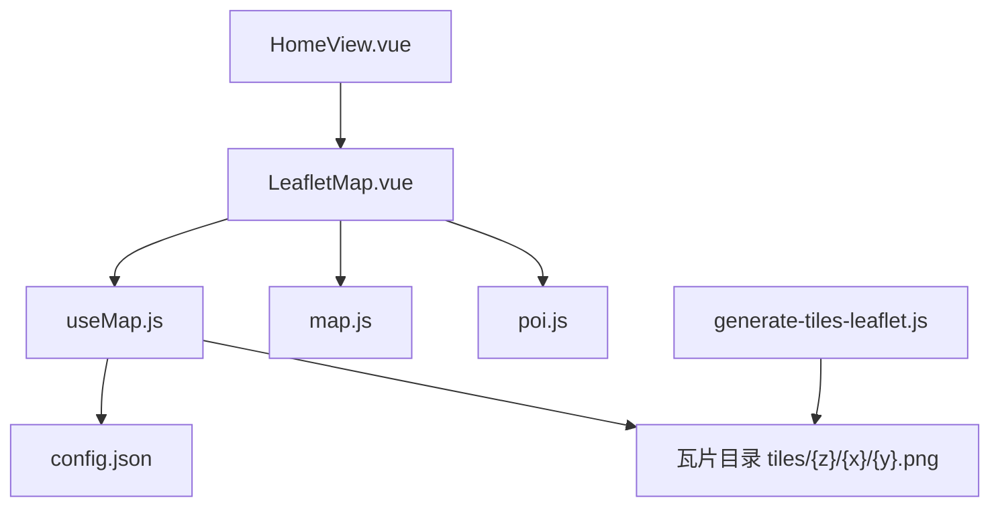
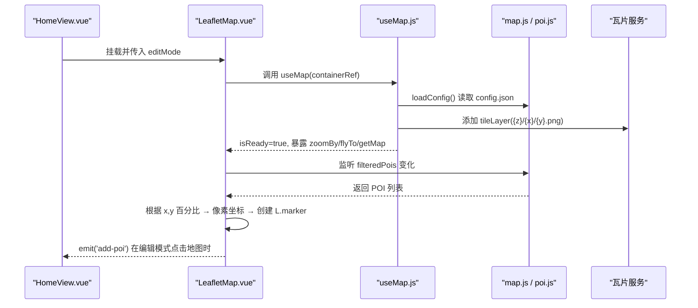
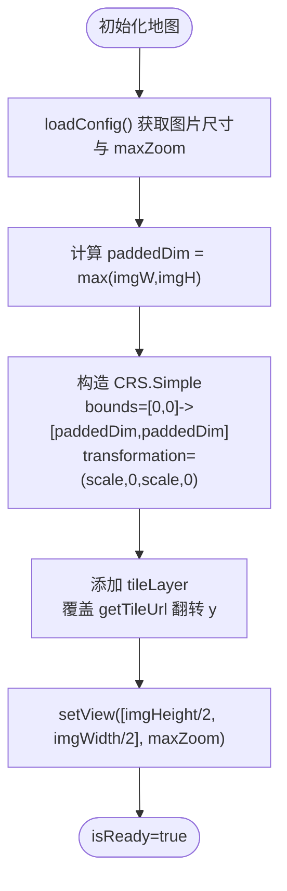
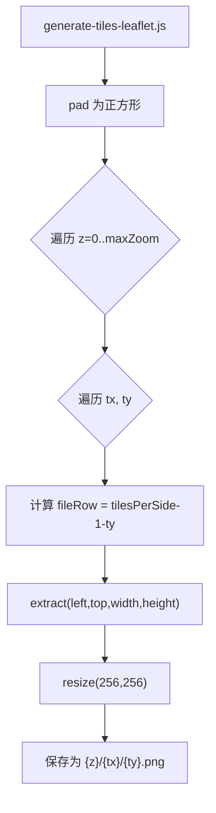
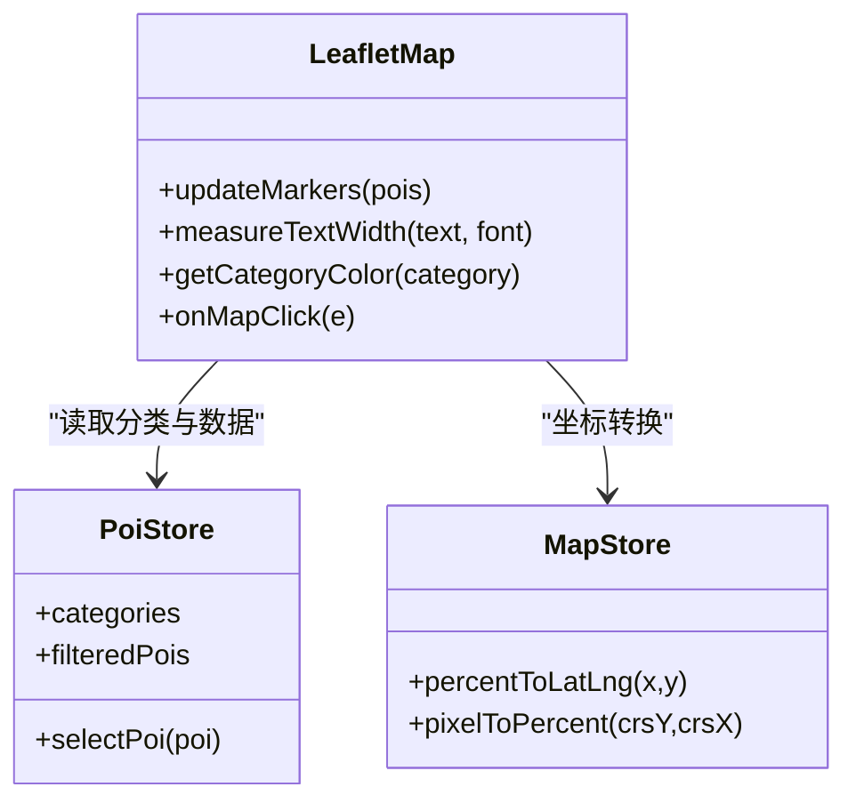
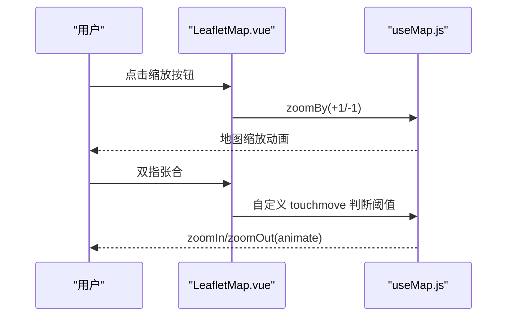
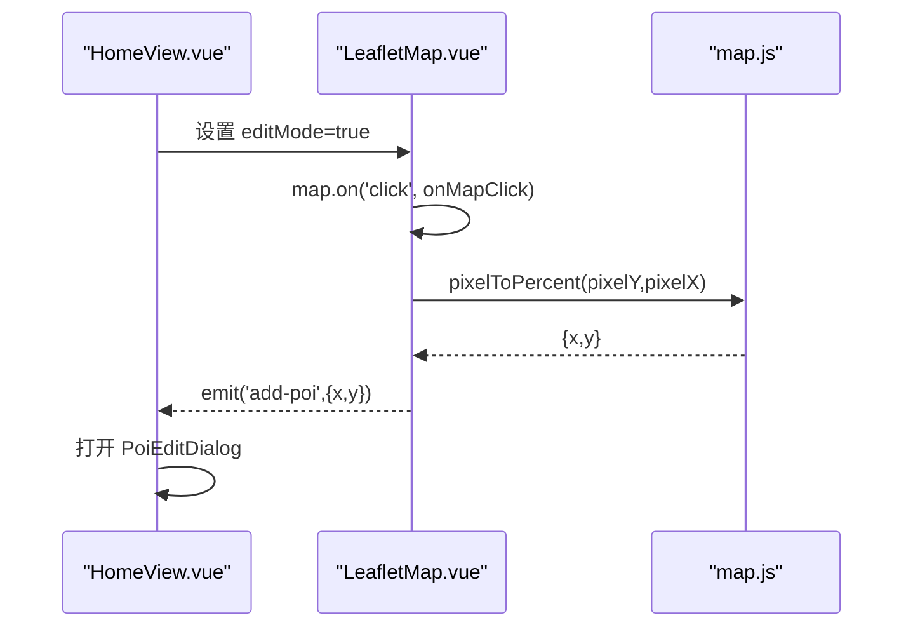
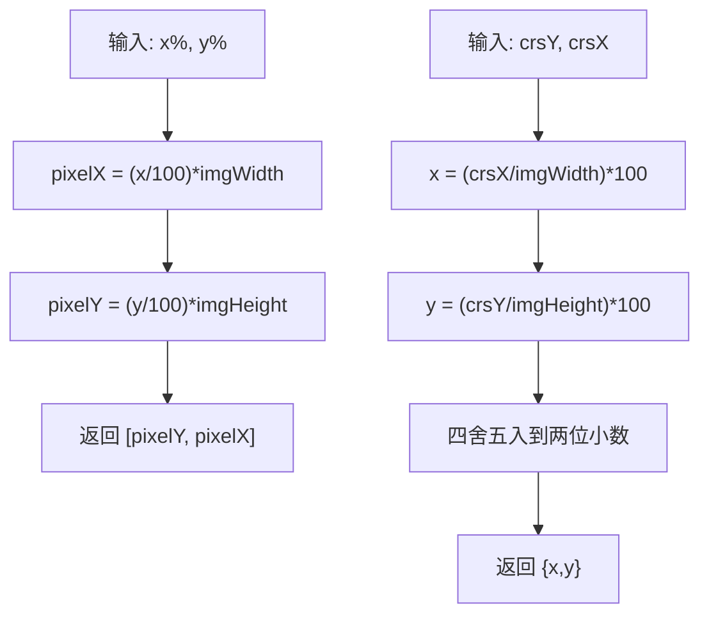
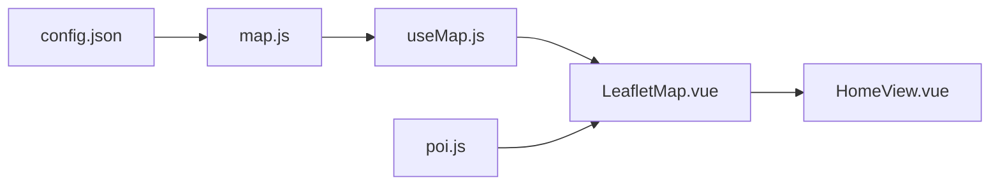

# 地图系统

<cite>
**本文引用的文件**
- [LeafletMap.vue](file://src/components/map/LeafletMap.vue)
- [useMap.js](file://src/composables/useMap.js)
- [map.js](file://src/stores/map.js)
- [poi.js](file://src/stores/poi.js)
- [HomeView.vue](file://src/views/HomeView.vue)
- [config.json](file://public/map/config.json)
- [generate-tiles-leaflet.js](file://scripts/generate-tiles-leaflet.js)
- [PoiMarker.vue](file://src/components/map/PoiMarker.vue)
- [README.md](file://README.md)
- [package.json](file://package.json)
</cite>

## 目录
1. [简介](#简介)
2. [项目结构](#项目结构)
3. [核心组件](#核心组件)
4. [架构总览](#架构总览)
5. [详细组件分析](#详细组件分析)
6. [依赖关系分析](#依赖关系分析)
7. [性能考量](#性能考量)
8. [故障排查指南](#故障排查指南)
9. [结论](#结论)
10. [附录：扩展示例与最佳实践](#附录：扩展示例与最佳实践)

## 简介
本系统基于 Leaflet 的 CRS.Simple 像素坐标系，将手绘地图切割为瓦片金字塔，实现移动端友好的多级缩放、POI 标记、分类筛选与编辑模式。通过自定义坐标转换（百分比 ↔ 像素）、瓦片 y 轴翻转适配、以及无级缩放与双指手势控制，提供流畅的手绘地图浏览体验。

## 项目结构
- 地图渲染层：LeafletMap.vue 负责 POI 标记渲染与点击事件；useMap.js 封装地图初始化、CRS.Simple 配置、瓦片加载与交互控制。
- 状态管理层：map.js 管理图片尺寸、paddedDim、CRS bounds、坐标转换；poi.js 管理 POI 数据、分类与搜索。
- 资源与脚本：public/map/config.json 定义图片路径、瓦片路径与最大缩放；scripts/generate-tiles-leaflet.js 生成瓦片金字塔并处理 y-flip。
- 页面集成：HomeView.vue 组合地图、控件、弹窗与底部 Tab，驱动编辑模式与 POI 添加流程。

图表来源
- [HomeView.vue:1-46](file://src/views/HomeView.vue#L1-L46)
- [LeafletMap.vue:1-133](file://src/components/map/LeafletMap.vue#L1-L133)
- [useMap.js:14-70](file://src/composables/useMap.js#L14-L70)
- [map.js:40-85](file://src/stores/map.js#L40-L85)
- [config.json:1-5](file://public/map/config.json#L1-L5)
- [generate-tiles-leaflet.js:29-122](file://scripts/generate-tiles-leaflet.js#L29-L122)

章节来源
- [README.md:1-184](file://README.md#L1-L184)
- [package.json:1-28](file://package.json#L1-L28)

## 核心组件
- LeafletMap.vue：创建 L.divIcon 动态宽度标签，监听 POI 变化更新标记，支持编辑模式下点击地图添加 POI。
- useMap.js：初始化 CRS.Simple 像素坐标系，设置 minZoom/maxZoom/zoomDelta/wheelPxPerZoomLevel，覆盖 getTileUrl 以翻转 y 坐标，实现双指缩放与 flyTo/zoomBy。
- map.js：加载配置、计算 paddedDim 与 maxZoom，提供 percentToLatLng 与 pixelToPercent 转换。
- poi.js：维护 POI 列表、分类、选中态与搜索过滤，供地图标记与详情面板消费。
- HomeView.vue：编排地图、控件、弹窗与分类 Tab，触发编辑模式与 POI 新增。

章节来源
- [LeafletMap.vue:1-133](file://src/components/map/LeafletMap.vue#L1-L133)
- [useMap.js:1-174](file://src/composables/useMap.js#L1-L174)
- [map.js:1-122](file://src/stores/map.js#L1-L122)
- [poi.js:1-84](file://src/stores/poi.js#L1-L84)
- [HomeView.vue:1-136](file://src/views/HomeView.vue#L1-L136)

## 架构总览
系统采用“视图-组合式-状态”分层：
- 视图层：HomeView.vue 聚合 UI 组件，LeafletMap.vue 承载地图渲染。
- 组合式层：useMap.js 封装 Leaflet 实例生命周期与交互逻辑。
- 状态层：map.js 与 poi.js 分别管理地图元数据与 POI 数据。
- 资源层：config.json 与瓦片目录提供静态资源；瓦片由 Node 脚本生成。

图表来源
- [HomeView.vue:10-46](file://src/views/HomeView.vue#L10-L46)
- [LeafletMap.vue:18-46](file://src/components/map/LeafletMap.vue#L18-L46)
- [useMap.js:14-70](file://src/composables/useMap.js#L14-L70)
- [map.js:40-85](file://src/stores/map.js#L40-L85)

## 详细组件分析

### Leaflet 地图初始化与 CRS.Simple 配置
- 使用 L.Util.extend 扩展 CRS.Simple，设置 projection.bounds 为 [0,0]→[paddedDim,paddedDim]，transformation 为 (scale,0,scale,0)，infinite=false，确保像素坐标与图片对齐。
- 设置 minZoom=0，maxZoom=maxNativeZoom+4，zoomSnap=0 允许无级缩放，zoomDelta=0.5 提升按钮缩放精度，wheelPxPerZoomLevel=60 调节滚轮灵敏度。
- 通过 tileLayer.getTileUrl 覆盖，按标准瓦片金字塔计算 flippedY = 2^z - 1 - y，匹配瓦片文件存储约定（ty=0 在顶部）。

图表来源
- [useMap.js:14-70](file://src/composables/useMap.js#L14-L70)
- [map.js:40-85](file://src/stores/map.js#L40-L85)

章节来源
- [useMap.js:14-70](file://src/composables/useMap.js#L14-L70)
- [map.js:40-85](file://src/stores/map.js#L40-L85)

### 瓦片系统的加载机制
- 瓦片目录遵循 {z}/{x}/{y}.png，maxNativeZoom 限制实际请求级别，超出级别由 CSS 放大显示。
- 瓦片生成脚本 sharp 将原图 pad 为正方形，按 z 级网格 2^z×2^z 切割，并对 y 轴进行翻转以匹配 CRS.Simple 的 y-flip 约定。
- 前端 getTileUrl 中再次翻转 y，保证瓦片内容与 Leaflet 定位区域一致。

图表来源
- [generate-tiles-leaflet.js:29-122](file://scripts/generate-tiles-leaflet.js#L29-L122)
- [useMap.js:47-68](file://src/composables/useMap.js#L47-L68)

章节来源
- [generate-tiles-leaflet.js:29-122](file://scripts/generate-tiles-leaflet.js#L29-L122)
- [useMap.js:47-68](file://src/composables/useMap.js#L47-L68)

### 自定义标记点的渲染逻辑
- 使用 L.divIcon 创建 HTML 标记，包含圆点与文字标签，文字宽度通过 Canvas measureText 自适应容器宽度。
- 根据 POI 分类从 store 取颜色，设置 iconSize 与 iconAnchor 使标签居中且锚点位于底部中心。
- 监听 marker click，阻止冒泡并选中 POI。

图表来源
- [LeafletMap.vue:48-116](file://src/components/map/LeafletMap.vue#L48-L116)
- [poi.js:6-31](file://src/stores/poi.js#L6-L31)
- [map.js:87-103](file://src/stores/map.js#L87-L103)

章节来源
- [LeafletMap.vue:48-116](file://src/components/map/LeafletMap.vue#L48-L116)
- [poi.js:6-31](file://src/stores/poi.js#L6-L31)

### 地图初始化流程、缩放与平移控制
- 初始化：onMounted 中先 loadConfig，再构造 CRS 与 tileLayer，最后 setView 到图片中心与 maxZoom。
- 缩放：zoomBy(delta) 直接调整 zoom；wheel 与按钮缩放受 zoomDelta 控制；touch 双指缩放通过自定义事件监听，超过阈值固定缩放一级。
- 平移：Leaflet 默认支持拖拽平移；flyTo(latlng,zoom) 用于平滑飞行到指定像素坐标。

图表来源
- [useMap.js:72-120](file://src/composables/useMap.js#L72-L120)
- [useMap.js:131-150](file://src/composables/useMap.js#L131-L150)

章节来源
- [useMap.js:72-120](file://src/composables/useMap.js#L72-L120)
- [useMap.js:131-150](file://src/composables/useMap.js#L131-L150)

### 点击事件处理与编辑模式
- 编辑模式开启时，绑定 map click；在 CRS.Simple 下 e.latlng 即为像素坐标 [pixelY, pixelX]。
- 通过 pixelToPercent 将像素坐标转为百分比坐标，emit('add-poi', {x,y}) 给父组件打开编辑弹窗。
- 关闭编辑模式时解绑 click，避免误触。

图表来源
- [LeafletMap.vue:105-129](file://src/components/map/LeafletMap.vue#L105-L129)
- [map.js:99-103](file://src/stores/map.js#L99-L103)
- [HomeView.vue:84-96](file://src/views/HomeView.vue#L84-L96)

章节来源
- [LeafletMap.vue:105-129](file://src/components/map/LeafletMap.vue#L105-L129)
- [HomeView.vue:84-96](file://src/views/HomeView.vue#L84-L96)

### 像素坐标与百分比坐标转换算法
- percentToLatLng(x%, y%)：将百分比坐标映射到像素坐标 [pixelY, pixelX]，其中 pixelX = (x/100)*imgWidth，pixelY = (y/100)*imgHeight。
- pixelToPercent(crsY, crsX)：将像素坐标反算为百分比，保留两位小数。
- 该转换是 POI 精确定位的核心，确保手绘地图上任意位置都能准确标注。

图表来源
- [map.js:87-103](file://src/stores/map.js#L87-L103)

章节来源
- [map.js:87-103](file://src/stores/map.js#L87-L103)

### 手绘地图上精确定位 POI 标记
- 在编辑模式下点击空白处，得到像素坐标后转换为百分比坐标，存入 pendingPoi 并打开编辑弹窗。
- 确认后将 POI 加入 store，LeafletMap 监听 filteredPois 变化，自动渲染新标记。
- 标记锚点与标签宽度自适应，确保在不同缩放级别下仍保持可读性与可点击性。

章节来源
- [LeafletMap.vue:105-116](file://src/components/map/LeafletMap.vue#L105-L116)
- [HomeView.vue:84-96](file://src/views/HomeView.vue#L84-L96)
- [LeafletMap.vue:61-95](file://src/components/map/LeafletMap.vue#L61-L95)

## 依赖关系分析
- 组件耦合：LeafletMap.vue 依赖 useMap.js 提供的地图实例与方法，依赖 map.js 的坐标转换与配置，依赖 poi.js 的 POI 数据与分类。
- 外部依赖：Leaflet 作为地图引擎；sharp 用于开发期瓦片生成；Vant 提供 UI 组件。
- 数据流：config.json → map.js → useMap.js → LeafletMap.vue；poi.js → LeafletMap.vue → HomeView.vue。

图表来源
- [map.js:40-85](file://src/stores/map.js#L40-L85)
- [useMap.js:14-70](file://src/composables/useMap.js#L14-L70)
- [LeafletMap.vue:18-46](file://src/components/map/LeafletMap.vue#L18-L46)
- [HomeView.vue:10-46](file://src/views/HomeView.vue#L10-L46)

章节来源
- [package.json:11-25](file://package.json#L11-L25)
- [map.js:40-85](file://src/stores/map.js#L40-L85)
- [useMap.js:14-70](file://src/composables/useMap.js#L14-L70)
- [LeafletMap.vue:18-46](file://src/components/map/LeafletMap.vue#L18-L46)
- [HomeView.vue:10-46](file://src/views/HomeView.vue#L10-L46)

## 性能考量
- 瓦片层级控制：maxNativeZoom 限制实际请求级别，超出级别由 CSS 放大，减少网络请求与内存占用。
- 无级缩放：zoomSnap=0 与 zoomDelta=0.5 提供更平滑的缩放体验，但需注意在高缩放级别下的瓦片质量。
- 触摸优化：禁用内置 touchZoom，使用自定义双指缩放逻辑，避免冲突与抖动。
- 标记渲染：动态计算标签宽度，避免过度重绘；及时移除旧标记以减少 DOM 节点数量。
- 调试日志：zoomend 事件输出瓦片加载统计，便于定位加载失败或性能瓶颈。

章节来源
- [useMap.js:34-45](file://src/composables/useMap.js#L34-L45)
- [useMap.js:47-68](file://src/composables/useMap.js#L47-L68)
- [useMap.js:113-120](file://src/composables/useMap.js#L113-L120)
- [LeafletMap.vue:61-95](file://src/components/map/LeafletMap.vue#L61-L95)

## 故障排查指南
- 瓦片不显示或灰色：检查瓦片生成脚本是否正确 pad 与 y-flip；确认前端 getTileUrl 翻转逻辑与脚本一致。
- 标记错位：核对 percentToLatLng 与 pixelToPercent 的 imgWidth/imgHeight 是否已正确加载；确保 CRS bounds 与 paddedDim 一致。
- 缩放异常：检查 zoomDelta、wheelPxPerZoomLevel 与 touch 事件是否冲突；确认 maxZoom 与 maxNativeZoom 设置合理。
- 编辑模式无效：确认 editMode 切换时正确绑定/解绑 click 事件；检查 pixelToPercent 返回值是否为有效百分比。

章节来源
- [useMap.js:47-68](file://src/composables/useMap.js#L47-L68)
- [map.js:40-85](file://src/stores/map.js#L40-L85)
- [LeafletMap.vue:118-129](file://src/components/map/LeafletMap.vue#L118-L129)

## 结论
本地图系统通过 CRS.Simple 像素坐标系与瓦片金字塔，实现了手绘地图的高保真渲染与交互。坐标转换、瓦片 y-flip 与无级缩放共同保障了定位精度与用户体验。配合 POI 分类与编辑模式，满足导览场景的多需求。后续可扩展更多交互与可视化能力。

## 附录：扩展示例与最佳实践
- 扩展标记样式：在 LeafletMap.vue 中修改 L.divIcon 的 html 模板与样式类，支持图标、气泡或动画效果。
- 增加图层切换：在 useMap.js 中添加多个 tileLayer，通过 layerControl 或自定义控件切换不同底图。
- 增强搜索联动：在 poi.js 中扩展 searchPois，结合 HomeView.vue 的 SearchBar 实时高亮或聚焦匹配 POI。
- 优化大图加载：在 map.js 中延迟加载图片尺寸，或使用 IntersectionObserver 按需初始化地图。
- 多语言与主题：在 map.js 与 LeafletMap.vue 中引入主题变量，动态切换颜色与文案。

章节来源
- [LeafletMap.vue:61-95](file://src/components/map/LeafletMap.vue#L61-L95)
- [useMap.js:47-70](file://src/composables/useMap.js#L47-L70)
- [poi.js:53-63](file://src/stores/poi.js#L53-L63)
- [HomeView.vue:1-46](file://src/views/HomeView.vue#L1-L46)