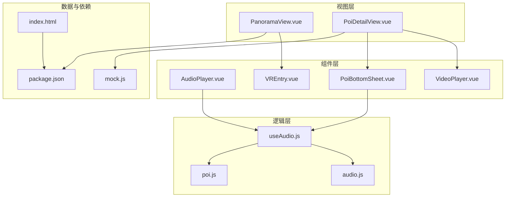
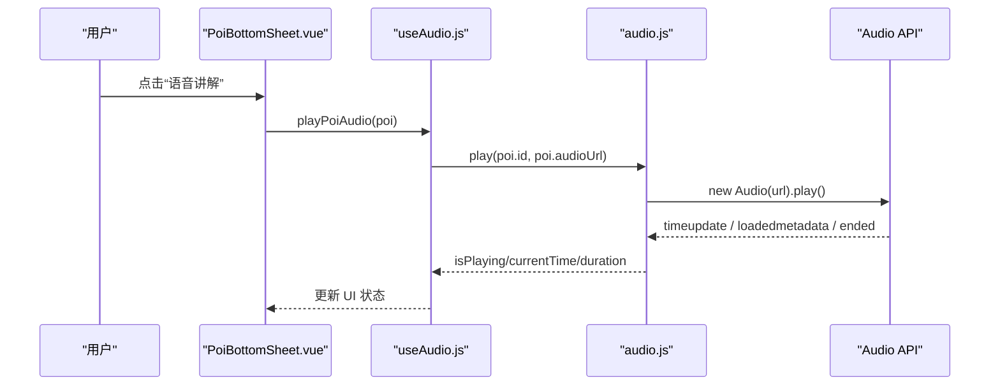
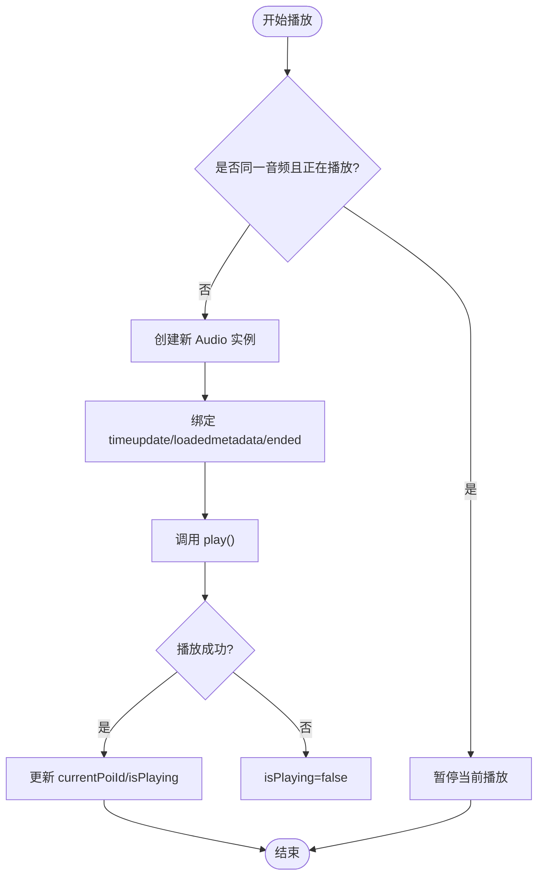
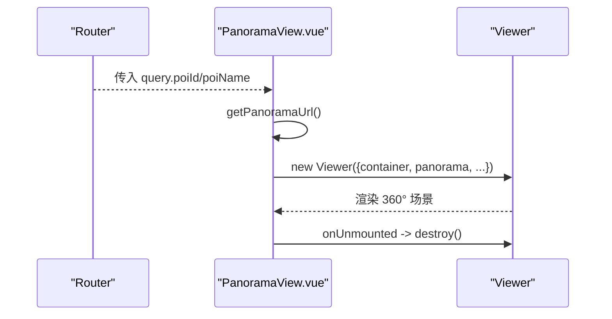
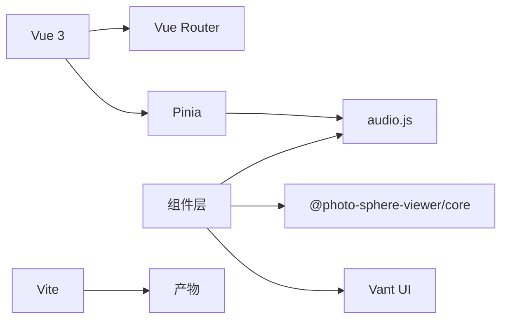

# 多媒体系统

<cite>
**本文引用的文件**
- [AudioPlayer.vue](file://src/components/common/AudioPlayer.vue)
- [VideoPlayer.vue](file://src/components/detail/VideoPlayer.vue)
- [PanoramaView.vue](file://src/views/PanoramaView.vue)
- [useAudio.js](file://src/composables/useAudio.js)
- [audio.js](file://src/stores/audio.js)
- [poi.js](file://src/stores/poi.js)
- [PoiBottomSheet.vue](file://src/components/common/PoiBottomSheet.vue)
- [VREntry.vue](file://src/components/detail/VREntry.vue)
- [PoiDetailView.vue](file://src/views/PoiDetailView.vue)
- [mock.js](file://src/data/mock.js)
- [package.json](file://package.json)
- [index.html](file://index.html)
</cite>

## 目录
1. [简介](#简介)
2. [项目结构](#项目结构)
3. [核心组件](#核心组件)
4. [架构总览](#架构总览)
5. [详细组件分析](#详细组件分析)
6. [依赖关系分析](#依赖关系分析)
7. [性能考虑](#性能考虑)
8. [故障排查指南](#故障排查指南)
9. [结论](#结论)
10. [附录](#附录)

## 简介
本文件为 FunMapUI 多媒体系统的技术文档，聚焦以下能力：
- 音频播放系统：音频文件管理、播放控制、进度跟踪与音量调节（当前实现基础播放控制与进度跟踪）。
- 全景展示功能：基于 Photo Sphere Viewer 的 360° 图片加载、交互配置与移动端手势支持。
- 视频播放器：原生 video 控件、移动端内联播放与响应式适配。
- 多媒体资源管理策略：懒加载、缓存机制与内存优化建议。
- 跨浏览器兼容性与移动端触摸手势支持。

## 项目结构
多媒体相关代码主要分布在以下位置：
- 音频：composables/useAudio.js、stores/audio.js、components/common/AudioPlayer.vue、components/common/PoiBottomSheet.vue
- 视频：components/detail/VideoPlayer.vue、views/PoiDetailView.vue
- 全景：views/PanoramaView.vue、components/detail/VREntry.vue
- 数据：data/mock.js（POI 元数据含 audioUrl/videoUrl/vrUrl）
- 入口与依赖：index.html、package.json

图表来源
- [PanoramaView.vue:25-95](file://src/views/PanoramaView.vue#L25-L95)
- [PoiDetailView.vue:51-80](file://src/views/PoiDetailView.vue#L51-L80)
- [AudioPlayer.vue:28-46](file://src/components/common/AudioPlayer.vue#L28-L46)
- [VideoPlayer.vue:23-38](file://src/components/detail/VideoPlayer.vue#L23-L38)
- [useAudio.js:8-58](file://src/composables/useAudio.js#L8-L58)
- [audio.js:4-110](file://src/stores/audio.js#L4-L110)
- [poi.js:5-83](file://src/stores/poi.js#L5-L83)
- [mock.js:5-349](file://src/data/mock.js#L5-L349)
- [package.json:11-21](file://package.json#L11-L21)
- [index.html:1-17](file://index.html#L1-L17)

章节来源
- [package.json:11-21](file://package.json#L11-L21)
- [index.html:1-17](file://index.html#L1-L17)

## 核心组件
- 音频播放状态与控制器：Pinia store 封装 Audio API，提供 play/pause/resume/stop/seek，并维护 currentPoiId、isPlaying、currentTime、duration。
- 音频 UI：悬浮条显示标题、时间、进度条与关闭按钮；底部面板提供“语音讲解”快捷入口。
- 视频播放器：轻量 wrapper，使用原生 video 标签，设置 playsinline/webkit-playsinline 以支持移动端内联播放，preload="metadata" 减少首屏流量。
- 全景查看器：基于 @photo-sphere-viewer/core 的 Viewer，配置双指缩放、惯性滑动、最小/最大 FOV 等。
- POI 数据：mock 数据包含 audioUrl、videoUrl、vrUrl 等字段，作为多媒体资源的入口。

章节来源
- [audio.js:4-110](file://src/stores/audio.js#L4-L110)
- [AudioPlayer.vue:1-46](file://src/components/common/AudioPlayer.vue#L1-L46)
- [PoiBottomSheet.vue:33-91](file://src/components/common/PoiBottomSheet.vue#L33-L91)
- [VideoPlayer.vue:1-38](file://src/components/detail/VideoPlayer.vue#L1-L38)
- [PanoramaView.vue:25-95](file://src/views/PanoramaView.vue#L25-L95)
- [mock.js:5-349](file://src/data/mock.js#L5-L349)

## 架构总览
多媒体子系统采用“视图-组合式函数-状态存储”的分层设计：
- 视图层负责渲染与用户交互（AudioPlayer、VideoPlayer、PanoramaView、PoiDetailView、PoiBottomSheet、VREntry）。
- 组合式函数 useAudio 聚合 store 与 POI 数据，暴露便捷方法（播放、切换、格式化时间）。
- Pinia store audio 集中管理音频实例与播放状态，避免多组件重复创建 Audio 对象。
- 全景通过路由参数传递 POI ID，在 PanoramaView 中解析并初始化 Viewer。

图表来源
- [PoiBottomSheet.vue:88-91](file://src/components/common/PoiBottomSheet.vue#L88-L91)
- [useAudio.js:16-19](file://src/composables/useAudio.js#L16-L19)
- [audio.js:25-58](file://src/stores/audio.js#L25-L58)

章节来源
- [PoiBottomSheet.vue:88-91](file://src/components/common/PoiBottomSheet.vue#L88-L91)
- [useAudio.js:16-19](file://src/composables/useAudio.js#L16-L19)
- [audio.js:25-58](file://src/stores/audio.js#L25-L58)

## 详细组件分析

### 音频播放系统
- 播放控制：store 中 play 会销毁旧实例并创建新 Audio，监听 timeupdate/loadedmetadata/ended 同步 currentTime/duration/isPlaying；pause/resume/stop/seek 分别对应暂停、恢复、停止与跳转。
- 进度跟踪：timeupdate 事件驱动进度更新，UI 通过 computed(progress) 计算百分比并绑定到滑块。
- 音量调节：当前未暴露音量控制接口，可在 store 中增加 volume 属性并在 Audio 实例上设置，同时在 UI 添加音量滑块。
- 错误处理：play() 返回 Promise，捕获失败后将 isPlaying 置为 false，避免 UI 状态不一致。

图表来源
- [audio.js:25-58](file://src/stores/audio.js#L25-L58)

章节来源
- [audio.js:25-97](file://src/stores/audio.js#L25-L97)
- [AudioPlayer.vue:37-45](file://src/components/common/AudioPlayer.vue#L37-L45)
- [useAudio.js:24-30](file://src/composables/useAudio.js#L24-L30)

### 全景展示功能（Photo Sphere Viewer）
- 集成方式：在 PanoramaView 中引入 @photo-sphere-viewer/core 的 Viewer，挂载到容器元素。
- 配置项：默认缩放级别、鱼眼开关、工具栏（zoom/fullscreen）、双指旋转、鼠标滚轮、惯性滑动、FOV 范围限制。
- 资源映射：通过 query.poiId 选择全景图，默认 fallback 到 demo.jpg。
- 生命周期：onMounted 初始化 Viewer，onUnmounted 调用 destroy 释放资源。

图表来源
- [PanoramaView.vue:46-95](file://src/views/PanoramaView.vue#L46-L95)

章节来源
- [PanoramaView.vue:46-95](file://src/views/PanoramaView.vue#L46-L95)
- [VREntry.vue:30-38](file://src/components/detail/VREntry.vue#L30-L38)

### 视频播放器
- 控件与行为：使用原生 video 控件，启用 controls；移动端通过 playsinline/webkit-playsinline 允许内联播放；preload="metadata" 仅预加载元信息以减少带宽。
- 响应式适配：容器宽度 100%，视频高度受限，保证在不同屏幕尺寸下布局稳定。
- 占位态：无视频时显示占位图标与文案，提升空状态体验。

章节来源
- [VideoPlayer.vue:1-38](file://src/components/detail/VideoPlayer.vue#L1-L38)
- [PoiDetailView.vue:21-25](file://src/views/PoiDetailView.vue#L21-L25)

### 多媒体资源管理策略
- 懒加载
  - 视频：preload="metadata"，仅在需要时加载完整媒体。
  - 全景：按需进入页面再初始化 Viewer，避免首屏开销。
  - 音频：仅在触发播放时创建 Audio 实例，避免预加载。
- 缓存机制
  - 浏览器 HTTP 缓存：对静态音频/视频/全景图可配合服务端 Cache-Control 提升命中。
  - 应用级缓存：可在 store 中缓存已加载的元数据（如 duration），减少重复请求。
- 内存优化
  - 音频：切换或停止时及时 pause 并置 null，避免悬挂实例。
  - 全景：离开页面时调用 destroy 释放 WebGL/纹理资源。
  - 图片：全景图建议使用合适分辨率与压缩格式，降低内存占用。

章节来源
- [audio.js:32-38](file://src/stores/audio.js#L32-L38)
- [PanoramaView.vue:90-95](file://src/views/PanoramaView.vue#L90-L95)
- [VideoPlayer.vue:6-13](file://src/components/detail/VideoPlayer.vue#L6-L13)

### 跨浏览器兼容性与移动端手势
- 移动端内联播放：video 标签设置 playsinline/webkit-playsinline，避免 iOS Safari 自动全屏。
- 手势支持：全景 Viewer 启用 touchmoveTwoFingers、mousewheel、moveInertia，提供顺滑的双指缩放与拖拽体验。
- 安全区域：样式中使用 env(safe-area-inset-top/bottom) 适配刘海屏设备。
- 视口与 PWA：index.html 设置 viewport 禁止缩放，启用 apple-mobile-web-app-capable。

章节来源
- [VideoPlayer.vue:6-13](file://src/components/detail/VideoPlayer.vue#L6-L13)
- [PanoramaView.vue:70-82](file://src/views/PanoramaView.vue#L70-L82)
- [index.html:5-9](file://index.html#L5-L9)

## 依赖关系分析
- 运行时依赖
  - @photo-sphere-viewer/core：全景查看器核心库。
  - leaflet：地图引擎（与多媒体间接相关）。
  - pinia：状态管理（音频状态）。
  - vant：UI 组件（图标、滑块、弹窗等）。
  - vue/vue-router：框架与路由。
- 构建与开发
  - vite：构建工具。
  - sharp：瓦片图片处理（开发脚本）。

图表来源
- [package.json:11-21](file://package.json#L11-L21)
- [audio.js:1-3](file://src/stores/audio.js#L1-L3)
- [PanoramaView.vue:28-29](file://src/views/PanoramaView.vue#L28-L29)

章节来源
- [package.json:11-21](file://package.json#L11-L21)

## 性能考虑
- 音频
  - 单例 Audio：store 中保持单一实例，避免并发播放导致资源竞争。
  - 事件节流：timeupdate 频率较高，必要时可结合 requestAnimationFrame 或节流策略更新 UI。
  - 错误降级：play 失败时重置状态，防止 UI 卡死在“播放中”。
- 视频
  - 预加载策略：preload="metadata" 仅加载头部元信息，按需加载完整流。
  - 自适应码率：后端可提供多码率源，前端根据网络状况切换（可扩展）。
- 全景
  - 图片尺寸：建议使用宽高比 2:1 的等距柱状投影图，分辨率按目标设备调整。
  - 资源释放：离开页面必须调用 destroy，释放 WebGL 上下文与纹理。
- 通用
  - 缓存：利用浏览器缓存与服务端缓存头，减少重复下载。
  - 懒加载：仅在可见或交互时加载媒体资源。

[本节为通用指导，不直接分析具体文件]

## 故障排查指南
- 无法自动播放
  - 现象：调用 play() 失败，isPlaying 被置为 false。
  - 排查：检查用户手势触发、浏览器自动播放策略；确保在用户交互后调用。
  - 参考：[audio.js:55-57](file://src/stores/audio.js#L55-L57)
- 进度不同步
  - 现象：滑块与真实进度不一致。
  - 排查：确认 timeupdate 事件正常触发；避免频繁重绘；检查 seek 逻辑。
  - 参考：[audio.js:42-48](file://src/stores/audio.js#L42-L48)、[AudioPlayer.vue:42-45](file://src/components/common/AudioPlayer.vue#L42-L45)
- 全景卡顿或崩溃
  - 现象：进入全景后卡顿或内存飙升。
  - 排查：检查全景图大小与压缩；确认 onUnmounted 中调用 destroy；避免同时加载多张全景。
  - 参考：[PanoramaView.vue:90-95](file://src/views/PanoramaView.vue#L90-L95)
- 移动端视频全屏异常
  - 现象：iOS 上自动全屏或黑屏。
  - 排查：确保设置 playsinline/webkit-playsinline；检查父容器尺寸与 z-index。
  - 参考：[VideoPlayer.vue:6-13](file://src/components/detail/VideoPlayer.vue#L6-L13)

章节来源
- [audio.js:42-57](file://src/stores/audio.js#L42-L57)
- [AudioPlayer.vue:42-45](file://src/components/common/AudioPlayer.vue#L42-L45)
- [PanoramaView.vue:90-95](file://src/views/PanoramaView.vue#L90-L95)
- [VideoPlayer.vue:6-13](file://src/components/detail/VideoPlayer.vue#L6-L13)

## 结论
FunMapUI 的多媒体系统以清晰的层次划分与合理的资源管理策略，实现了音频播放、视频播放与全景展示的完整闭环。当前版本已具备稳定的播放控制、进度跟踪与移动端手势支持。后续可在此基础上扩展音量控制、多码率视频、应用级缓存与更精细的性能监控，以提升用户体验与系统健壮性。

[本节为总结性内容，不直接分析具体文件]

## 附录
- 关键数据结构（POI 多媒体字段）
  - audioUrl：音频地址
  - audioDuration：音频时长（秒）
  - videoUrl：视频地址
  - vrUrl：全景入口地址
  - 参考路径：[mock.js:5-349](file://src/data/mock.js#L5-L349)

章节来源
- [mock.js:5-349](file://src/data/mock.js#L5-L349)