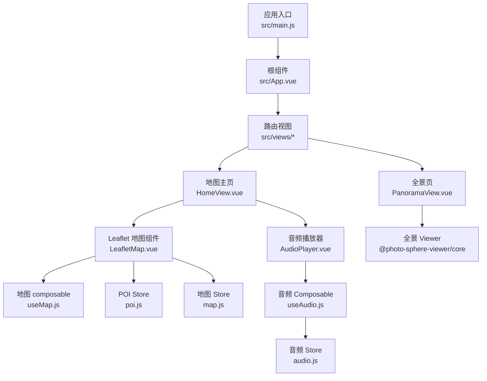
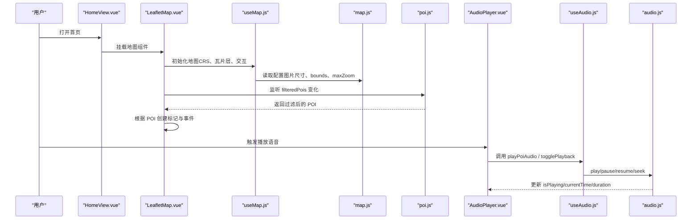
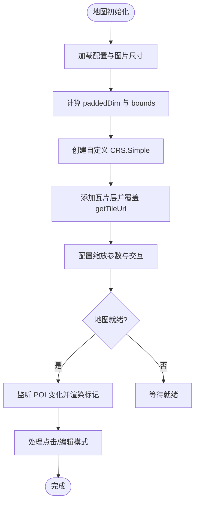
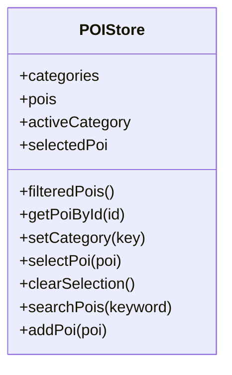
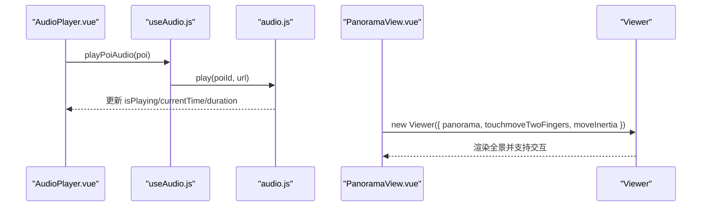
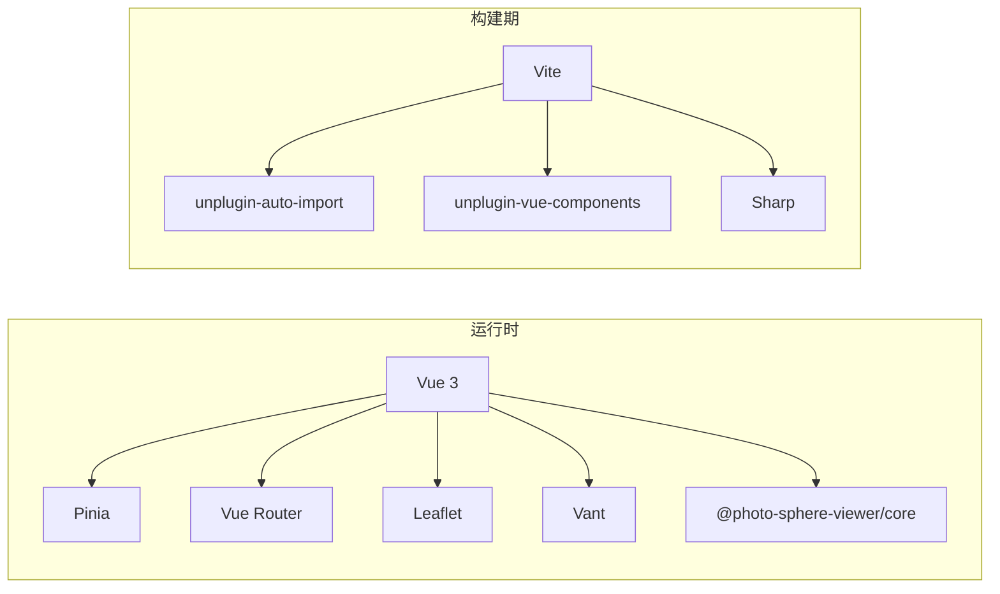

# 核心功能模块

<cite>
**本文引用的文件**
- [package.json](file://package.json)
- [README.md](file://README.md)
- [vite.config.js](file://vite.config.js)
- [src/main.js](file://src/main.js)
- [src/App.vue](file://src/App.vue)
- [src/stores/map.js](file://src/stores/map.js)
- [src/stores/poi.js](file://src/stores/poi.js)
- [src/stores/audio.js](file://src/stores/audio.js)
- [src/composables/useMap.js](file://src/composables/useMap.js)
- [src/composables/useAudio.js](file://src/composables/useAudio.js)
- [src/components/map/LeafletMap.vue](file://src/components/map/LeafletMap.vue)
- [src/components/common/AudioPlayer.vue](file://src/components/common/AudioPlayer.vue)
- [src/components/detail/VideoPlayer.vue](file://src/components/detail/VideoPlayer.vue)
- [src/views/HomeView.vue](file://src/views/HomeView.vue)
- [src/views/PanoramaView.vue](file://src/views/PanoramaView.vue)
</cite>

## 目录
1. [简介](#简介)
2. [项目结构](#项目结构)
3. [核心组件](#核心组件)
4. [架构总览](#架构总览)
5. [详细组件分析](#详细组件分析)
6. [依赖关系分析](#依赖关系分析)
7. [性能考虑](#性能考虑)
8. [故障排查指南](#故障排查指南)
9. [结论](#结论)
10. [附录：使用示例与扩展方法](#附录使用示例与扩展方法)

## 简介
FunMapUI 是基于手绘地图的移动端旅游导览应用，提供地图浏览、POI 标注、全景查看、语音讲解等功能。本章节聚焦核心功能模块：地图系统（Leaflet 集成、瓦片渲染、CRS 配置、交互控制）、POI 管理系统（数据结构、分类筛选、搜索、编辑）、多媒体模块（音频播放、全景展示、视频播放器），以及 UI 组件设计模式（响应式与移动端优化）。文档同时给出各模块的使用示例、配置项与扩展方式，并附性能优化建议与常见问题解决方案。

## 项目结构
- 构建与入口
  - Vite 构建配置启用 Vue 插件与自动导入；别名 @ 指向 src。
  - 应用入口初始化 Pinia、路由与全局样式。
- 状态管理
  - map store：维护图片尺寸、paddedDim、CRS bounds、中心点、缩放范围、瓦片路径等。
  - poi store：维护 POI 数据、分类定义、当前选中、过滤结果与搜索能力。
  - audio store：维护当前播放 POI、播放状态、进度与时长，封装播放/暂停/跳转逻辑。
- 组合式函数
  - useMap：封装 Leaflet 地图初始化、自定义 CRS.Simple、瓦片层、双指缩放、视图定位等。
  - useAudio：封装播放 POI 语音、切换播放、获取当前 POI、时间格式化。
- 组件与页面
  - 地图组件：LeafletMap 负责标记渲染、点击选择、编辑模式添加 POI。
  - 通用组件：AudioPlayer 悬浮播放器、SearchBar、PoiBottomSheet 等。
  - 详情组件：VideoPlayer 视频播放器、VREntry 全景入口等。
  - 页面：HomeView（地图主页）、PanoramaView（全景页）等。

图表来源
- [src/main.js:1-21](file://src/main.js#L1-L21)
- [src/App.vue:1-59](file://src/App.vue#L1-L59)
- [src/views/HomeView.vue:1-136](file://src/views/HomeView.vue#L1-L136)
- [src/views/PanoramaView.vue:1-190](file://src/views/PanoramaView.vue#L1-L190)
- [src/components/map/LeafletMap.vue:1-141](file://src/components/map/LeafletMap.vue#L1-L141)
- [src/composables/useMap.js:1-174](file://src/composables/useMap.js#L1-L174)
- [src/stores/poi.js:1-84](file://src/stores/poi.js#L1-L84)
- [src/stores/map.js:1-122](file://src/stores/map.js#L1-L122)
- [src/components/common/AudioPlayer.vue:1-104](file://src/components/common/AudioPlayer.vue#L1-L104)
- [src/composables/useAudio.js:1-59](file://src/composables/useAudio.js#L1-L59)
- [src/stores/audio.js:1-111](file://src/stores/audio.js#L1-L111)

章节来源
- [package.json:1-28](file://package.json#L1-L28)
- [vite.config.js:1-27](file://vite.config.js#L1-L27)
- [src/main.js:1-21](file://src/main.js#L1-L21)
- [src/App.vue:1-59](file://src/App.vue#L1-L59)

## 核心组件
- 地图系统
  - 基于 Leaflet 的 CRS.Simple 像素坐标系，结合 paddedDim 与 bounds 确保瓦片坐标正确。
  - 瓦片层通过 getTileUrl 翻转 y 坐标以匹配瓦片存储约定；maxNativeZoom 限制瓦片级别，超出由 CSS 放大。
  - 支持无级缩放（zoomSnap=0）、按钮缩放增量、滚轮灵敏度调节与触摸双指缩放阈值控制。
- POI 管理系统
  - 分类定义与颜色映射；按 activeCategory 过滤显示。
  - 搜索算法对名称、描述、标签进行关键词匹配。
  - 编辑模式支持点击空白处添加 POI，表单确认后加入内存列表。
- 多媒体模块
  - 音频播放：单例 Audio 实例，支持播放/暂停/恢复/停止/跳转，实时进度与时长更新。
  - 全景展示：基于 Photo Sphere Viewer 的全景查看器，支持触摸旋转、双指缩放、惯性滑动与全屏。
  - 视频播放：原生 video 元素，支持封面图、移动端内联播放与元数据预加载。

章节来源
- [src/composables/useMap.js:1-174](file://src/composables/useMap.js#L1-L174)
- [src/stores/poi.js:1-84](file://src/stores/poi.js#L1-L84)
- [src/stores/audio.js:1-111](file://src/stores/audio.js#L1-L111)
- [src/components/common/AudioPlayer.vue:1-104](file://src/components/common/AudioPlayer.vue#L1-L104)
- [src/components/detail/VideoPlayer.vue:1-67](file://src/components/detail/VideoPlayer.vue#L1-L67)
- [src/views/PanoramaView.vue:1-190](file://src/views/PanoramaView.vue#L1-L190)

## 架构总览
下图展示了从页面到状态管理与第三方库的整体调用关系，体现数据流与控制流。

图表来源
- [src/views/HomeView.vue:1-136](file://src/views/HomeView.vue#L1-L136)
- [src/components/map/LeafletMap.vue:1-141](file://src/components/map/LeafletMap.vue#L1-L141)
- [src/composables/useMap.js:1-174](file://src/composables/useMap.js#L1-L174)
- [src/stores/map.js:1-122](file://src/stores/map.js#L1-L122)
- [src/stores/poi.js:1-84](file://src/stores/poi.js#L1-L84)
- [src/components/common/AudioPlayer.vue:1-104](file://src/components/common/AudioPlayer.vue#L1-L104)
- [src/composables/useAudio.js:1-59](file://src/composables/useAudio.js#L1-L59)
- [src/stores/audio.js:1-111](file://src/stores/audio.js#L1-L111)

## 详细组件分析

### 地图系统（Leaflet + CRS.Simple + 瓦片渲染）
- 初始化流程
  - 加载地图配置与图片尺寸，计算 paddedDim 与 bounds。
  - 自定义 CRS：覆盖 projection.bounds 为实际图片尺寸，设置 transformation 无 y-flip，infinite=false。
  - 创建 tileLayer，覆盖 getTileUrl 翻转 y 坐标以匹配瓦片存储；设置 maxNativeZoom 限制瓦片级别。
  - 配置无级缩放、按钮缩放增量、滚轮灵敏度与触摸双指缩放阈值。
- 标记渲染
  - 将 POI 百分比坐标转换为像素坐标，动态测量文字宽度自适应容器大小。
  - 使用 L.divIcon 创建带圆点与标签的标记，绑定点击事件更新选中 POI。
- 交互控制
  - 编辑模式下绑定地图 click，将点击位置转换为百分比坐标并通过事件传递给父组件。
  - 暴露 flyTo/zoomBy/getMap 等方法供外部调用。

图表来源
- [src/composables/useMap.js:1-174](file://src/composables/useMap.js#L1-L174)
- [src/stores/map.js:1-122](file://src/stores/map.js#L1-L122)
- [src/components/map/LeafletMap.vue:1-141](file://src/components/map/LeafletMap.vue#L1-L141)

章节来源
- [src/composables/useMap.js:1-174](file://src/composables/useMap.js#L1-L174)
- [src/stores/map.js:1-122](file://src/stores/map.js#L1-L122)
- [src/components/map/LeafletMap.vue:1-141](file://src/components/map/LeafletMap.vue#L1-L141)

### POI 管理系统（数据结构、分类筛选、搜索、编辑）
- 数据结构
  - categories：分类键值与颜色、图标定义。
  - pois：全部 POI 列表（来自 mock 数据）。
  - activeCategory：当前选中的分类 Tab。
  - selectedPoi：当前选中的 POI。
- 筛选与搜索
  - filteredPois：根据 activeCategory 过滤 POI。
  - searchPois：按名称、描述、标签进行关键词匹配。
- 编辑功能
  - addPoi：在内存中添加新 POI（会话级不持久化）。
  - 配合 LeafletMap 的编辑模式，点击空白处生成待确认的 POI 坐标。

图表来源
- [src/stores/poi.js:1-84](file://src/stores/poi.js#L1-L84)

章节来源
- [src/stores/poi.js:1-84](file://src/stores/poi.js#L1-L84)
- [src/components/map/LeafletMap.vue:1-141](file://src/components/map/LeafletMap.vue#L1-L141)

### 多媒体模块（音频、全景、视频）
- 音频播放系统
  - 单例 Audio 实例管理，避免多实例冲突。
  - 事件驱动更新 currentTime 与 duration，ended 时重置状态。
  - 提供 play/pause/resume/stop/seek 接口，支持跳转到指定时间。
- 全景展示集成
  - 使用 Photo Sphere Viewer 初始化 Viewer，配置触摸、鼠标滚轮、惯性滑动与 FOV 范围。
  - 通过 URL query 传入 poiId 选择对应全景图，默认 fallback 到 demo。
- 视频播放器实现
  - 原生 video 元素，支持封面图、移动端内联播放与元数据预加载。
  - 当无视频资源时显示占位提示。

图表来源
- [src/components/common/AudioPlayer.vue:1-104](file://src/components/common/AudioPlayer.vue#L1-L104)
- [src/composables/useAudio.js:1-59](file://src/composables/useAudio.js#L1-L59)
- [src/stores/audio.js:1-111](file://src/stores/audio.js#L1-L111)
- [src/views/PanoramaView.vue:1-190](file://src/views/PanoramaView.vue#L1-L190)

章节来源
- [src/components/common/AudioPlayer.vue:1-104](file://src/components/common/AudioPlayer.vue#L1-L104)
- [src/composables/useAudio.js:1-59](file://src/composables/useAudio.js#L1-L59)
- [src/stores/audio.js:1-111](file://src/stores/audio.js#L1-L111)
- [src/views/PanoramaView.vue:1-190](file://src/views/PanoramaView.vue#L1-L190)
- [src/components/detail/VideoPlayer.vue:1-67](file://src/components/detail/VideoPlayer.vue#L1-L67)

### 用户界面组件（响应式设计与移动端优化）
- 布局与层级
  - 首页采用 flex 纵向布局，地图区域自适应高度，控件绝对定位右下角。
  - 头部与底部安全区适配 env(safe-area-inset-* )。
- 交互优化
  - 禁用滚动反弹 bounceAtZoomLimits，减少误触。
  - 双指缩放阈值控制 PINCH_THRESHOLD，提升操作确定性。
  - 标记标签自适应宽度，避免长文本溢出。
- 主题与样式
  - 使用 CSS 变量统一主题色、间距、圆角与层级。
  - 全局重置与字体平滑，移动端点击高亮透明化。

章节来源
- [src/views/HomeView.vue:1-136](file://src/views/HomeView.vue#L1-L136)
- [src/App.vue:1-59](file://src/App.vue#L1-L59)
- [src/composables/useMap.js:1-174](file://src/composables/useMap.js#L1-L174)

## 依赖关系分析
- 运行时依赖
  - Vue 3、Pinia、Vue Router、Leaflet、Vant、Photo Sphere Viewer。
- 构建与工具
  - Vite、Sharp（开发脚本用于瓦片处理）、自动导入与组件解析。
- 内部依赖
  - 页面依赖组件，组件依赖 composables，composables 依赖 stores 与第三方库。

图表来源
- [package.json:1-28](file://package.json#L1-L28)
- [vite.config.js:1-27](file://vite.config.js#L1-L27)

章节来源
- [package.json:1-28](file://package.json#L1-L28)
- [vite.config.js:1-27](file://vite.config.js#L1-L27)

## 性能考虑
- 瓦片与缩放
  - 使用 maxNativeZoom 限制瓦片请求级别，超出级别由 CSS 放大，减少网络请求与内存占用。
  - 自定义 getTileUrl 翻转 y 坐标，避免额外计算开销。
- 交互与渲染
  - zoomSnap=0 支持无级缩放，提升体验但需关注频繁重绘；合理设置 wheelPxPerZoomLevel 降低灵敏度。
  - 标记标签通过 Canvas 测量文字宽度，避免多次 DOM 测量。
- 多媒体
  - 音频单例管理，避免重复创建实例；ended 时清理状态。
  - 全景 Viewer 启用惯性滑动与 FOV 限制，减少过度缩放带来的性能问题。
  - 视频 preload="metadata" 仅预加载元数据，降低首屏压力。

[本节为通用性能讨论，不直接分析具体文件]

## 故障排查指南
- 地图瓦片不显示或错位
  - 检查 getTileUrl 是否翻转 y 坐标；确认 tilesPath 与瓦片目录结构一致。
  - 确认 maxNativeZoom 与实际生成的瓦片级别匹配。
- 缩放异常或卡顿
  - 调整 zoomDelta 与 wheelPxPerZoomLevel；检查触摸事件是否被阻止冒泡。
  - 观察控制台调试输出（zoomend 事件统计瓦片加载情况）。
- 音频无法播放
  - 浏览器策略可能阻止自动播放；确保用户交互后调用 play。
  - 检查音频 URL 可访问性与 MIME 类型。
- 全景无法加载
  - 确认全景图为 2:1 等距柱状投影格式；检查 PANORAMA_MAP 映射是否正确。
  - 若跨域，需服务器配置 CORS。

章节来源
- [src/composables/useMap.js:1-174](file://src/composables/useMap.js#L1-L174)
- [src/stores/audio.js:1-111](file://src/stores/audio.js#L1-L111)
- [src/views/PanoramaView.vue:1-190](file://src/views/PanoramaView.vue#L1-L190)

## 结论
FunMapUI 的核心模块围绕 Leaflet 地图、POI 管理与多媒体展开，通过清晰的职责划分与状态管理实现了良好的可扩展性与用户体验。地图系统利用 CRS.Simple 与瓦片金字塔实现手绘地图的高效渲染；POI 管理提供灵活的分类与搜索；多媒体模块整合音频、全景与视频，满足导览场景需求。建议在后续迭代中引入缓存策略、懒加载与更精细的性能监控，进一步提升大规模 POI 与多媒体资源的加载效率。

## 附录：使用示例与扩展方法
- 地图系统
  - 初始化与配置：通过 useMap 组合式函数在组件挂载时初始化地图；在 map store 中配置 tilesPath、imagePath、maxZoom。
  - 交互控制：使用 zoomBy/flyTo 控制缩放与视图；在编辑模式下监听地图点击添加 POI。
  - 参考路径
    - [src/composables/useMap.js:1-174](file://src/composables/useMap.js#L1-L174)
    - [src/stores/map.js:1-122](file://src/stores/map.js#L1-L122)
    - [src/components/map/LeafletMap.vue:1-141](file://src/components/map/LeafletMap.vue#L1-L141)
- POI 管理
  - 分类筛选：通过 setCategory 切换 activeCategory，filteredPois 自动更新。
  - 搜索：调用 searchPois 传入关键词，返回匹配的 POI 列表。
  - 编辑：在编辑模式下点击地图空白处，提交表单后调用 addPoi 添加到内存。
  - 参考路径
    - [src/stores/poi.js:1-84](file://src/stores/poi.js#L1-L84)
    - [src/components/map/LeafletMap.vue:1-141](file://src/components/map/LeafletMap.vue#L1-L141)
- 多媒体模块
  - 音频播放：在 AudioPlayer 中调用 playPoiAudio/togglePlayback；store 管理播放状态与进度。
  - 全景展示：在 PanoramaView 中根据 poiId 选择全景图，配置 Viewer 选项。
  - 视频播放：在 VideoPlayer 中传入 videoUrl 与 poster，支持移动端内联播放。
  - 参考路径
    - [src/components/common/AudioPlayer.vue:1-104](file://src/components/common/AudioPlayer.vue#L1-L104)
    - [src/composables/useAudio.js:1-59](file://src/composables/useAudio.js#L1-L59)
    - [src/stores/audio.js:1-111](file://src/stores/audio.js#L1-L111)
    - [src/views/PanoramaView.vue:1-190](file://src/views/PanoramaView.vue#L1-L190)
    - [src/components/detail/VideoPlayer.vue:1-67](file://src/components/detail/VideoPlayer.vue#L1-L67)
- 页面集成
  - 首页 HomeView 组装地图、控件、播放器与弹窗；提供编辑模式开关与缩放控制。
  - 参考路径
    - [src/views/HomeView.vue:1-136](file://src/views/HomeView.vue#L1-L136)