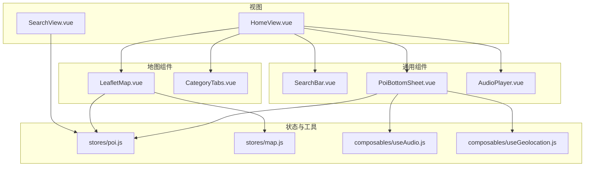
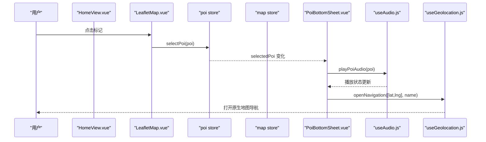
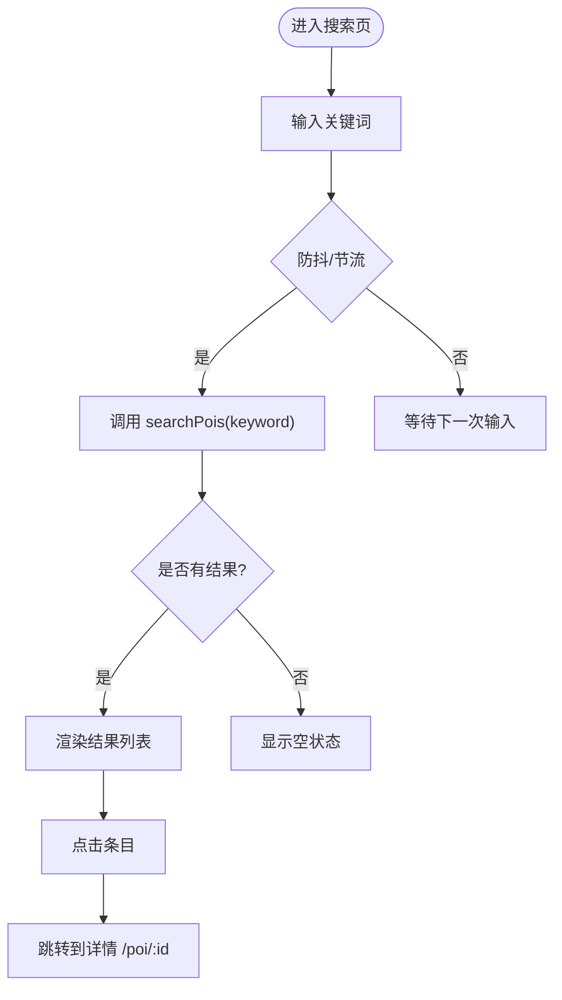
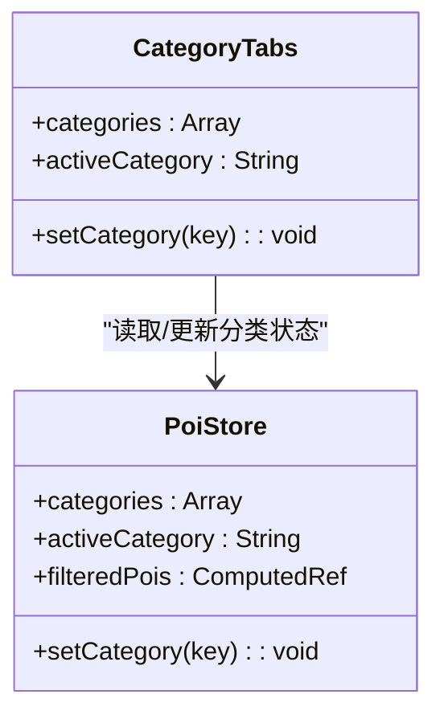
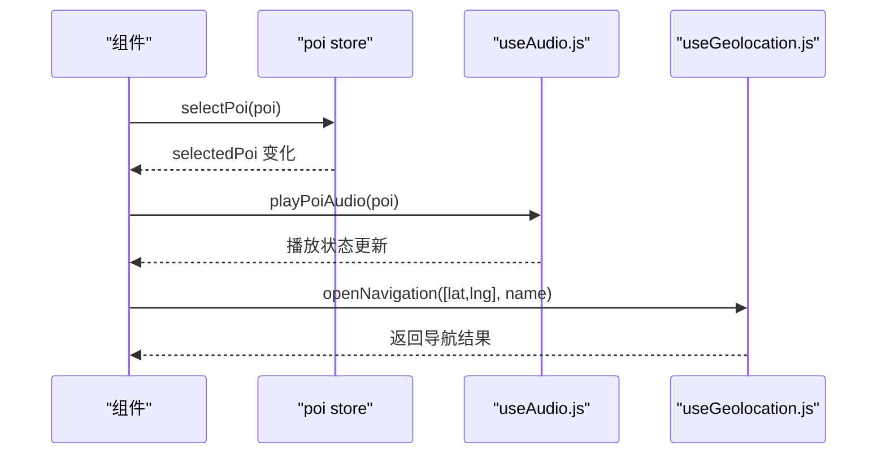
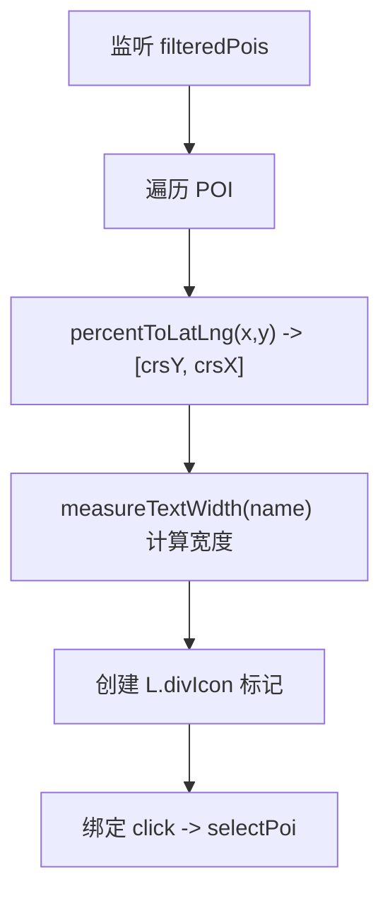
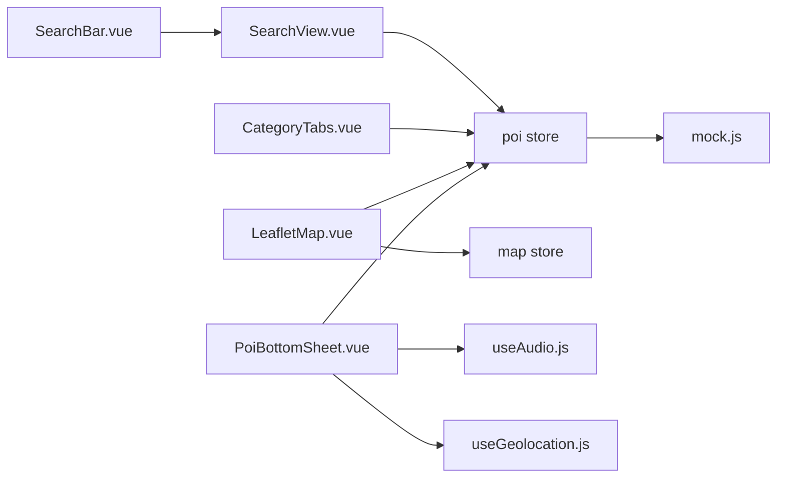

# 用户界面组件

<cite>
**本文引用的文件**
- [SearchBar.vue](file://src/components/common/SearchBar.vue)
- [CategoryTabs.vue](file://src/components/map/CategoryTabs.vue)
- [PoiBottomSheet.vue](file://src/components/common/PoiBottomSheet.vue)
- [variables.css](file://src/styles/variables.css)
- [App.vue](file://src/App.vue)
- [HomeView.vue](file://src/views/HomeView.vue)
- [LeafletMap.vue](file://src/components/map/LeafletMap.vue)
- [poi.js](file://src/stores/poi.js)
- [map.js](file://src/stores/map.js)
- [useAudio.js](file://src/composables/useAudio.js)
- [useGeolocation.js](file://src/composables/useGeolocation.js)
- [SearchView.vue](file://src/views/SearchView.vue)
- [mock.js](file://src/data/mock.js)
</cite>

## 目录
1. [简介](#简介)
2. [项目结构](#项目结构)
3. [核心组件](#核心组件)
4. [架构总览](#架构总览)
5. [详细组件分析](#详细组件分析)
6. [依赖关系分析](#依赖关系分析)
7. [性能考量](#性能考量)
8. [故障排查指南](#故障排查指南)
9. [结论](#结论)
10. [附录](#附录)

## 简介
本文件面向 FunMapUI 的用户界面组件，聚焦以下目标：
- 响应式设计实现：移动端优先、触摸手势与屏幕适配（安全区域、视口高度等）
- 搜索栏组件：实时搜索、历史记录与智能提示的扩展思路
- 分类标签系统：动态分类、颜色主题与交互反馈
- 底部弹窗组件：滑入动画、遮罩层处理与键盘导航
- 样式变量管理、主题定制与可访问性支持

## 项目结构
FunMapUI 采用 Vue 3 + Vite + Pinia + Leaflet + Vant 的移动端优先架构。关键 UI 组件分布在 common 与 map 目录下，状态集中在 stores，样式通过 CSS 变量统一管理。

图表来源
- [HomeView.vue:1-46](file://src/views/HomeView.vue#L1-L46)
- [SearchView.vue:1-63](file://src/views/SearchView.vue#L1-L63)
- [LeafletMap.vue:1-24](file://src/components/map/LeafletMap.vue#L1-L24)
- [CategoryTabs.vue:1-14](file://src/components/map/CategoryTabs.vue#L1-L14)
- [PoiBottomSheet.vue:1-54](file://src/components/common/PoiBottomSheet.vue#L1-L54)
- [poi.js:1-20](file://src/stores/poi.js#L1-L20)
- [map.js:1-36](file://src/stores/map.js#L1-L36)
- [useAudio.js:1-20](file://src/composables/useAudio.js#L1-L20)
- [useGeolocation.js:1-20](file://src/composables/useGeolocation.js#L1-L20)

章节来源
- [HomeView.vue:1-46](file://src/views/HomeView.vue#L1-L46)
- [SearchView.vue:1-63](file://src/views/SearchView.vue#L1-L63)
- [LeafletMap.vue:1-24](file://src/components/map/LeafletMap.vue#L1-L24)
- [CategoryTabs.vue:1-14](file://src/components/map/CategoryTabs.vue#L1-L14)
- [PoiBottomSheet.vue:1-54](file://src/components/common/PoiBottomSheet.vue#L1-L54)
- [poi.js:1-20](file://src/stores/poi.js#L1-L20)
- [map.js:1-36](file://src/stores/map.js#L1-L36)
- [useAudio.js:1-20](file://src/composables/useAudio.js#L1-L20)
- [useGeolocation.js:1-20](file://src/composables/useGeolocation.js#L1-L20)

## 核心组件
- 搜索栏 SearchBar：提供占位符与点击事件，作为入口跳转至搜索页；样式使用 CSS 变量，具备移动端友好的尺寸与圆角。
- 分类标签 CategoryTabs：基于 store 的动态分类渲染，支持激活态高亮与横向滚动，适配安全区域。
- 底部弹窗 PoiBottomSheet：基于 van-popup 的底部弹出面板，展示 POI 基本信息、快捷操作（语音讲解、导航、电话），并集成音频播放与地理定位能力。
- 全局样式变量 variables.css：集中定义主题色、功能色、间距、圆角、阴影与层级，便于主题定制与一致性维护。

章节来源
- [SearchBar.vue:1-47](file://src/components/common/SearchBar.vue#L1-L47)
- [CategoryTabs.vue:1-59](file://src/components/map/CategoryTabs.vue#L1-L59)
- [PoiBottomSheet.vue:1-190](file://src/components/common/PoiBottomSheet.vue#L1-L190)
- [variables.css:1-52](file://src/styles/variables.css#L1-L52)

## 架构总览
整体数据流以 Pinia Store 为中心：POI 数据与分类在 poi store 中管理，地图坐标转换在 map store 中完成；组件通过组合式函数 useAudio 与 useGeolocation 复用业务逻辑。

图表来源
- [LeafletMap.vue:68-94](file://src/components/map/LeafletMap.vue#L68-L94)
- [poi.js:43-51](file://src/stores/poi.js#L43-L51)
- [PoiBottomSheet.vue:88-102](file://src/components/common/PoiBottomSheet.vue#L88-L102)
- [useAudio.js:16-19](file://src/composables/useAudio.js#L16-L19)
- [useGeolocation.js:52-63](file://src/composables/useGeolocation.js#L52-L63)

## 详细组件分析

### 搜索栏组件（SearchBar）
- 功能要点
  - 占位文案与图标布局，点击触发父级路由跳转至搜索页
  - 样式使用 CSS 变量控制背景、圆角、阴影与字号，保证移动端视觉一致
- 响应式与触摸优化
  - 固定高度与内边距，确保触控热区足够
  - 文本溢出省略，避免长文案破坏布局
- 可扩展点
  - 实时搜索：可在父组件监听输入事件并调用 poi.store.searchPois 进行过滤
  - 历史记录：结合本地存储缓存最近搜索词，在下拉或结果区展示
  - 智能提示：根据输入前缀匹配名称、描述与标签，提供建议列表

图表来源
- [SearchView.vue:77-92](file://src/views/SearchView.vue#L77-L92)
- [poi.js:53-63](file://src/stores/poi.js#L53-L63)

章节来源
- [SearchBar.vue:1-47](file://src/components/common/SearchBar.vue#L1-L47)
- [SearchView.vue:1-215](file://src/views/SearchView.vue#L1-L215)
- [poi.js:53-63](file://src/stores/poi.js#L53-L63)

### 分类标签系统（CategoryTabs）
- 动态分类
  - 从 poi store 读取 categories 数组，按 key 渲染标签项
  - 当前选中项通过 activeCategory 驱动样式类名切换
- 颜色主题
  - 每个分类携带 color，用于标记点与搜索结果图标着色
  - 可通过 variables.css 统一调整主色与中性色，实现全局主题切换
- 交互反馈
  - 点击触发 setCategory(key)，实时更新 filteredPois，地图标记随之刷新
  - 横向滚动容器启用触摸滚动，提升小屏体验

图表来源
- [CategoryTabs.vue:1-20](file://src/components/map/CategoryTabs.vue#L1-L20)
- [poi.js:6-41](file://src/stores/poi.js#L6-L41)

章节来源
- [CategoryTabs.vue:1-59](file://src/components/map/CategoryTabs.vue#L1-L59)
- [poi.js:6-41](file://src/stores/poi.js#L6-L41)

### 底部弹窗组件（PoiBottomSheet）
- 设计模式
  - 基于 van-popup 的底部弹出，round 圆角与 maxHeight 限制高度，适配不同屏幕
  - 拖拽指示条与头部信息区，点击头部进入详情页
- 滑入动画与遮罩层
  - 由 van-popup 内置动画与遮罩层控制，关闭时自动清理选中状态
- 键盘导航
  - 建议在弹窗打开时将焦点置于首个可操作元素，Esc 键触发关闭；当前实现通过点击外部区域或关闭回调清理状态
- 快捷操作
  - 语音讲解：调用 useAudio.playPoiAudio，结合 AudioPlayer 全局悬浮播放器
  - 导航：调用 useGeolocation.openNavigation，打开系统地图应用
  - 电话：调用 useGeolocation.callPhone，拨号链接

图表来源
- [PoiBottomSheet.vue:56-102](file://src/components/common/PoiBottomSheet.vue#L56-L102)
- [useAudio.js:16-19](file://src/composables/useAudio.js#L16-L19)
- [useGeolocation.js:52-63](file://src/composables/useGeolocation.js#L52-L63)

章节来源
- [PoiBottomSheet.vue:1-190](file://src/components/common/PoiBottomSheet.vue#L1-L190)
- [useAudio.js:1-59](file://src/composables/useAudio.js#L1-L59)
- [useGeolocation.js:1-83](file://src/composables/useGeolocation.js#L1-L83)

### 地图标记与坐标转换（LeafletMap + map store）
- 标记渲染
  - 监听 filteredPois 变化，计算文字宽度自适应容器宽度，创建自定义 HTML 标记
  - 点击标记触发 poi store 的 selectPoi，联动底部弹窗
- 坐标系统
  - map store 负责加载图片尺寸、计算 paddedDim 与 CRS bounds，并提供 percentToLatLng 与 pixelToPercent 转换
  - LeafletMap 将百分比坐标转换为像素坐标后放置标记

图表来源
- [LeafletMap.vue:31-94](file://src/components/map/LeafletMap.vue#L31-L94)
- [map.js:87-103](file://src/stores/map.js#L87-L103)

章节来源
- [LeafletMap.vue:1-141](file://src/components/map/LeafletMap.vue#L1-L141)
- [map.js:1-122](file://src/stores/map.js#L1-L122)

### 响应式设计与屏幕适配
- 移动端优先
  - 根组件设置全局字体、禁用默认点击高亮与滚动行为，提升移动端体验
  - 首页使用 flex 纵向布局，地图区域自适应剩余空间
- 安全区域与视口
  - 顶部与底部使用 env(safe-area-inset-top/bottom) 适配刘海与底部横条
  - 使用 100dvh 确保全屏高度正确
- 触摸手势
  - 分类标签启用横向触摸滚动
  - 全景查看器（不在本节范围）支持双指缩放与惯性滑动

章节来源
- [App.vue:5-23](file://src/App.vue#L5-L23)
- [HomeView.vue:99-136](file://src/views/HomeView.vue#L99-L136)
- [CategoryTabs.vue:22-31](file://src/components/map/CategoryTabs.vue#L22-L31)

### 样式变量管理与主题定制
- 变量体系
  - 主题色、功能色、分类色、中性色、间距、圆角、阴影与层级均通过 CSS 变量定义
- 主题定制
  - 通过覆盖 :root 中的变量即可实现品牌化换肤
  - 分类色与主色联动，确保标记、标签与按钮风格一致
- 可访问性
  - 合理对比度与触控尺寸，减少误触
  - 为交互元素提供清晰的视觉反馈（如 :active 态）

章节来源
- [variables.css:1-52](file://src/styles/variables.css#L1-L52)
- [SearchBar.vue:19-47](file://src/components/common/SearchBar.vue#L19-L47)
- [CategoryTabs.vue:22-59](file://src/components/map/CategoryTabs.vue#L22-L59)
- [PoiBottomSheet.vue:105-190](file://src/components/common/PoiBottomSheet.vue#L105-L190)

## 依赖关系分析
- 组件到 Store
  - CategoryTabs 依赖 poi store 的分类与选中状态
  - LeafletMap 依赖 poi store 的过滤结果与 map store 的坐标转换
  - PoiBottomSheet 依赖 poi store 的选中 POI、useAudio 与 useGeolocation
- 组件到 Composable
  - useAudio 封装音频播放逻辑，供底部弹窗与全局播放器复用
  - useGeolocation 封装定位与导航、拨号等系统能力
- 数据源
  - mock.js 提供初始 POI 数据，包含名称、分类、坐标、标签等字段

图表来源
- [SearchView.vue:65-92](file://src/views/SearchView.vue#L65-L92)
- [CategoryTabs.vue:16-20](file://src/components/map/CategoryTabs.vue#L16-L20)
- [LeafletMap.vue:6-21](file://src/components/map/LeafletMap.vue#L6-L21)
- [PoiBottomSheet.vue:56-68](file://src/components/common/PoiBottomSheet.vue#L56-L68)
- [poi.js:1-20](file://src/stores/poi.js#L1-L20)
- [map.js:1-36](file://src/stores/map.js#L1-L36)
- [mock.js:1-24](file://src/data/mock.js#L1-L24)

章节来源
- [SearchView.vue:65-92](file://src/views/SearchView.vue#L65-L92)
- [CategoryTabs.vue:16-20](file://src/components/map/CategoryTabs.vue#L16-L20)
- [LeafletMap.vue:6-21](file://src/components/map/LeafletMap.vue#L6-L21)
- [PoiBottomSheet.vue:56-68](file://src/components/common/PoiBottomSheet.vue#L56-L68)
- [poi.js:1-20](file://src/stores/poi.js#L1-L20)
- [map.js:1-36](file://src/stores/map.js#L1-L36)
- [mock.js:1-24](file://src/data/mock.js#L1-L24)

## 性能考量
- 标记渲染
  - 使用 Canvas measureText 测量文字宽度，避免重复 DOM 测量开销
  - 监听 filteredPois 变化批量更新标记，减少重绘
- 搜索性能
  - 建议在 SearchView 中加入防抖/节流，降低高频输入导致的计算压力
- 音频播放
  - 使用单一 audio store 管理播放状态，避免多实例冲突
- 地图坐标
  - 使用 map store 的转换方法，避免在组件中重复计算

[本节为通用指导，不直接分析具体文件]

## 故障排查指南
- 搜索无结果
  - 检查 keyword 是否为空，确认 searchPois 是否被调用
  - 验证 mock 数据中是否存在匹配的 name/description/tags
- 分类切换无效
  - 确认 activeCategory 是否正确更新，filteredPois 是否重新计算
- 底部弹窗不显示
  - 检查 selectedPoi 是否被设置，van-popup 的 show 状态是否受控
- 导航失败
  - 确认设备是否支持 URL scheme，必要时回退到系统地图
- 音频无法播放
  - 检查 audioUrl 是否存在，浏览器是否允许自动播放策略

章节来源
- [SearchView.vue:77-92](file://src/views/SearchView.vue#L77-L92)
- [poi.js:53-63](file://src/stores/poi.js#L53-L63)
- [PoiBottomSheet.vue:70-86](file://src/components/common/PoiBottomSheet.vue#L70-L86)
- [useGeolocation.js:52-72](file://src/composables/useGeolocation.js#L52-L72)
- [useAudio.js:16-29](file://src/composables/useAudio.js#L16-L29)

## 结论
FunMapUI 的 UI 组件围绕移动端优先与可访问性展开，通过 CSS 变量实现主题一致性，借助 Pinia Store 与组合式函数解耦业务逻辑。搜索、分类与底部弹窗形成完整的交互闭环，配合地图标记与坐标转换，提供流畅的导览体验。未来可在搜索历史、智能提示与键盘导航方面进一步增强可访问性与易用性。

## 附录
- 推荐实践
  - 搜索输入加入防抖与清空按钮，提升可用性
  - 分类标签增加无障碍标签与键盘可达性
  - 底部弹窗添加焦点管理与 Esc 关闭
  - 主题切换通过覆盖 CSS 变量实现，保持组件样式稳定

[本节为通用指导，不直接分析具体文件]