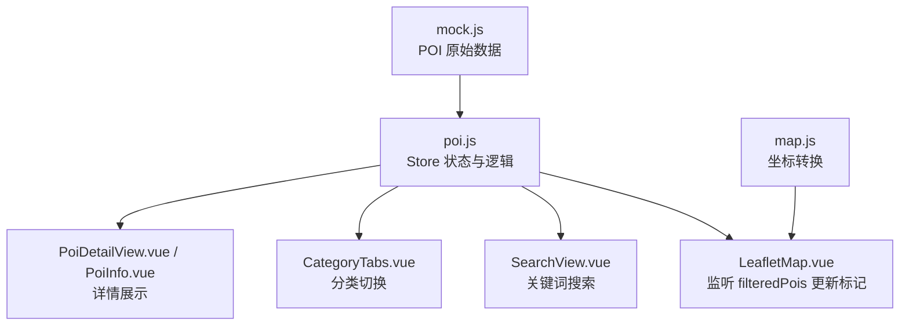
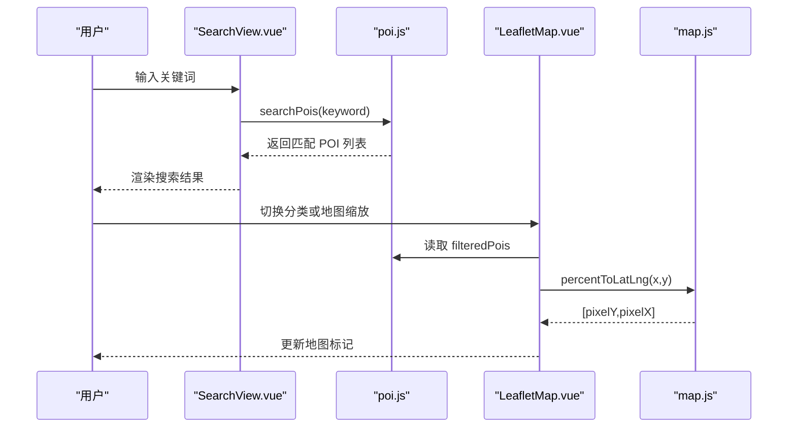
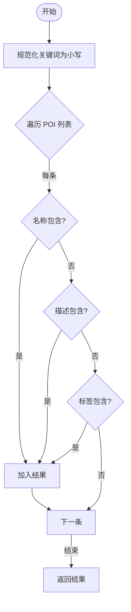
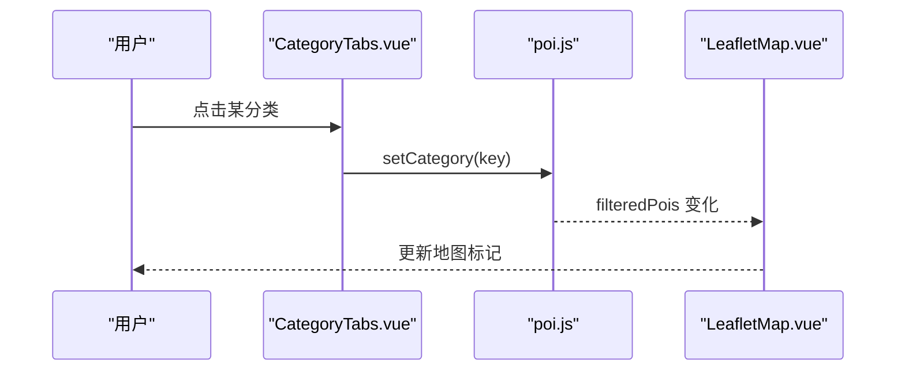
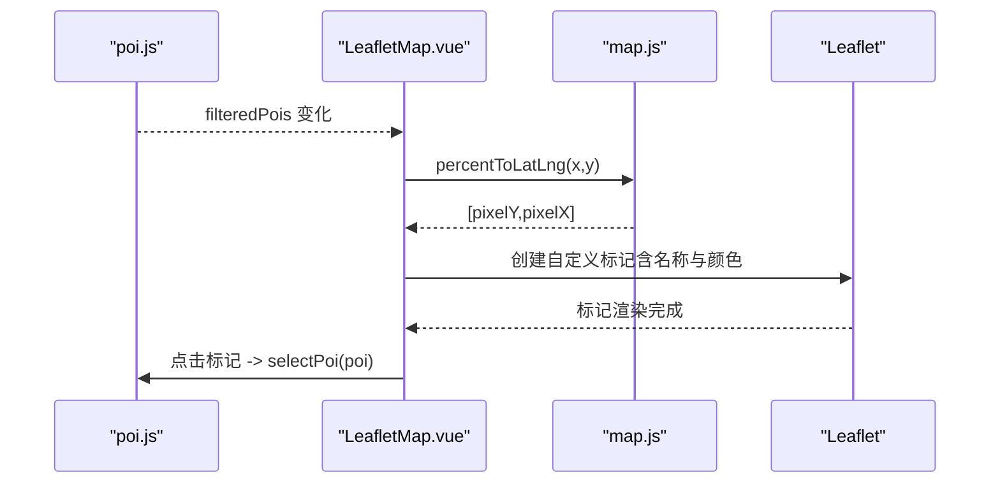
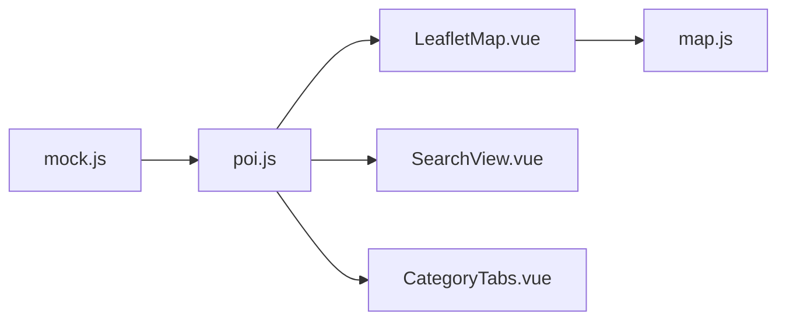

# POI 状态管理

<cite>
**本文引用的文件**
- [src/stores/poi.js](file://src/stores/poi.js)
- [src/data/mock.js](file://src/data/mock.js)
- [src/components/map/LeafletMap.vue](file://src/components/map/LeafletMap.vue)
- [src/stores/map.js](file://src/stores/map.js)
- [src/views/SearchView.vue](file://src/views/SearchView.vue)
- [src/components/map/CategoryTabs.vue](file://src/components/map/CategoryTabs.vue)
- [src/components/detail/PoiInfo.vue](file://src/components/detail/PoiInfo.vue)
- [src/components/map/PoiEditDialog.vue](file://src/components/map/PoiEditDialog.vue)
- [README.md](file://README.md)
</cite>

## 目录
1. [简介](#简介)
2. [项目结构](#项目结构)
3. [核心组件](#核心组件)
4. [架构总览](#架构总览)
5. [详细组件分析](#详细组件分析)
6. [依赖关系分析](#依赖关系分析)
7. [性能考量](#性能考量)
8. [故障排查指南](#故障排查指南)
9. [结论](#结论)
10. [附录](#附录)

## 简介
本文件围绕 POI（兴趣点）状态管理进行系统化说明，覆盖数据模型、分类体系、搜索算法、增删改查操作、与地图标记的关联机制、状态同步策略、数据验证规则、错误处理与性能优化。目标是帮助开发者快速理解并高效维护 POI 相关功能。

## 项目结构
POI 状态由 Pinia store 集中管理，配合地图组件渲染标记、搜索页执行关键词检索、详情页展示信息。整体数据流如下：
- Mock 数据提供初始 POI 集合
- POI Store 负责分类筛选、搜索、选中态
- 地图组件监听过滤结果，将百分比坐标转换为像素坐标并创建 Leaflet 标记
- 搜索页调用 store 的搜索方法返回匹配结果
- 编辑弹窗用于新增 POI（会话级内存）

图表来源
- [src/stores/poi.js:1-84](file://src/stores/poi.js#L1-L84)
- [src/data/mock.js:1-349](file://src/data/mock.js#L1-L349)
- [src/components/map/LeafletMap.vue:1-141](file://src/components/map/LeafletMap.vue#L1-L141)
- [src/stores/map.js:1-122](file://src/stores/map.js#L1-L122)
- [src/views/SearchView.vue:1-215](file://src/views/SearchView.vue#L1-L215)
- [src/components/map/CategoryTabs.vue:1-59](file://src/components/map/CategoryTabs.vue#L1-L59)
- [src/components/detail/PoiInfo.vue:1-130](file://src/components/detail/PoiInfo.vue#L1-L130)

章节来源
- [README.md:1-184](file://README.md#L1-L184)

## 核心组件
- POI Store（poi.js）：定义分类、存储 POI 列表、当前选中项、计算属性 filteredPois、搜索、添加等能力
- 地图组件（LeafletMap.vue）：监听 filteredPois，使用 map store 的坐标转换生成标记，点击标记触发选中
- 搜索页（SearchView.vue）：输入关键词调用 store 的 searchPois 获取结果
- 分类标签（CategoryTabs.vue）：切换 activeCategory，驱动 filteredPois 变化
- 详情展示（PoiInfo.vue）：基于 POI 对象渲染名称、描述、地址、标签等
- 编辑弹窗（PoiEditDialog.vue）：表单收集新 POI 字段，提交后由父组件添加到 store

章节来源
- [src/stores/poi.js:1-84](file://src/stores/poi.js#L1-L84)
- [src/components/map/LeafletMap.vue:1-141](file://src/components/map/LeafletMap.vue#L1-L141)
- [src/views/SearchView.vue:1-215](file://src/views/SearchView.vue#L1-L215)
- [src/components/map/CategoryTabs.vue:1-59](file://src/components/map/CategoryTabs.vue#L1-L59)
- [src/components/detail/PoiInfo.vue:1-130](file://src/components/detail/PoiInfo.vue#L1-L130)
- [src/components/map/PoiEditDialog.vue:1-173](file://src/components/map/PoiEditDialog.vue#L1-L173)

## 架构总览
POI 状态管理的核心在于“单一数据源 + 响应式计算”：
- 数据源：mock.js 中的 POI 数组作为初始数据
- 状态层：poi.js 暴露 categories、pois、activeCategory、selectedPoi 以及 computed filteredPois
- 视图层：通过 watch/computed 自动响应状态变化，更新 UI（地图标记、搜索结果、详情面板）

图表来源
- [src/views/SearchView.vue:65-100](file://src/views/SearchView.vue#L65-L100)
- [src/stores/poi.js:27-63](file://src/stores/poi.js#L27-L63)
- [src/components/map/LeafletMap.vue:31-95](file://src/components/map/LeafletMap.vue#L31-L95)
- [src/stores/map.js:87-103](file://src/stores/map.js#L87-L103)

## 详细组件分析

### POI 实体模型与分类体系
- 实体字段（来自 mock.js）：id、name、category、description、x、y、image、audioUrl、audioDuration、videoUrl、vrUrl、phone、address、openTime、tags
- 分类体系（来自 poi.js）：all、scenic、food、hotel、shopping、toilet、parking、service，每个分类包含 key、label、icon、color
- 分类与颜色/图标联动：地图标记和搜索结果根据 category 查找对应 color/icon

复杂度与影响：
- 分类为固定枚举，便于扩展时保持 UI 一致性
- tags 为可选字符串数组，支持多标签展示与搜索命中

章节来源
- [src/data/mock.js:1-349](file://src/data/mock.js#L1-L349)
- [src/stores/poi.js:6-16](file://src/stores/poi.js#L6-L16)
- [src/components/map/LeafletMap.vue:97-103](file://src/components/map/LeafletMap.vue#L97-L103)
- [src/views/SearchView.vue:94-100](file://src/views/SearchView.vue#L94-L100)

### 搜索算法实现
- 大小写不敏感：keyword 转为小写
- 匹配范围：name、description、tags（任一命中即保留）
- 时间复杂度：O(n)，n 为 pois 数量；适合当前规模数据

优化建议：
- 对大集合可引入倒排索引或前端搜索引擎（如 FlexSearch）
- 防抖输入避免频繁计算

图表来源
- [src/stores/poi.js:53-63](file://src/stores/poi.js#L53-L63)

章节来源
- [src/stores/poi.js:53-63](file://src/stores/poi.js#L53-L63)
- [src/views/SearchView.vue:81-88](file://src/views/SearchView.vue#L81-L88)

### 分类筛选逻辑
- activeCategory 控制筛选：'all' 显示全部，否则按 category 过滤
- filteredPois 为 computed，自动响应 activeCategory 变化
- CategoryTabs 通过 setCategory 切换 activeCategory

图表来源
- [src/components/map/CategoryTabs.vue:1-20](file://src/components/map/CategoryTabs.vue#L1-L20)
- [src/stores/poi.js:21-31](file://src/stores/poi.js#L21-L31)
- [src/components/map/LeafletMap.vue:31-39](file://src/components/map/LeafletMap.vue#L31-L39)

章节来源
- [src/stores/poi.js:21-31](file://src/stores/poi.js#L21-L31)
- [src/components/map/CategoryTabs.vue:1-20](file://src/components/map/CategoryTabs.vue#L1-L20)
- [src/components/map/LeafletMap.vue:31-39](file://src/components/map/LeafletMap.vue#L31-L39)

### POI 与地图标记点的关联机制与状态同步
- 坐标系统：POI 使用百分比坐标 x/y；map store 提供 percentToLatLng 将其转换为 Leaflet CRS.Simple 像素坐标
- 标记创建：LeafletMap 监听 filteredPois，为每个 POI 创建自定义 HTML 标记，设置 iconSize/iconAnchor 自适应文字宽度
- 交互同步：点击标记调用 selectPoi(poi) 更新 selectedPoi，供详情面板使用

图表来源
- [src/stores/map.js:87-103](file://src/stores/map.js#L87-L103)
- [src/components/map/LeafletMap.vue:61-95](file://src/components/map/LeafletMap.vue#L61-L95)
- [src/stores/poi.js:43-51](file://src/stores/poi.js#L43-L51)

章节来源
- [src/components/map/LeafletMap.vue:61-95](file://src/components/map/LeafletMap.vue#L61-L95)
- [src/stores/map.js:87-103](file://src/stores/map.js#L87-L103)
- [src/stores/poi.js:43-51](file://src/stores/poi.js#L43-L51)

### 增删改查操作与管理模式
- 查询：getPoiById(id) 精确查找；filteredPois 按分类过滤；searchPois(keyword) 关键词搜索
- 新增：addPoi(poi) 直接 push 到内存数组；编辑弹窗收集表单并提交新 POI（会话级，不持久化）
- 删除/修改：当前未实现删除与修改方法；可在 store 中补充 removePoi/updatePoi
- 管理模式：以 Pinia store 为中心，组件只读状态并通过 actions 变更，保证单向数据流

最佳实践：
- 新增 POI 时确保必填字段存在（如 id、name、category、x、y）
- 对 tags 做清洗（去空白、去空串）
- 在编辑弹窗中限制分类选择为非 'all'

章节来源
- [src/stores/poi.js:33-68](file://src/stores/poi.js#L33-L68)
- [src/components/map/PoiEditDialog.vue:127-154](file://src/components/map/PoiEditDialog.vue#L127-L154)
- [src/views/SearchView.vue:81-88](file://src/views/SearchView.vue#L81-L88)

### 数据验证规则与错误处理策略
- 表单验证：编辑弹窗使用 van-field rules 校验名称必填；分类选择器排除 'all'
- 搜索容错：空关键词返回空数组；大小写归一化避免误判
- 地图加载：LeafletMap 在 isReady 后才更新标记，避免未初始化报错
- 错误日志：map store 配置加载失败时输出错误日志

建议增强：
- 统一错误类型与提示（如无效坐标、重复 id）
- 对新增 POI 的坐标范围进行校验（0-100）

章节来源
- [src/components/map/PoiEditDialog.vue:10-50](file://src/components/map/PoiEditDialog.vue#L10-L50)
- [src/stores/poi.js:53-63](file://src/stores/poi.js#L53-L63)
- [src/components/map/LeafletMap.vue:31-46](file://src/components/map/LeafletMap.vue#L31-L46)
- [src/stores/map.js:40-85](file://src/stores/map.js#L40-L85)

### 性能优化方案
- 搜索优化：对大数据集引入防抖与索引结构（如 Trie/倒排索引）
- 标记渲染：仅当 filteredPois 变化时重建标记；已实现 markers 清理再创建
- 文本测量：使用 Canvas 测量文字宽度，减少 DOM 重排
- 坐标转换：map store 缓存图片尺寸与 paddedDim，避免重复计算

章节来源
- [src/components/map/LeafletMap.vue:48-95](file://src/components/map/LeafletMap.vue#L48-L95)
- [src/stores/map.js:5-16](file://src/stores/map.js#L5-L16)

## 依赖关系分析
- poi.js 依赖 mock.js 提供初始数据
- LeafletMap.vue 依赖 poi.js（filteredPois、categories）、map.js（percentToLatLng）
- SearchView.vue 依赖 poi.js（searchPois、categories）
- CategoryTabs.vue 依赖 poi.js（categories、setCategory）
- PoiInfo.vue 依赖传入的 POI 对象进行展示

图表来源
- [src/stores/poi.js:1-84](file://src/stores/poi.js#L1-L84)
- [src/data/mock.js:1-349](file://src/data/mock.js#L1-L349)
- [src/components/map/LeafletMap.vue:1-141](file://src/components/map/LeafletMap.vue#L1-L141)
- [src/stores/map.js:1-122](file://src/stores/map.js#L1-L122)
- [src/views/SearchView.vue:1-215](file://src/views/SearchView.vue#L1-L215)
- [src/components/map/CategoryTabs.vue:1-59](file://src/components/map/CategoryTabs.vue#L1-L59)

章节来源
- [src/stores/poi.js:1-84](file://src/stores/poi.js#L1-L84)
- [src/components/map/LeafletMap.vue:1-141](file://src/components/map/LeafletMap.vue#L1-L141)
- [src/stores/map.js:1-122](file://src/stores/map.js#L1-L122)
- [src/views/SearchView.vue:1-215](file://src/views/SearchView.vue#L1-L215)
- [src/components/map/CategoryTabs.vue:1-59](file://src/components/map/CategoryTabs.vue#L1-L59)

## 性能考量
- 搜索频率：建议在 SearchView 中对输入事件加防抖（如 200-300ms），降低频繁计算
- 标记重建：当前每次 filteredPois 变化会移除旧标记并重建，若 POI 数量增长可考虑增量更新（diff）
- 文本测量：Canvas 测量复用实例，避免重复创建开销
- 坐标转换：map store 的 percentToLatLng 依赖图片尺寸，应在图片加载完成后稳定使用

[本节为通用指导，无需具体文件引用]

## 故障排查指南
- 地图标记不显示：检查 isReady 是否为真、map 是否已初始化；确认 percentToLatLng 返回值有效
- 搜索无结果：确认 keyword 非空且大小写处理正确；检查 POI 的 name/description/tags 是否存在
- 分类切换无效：确认 activeCategory 是否正确更新；检查 filteredPois 计算逻辑
- 新增 POI 未生效：确认表单校验通过、emit 的 confirm 被父组件接收并调用 addPoi

章节来源
- [src/components/map/LeafletMap.vue:31-46](file://src/components/map/LeafletMap.vue#L31-L46)
- [src/stores/poi.js:53-68](file://src/stores/poi.js#L53-L68)
- [src/components/map/PoiEditDialog.vue:127-154](file://src/components/map/PoiEditDialog.vue#L127-L154)

## 结论
本项目采用 Pinia 集中管理 POI 状态，结合 Vue 的响应式特性实现了分类筛选、关键词搜索与地图标记的动态同步。数据模型清晰、职责分离明确，具备良好的可扩展性。后续可在此基础上完善删除/修改能力、引入更高效的搜索索引与增量渲染策略，进一步提升大规模数据下的性能与体验。

[本节为总结性内容，无需具体文件引用]

## 附录
- 路由与页面：首页（地图主界面）、POI 详情页、搜索页、全景查看页
- 技术栈：Vue 3、Pinia、Leaflet、Vant、@photo-sphere-viewer/core

章节来源
- [README.md:101-109](file://README.md#L101-L109)
- [README.md:29-40](file://README.md#L29-L40)