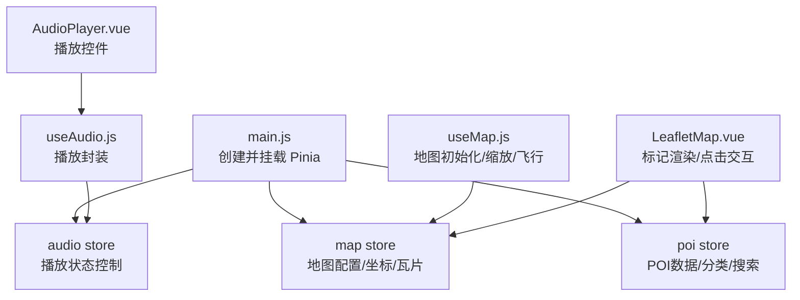
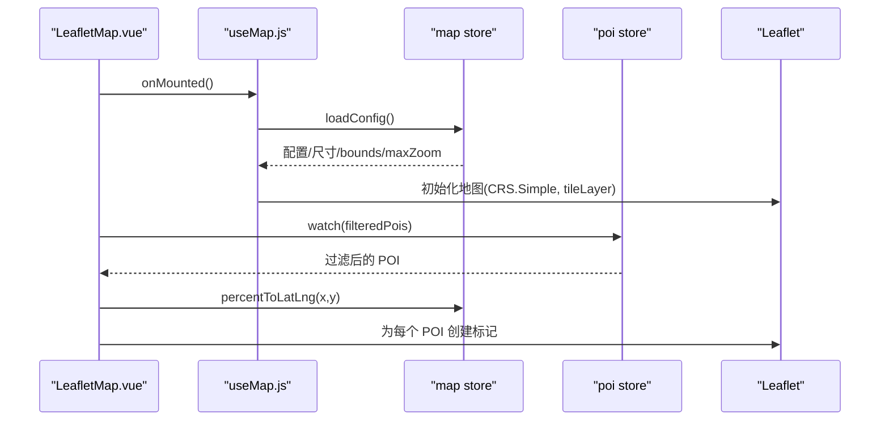
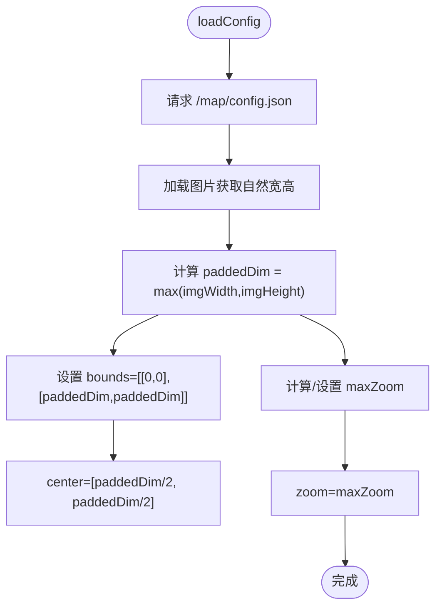
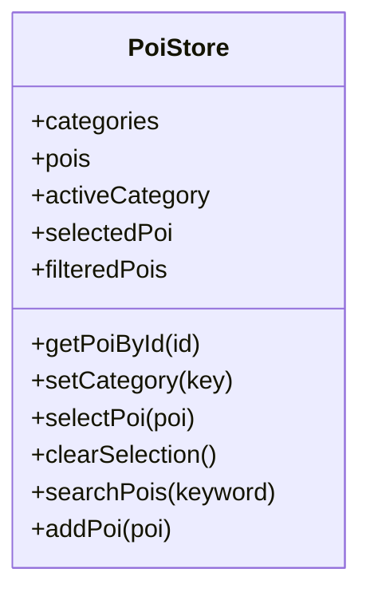
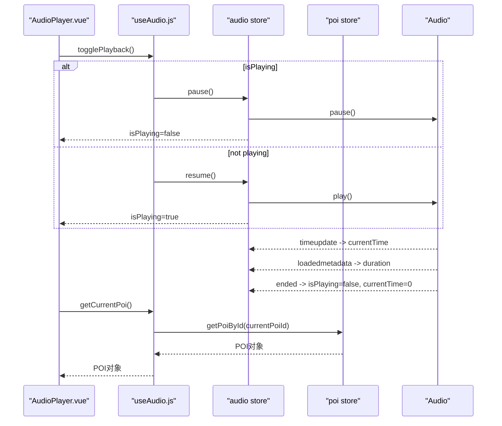
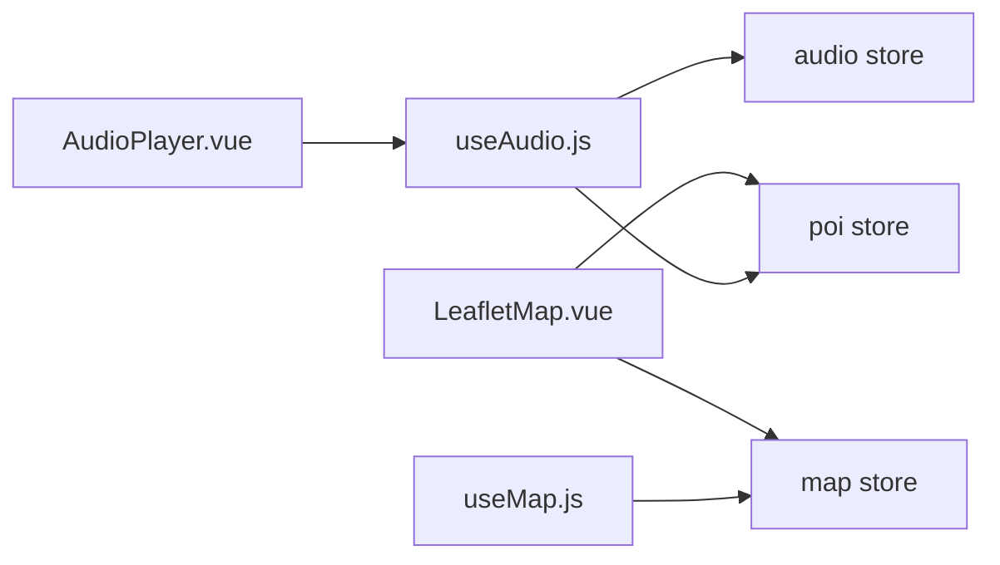

# Pinia Store 架构设计

<cite>
**本文引用的文件**
- [src/stores/map.js](file://src/stores/map.js)
- [src/stores/poi.js](file://src/stores/poi.js)
- [src/stores/audio.js](file://src/stores/audio.js)
- [src/main.js](file://src/main.js)
- [package.json](file://package.json)
- [src/composables/useMap.js](file://src/composables/useMap.js)
- [src/composables/useAudio.js](file://src/composables/useAudio.js)
- [src/components/map/LeafletMap.vue](file://src/components/map/LeafletMap.vue)
- [src/components/common/AudioPlayer.vue](file://src/components/common/AudioPlayer.vue)
- [public/map/config.json](file://public/map/config.json)
</cite>

## 目录
1. [简介](#简介)
2. [项目结构](#项目结构)
3. [核心组件](#核心组件)
4. [架构总览](#架构总览)
5. [详细组件分析](#详细组件分析)
6. [依赖关系分析](#依赖关系分析)
7. [性能考虑](#性能考虑)
8. [故障排查指南](#故障排查指南)
9. [结论](#结论)
10. [附录](#附录)

## 简介
本文件面向 FunMapUI 项目的状态管理，系统性阐述基于 Pinia 的 Store 架构。项目包含三个核心 store：
- map store：负责地图配置、坐标转换、瓦片系统与视图边界等与地图渲染相关的状态与能力。
- poi store：负责 POI 数据管理、分类筛选、搜索与选中态等。
- audio store：负责音频播放状态控制（当前 POI、播放进度、时长、播放/暂停/停止/跳转）。

文档将解释三者之间的依赖关系与数据流向，说明响应式更新机制，并提供扩展最佳实践、性能优化策略以及调试排错方法。

## 项目结构
- 应用入口初始化 Pinia，并在根实例中注入。
- 三个 store 位于 src/stores 下，分别对应地图、POI、音频领域。
- 组件通过 composables 间接或直接使用 store，实现关注点分离。
- 地图相关逻辑集中在 useMap composable 与 LeafletMap 组件中；音频相关逻辑集中在 useAudio composable 与 AudioPlayer 组件中。

图表来源
- [src/main.js:1-21](file://src/main.js#L1-L21)
- [src/stores/map.js:1-122](file://src/stores/map.js#L1-L122)
- [src/stores/poi.js:1-84](file://src/stores/poi.js#L1-L84)
- [src/stores/audio.js:1-111](file://src/stores/audio.js#L1-L111)
- [src/composables/useMap.js:1-174](file://src/composables/useMap.js#L1-L174)
- [src/components/map/LeafletMap.vue:1-141](file://src/components/map/LeafletMap.vue#L1-L141)
- [src/composables/useAudio.js:1-59](file://src/composables/useAudio.js#L1-L59)
- [src/components/common/AudioPlayer.vue:1-104](file://src/components/common/AudioPlayer.vue#L1-L104)

章节来源
- [src/main.js:1-21](file://src/main.js#L1-L21)
- [package.json:11-20](file://package.json#L11-L20)

## 核心组件
- map store：维护图片尺寸、Pad 后的正方形边长、CRS bounds、中心点、缩放级别、瓦片路径、图片路径、配置加载状态；提供百分比坐标与像素坐标互转方法；负责从配置加载并计算最大缩放级别。
- poi store：维护分类定义、全部 POI、当前分类、选中 POI；提供按分类过滤、按 ID 获取、设置分类、选择/清除选中、关键词搜索、添加新 POI 等方法。
- audio store：维护当前 POI ID、播放状态、当前时间、总时长；管理原生 Audio 实例，提供播放、暂停、恢复、停止、跳转等方法，并监听事件同步时间与结束状态。

章节来源
- [src/stores/map.js:1-122](file://src/stores/map.js#L1-L122)
- [src/stores/poi.js:1-84](file://src/stores/poi.js#L1-L84)
- [src/stores/audio.js:1-111](file://src/stores/audio.js#L1-L111)

## 架构总览
Pinia 在应用启动时创建并注入到 Vue 应用中，各组件通过组合式 API 或 composables 访问 store。Store 之间保持低耦合：
- LeafletMap 组件依赖 map store 进行坐标转换，依赖 poi store 获取 POI 列表以渲染标记。
- AudioPlayer 组件通过 useAudio composable 访问 audio store，并通过 poi store 获取当前播放 POI 的名称等信息。
- useMap composable 在地图初始化时读取 map store 的配置与边界信息，构建自定义 CRS 与瓦片层。
- useAudio composable 封装了播放流程，内部调用 audio store 的 play/pause/resume/stop/seek，并从 poi store 解析当前 POI。

图表来源
- [src/components/map/LeafletMap.vue:1-141](file://src/components/map/LeafletMap.vue#L1-L141)
- [src/composables/useMap.js:1-174](file://src/composables/useMap.js#L1-L174)
- [src/stores/map.js:1-122](file://src/stores/map.js#L1-L122)
- [src/stores/poi.js:1-84](file://src/stores/poi.js#L1-L84)

## 详细组件分析

### map store（地图配置、坐标转换、瓦片系统）
- 职责
  - 加载地图配置与图片尺寸，计算 Pad 后的正方形边长与 CRS bounds。
  - 维护 center、zoom、minZoom、maxZoom、tilesPath、imagePath、configLoaded。
  - 提供坐标转换：百分比坐标与像素坐标互转。
- 关键流程
  - 加载配置：读取 /map/config.json，动态获取图片尺寸，计算 paddedDim 与 maxZoom，设置初始 zoom 与 center。
  - 坐标转换：percentToLatLng 将百分比坐标映射到像素坐标；pixelToPercent 反向转换。
- 与外部集成
  - useMap 在初始化时读取 paddedDim、maxZoom、tilesPath 等，构建自定义 CRS 与瓦片层，并设置初始视图。
  - LeafletMap 使用 percentToLatLng 将 POI 的百分比坐标转换为像素坐标以放置标记。

图表来源
- [src/stores/map.js:40-85](file://src/stores/map.js#L40-L85)

章节来源
- [src/stores/map.js:1-122](file://src/stores/map.js#L1-L122)
- [public/map/config.json:1-5](file://public/map/config.json#L1-L5)
- [src/composables/useMap.js:14-129](file://src/composables/useMap.js#L14-L129)
- [src/components/map/LeafletMap.vue:61-95](file://src/components/map/LeafletMap.vue#L61-L95)

### poi store（POI 数据管理、分类筛选、搜索功能）
- 职责
  - 维护分类定义、全部 POI、当前分类、选中 POI。
  - 提供按分类过滤、按 ID 获取、设置分类、选择/清除选中、关键词搜索、添加新 POI。
- 关键特性
  - 使用 computed 派生 filteredPois，响应式地根据 activeCategory 变化更新 UI。
  - searchPois 支持名称、描述、标签的多字段模糊匹配。
- 与外部集成
  - LeafletMap 监听 filteredPois 变化，据此更新地图上的标记。
  - HomeView 在编辑模式下通过 addPoi 新增 POI。

图表来源
- [src/stores/poi.js:5-84](file://src/stores/poi.js#L5-L84)

章节来源
- [src/stores/poi.js:1-84](file://src/stores/poi.js#L1-L84)
- [src/components/map/LeafletMap.vue:31-46](file://src/components/map/LeafletMap.vue#L31-L46)
- [src/views/HomeView.vue:88-96](file://src/views/HomeView.vue#L88-L96)

### audio store（音频播放状态控制）
- 职责
  - 维护 currentPoiId、isPlaying、currentTime、duration。
  - 管理原生 Audio 实例的生命周期与事件监听，提供 play/pause/resume/stop/seek。
- 关键流程
  - play：若正在播放同一音频则暂停；否则创建新的 Audio 实例，绑定 timeupdate/loadedmetadata/ended 事件，更新 currentTime/duration/isPlaying。
  - pause/resume/stop/seek：对 Audio 实例执行相应操作并同步 store 状态。
- 与外部集成
  - useAudio composable 暴露 playPoiAudio/togglePlayback/getCurrentPoi/formatTime，供 AudioPlayer 组件使用。
  - getCurrentPoi 通过 poi store 的 getPoiById 获取当前播放 POI 的信息。

图表来源
- [src/stores/audio.js:25-97](file://src/stores/audio.js#L25-L97)
- [src/composables/useAudio.js:16-38](file://src/composables/useAudio.js#L16-L38)
- [src/components/common/AudioPlayer.vue:28-45](file://src/components/common/AudioPlayer.vue#L28-L45)

章节来源
- [src/stores/audio.js:1-111](file://src/stores/audio.js#L1-L111)
- [src/composables/useAudio.js:1-59](file://src/composables/useAudio.js#L1-L59)
- [src/components/common/AudioPlayer.vue:1-104](file://src/components/common/AudioPlayer.vue#L1-L104)

## 依赖关系分析
- 组件到 store 的直接依赖
  - LeafletMap.vue 直接依赖 map store（坐标转换）与 poi store（数据源与选中态）。
  - AudioPlayer.vue 通过 useAudio composable 间接依赖 audio store 与 poi store。
- Composable 到 store 的依赖
  - useMap.js 依赖 map store 读取配置与边界信息，用于初始化 Leaflet 地图与瓦片层。
  - useAudio.js 依赖 audio store 与 poi store，封装播放流程与当前 POI 解析。
- Store 间耦合
  - 三个 store 彼此独立，无相互引用，通过组件与 composable 协作，符合单一职责原则。
  - 数据流单向：组件触发 action -> store 更新 state -> 组件响应式更新。

图表来源
- [src/components/map/LeafletMap.vue:1-141](file://src/components/map/LeafletMap.vue#L1-L141)
- [src/components/common/AudioPlayer.vue:1-104](file://src/components/common/AudioPlayer.vue#L1-L104)
- [src/composables/useMap.js:1-174](file://src/composables/useMap.js#L1-L174)
- [src/composables/useAudio.js:1-59](file://src/composables/useAudio.js#L1-L59)
- [src/stores/map.js:1-122](file://src/stores/map.js#L1-L122)
- [src/stores/poi.js:1-84](file://src/stores/poi.js#L1-L84)
- [src/stores/audio.js:1-111](file://src/stores/audio.js#L1-L111)

章节来源
- [src/components/map/LeafletMap.vue:1-141](file://src/components/map/LeafletMap.vue#L1-L141)
- [src/components/common/AudioPlayer.vue:1-104](file://src/components/common/AudioPlayer.vue#L1-L104)
- [src/composables/useMap.js:1-174](file://src/composables/useMap.js#L1-L174)
- [src/composables/useAudio.js:1-59](file://src/composables/useAudio.js#L1-L59)

## 性能考虑
- 响应式更新
  - poi store 使用 computed 派生 filteredPois，避免重复过滤逻辑，提升渲染效率。
  - audio store 通过事件驱动更新 currentTime/duration，减少轮询开销。
- 地图渲染
  - 使用 Leaflet 的 tileLayer 与 CSS 放大超出 maxNativeZoom 的层级，减少瓦片生成成本。
  - 自定义 getTileUrl 翻转 y 坐标，确保瓦片正确显示，避免不必要的重绘。
- 内存与资源
  - audio store 在切换音频时释放旧 Audio 实例，防止内存泄漏。
  - LeafletMap 在更新标记前移除旧标记，避免 DOM 节点堆积。
- 交互体验
  - useMap 禁用内置 touchZoom，采用双指手势阈值触发缩放，提升移动端体验。
  - 地图初始视图以实际图片中心为准，避免用户进入后需要手动定位。

[本节为通用性能建议，不直接分析具体代码行]

## 故障排查指南
- 地图配置加载失败
  - 现象：无法加载图片尺寸或瓦片路径错误。
  - 排查：检查 /map/config.json 是否存在且格式正确；确认 tilesPath 与 imagePath 指向有效资源。
  - 参考位置：配置加载逻辑与日志输出。
- 瓦片显示异常
  - 现象：瓦片错位或空白。
  - 排查：确认 getTileUrl 中的 y 坐标翻转逻辑；检查 maxNativeZoom 与实际瓦片层级是否一致；查看控制台输出的瓦片加载统计。
  - 参考位置：useMap 中 tileLayer 初始化与 getTileUrl 覆盖。
- 音频无法播放
  - 现象：点击播放无声音或立即停止。
  - 排查：检查浏览器自动播放策略限制；确认音频 URL 可访问；查看 isPlaying 状态与错误捕获分支。
  - 参考位置：audio store 的 play 方法与事件监听。
- POI 标记未更新
  - 现象：切换分类或搜索后标记不变化。
  - 排查：确认 filteredPois 是否正确派生；检查 watch 是否触发；验证 percentToLatLng 转换结果。
  - 参考位置：LeafletMap 中 watch 与 updateMarkers。

章节来源
- [src/stores/map.js:40-85](file://src/stores/map.js#L40-L85)
- [src/composables/useMap.js:47-68](file://src/composables/useMap.js#L47-L68)
- [src/stores/audio.js:25-58](file://src/stores/audio.js#L25-L58)
- [src/components/map/LeafletMap.vue:31-95](file://src/components/map/LeafletMap.vue#L31-L95)

## 结论
FunMapUI 的 Pinia Store 架构清晰、职责明确：
- map store 专注地图配置与坐标体系，为地图渲染提供基础能力。
- poi store 管理业务数据与筛选逻辑，支撑地图标记与详情展示。
- audio store 统一管理音频播放状态，提供跨组件一致的播放体验。
三者通过组件与 composable 解耦协作，数据流单向、响应式更新高效。遵循本文的最佳实践与优化策略，可进一步提升可维护性与性能表现。

[本节为总结性内容，不直接分析具体代码行]

## 附录
- 环境依赖
  - 使用 Vite 作为构建工具，Vue 3 与 Pinia 作为前端框架与状态管理库。
  - 引入 Leaflet 用于地图渲染，Vant 用于 UI 组件。
- 扩展建议
  - 新增 store：遵循单一职责，避免跨 store 直接引用，通过组件或 composable 协调。
  - 状态持久化：如需跨会话保存，可在 store 中结合本地存储或后端接口。
  - 测试策略：为 store 的 action 与 computed 编写单元测试，验证边界条件与异常处理。

章节来源
- [package.json:11-20](file://package.json#L11-L20)