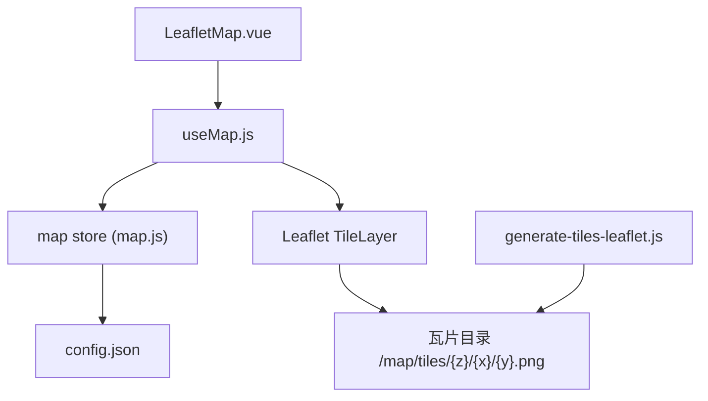
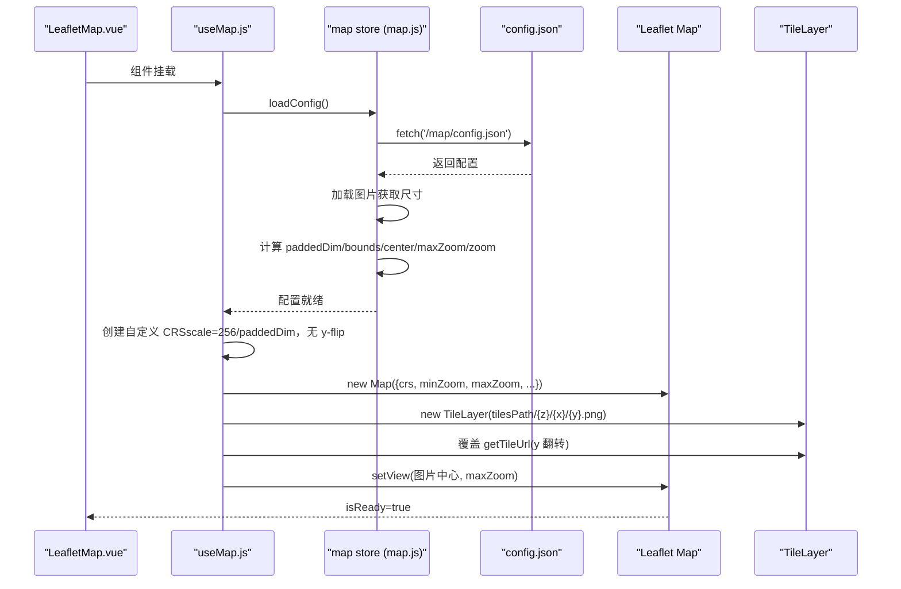
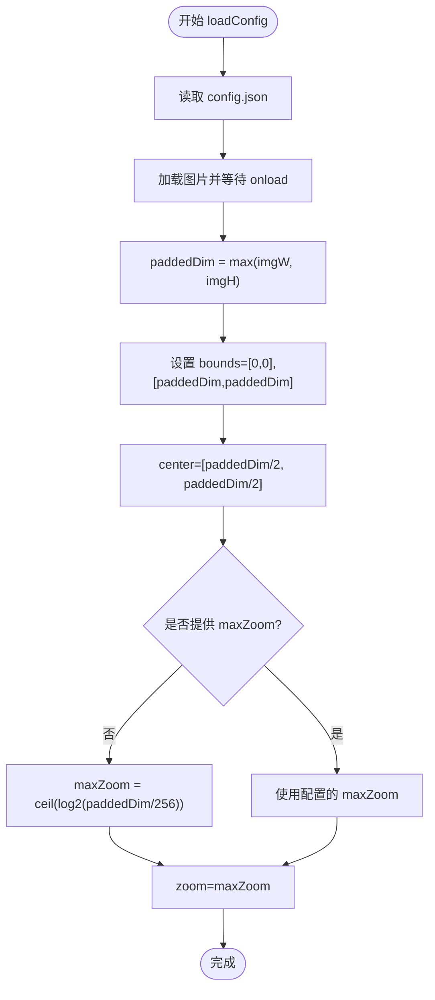
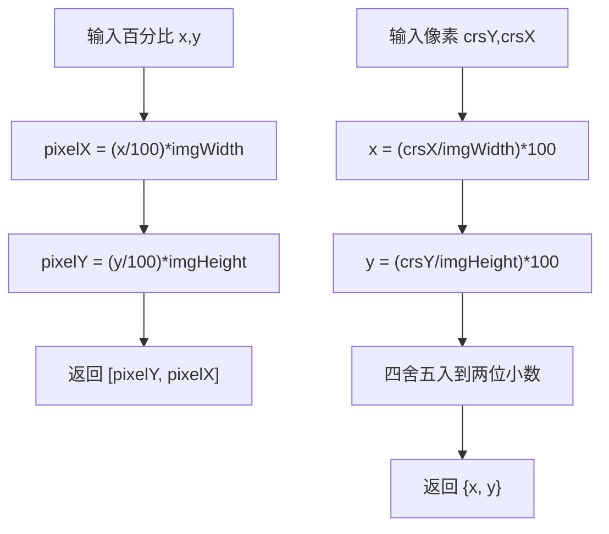
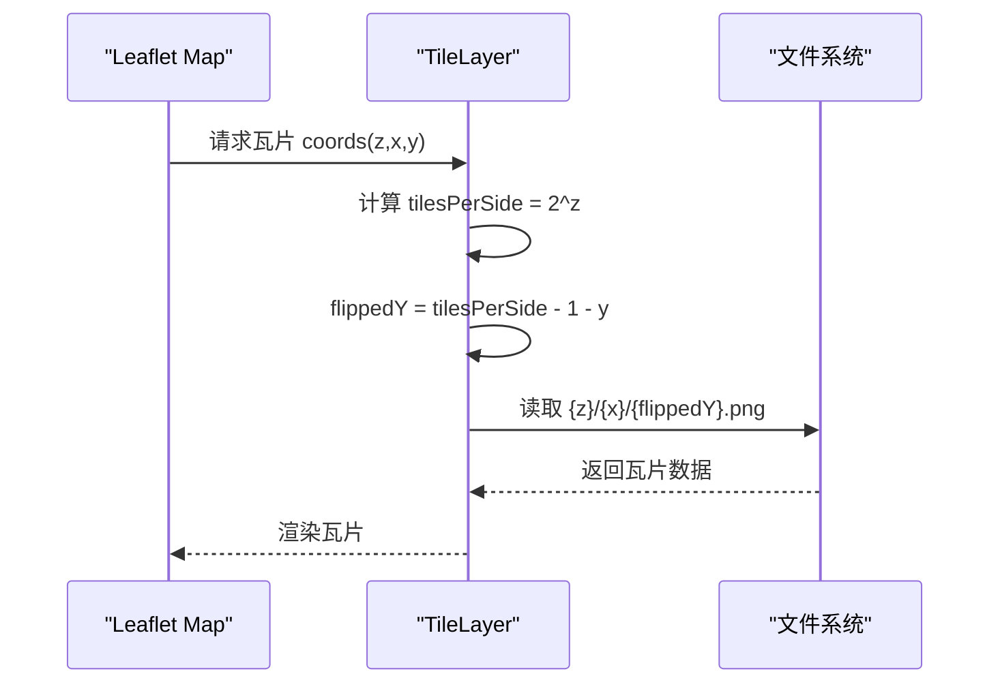
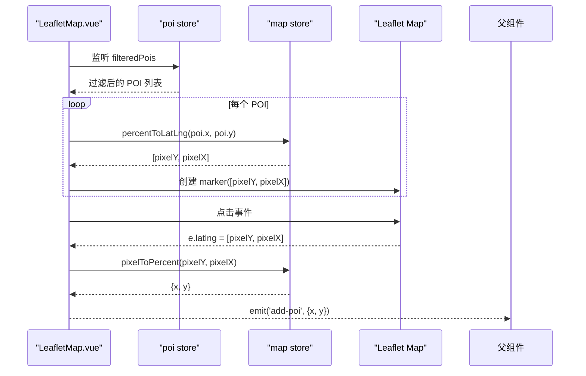
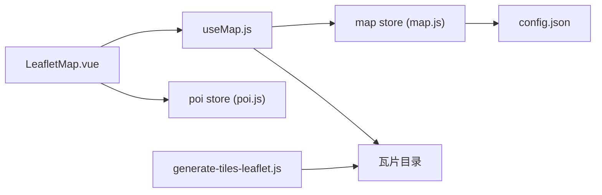

# 地图状态管理

<cite>
**本文引用的文件**
- [src/stores/map.js](file://src/stores/map.js)
- [src/composables/useMap.js](file://src/composables/useMap.js)
- [src/components/map/LeafletMap.vue](file://src/components/map/LeafletMap.vue)
- [public/map/config.json](file://public/map/config.json)
- [scripts/generate-tiles-leaflet.js](file://scripts/generate-tiles-leaflet.js)
- [src/stores/poi.js](file://src/stores/poi.js)
</cite>

## 目录
1. [简介](#简介)
2. [项目结构](#项目结构)
3. [核心组件](#核心组件)
4. [架构总览](#架构总览)
5. [详细组件分析](#详细组件分析)
6. [依赖关系分析](#依赖关系分析)
7. [性能考虑](#性能考虑)
8. [故障排查指南](#故障排查指南)
9. [结论](#结论)
10. [附录](#附录)

## 简介
本文件围绕“地图状态管理”展开，聚焦 map store 的实现细节与使用方式。内容涵盖：
- 图片尺寸管理与 paddedDim 的正方形化原理
- CRS.Simple 坐标系配置（无 y-flip、bounds 设置）
- 瓦片路径管理与 getTileUrl 的 y 坐标翻转
- 坐标转换函数 percentToLatLng 与 pixelToPercent 的数学原理
- loadConfig 的异步加载流程与 maxZoom 自动计算机制
- 地图状态在 LeafletMap 中的集成模式与使用示例
- 性能优化建议与常见问题排查

## 项目结构
本项目采用 Vue 3 + Pinia 的状态管理模式，结合 Leaflet 实现基于 CRS.Simple 像素坐标系的地图渲染。关键文件职责如下：
- src/stores/map.js：定义地图状态（图片尺寸、paddedDim、bounds、center、zoom、maxZoom、tilesPath、imagePath），并提供 loadConfig、percentToLatLng、pixelToPercent 等方法
- src/composables/useMap.js：封装 Leaflet 地图初始化、CRS 配置、瓦片层、触摸缩放等逻辑，并消费 map store
- src/components/map/LeafletMap.vue：页面级地图组件，负责 POI 标记渲染、点击事件处理、编辑模式交互
- public/map/config.json：地图配置（图片路径、瓦片路径、可选的 maxZoom）
- scripts/generate-tiles-leaflet.js：构建期脚本，生成标准瓦片金字塔（含 y-flip 约定）
- src/stores/poi.js：POI 数据与筛选逻辑，配合地图标记展示

图表来源
- [src/components/map/LeafletMap.vue:1-141](file://src/components/map/LeafletMap.vue#L1-L141)
- [src/composables/useMap.js:1-174](file://src/composables/useMap.js#L1-L174)
- [src/stores/map.js:1-122](file://src/stores/map.js#L1-L122)
- [public/map/config.json:1-5](file://public/map/config.json#L1-L5)
- [scripts/generate-tiles-leaflet.js:1-128](file://scripts/generate-tiles-leaflet.js#L1-L128)

章节来源
- [src/stores/map.js:1-122](file://src/stores/map.js#L1-L122)
- [src/composables/useMap.js:1-174](file://src/composables/useMap.js#L1-L174)
- [src/components/map/LeafletMap.vue:1-141](file://src/components/map/LeafletMap.vue#L1-L141)
- [public/map/config.json:1-5](file://public/map/config.json#L1-L5)
- [scripts/generate-tiles-leaflet.js:1-128](file://scripts/generate-tiles-leaflet.js#L1-L128)

## 核心组件
- map store（Pinia）：集中管理地图相关状态与算法
  - 图片尺寸 imgWidth/imgHeight
  - paddedDim：正方形化边长，用于 CRS bounds
  - bounds：CRS.Simple 的边界范围
  - center：初始中心（像素坐标）
  - zoom/maxZoom/minZoom：缩放控制
  - tilesPath/imagePath：资源路径
  - loadConfig：异步加载配置与图片尺寸，计算 paddedDim、bounds、maxZoom、center、zoom
  - percentToLatLng：百分比坐标 → 像素坐标 [crsY, crsX]
  - pixelToPercent：像素坐标 → 百分比坐标 {x, y}
- useMap（composable）：封装 Leaflet 地图实例生命周期与交互
  - 自定义 CRS：scale = 256 / paddedDim，无 y-flip，infinite=false
  - 瓦片层：覆盖 getTileUrl 以翻转 y 坐标，匹配瓦片生成时的 y-flip 约定
  - 触摸双指缩放：阈值触发整级缩放
  - 视图初始化：setView 到图片中心，zoom 为 maxZoom
- LeafletMap.vue：页面集成
  - 监听 POI 变化更新标记
  - 点击地图获取像素坐标并转换为百分比，触发 add-poi 事件
  - 编辑模式下绑定/解绑点击事件

章节来源
- [src/stores/map.js:1-122](file://src/stores/map.js#L1-L122)
- [src/composables/useMap.js:1-174](file://src/composables/useMap.js#L1-L174)
- [src/components/map/LeafletMap.vue:1-141](file://src/components/map/LeafletMap.vue#L1-L141)

## 架构总览
下图展示了从配置加载到地图渲染的关键流程，包括异步加载、CRS 配置、瓦片路径与坐标转换。

图表来源
- [src/components/map/LeafletMap.vue:1-141](file://src/components/map/LeafletMap.vue#L1-L141)
- [src/composables/useMap.js:1-174](file://src/composables/useMap.js#L1-L174)
- [src/stores/map.js:1-122](file://src/stores/map.js#L1-L122)
- [public/map/config.json:1-5](file://public/map/config.json#L1-L5)

## 详细组件分析

### map store：loadConfig 异步加载与 maxZoom 自动计算
- 异步流程
  - 读取 /map/config.json，设置 tilesPath 与 imagePath
  - 通过 Image 对象加载图片，等待 onload 后获取 naturalWidth/naturalHeight
  - 计算 paddedDim = max(imgWidth, imgHeight)，保证后续瓦片与坐标系统一致
  - 设置 bounds = [[0,0],[paddedDim,paddedDim]]，center = [paddedDim/2, paddedDim/2]
  - 若配置未提供 maxZoom，则按 Math.ceil(log2(paddedDim / 256)) 自动计算；否则使用配置值
  - 初始 zoom = maxZoom，表示完整显示图片且每片瓦片约 256px
- 错误处理
  - 捕获异常并输出错误日志，避免中断应用启动
- 返回值
  - 暴露 imgWidth/imgHeight、paddedDim、bounds、center、zoom、minZoom、maxZoom、tilesPath、imagePath、configLoaded 以及方法 loadConfig、percentToLatLng、pixelToPercent

图表来源
- [src/stores/map.js:40-85](file://src/stores/map.js#L40-L85)

章节来源
- [src/stores/map.js:40-85](file://src/stores/map.js#L40-L85)

### 坐标转换：percentToLatLng 与 pixelToPercent 的数学原理
- 背景
  - 使用 CRS.Simple 像素坐标系，坐标顺序为 [crsY, crsX]
  - 百分比坐标 x,y ∈ [0,100]，分别对应图片宽高的比例位置
- 公式
  - percentToLatLng(x, y):
    - pixelX = (x / 100) * imgWidth
    - pixelY = (y / 100) * imgHeight
    - 返回 [pixelY, pixelX]
  - pixelToPercent(crsY, crsX):
    - x = (crsX / imgWidth) * 100
    - y = (crsY / imgHeight) * 100
    - 返回 {x, y}，保留两位小数
- 用途
  - POI 存储通常使用百分比坐标，便于响应式布局
  - 地图渲染时转换为像素坐标以放置 marker
  - 用户点击地图时，将像素坐标转回百分比以便持久化

图表来源
- [src/stores/map.js:93-103](file://src/stores/map.js#L93-L103)

章节来源
- [src/stores/map.js:93-103](file://src/stores/map.js#L93-L103)

### CRS.Simple 配置与瓦片路径管理
- 自定义 CRS
  - scale = 256 / paddedDim，确保在 z=0 时每片瓦片 256px
  - 覆盖 projection.bounds 为 [0,0] 到 [paddedDim,paddedDim]
  - transformation 使用新 L.Transformation(scale, 0, scale, 0)，无 y-flip
  - infinite=false，限制地图不可无限平铺
- 瓦片层
  - URL 模板：{tilesPath}/{z}/{x}/{y}.png
  - maxNativeZoom = mapStore.maxZoom，超出级别由 CSS 放大
  - 覆盖 getTileUrl：根据 Leaflet 计算的 coords.y 进行翻转，得到瓦片文件中的 ty
    - flippedY = tilesPerSide - 1 - coords.y
- 瓦片生成脚本
  - 生成时遵循 CRS.Simple 的 y-flip 约定：ty=0 对应图像底部
  - 对 pad 后的正方形进行标准瓦片金字塔切割，确保内容与 Leaflet 定位一致

图表来源
- [src/composables/useMap.js:47-68](file://src/composables/useMap.js#L47-L68)
- [scripts/generate-tiles-leaflet.js:60-115](file://scripts/generate-tiles-leaflet.js#L60-L115)

章节来源
- [src/composables/useMap.js:20-68](file://src/composables/useMap.js#L20-L68)
- [scripts/generate-tiles-leaflet.js:29-122](file://scripts/generate-tiles-leaflet.js#L29-L122)

### paddedDim 的正方形化处理原理
- 目的
  - 保证 Leaflet 瓦片坐标系统在正方形网格上工作，避免非正方形导致的坐标偏移或裁剪问题
- 方法
  - paddedDim = max(imgWidth, imgHeight)
  - 将图片置于左上角，右下角填充透明区域，形成正方形画布
- 影响
  - bounds 设置为 [0,0] 到 [paddedDim,paddedDim]
  - 瓦片生成脚本同样基于 paddedDim 进行切割，前后端保持一致

章节来源
- [src/stores/map.js:59-66](file://src/stores/map.js#L59-L66)
- [scripts/generate-tiles-leaflet.js:34-57](file://scripts/generate-tiles-leaflet.js#L34-L57)

### 地图状态的使用示例与集成模式
- 在 LeafletMap.vue 中
  - 通过 useMap(containerRef) 获取地图实例与就绪状态
  - 监听 poiStore.filteredPois 变化，调用 mapStore.percentToLatLng 将百分比坐标转为像素坐标，创建 marker
  - 点击地图时，读取 e.latlng（像素坐标），调用 mapStore.pixelToPercent 转回百分比，并通过 emit('add-poi', {x,y}) 通知父组件
- 与 POI 状态的协作
  - POI 数据存储在 poi store，支持分类筛选与搜索
  - 地图标记随 filteredPois 动态更新

图表来源
- [src/components/map/LeafletMap.vue:31-116](file://src/components/map/LeafletMap.vue#L31-L116)
- [src/stores/map.js:93-103](file://src/stores/map.js#L93-L103)
- [src/stores/poi.js:27-31](file://src/stores/poi.js#L27-L31)

章节来源
- [src/components/map/LeafletMap.vue:31-116](file://src/components/map/LeafletMap.vue#L31-L116)
- [src/stores/poi.js:1-84](file://src/stores/poi.js#L1-L84)

## 依赖关系分析
- 组件依赖
  - LeafletMap.vue 依赖 useMap composable 与 map store、poi store
  - useMap 依赖 map store 提供的配置与状态
  - map store 依赖外部配置文件 config.json
- 构建期依赖
  - generate-tiles-leaflet.js 依赖 config.json 与 sharp 图像处理库，生成瓦片金字塔
- 运行时依赖
  - Leaflet 库用于地图渲染与交互
  - Pinia 用于状态管理

图表来源
- [src/components/map/LeafletMap.vue:1-141](file://src/components/map/LeafletMap.vue#L1-L141)
- [src/composables/useMap.js:1-174](file://src/composables/useMap.js#L1-L174)
- [src/stores/map.js:1-122](file://src/stores/map.js#L1-L122)
- [src/stores/poi.js:1-84](file://src/stores/poi.js#L1-L84)
- [scripts/generate-tiles-leaflet.js:1-128](file://scripts/generate-tiles-leaflet.js#L1-L128)
- [public/map/config.json:1-5](file://public/map/config.json#L1-L5)

章节来源
- [src/components/map/LeafletMap.vue:1-141](file://src/components/map/LeafletMap.vue#L1-L141)
- [src/composables/useMap.js:1-174](file://src/composables/useMap.js#L1-L174)
- [src/stores/map.js:1-122](file://src/stores/map.js#L1-L122)
- [src/stores/poi.js:1-84](file://src/stores/poi.js#L1-L84)
- [scripts/generate-tiles-leaflet.js:1-128](file://scripts/generate-tiles-leaflet.js#L1-L128)
- [public/map/config.json:1-5](file://public/map/config.json#L1-L5)

## 性能考虑
- 瓦片层级与缓存
  - 使用 maxNativeZoom 限制原生瓦片层级，超出部分由 CSS 放大，减少网络请求与内存占用
  - 合理设置 tileSize=256，符合 Leaflet 默认瓦片尺寸，利于浏览器缓存
- 坐标与变换
  - 自定义 CRS 的 scale 与 transformation 避免重复计算，提升渲染效率
  - 使用 noWrap=true 防止不必要的瓦片重复加载
- 交互优化
  - 禁用内置 touchZoom，改用自定义双指缩放，减少抖动与频繁重绘
  - zoomDelta=0.5 提供更平滑的缩放体验
- 调试与监控
  - 监听 zoomend 事件统计瓦片加载情况，辅助定位性能瓶颈

[本节为通用性能指导，不直接分析具体代码文件]

## 故障排查指南
- 配置加载失败
  - 检查 /map/config.json 是否存在且可访问
  - 确认图片路径正确，Image 加载成功
  - 查看控制台错误日志定位问题
- 瓦片不显示或错位
  - 确认瓦片目录结构与 URL 模板一致
  - 检查 getTileUrl 的 y 坐标翻转逻辑是否与生成脚本一致
  - 验证 paddedDim 与 maxZoom 计算是否正确
- 坐标转换异常
  - 确认百分比坐标范围在 [0,100]
  - 检查 imgWidth/imgHeight 是否为 0（图片未加载完成）
- 触摸缩放无效
  - 确认 touchZoom=false 且自定义事件已绑定
  - 检查 PINCH_THRESHOLD 阈值是否合适

章节来源
- [src/stores/map.js:40-85](file://src/stores/map.js#L40-L85)
- [src/composables/useMap.js:60-68](file://src/composables/useMap.js#L60-L68)
- [src/composables/useMap.js:72-111](file://src/composables/useMap.js#L72-L111)
- [scripts/generate-tiles-leaflet.js:60-115](file://scripts/generate-tiles-leaflet.js#L60-L115)

## 结论
本方案通过 map store 统一管理地图状态，结合 useMap composable 封装 Leaflet 地图初始化与交互，实现了基于 CRS.Simple 像素坐标系的精确渲染。关键点包括：
- 图片尺寸与 paddedDim 的正方形化处理，确保瓦片与坐标系统一致
- 自定义 CRS 与 getTileUrl 的 y 坐标翻转，匹配瓦片生成约定
- 百分比与像素坐标的双向转换，简化 POI 数据存储与渲染
- 异步配置加载与 maxZoom 自动计算，提升易用性与鲁棒性
- 合理的性能优化与调试手段，保障用户体验

[本节为总结性内容，不直接分析具体代码文件]

## 附录
- 配置项说明
  - image：手绘地图图片路径
  - tilesPath：瓦片目录路径
  - maxZoom：最大原生瓦片层级（可为 null，自动计算）
- 常用 API
  - mapStore.loadConfig()：异步加载配置与图片尺寸
  - mapStore.percentToLatLng(x, y)：百分比 → 像素坐标
  - mapStore.pixelToPercent(crsY, crsX)：像素 → 百分比坐标
  - useMap.zoomBy(delta)：缩放地图
  - useMap.flyTo(latlng, zoom)：飞行到指定坐标与缩放级别

章节来源
- [public/map/config.json:1-5](file://public/map/config.json#L1-L5)
- [src/stores/map.js:40-120](file://src/stores/map.js#L40-L120)
- [src/composables/useMap.js:131-172](file://src/composables/useMap.js#L131-L172)