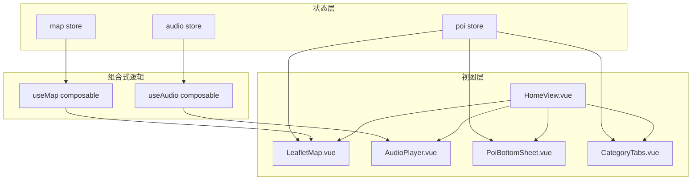
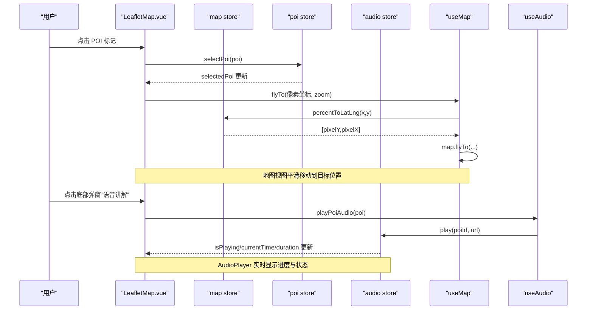
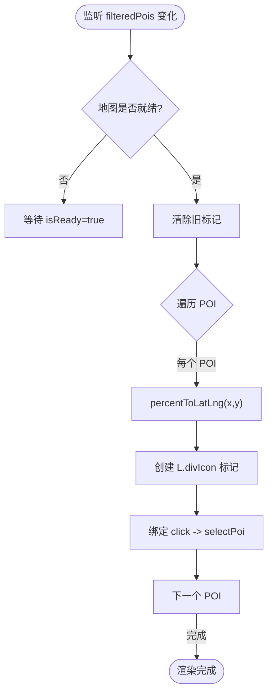
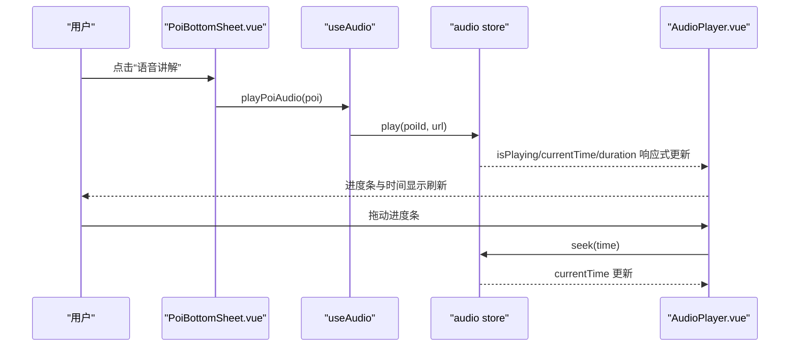
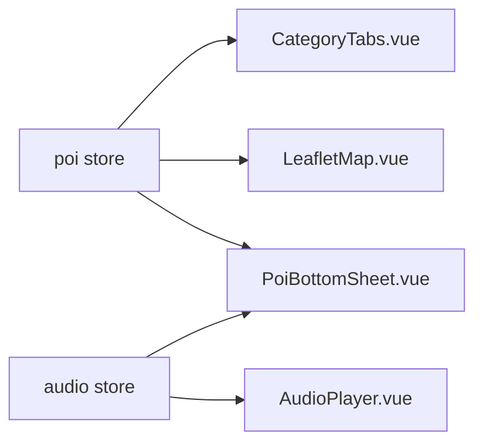
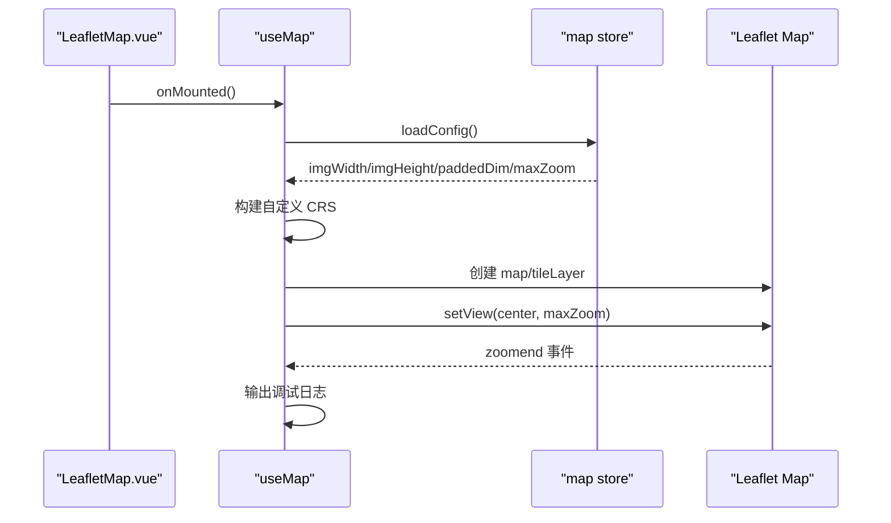
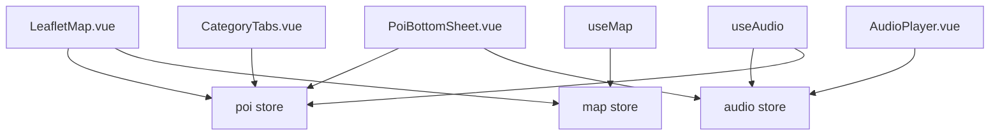

# 状态同步机制

<cite>
**本文引用的文件**
- [src/stores/map.js](file://src/stores/map.js)
- [src/stores/poi.js](file://src/stores/poi.js)
- [src/stores/audio.js](file://src/stores/audio.js)
- [src/composables/useMap.js](file://src/composables/useMap.js)
- [src/composables/useAudio.js](file://src/composables/useAudio.js)
- [src/components/map/LeafletMap.vue](file://src/components/map/LeafletMap.vue)
- [src/components/common/AudioPlayer.vue](file://src/components/common/AudioPlayer.vue)
- [src/components/common/PoiBottomSheet.vue](file://src/components/common/PoiBottomSheet.vue)
- [src/components/map/CategoryTabs.vue](file://src/components/map/CategoryTabs.vue)
- [src/views/HomeView.vue](file://src/views/HomeView.vue)
- [src/data/mock.js](file://src/data/mock.js)
</cite>

## 目录
1. [简介](#简介)
2. [项目结构](#项目结构)
3. [核心组件与状态](#核心组件与状态)
4. [架构总览](#架构总览)
5. [详细组件分析](#详细组件分析)
6. [依赖关系分析](#依赖关系分析)
7. [性能考虑](#性能考虑)
8. [故障排查指南](#故障排查指南)
9. [结论](#结论)
10. [附录：最佳实践与调试技巧](#附录最佳实践与调试技巧)

## 简介
本文档聚焦 FunMapUI 的状态同步机制，围绕 Pinia store（map、poi、audio）与 Vue 组件之间的响应式联动展开，重点说明：
- 地图状态与 POI 状态的联动策略
- 音频状态与用户交互的同步方式
- 跨组件状态共享机制
- 响应式数据更新的触发条件与性能优化
- 异步状态更新的处理模式与错误恢复
- 状态一致性保证与并发访问处理策略
- 状态同步的最佳实践与调试技巧

## 项目结构
本项目采用“Store + Composable + Component”的分层组织：
- Store 层：集中管理应用状态（地图配置与视图、POI 数据与筛选、音频播放控制）
- Composable 层：封装业务逻辑与第三方库集成（Leaflet 地图初始化、音频播放封装）
- 组件层：负责 UI 展示与用户交互，通过 watch/computed 订阅 store 变化并驱动视图更新

图表来源
- [src/stores/map.js:1-122](file://src/stores/map.js#L1-L122)
- [src/stores/poi.js:1-84](file://src/stores/poi.js#L1-L84)
- [src/stores/audio.js:1-111](file://src/stores/audio.js#L1-L111)
- [src/composables/useMap.js:1-174](file://src/composables/useMap.js#L1-L174)
- [src/composables/useAudio.js:1-59](file://src/composables/useAudio.js#L1-L59)
- [src/components/map/LeafletMap.vue:1-141](file://src/components/map/LeafletMap.vue#L1-L141)
- [src/components/common/AudioPlayer.vue:1-104](file://src/components/common/AudioPlayer.vue#L1-L104)
- [src/components/common/PoiBottomSheet.vue:1-190](file://src/components/common/PoiBottomSheet.vue#L1-L190)
- [src/components/map/CategoryTabs.vue:1-59](file://src/components/map/CategoryTabs.vue#L1-L59)
- [src/views/HomeView.vue:1-136](file://src/views/HomeView.vue#L1-L136)

章节来源
- [src/stores/map.js:1-122](file://src/stores/map.js#L1-L122)
- [src/stores/poi.js:1-84](file://src/stores/poi.js#L1-L84)
- [src/stores/audio.js:1-111](file://src/stores/audio.js#L1-L111)
- [src/composables/useMap.js:1-174](file://src/composables/useMap.js#L1-L174)
- [src/composables/useAudio.js:1-59](file://src/composables/useAudio.js#L1-L59)
- [src/components/map/LeafletMap.vue:1-141](file://src/components/map/LeafletMap.vue#L1-L141)
- [src/components/common/AudioPlayer.vue:1-104](file://src/components/common/AudioPlayer.vue#L1-L104)
- [src/components/common/PoiBottomSheet.vue:1-190](file://src/components/common/PoiBottomSheet.vue#L1-L190)
- [src/components/map/CategoryTabs.vue:1-59](file://src/components/map/CategoryTabs.vue#L1-L59)
- [src/views/HomeView.vue:1-136](file://src/views/HomeView.vue#L1-L136)

## 核心组件与状态
- map store：维护图片尺寸、CRS 边界、中心点、缩放级别、瓦片路径、配置加载状态；提供坐标转换工具方法。
- poi store：维护分类、POI 列表、当前选中项、当前激活分类；提供过滤、搜索、选择等能力。
- audio store：维护当前播放 POI ID、播放状态、进度、时长；封装播放/暂停/停止/跳转等。
- useMap composable：封装 Leaflet 地图初始化、自定义 CRS、瓦片 y 翻转、双指缩放、初始视图设置等。
- useAudio composable：封装播放 POI 语音、切换播放状态、获取当前 POI、时间格式化等。

章节来源
- [src/stores/map.js:1-122](file://src/stores/map.js#L1-L122)
- [src/stores/poi.js:1-84](file://src/stores/poi.js#L1-L84)
- [src/stores/audio.js:1-111](file://src/stores/audio.js#L1-L111)
- [src/composables/useMap.js:1-174](file://src/composables/useMap.js#L1-L174)
- [src/composables/useAudio.js:1-59](file://src/composables/useAudio.js#L1-L59)

## 架构总览
整体采用单向数据流：
- 用户交互在组件中触发 store 方法或 composable 方法
- Store 变更通过响应式系统自动驱动视图更新
- Composable 作为中间层协调第三方库（Leaflet、Audio）与 Store 的交互

图表来源
- [src/components/map/LeafletMap.vue:61-95](file://src/components/map/LeafletMap.vue#L61-L95)
- [src/stores/poi.js:43-51](file://src/stores/poi.js#L43-L51)
- [src/composables/useMap.js:146-150](file://src/composables/useMap.js#L146-L150)
- [src/stores/map.js:93-103](file://src/stores/map.js#L93-L103)
- [src/components/common/PoiBottomSheet.vue:88-91](file://src/components/common/PoiBottomSheet.vue#L88-L91)
- [src/composables/useAudio.js:16-19](file://src/composables/useAudio.js#L16-L19)
- [src/stores/audio.js:25-58](file://src/stores/audio.js#L25-L58)

## 详细组件分析

### 地图状态与 POI 状态的联动
- 触发条件
  - POI 列表变化：watch 监听 poiStore.filteredPois，当分类切换或新增 POI 时重新渲染标记
  - 地图就绪：watch isReady，确保地图实例可用后再添加标记
  - 编辑模式切换：动态绑定/解绑地图点击事件以支持添加 POI
- 坐标转换
  - 使用 mapStore.percentToLatLng 将百分比坐标转换为 CRS.Simple 像素坐标
  - 使用 mapStore.pixelToPercent 将点击事件的像素坐标转回百分比坐标用于新增 POI
- 标记渲染
  - 根据 POI 分类颜色生成自定义 HTML 标记
  - 点击标记调用 poiStore.selectPoi 更新选中项，触发底部弹窗显示

图表来源
- [src/components/map/LeafletMap.vue:31-46](file://src/components/map/LeafletMap.vue#L31-L46)
- [src/components/map/LeafletMap.vue:61-95](file://src/components/map/LeafletMap.vue#L61-L95)
- [src/stores/map.js:93-103](file://src/stores/map.js#L93-L103)
- [src/stores/poi.js:27-31](file://src/stores/poi.js#L27-L31)

章节来源
- [src/components/map/LeafletMap.vue:1-141](file://src/components/map/LeafletMap.vue#L1-L141)
- [src/stores/map.js:93-103](file://src/stores/map.js#L93-L103)
- [src/stores/poi.js:27-31](file://src/stores/poi.js#L27-L31)

### 音频状态与用户交互的同步
- 触发条件
  - 用户点击“语音讲解”按钮：调用 useAudio.playPoiAudio，内部委托 audioStore.play
  - 用户切换播放/暂停：togglePlayback 根据当前播放状态调用 pause/resume
  - 用户拖动进度条：计算目标时间并调用 seek
- 状态同步
  - audioStore 维护 currentPoiId、isPlaying、currentTime、duration
  - AudioPlayer 通过 computed 派生 progress 并实时更新 UI
  - PoiBottomSheet 根据 audioStore.isPlaying 与 currentPoiId 判断当前 POI 是否在播放

图表来源
- [src/components/common/PoiBottomSheet.vue:88-91](file://src/components/common/PoiBottomSheet.vue#L88-L91)
- [src/composables/useAudio.js:16-19](file://src/composables/useAudio.js#L16-L19)
- [src/stores/audio.js:25-58](file://src/stores/audio.js#L25-L58)
- [src/components/common/AudioPlayer.vue:37-45](file://src/components/common/AudioPlayer.vue#L37-L45)

章节来源
- [src/components/common/AudioPlayer.vue:1-104](file://src/components/common/AudioPlayer.vue#L1-L104)
- [src/components/common/PoiBottomSheet.vue:1-190](file://src/components/common/PoiBottomSheet.vue#L1-L190)
- [src/composables/useAudio.js:1-59](file://src/composables/useAudio.js#L1-L59)
- [src/stores/audio.js:1-111](file://src/stores/audio.js#L1-L111)

### 跨组件状态共享机制
- 共享状态
  - poiStore.selectedPoi：被 LeafletMap、PoiBottomSheet、CategoryTabs 等多处读取/写入
  - poiStore.activeCategory：被 CategoryTabs 修改，影响 LeafletMap 的标记渲染
  - audioStore.currentPoiId/isPlaying：被 AudioPlayer、PoiBottomSheet 共同消费
- 共享方式
  - 通过 Pinia store 全局单例实现跨组件共享
  - 组件通过 computed/watch 订阅 store 响应式属性，实现自动更新

图表来源
- [src/stores/poi.js:1-84](file://src/stores/poi.js#L1-L84)
- [src/stores/audio.js:1-111](file://src/stores/audio.js#L1-L111)
- [src/components/map/CategoryTabs.vue:1-59](file://src/components/map/CategoryTabs.vue#L1-L59)
- [src/components/map/LeafletMap.vue:1-141](file://src/components/map/LeafletMap.vue#L1-L141)
- [src/components/common/PoiBottomSheet.vue:1-190](file://src/components/common/PoiBottomSheet.vue#L1-L190)
- [src/components/common/AudioPlayer.vue:1-104](file://src/components/common/AudioPlayer.vue#L1-L104)

章节来源
- [src/stores/poi.js:1-84](file://src/stores/poi.js#L1-L84)
- [src/stores/audio.js:1-111](file://src/stores/audio.js#L1-L111)
- [src/components/map/CategoryTabs.vue:1-59](file://src/components/map/CategoryTabs.vue#L1-L59)
- [src/components/map/LeafletMap.vue:1-141](file://src/components/map/LeafletMap.vue#L1-L141)
- [src/components/common/PoiBottomSheet.vue:1-190](file://src/components/common/PoiBottomSheet.vue#L1-L190)
- [src/components/common/AudioPlayer.vue:1-104](file://src/components/common/AudioPlayer.vue#L1-L104)

### 地图初始化与视图同步
- 初始化流程
  - 组件挂载后调用 useMap，内部先 await mapStore.loadConfig() 获取图片尺寸与配置
  - 基于 paddedDim 构建自定义 CRS，覆盖 bounds 与 transformation
  - 添加 tileLayer 并覆盖 getTileUrl 以匹配瓦片 y-flip
  - 设置初始视图为图片中心与 maxZoom
- 视图同步
  - 通过 mapStore.center/zoom 与 Leaflet 实例的双向配合，确保视图与 store 一致
  - 监听 zoomend 输出调试信息，便于定位瓦片加载问题

图表来源
- [src/composables/useMap.js:14-129](file://src/composables/useMap.js#L14-L129)
- [src/stores/map.js:40-85](file://src/stores/map.js#L40-L85)

章节来源
- [src/composables/useMap.js:1-174](file://src/composables/useMap.js#L1-L174)
- [src/stores/map.js:40-85](file://src/stores/map.js#L40-L85)

## 依赖关系分析
- 组件对 store 的依赖
  - LeafletMap.vue 依赖 poiStore.filteredPois 与 mapStore 坐标转换方法
  - AudioPlayer.vue 依赖 audioStore 的播放状态与进度
  - PoiBottomSheet.vue 依赖 poiStore.selectedPoi 与 audioStore 播放状态
  - CategoryTabs.vue 依赖 poiStore.categories 与 activeCategory
- Composable 对 store 的依赖
  - useMap 依赖 mapStore 的配置与坐标转换
  - useAudio 依赖 audioStore 与 poiStore 的关联查询

图表来源
- [src/components/map/LeafletMap.vue:1-141](file://src/components/map/LeafletMap.vue#L1-L141)
- [src/components/common/AudioPlayer.vue:1-104](file://src/components/common/AudioPlayer.vue#L1-L104)
- [src/components/common/PoiBottomSheet.vue:1-190](file://src/components/common/PoiBottomSheet.vue#L1-L190)
- [src/components/map/CategoryTabs.vue:1-59](file://src/components/map/CategoryTabs.vue#L1-L59)
- [src/composables/useMap.js:1-174](file://src/composables/useMap.js#L1-L174)
- [src/composables/useAudio.js:1-59](file://src/composables/useAudio.js#L1-L59)

章节来源
- [src/components/map/LeafletMap.vue:1-141](file://src/components/map/LeafletMap.vue#L1-L141)
- [src/components/common/AudioPlayer.vue:1-104](file://src/components/common/AudioPlayer.vue#L1-L104)
- [src/components/common/PoiBottomSheet.vue:1-190](file://src/components/common/PoiBottomSheet.vue#L1-L190)
- [src/components/map/CategoryTabs.vue:1-59](file://src/components/map/CategoryTabs.vue#L1-L59)
- [src/composables/useMap.js:1-174](file://src/composables/useMap.js#L1-L174)
- [src/composables/useAudio.js:1-59](file://src/composables/useAudio.js#L1-L59)

## 性能考虑
- 响应式更新最小化
  - 使用 computed 派生 filteredPois，避免重复过滤逻辑
  - 仅在地图就绪后渲染标记，减少无效操作
- 瓦片加载优化
  - 使用 maxNativeZoom 限制原生瓦片级别，超出级别通过 CSS 放大，减少网络请求
  - 自定义 getTileUrl 翻转 y 坐标，确保瓦片正确加载
- 音频更新节流
  - timeupdate 事件频繁触发，仅更新 currentTime，避免过度重绘
- 内存管理
  - 组件卸载时移除地图实例，防止内存泄漏
  - 音频实例在 stop 时清理引用

[本节为通用性能建议，不直接分析具体文件]

## 故障排查指南
- 地图瓦片加载失败
  - 检查 tilesPath 与瓦片目录结构是否匹配
  - 查看 zoomend 调试日志中的 total/loaded/failed 数量，定位失败瓦片
- 音频无法播放
  - 浏览器自动播放策略可能导致 play().catch 进入异常分支，需用户手势触发
  - 确认 audioUrl 有效且可访问
- POI 标记未显示
  - 确认 mapStore.imgWidth/imgHeight 已加载，否则 percentToLatLng 可能返回 NaN
  - 检查 poiStore.activeCategory 是否正确过滤
- 状态不同步
  - 确认组件是否正确订阅 store 的响应式属性（computed/watch）
  - 检查是否存在多处直接修改 store 导致的状态不一致

章节来源
- [src/composables/useMap.js:113-120](file://src/composables/useMap.js#L113-L120)
- [src/stores/audio.js:55-57](file://src/stores/audio.js#L55-L57)
- [src/components/map/LeafletMap.vue:61-95](file://src/components/map/LeafletMap.vue#L61-L95)
- [src/stores/map.js:40-85](file://src/stores/map.js#L40-L85)

## 结论
FunMapUI 通过 Pinia store 统一管理地图、POI、音频三类核心状态，结合 Vue 响应式系统与 composable 封装，实现了清晰的单向数据流与高效的跨组件状态同步。地图与 POI 的联动依赖于坐标转换与标记渲染逻辑；音频状态与用户交互通过 composable 桥接 store 与原生 API；跨组件共享通过 store 单例与 computed/watch 实现。整体架构具备良好的可维护性与扩展性，同时通过合理的性能优化与错误处理保障用户体验。

[本节为总结性内容，不直接分析具体文件]

## 附录：最佳实践与调试技巧
- 状态一致性保证
  - 单一职责：每个 store 只管理自身领域状态，避免交叉污染
  - 原子更新：复杂状态变更拆分为多个小步骤，确保中间状态合法
  - 不可变更新：优先使用新对象/数组替换旧值，避免原地修改导致视图不更新
- 并发访问处理
  - 使用 async/await 串行化异步操作，避免竞态条件
  - 对高频事件（如 timeupdate、touchmove）进行节流或防抖
- 调试技巧
  - 利用 console.log 输出关键状态变化（如地图 zoomend 日志）
  - 使用浏览器开发者工具的 Vue Devtools 观察 store 状态与组件响应式更新
  - 针对音频播放，捕获并记录错误堆栈，便于定位资源或权限问题

[本节为通用指导，不直接分析具体文件]