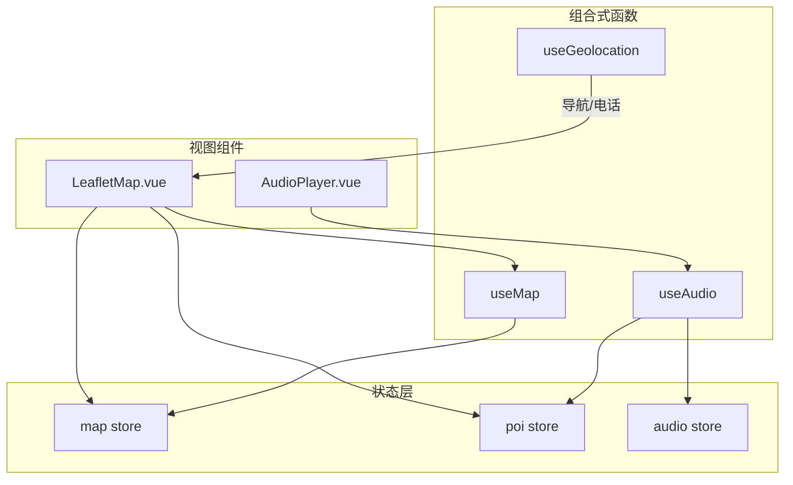
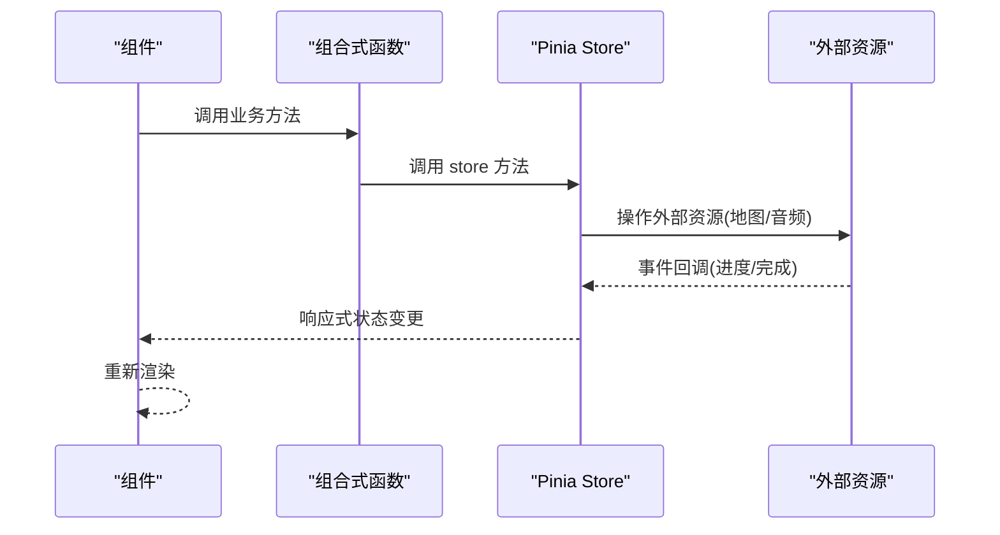
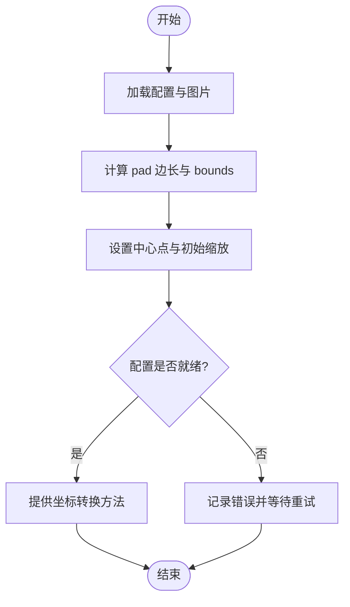
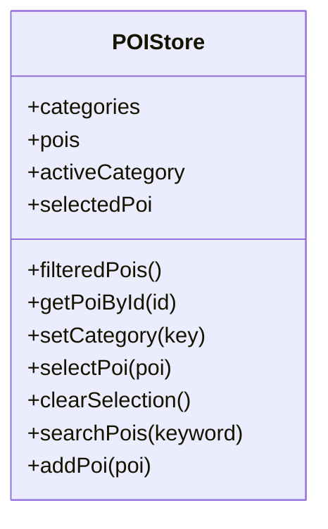
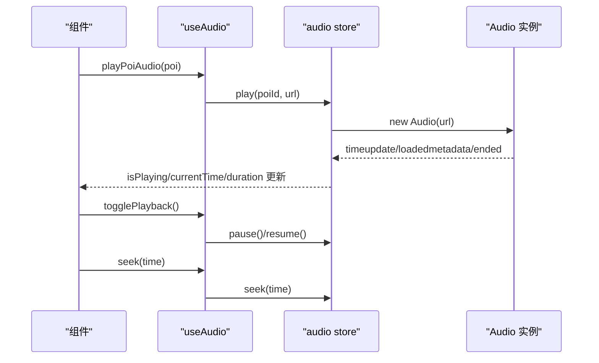
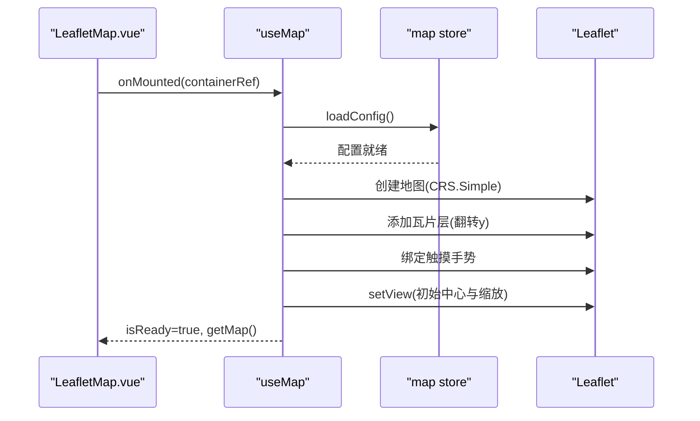
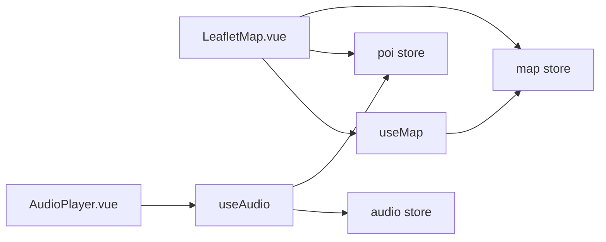

# 状态管理

<cite>
**本文引用的文件**
- [src/stores/map.js](file://src/stores/map.js)
- [src/stores/poi.js](file://src/stores/poi.js)
- [src/stores/audio.js](file://src/stores/audio.js)
- [src/composables/useMap.js](file://src/composables/useMap.js)
- [src/composables/useAudio.js](file://src/composables/useAudio.js)
- [src/composables/useGeolocation.js](file://src/composables/useGeolocation.js)
- [src/components/map/LeafletMap.vue](file://src/components/map/LeafletMap.vue)
- [src/components/common/AudioPlayer.vue](file://src/components/common/AudioPlayer.vue)
- [public/map/config.json](file://public/map/config.json)
</cite>

## 目录
1. [简介](#简介)
2. [项目结构](#项目结构)
3. [核心组件](#核心组件)
4. [架构总览](#架构总览)
5. [详细组件分析](#详细组件分析)
6. [依赖关系分析](#依赖关系分析)
7. [性能考量](#性能考量)
8. [故障排查指南](#故障排查指南)
9. [结论](#结论)
10. [附录：扩展与最佳实践](#附录：扩展与最佳实践)

## 简介
本文件面向 FunMapUI 的状态管理，系统基于 Pinia 构建，围绕三个核心 store 展开：
- map store：负责地图配置、坐标转换、瓦片路径与缩放范围等。
- poi store：负责 POI 数据、分类筛选、搜索与选中态。
- audio store：负责音频播放状态（当前 POI、播放进度、时长、播放控制）。

同时，文档详细说明组合式函数 useMap、useAudio、useGeolocation 的设计模式与实现逻辑，解释状态同步机制和数据流管理，并提供调试技巧、常见问题解决方案以及扩展现有状态管理的建议。

## 项目结构
FunMapUI 将“状态”与“视图交互”解耦：
- stores 层：定义全局状态与业务方法（map、poi、audio）。
- composables 层：封装跨组件复用的逻辑（地图初始化、音频播放、地理定位）。
- components 层：通过组合式函数与 store 协作，驱动 UI 更新。

图表来源
- [src/stores/map.js:1-122](file://src/stores/map.js#L1-L122)
- [src/stores/poi.js:1-84](file://src/stores/poi.js#L1-L84)
- [src/stores/audio.js:1-111](file://src/stores/audio.js#L1-L111)
- [src/composables/useMap.js:1-174](file://src/composables/useMap.js#L1-L174)
- [src/composables/useAudio.js:1-59](file://src/composables/useAudio.js#L1-L59)
- [src/composables/useGeolocation.js:1-83](file://src/composables/useGeolocation.js#L1-L83)
- [src/components/map/LeafletMap.vue:1-141](file://src/components/map/LeafletMap.vue#L1-L141)
- [src/components/common/AudioPlayer.vue:1-104](file://src/components/common/AudioPlayer.vue#L1-L104)

章节来源
- [src/stores/map.js:1-122](file://src/stores/map.js#L1-L122)
- [src/stores/poi.js:1-84](file://src/stores/poi.js#L1-L84)
- [src/stores/audio.js:1-111](file://src/stores/audio.js#L1-L111)
- [src/composables/useMap.js:1-174](file://src/composables/useMap.js#L1-L174)
- [src/composables/useAudio.js:1-59](file://src/composables/useAudio.js#L1-L59)
- [src/composables/useGeolocation.js:1-83](file://src/composables/useGeolocation.js#L1-L83)
- [src/components/map/LeafletMap.vue:1-141](file://src/components/map/LeafletMap.vue#L1-L141)
- [src/components/common/AudioPlayer.vue:1-104](file://src/components/common/AudioPlayer.vue#L1-L104)

## 核心组件
- map store：维护图片尺寸、pad 后的正方形边长、CRS bounds、中心点、缩放级别、瓦片路径、图片路径与配置加载状态；提供百分比坐标与像素坐标的互转方法。
- poi store：维护分类列表、全部 POI、当前分类、选中 POI；提供按分类过滤、按 ID 查询、搜索、添加 POI 等方法。
- audio store：维护当前 POI ID、播放状态、当前时间与总时长；提供播放、暂停、恢复、停止、跳转等方法，并监听 Audio 事件同步进度与结束状态。

章节来源
- [src/stores/map.js:1-122](file://src/stores/map.js#L1-L122)
- [src/stores/poi.js:1-84](file://src/stores/poi.js#L1-L84)
- [src/stores/audio.js:1-111](file://src/stores/audio.js#L1-L111)

## 架构总览
Pinia store 作为单一可信源，composables 在组件中按需组合，组件仅关注渲染与用户交互。数据流向清晰：
- 组件调用 composable 暴露的方法 → 调用 store 方法 → 修改响应式状态 → 触发视图更新。
- 外部资源（如地图、音频）由 composable 或 store 持有实例，避免重复创建。

图表来源
- [src/composables/useMap.js:1-174](file://src/composables/useMap.js#L1-L174)
- [src/composables/useAudio.js:1-59](file://src/composables/useAudio.js#L1-L59)
- [src/stores/audio.js:1-111](file://src/stores/audio.js#L1-L111)
- [src/stores/map.js:1-122](file://src/stores/map.js#L1-L122)

## 详细组件分析

### Map Store（地图配置与坐标转换）
职责
- 加载地图配置与图片尺寸，计算 pad 后正方形边长与 CRS bounds。
- 维护中心点、缩放级别、最大最小缩放、瓦片路径与图片路径。
- 提供百分比坐标与像素坐标互转方法，供标记定位与编辑使用。

关键流程
- 配置加载：读取远程配置，动态获取图片尺寸，设置 bounds、center、maxZoom，并标记配置已加载。
- 坐标转换：百分比到像素坐标用于 Leaflet 标记定位；像素到百分比用于点击编辑时回写位置。

图表来源
- [src/stores/map.js:40-85](file://src/stores/map.js#L40-L85)
- [src/stores/map.js:87-103](file://src/stores/map.js#L87-L103)

章节来源
- [src/stores/map.js:1-122](file://src/stores/map.js#L1-L122)

### POI Store（POI 数据、分类筛选、搜索）
职责
- 维护分类定义、全部 POI、当前分类、选中 POI。
- 提供按分类过滤、按 ID 查询、搜索、添加 POI 等方法。

数据流
- 分类切换 → filteredPois 变化 → 地图标记更新。
- 点击标记 → selectedPoi 更新 → 底部面板/详情页展示。
- 搜索关键词 → 返回匹配 POI 集合（可结合分类过滤）。

图表来源
- [src/stores/poi.js:5-84](file://src/stores/poi.js#L5-L84)

章节来源
- [src/stores/poi.js:1-84](file://src/stores/poi.js#L1-L84)

### Audio Store（音频播放状态）
职责
- 维护当前 POI ID、播放状态、当前时间与总时长。
- 提供播放、暂停、恢复、停止、跳转等方法，监听 Audio 事件同步进度与结束状态。

播放时序
- 播放：若正在播放同一音频则暂停；否则创建新 Audio 实例，绑定事件，更新状态。
- 暂停/恢复：控制实例播放状态并同步 isPlaying。
- 停止：释放实例并重置所有状态。
- 跳转：设置 currentTime 并同步状态。

图表来源
- [src/stores/audio.js:20-97](file://src/stores/audio.js#L20-L97)
- [src/composables/useAudio.js:12-49](file://src/composables/useAudio.js#L12-L49)

章节来源
- [src/stores/audio.js:1-111](file://src/stores/audio.js#L1-L111)
- [src/composables/useAudio.js:1-59](file://src/composables/useAudio.js#L1-L59)

### 组合式函数 useMap（地图初始化与控制）
职责
- 初始化 Leaflet 地图（自定义 CRS.Simple），加载瓦片图层，处理双指缩放与滚动缩放。
- 提供 zoomBy、flyTo、getMap 等方法。
- 在组件挂载时自动加载地图配置并设置初始视图。

关键点
- 自定义 CRS：覆盖 projection bounds 与 transformation，确保瓦片坐标正确。
- 瓦片 URL 翻转 y：适配瓦片生成时的 y-flip。
- 触摸手势：阈值判断张合距离以触发整级缩放。
- 调试日志：监听 zoomend 输出瓦片加载情况。

图表来源
- [src/composables/useMap.js:14-129](file://src/composables/useMap.js#L14-L129)
- [src/stores/map.js:40-85](file://src/stores/map.js#L40-L85)

章节来源
- [src/composables/useMap.js:1-174](file://src/composables/useMap.js#L1-L174)

### 组合式函数 useAudio（语音播放便捷封装）
职责
- 封装播放指定 POI 的语音、切换播放/暂停、获取当前 POI、格式化时间。
- 与 audio store 和 poi store 协作，简化组件侧调用。

章节来源
- [src/composables/useAudio.js:1-59](file://src/composables/useAudio.js#L1-L59)

### 组合式函数 useGeolocation（地理定位与导航）
职责
- 获取当前位置（支持高精度、超时与缓存策略）。
- 调起原生地图进行路线导航（优先 Apple Maps，失败可尝试其他方案）。
- 拨打电话号码。

章节来源
- [src/composables/useGeolocation.js:1-83](file://src/composables/useGeolocation.js#L1-L83)

## 依赖关系分析
- LeafletMap.vue 依赖 useMap、poi store、map store，负责标记渲染与点击交互。
- AudioPlayer.vue 依赖 useAudio，间接依赖 audio store 与 poi store。
- useMap 依赖 map store 的配置与坐标转换能力。
- useAudio 依赖 audio store 与 poi store。
- useGeolocation 独立于 store，提供定位与导航能力，被需要导航的组件调用。

图表来源
- [src/components/map/LeafletMap.vue:1-141](file://src/components/map/LeafletMap.vue#L1-L141)
- [src/components/common/AudioPlayer.vue:1-104](file://src/components/common/AudioPlayer.vue#L1-L104)
- [src/composables/useMap.js:1-174](file://src/composables/useMap.js#L1-L174)
- [src/composables/useAudio.js:1-59](file://src/composables/useAudio.js#L1-L59)
- [src/stores/map.js:1-122](file://src/stores/map.js#L1-L122)
- [src/stores/poi.js:1-84](file://src/stores/poi.js#L1-L84)
- [src/stores/audio.js:1-111](file://src/stores/audio.js#L1-L111)

章节来源
- [src/components/map/LeafletMap.vue:1-141](file://src/components/map/LeafletMap.vue#L1-L141)
- [src/components/common/AudioPlayer.vue:1-104](file://src/components/common/AudioPlayer.vue#L1-L104)
- [src/composables/useMap.js:1-174](file://src/composables/useMap.js#L1-L174)
- [src/composables/useAudio.js:1-59](file://src/composables/useAudio.js#L1-L59)
- [src/stores/map.js:1-122](file://src/stores/map.js#L1-L122)
- [src/stores/poi.js:1-84](file://src/stores/poi.js#L1-L84)
- [src/stores/audio.js:1-111](file://src/stores/audio.js#L1-L111)

## 性能考量
- 地图瓦片层级：maxNativeZoom 限制实际瓦片级别，超出级别通过 CSS 放大，减少请求量。
- 标记更新：监听 filteredPois 变化批量更新标记，避免频繁 DOM 操作。
- 音频实例复用：audio store 在同一时刻只保留一个 Audio 实例，避免内存泄漏。
- 坐标转换缓存：如需高频转换，可在上层增加缓存策略（例如最近 N 次结果）。
- 事件监听：注意在组件卸载时移除不必要的监听器，防止内存占用。

[本节为通用指导，不直接分析具体文件]

## 故障排查指南
常见问题与解决思路
- 地图瓦片未加载或显示异常
  - 检查 tilesPath 与 config.json 配置是否正确。
  - 确认瓦片 y 坐标翻转逻辑与生成规则一致。
  - 查看 zoomend 调试日志，统计 loaded/failed 数量定位问题。
- 坐标错位或标记偏移
  - 确认 percentToLatLng 与 pixelToPercent 的使用场景与坐标系一致性。
  - 检查 Leaflet 的 CRS 配置与 bounds 设置。
- 音频无法播放或状态不同步
  - 浏览器自动播放策略可能导致首次播放失败，需用户交互触发。
  - 检查 Audio 事件绑定与状态更新逻辑，确保 ended 时重置状态。
- 定位失败或导航未打开
  - 检查浏览器权限与网络环境。
  - 平台差异导致 URL scheme 不同，必要时降级到系统地图。

章节来源
- [src/composables/useMap.js:113-120](file://src/composables/useMap.js#L113-L120)
- [src/stores/audio.js:42-57](file://src/stores/audio.js#L42-L57)
- [src/composables/useGeolocation.js:15-44](file://src/composables/useGeolocation.js#L15-L44)
- [public/map/config.json:1-5](file://public/map/config.json#L1-L5)

## 结论
FunMapUI 的状态管理采用 Pinia 作为单一可信源，配合组合式函数将复杂逻辑下沉至可复用模块。map store 负责地图配置与坐标转换，poi store 管理 POI 数据与筛选，audio store 统一音频播放状态。组件通过组合式函数与 store 协作，形成清晰的数据流与低耦合架构。该设计便于扩展与维护，适合后续新增业务功能。

[本节为总结性内容，不直接分析具体文件]

## 附录：扩展与最佳实践
- 扩展现有状态管理
  - 新增业务字段：在对应 store 中添加 ref/computed，并在相关方法中维护一致性。
  - 新增 store：遵循现有命名与导出规范，在需要的地方通过组合式函数引入。
  - 跨 store 协作：通过组合式函数聚合多个 store 的能力，避免组件直接耦合。
- 最佳实践
  - 单一职责：每个 store 聚焦一类领域（地图、POI、音频）。
  - 响应式更新：尽量使用 computed 派生状态，减少重复计算。
  - 资源管理：外部资源（地图、音频）在组合式函数或 store 中集中管理，组件仅消费状态。
  - 错误处理：对外部请求与异步操作增加 try/catch 与用户提示。
  - 可测试性：将纯逻辑放入组合式函数，便于单元测试。
- 状态调试技巧
  - 地图调试：监听 zoomend 输出瓦片加载统计，辅助定位瓦片问题。
  - 音频调试：在 timeupdate 与 ended 事件中打印进度与状态，验证同步逻辑。
  - POI 调试：在分类切换与搜索时打印 filteredPois 长度与内容，验证过滤逻辑。

[本节为通用指导，不直接分析具体文件]