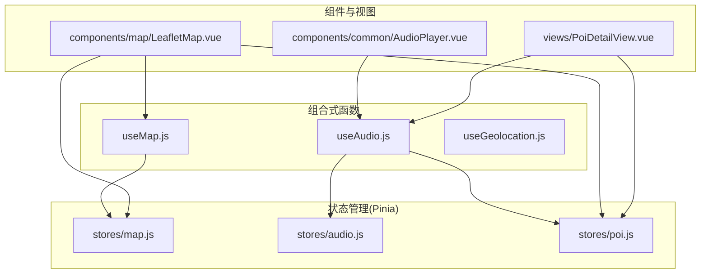
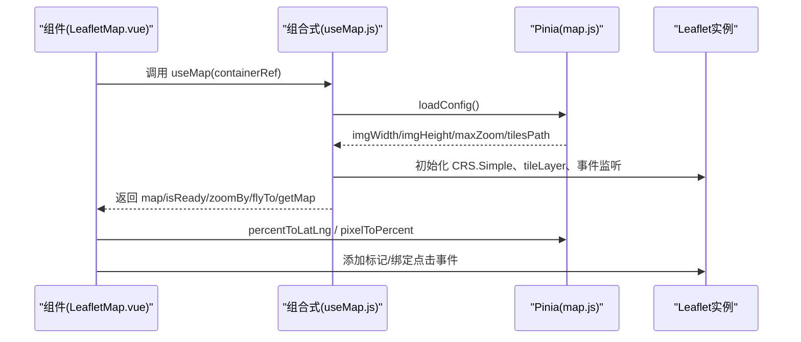
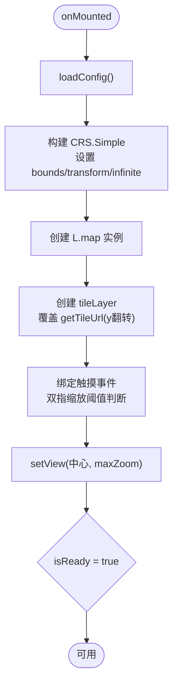
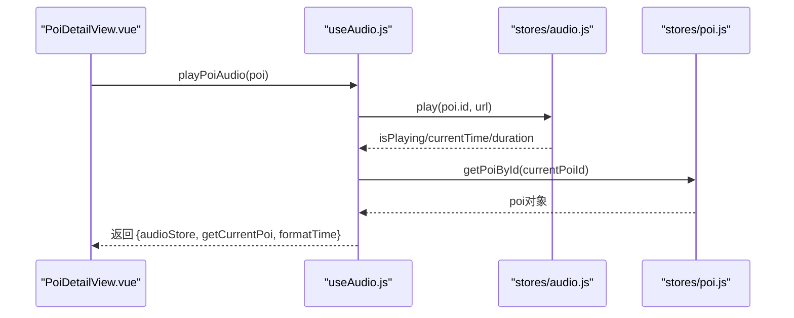
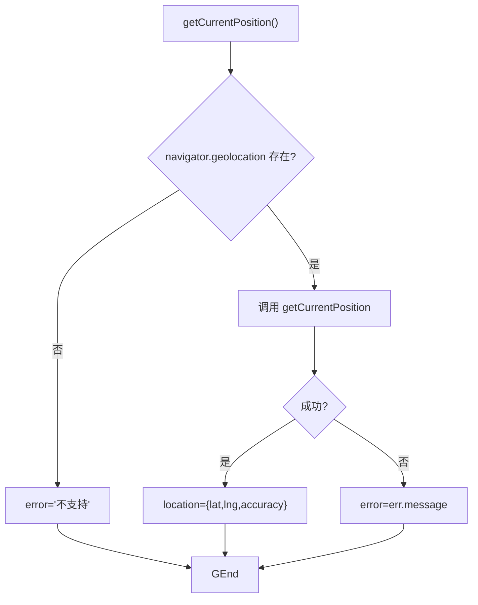
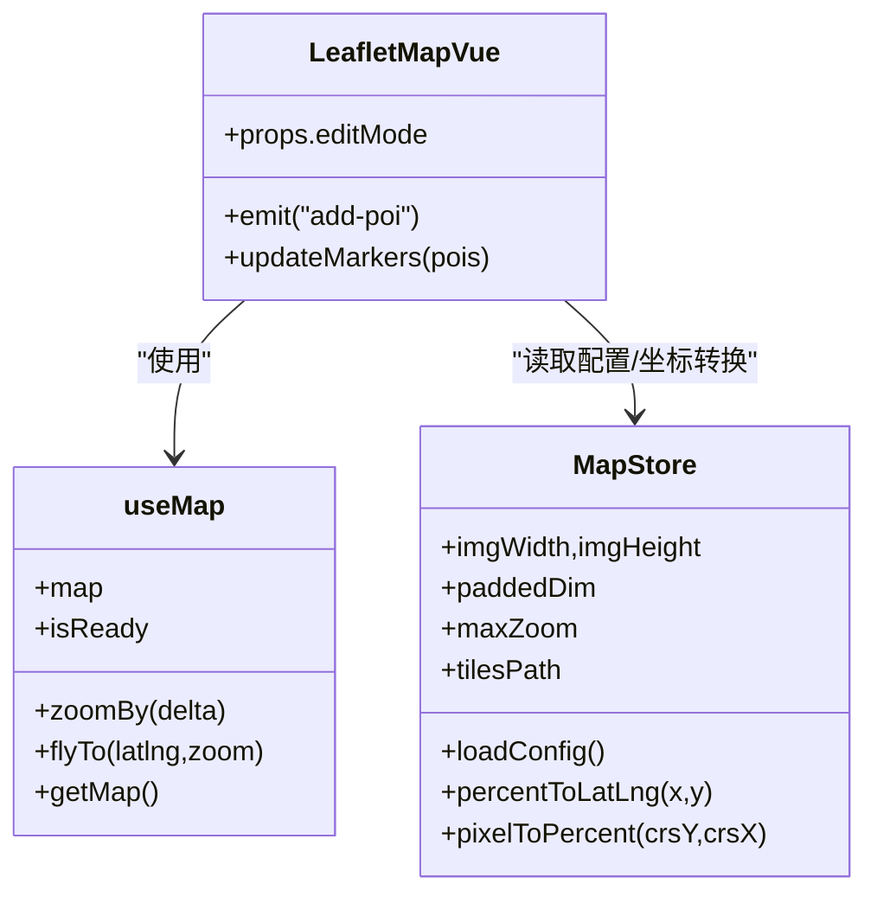
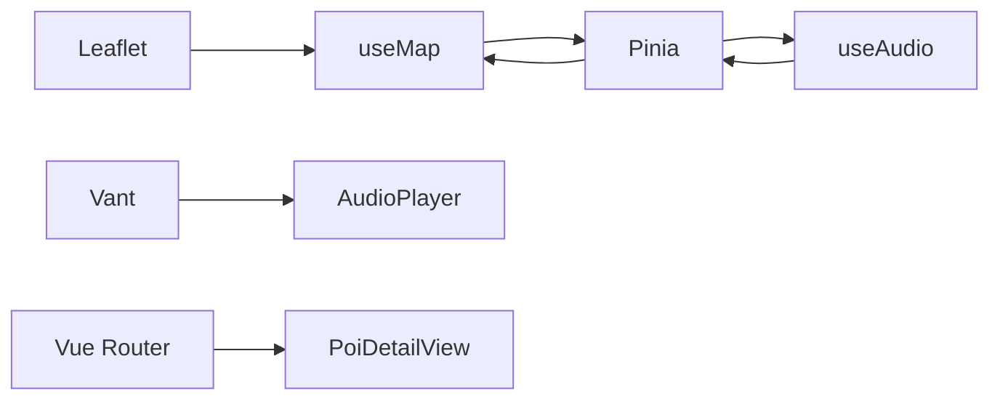

# 组合式函数模式

<cite>
**本文引用的文件**
- [useMap.js](file://src/composables/useMap.js)
- [useAudio.js](file://src/composables/useAudio.js)
- [useGeolocation.js](file://src/composables/useGeolocation.js)
- [map.js](file://src/stores/map.js)
- [audio.js](file://src/stores/audio.js)
- [poi.js](file://src/stores/poi.js)
- [LeafletMap.vue](file://src/components/map/LeafletMap.vue)
- [AudioPlayer.vue](file://src/components/common/AudioPlayer.vue)
- [PoiDetailView.vue](file://src/views/PoiDetailView.vue)
- [package.json](file://package.json)
</cite>

## 目录
1. [简介](#简介)
2. [项目结构](#项目结构)
3. [核心组件](#核心组件)
4. [架构总览](#架构总览)
5. [详细组件分析](#详细组件分析)
6. [依赖关系分析](#依赖关系分析)
7. [性能考虑](#性能考虑)
8. [故障排查指南](#故障排查指南)
9. [结论](#结论)
10. [附录：自定义组合式函数开发指南与最佳实践](#附录自定义组合式函数开发指南与最佳实践)

## 简介
本文件系统性梳理本项目中基于 Vue 3 Composition API 的组合式函数模式，重点围绕 useMap、useAudio、useGeolocation 的设计思路与实现逻辑，说明其与 Pinia store 的协作方式、状态共享机制、事件处理模式，以及可复用逻辑提取原则与组件化设计。同时给出性能优化建议、错误处理策略与测试要点，帮助读者在复杂业务中构建高内聚、低耦合、易维护的前端模块。

## 项目结构
项目采用“功能域 + 分层”组织：
- composables：组合式函数（useMap、useAudio、useGeolocation）封装跨组件复用的响应式逻辑与副作用
- stores：Pinia store（map、audio、poi）集中管理全局状态与领域方法
- components：UI 组件（如 LeafletMap、AudioPlayer）通过组合式函数与 store 协作
- views：页面级视图（如 PoiDetailView）编排组件与业务流

图表来源
- [useMap.js:1-174](file://src/composables/useMap.js#L1-L174)
- [useAudio.js:1-59](file://src/composables/useAudio.js#L1-L59)
- [useGeolocation.js:1-83](file://src/composables/useGeolocation.js#L1-L83)
- [map.js:1-122](file://src/stores/map.js#L1-L122)
- [audio.js:1-111](file://src/stores/audio.js#L1-L111)
- [poi.js:1-84](file://src/stores/poi.js#L1-L84)
- [LeafletMap.vue:1-141](file://src/components/map/LeafletMap.vue#L1-L141)
- [AudioPlayer.vue:1-104](file://src/components/common/AudioPlayer.vue#L1-L104)
- [PoiDetailView.vue:1-136](file://src/views/PoiDetailView.vue#L1-L136)

章节来源
- [package.json:1-28](file://package.json#L1-L28)

## 核心组件
- useMap：封装 Leaflet 地图初始化、CRS.Simple 像素坐标系配置、瓦片加载与翻转、双指缩放、缩放控制、生命周期清理等；与 map store 协同获取配置与坐标转换能力。
- useAudio：封装音频播放流程（播放/暂停/恢复/停止/跳转），聚合 audio store 与 poi store，提供便捷方法与格式化时间工具。
- useGeolocation：封装地理定位、导航唤起、电话拨打等原生能力调用，统一错误与加载状态。

章节来源
- [useMap.js:1-174](file://src/composables/useMap.js#L1-L174)
- [useAudio.js:1-59](file://src/composables/useAudio.js#L1-L59)
- [useGeolocation.js:1-83](file://src/composables/useGeolocation.js#L1-L83)

## 架构总览
组合式函数作为“行为层”，将副作用与 UI 无关的逻辑从组件中抽离；Pinia store 作为“状态层”，负责跨组件共享数据与领域方法；组件仅关注渲染与交互编排。三者通过响应式 ref/computed 与事件驱动形成清晰的数据流。

图表来源
- [LeafletMap.vue:1-141](file://src/components/map/LeafletMap.vue#L1-L141)
- [useMap.js:1-174](file://src/composables/useMap.js#L1-L174)
- [map.js:1-122](file://src/stores/map.js#L1-L122)

## 详细组件分析

### useMap：地图初始化与交互封装
- 设计目标
  - 将 Leaflet 地图初始化、CRS 配置、瓦片路径与缩放限制等细节下沉到组合式函数，使组件只关心“何时更新标记”和“如何与 POI 数据联动”。
  - 通过 map store 暴露图片尺寸、最大缩放、瓦片路径等配置，保证地图与资源一致。
- 关键实现要点
  - 使用 onMounted/onUnmounted 管理生命周期，避免内存泄漏。
  - 自定义 CRS.Simple 的 bounds 与 transformation，适配手绘图瓦片坐标系。
  - 覆盖 tileLayer.getTileUrl 以翻转 y 坐标，匹配瓦片生成规则。
  - 实现双指缩放阈值判定，提升移动端体验。
  - 暴露 zoomBy/flyTo/getMap 等方法供组件调用。
- 与 store 协作
  - 读取并等待 map store 的配置加载完成，再初始化地图。
  - 通过 store 提供的坐标转换方法，将百分比坐标与像素坐标互转。

图表来源
- [useMap.js:14-129](file://src/composables/useMap.js#L14-L129)

章节来源
- [useMap.js:1-174](file://src/composables/useMap.js#L1-L174)
- [map.js:1-122](file://src/stores/map.js#L1-L122)
- [LeafletMap.vue:1-141](file://src/components/map/LeafletMap.vue#L1-L141)

### useAudio：音频播放与状态聚合
- 设计目标
  - 将音频播放的生命周期、进度同步、错误处理封装为可复用逻辑，组件只需触发播放/暂停等操作。
  - 聚合 audio store 与 poi store，提供 playPoiAudio、togglePlayback、getCurrentPoi、formatTime 等便捷方法。
- 关键实现要点
  - 播放时若当前已在播放同一音频则暂停；切换新音频会先释放旧实例。
  - 通过 timeupdate/loadedmetadata/ended 事件同步 currentTime/duration/播放状态。
  - 提供 seek 跳转与 stop 重置能力。
- 与 store 协作
  - 通过 audio store 管理 Audio 实例与播放状态。
  - 通过 poi store 根据 currentPoiId 获取当前 POI 信息用于展示。

图表来源
- [useAudio.js:1-59](file://src/composables/useAudio.js#L1-L59)
- [audio.js:1-111](file://src/stores/audio.js#L1-L111)
- [poi.js:1-84](file://src/stores/poi.js#L1-L84)
- [PoiDetailView.vue:1-136](file://src/views/PoiDetailView.vue#L1-L136)

章节来源
- [useAudio.js:1-59](file://src/composables/useAudio.js#L1-L59)
- [audio.js:1-111](file://src/stores/audio.js#L1-L111)
- [poi.js:1-84](file://src/stores/poi.js#L1-L84)
- [PoiDetailView.vue:1-136](file://src/views/PoiDetailView.vue#L1-L136)

### useGeolocation：定位与系统能力桥接
- 设计目标
  - 封装浏览器地理定位 API，统一 loading/error 状态，并提供导航与电话等系统能力调用入口。
- 关键实现要点
  - getCurrentPosition 支持高精度、超时与缓存策略。
  - openNavigation 优先尝试 Apple Maps，失败回退至其他方案（示例中预留）。
  - callPhone 直接唤起拨号。
- 适用场景
  - 详情页或列表页中“导航到目的地”、“拨打电话”等原生能力调用。

图表来源
- [useGeolocation.js:15-44](file://src/composables/useGeolocation.js#L15-L44)

章节来源
- [useGeolocation.js:1-83](file://src/composables/useGeolocation.js#L1-L83)

### 组件与组合式函数的协作
- LeafletMap.vue
  - 通过 useMap 获取地图实例与就绪状态，监听 filteredPois 变化动态更新标记。
  - 使用 map store 的坐标转换方法，将 POI 百分比坐标映射到像素坐标。
  - 在编辑模式下绑定地图点击事件，发射 add-poi 事件给父组件。
- AudioPlayer.vue
  - 通过 useAudio 获取播放控制与当前 POI，计算进度条值并调用 seek。
- PoiDetailView.vue
  - 通过 useAudio 触发播放，结合 poi store 获取详情数据，展示音频卡片。

图表来源
- [LeafletMap.vue:1-141](file://src/components/map/LeafletMap.vue#L1-L141)
- [useMap.js:1-174](file://src/composables/useMap.js#L1-L174)
- [map.js:1-122](file://src/stores/map.js#L1-L122)

章节来源
- [LeafletMap.vue:1-141](file://src/components/map/LeafletMap.vue#L1-L141)
- [AudioPlayer.vue:1-104](file://src/components/common/AudioPlayer.vue#L1-L104)
- [PoiDetailView.vue:1-136](file://src/views/PoiDetailView.vue#L1-L136)

## 依赖关系分析
- 组合式函数依赖 Pinia store 提供状态与方法，组件依赖组合式函数简化调用。
- 外部库依赖：Leaflet（地图）、Pinia（状态管理）、Vant（UI 组件）、Vue Router（路由）。
- 可能的循环依赖风险：组合式函数不应直接 import 组件，组件也不应反向 import 组合式函数内部实现（仅通过接口），当前结构满足解耦要求。

图表来源
- [package.json:11-20](file://package.json#L11-L20)
- [useAudio.js:1-59](file://src/composables/useAudio.js#L1-L59)
- [useMap.js:1-174](file://src/composables/useMap.js#L1-L174)

章节来源
- [package.json:1-28](file://package.json#L1-L28)

## 性能考虑
- 地图瓦片与缩放
  - 使用 maxNativeZoom 限制原生瓦片级别，超出级别由 CSS 放大，减少请求量。
  - 自定义 getTileUrl 翻转 y 坐标，避免重复计算与额外开销。
  - 禁用不必要的控件（zoomControl、attributionControl）以减少 DOM 与事件。
- 事件与监听
  - 在 onUnmounted 中移除地图实例，避免内存泄漏。
  - 使用 watch 精确监听 filteredPois 变化，避免全量重绘。
- 音频播放
  - 切换音频时及时释放旧实例，防止并发播放。
  - 通过事件驱动更新 currentTime/duration，避免高频轮询。
- 坐标转换
  - 将坐标转换逻辑集中在 store，避免在组件中重复计算。

[本节为通用性能建议，不直接分析具体代码行]

## 故障排查指南
- 地图无法显示或瓦片错位
  - 检查 map store 的 loadConfig 是否成功，确认 tilesPath、image、maxZoom 是否正确。
  - 核对 getTileUrl 的 y 翻转逻辑是否与瓦片生成一致。
  - 查看控制台调试输出（zoomend 日志）确认瓦片加载数量与失败数。
- 音频无法播放
  - 检查浏览器自动播放策略，必要时用户手势触发。
  - 确认 audio store 的 play/catch 分支是否正确处理异常。
- 定位失败
  - 检查浏览器权限与 HTTPS 环境要求。
  - 捕获 error 消息并提示用户。

章节来源
- [useMap.js:113-120](file://src/composables/useMap.js#L113-L120)
- [map.js:40-85](file://src/stores/map.js#L40-L85)
- [audio.js:55-57](file://src/stores/audio.js#L55-L57)
- [useGeolocation.js:19-43](file://src/composables/useGeolocation.js#L19-L43)

## 结论
本项目通过组合式函数将复杂副作用与业务逻辑从组件中剥离，配合 Pinia store 实现状态集中管理与跨组件共享。useMap、useAudio、useGeolocation 分别聚焦地图、音频、定位三大领域，职责清晰、边界明确。组件仅做编排与渲染，提升了可维护性与可测试性。建议在后续扩展中继续遵循“组合式函数 + store”的分层模式，保持高内聚、低耦合。

[本节为总结性内容，不直接分析具体代码行]

## 附录：自定义组合式函数开发指南与最佳实践
- 设计原则
  - 单一职责：每个组合式函数聚焦一个领域能力（如地图、音频、定位）。
  - 输入输出明确：接收必要参数（如容器 ref），返回稳定的接口集合（ref/computed/方法）。
  - 副作用隔离：在 onMounted/onUnmounted 中管理生命周期，确保清理。
  - 与 store 协作：状态与持久化逻辑放入 store，组合式函数专注流程编排。
- 事件处理模式
  - 对外暴露方法（如 zoomBy、playPoiAudio），组件调用后通过 store 变更状态，视图自动响应。
  - 对第三方库事件（如 Leaflet 的 zoomend、Audio 的 timeupdate）进行监听并同步到响应式状态。
- 错误处理
  - 统一错误状态（如 useGeolocation.error），提供友好提示。
  - 对异步操作（fetch、Audio.play）增加 try/catch 或 .catch 分支。
- 性能优化
  - 避免在渲染路径中进行昂贵计算，使用 computed 缓存结果。
  - 合理设置监听粒度（watch 精确字段），减少不必要重渲染。
  - 对第三方实例（地图、音频）做好销毁与重建策略。
- 测试策略
  - 单元测试：针对组合式函数暴露的方法进行断言（如 formatTime、percentToLatLng）。
  - 集成测试：模拟 store 与第三方库（Leaflet、Audio、geolocation），验证流程正确性。
  - 组件测试：验证组合式函数在组件中的使用是否符合预期（如播放按钮触发播放、进度条拖动跳转）。

[本节为通用指导，不直接分析具体代码行]