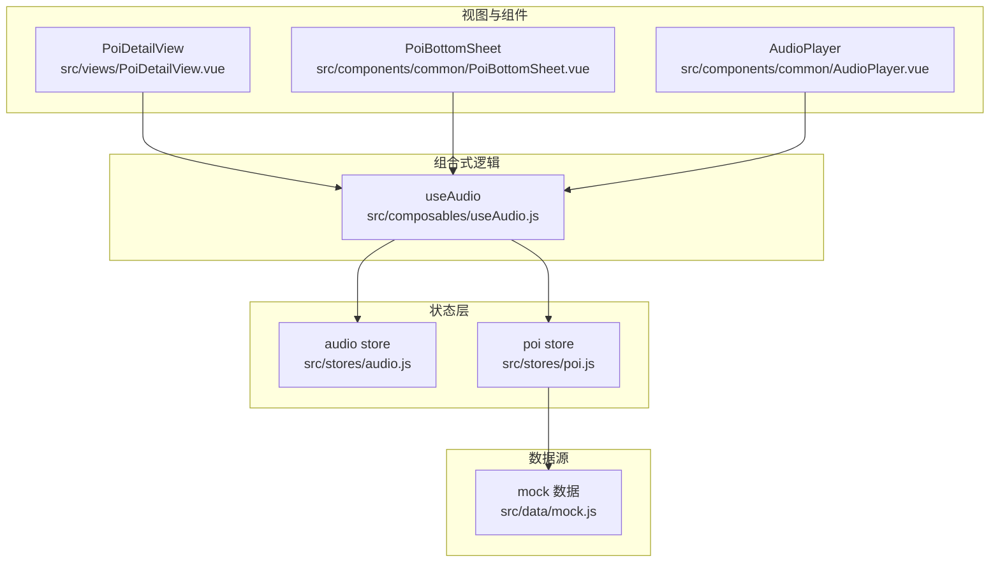
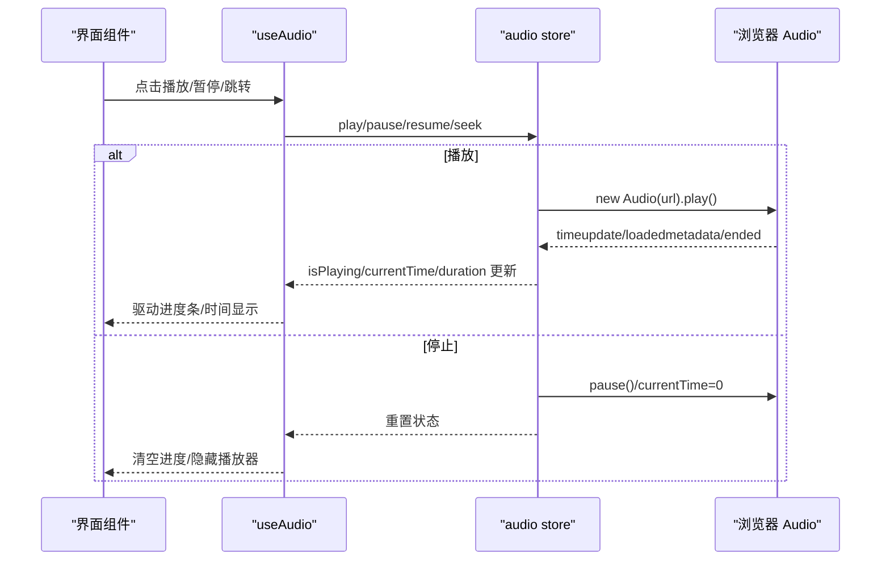
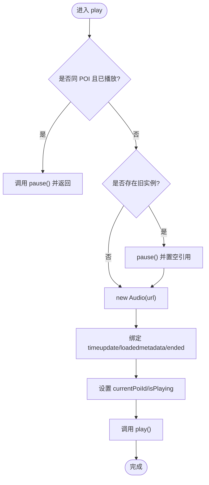
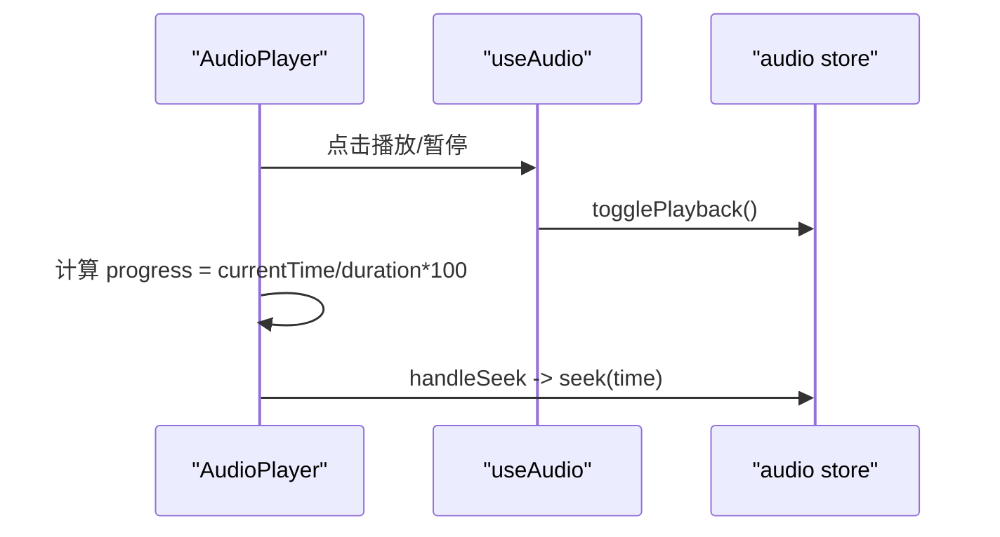
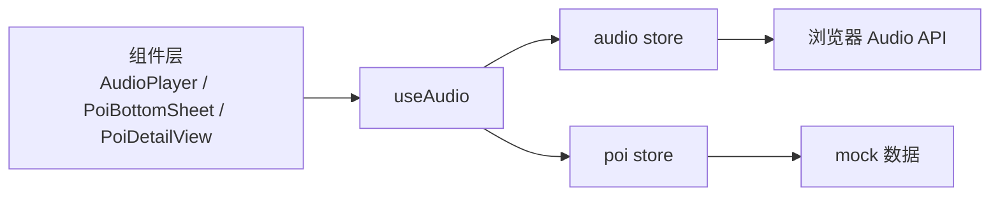

# 音频状态管理

<cite>
**本文引用的文件**
- [src/stores/audio.js](file://src/stores/audio.js)
- [src/composables/useAudio.js](file://src/composables/useAudio.js)
- [src/components/common/AudioPlayer.vue](file://src/components/common/AudioPlayer.vue)
- [src/stores/poi.js](file://src/stores/poi.js)
- [src/data/mock.js](file://src/data/mock.js)
- [src/components/common/PoiBottomSheet.vue](file://src/components/common/PoiBottomSheet.vue)
- [src/views/PoiDetailView.vue](file://src/views/PoiDetailView.vue)
</cite>

## 目录
1. [简介](#简介)
2. [项目结构](#项目结构)
3. [核心组件](#核心组件)
4. [架构总览](#架构总览)
5. [详细组件分析](#详细组件分析)
6. [依赖关系分析](#依赖关系分析)
7. [性能与内存优化](#性能与内存优化)
8. [故障排查指南](#故障排查指南)
9. [结论](#结论)
10. [附录：集成示例与扩展方法](#附录集成示例与扩展方法)

## 简介
本文件围绕“音频状态管理”展开，系统性说明 audio store 的播放控制、进度跟踪、音量调节（预留接口）、音频加载与管理机制、播放队列处理（当前为单实例模式）、用户交互响应、音频状态与 POI 信息的关联方式及生命周期管理。同时提供集成示例与自定义扩展建议，并给出性能优化、内存管理与错误处理策略。

## 项目结构
本项目采用 Vue 3 + Pinia 的状态管理模式，音频能力由 store 集中管理，composable 封装常用操作，UI 组件通过 composable 消费状态与方法。POI 数据与分类在独立 store 中维护，音频与 POI 通过 ID 进行关联。

图表来源
- [src/stores/audio.js:1-111](file://src/stores/audio.js#L1-L111)
- [src/composables/useAudio.js:1-59](file://src/composables/useAudio.js#L1-L59)
- [src/stores/poi.js:1-84](file://src/stores/poi.js#L1-L84)
- [src/data/mock.js:1-349](file://src/data/mock.js#L1-L349)
- [src/components/common/AudioPlayer.vue:1-104](file://src/components/common/AudioPlayer.vue#L1-L104)
- [src/components/common/PoiBottomSheet.vue:1-190](file://src/components/common/PoiBottomSheet.vue#L1-L190)
- [src/views/PoiDetailView.vue:1-136](file://src/views/PoiDetailView.vue#L1-L136)

章节来源
- [src/stores/audio.js:1-111](file://src/stores/audio.js#L1-L111)
- [src/composables/useAudio.js:1-59](file://src/composables/useAudio.js#L1-L59)
- [src/stores/poi.js:1-84](file://src/stores/poi.js#L1-L84)
- [src/data/mock.js:1-349](file://src/data/mock.js#L1-L349)
- [src/components/common/AudioPlayer.vue:1-104](file://src/components/common/AudioPlayer.vue#L1-L104)
- [src/components/common/PoiBottomSheet.vue:1-190](file://src/components/common/PoiBottomSheet.vue#L1-L190)
- [src/views/PoiDetailView.vue:1-136](file://src/views/PoiDetailView.vue#L1-L136)

## 核心组件
- audio store：集中管理音频实例、播放状态、进度与时长，暴露 play/pause/resume/stop/seek 等方法。
- useAudio composable：封装对 store 的调用，提供 playPoiAudio、togglePlayback、getCurrentPoi、formatTime 等便捷方法。
- AudioPlayer 组件：展示当前播放信息、进度条、关闭按钮，支持拖拽跳转。
- PoiBottomSheet / PoiDetailView：业务入口，触发播放并与 POI 详情联动。
- poi store：维护 POI 列表、分类、选中项，并提供按 ID 查询方法。

章节来源
- [src/stores/audio.js:1-111](file://src/stores/audio.js#L1-L111)
- [src/composables/useAudio.js:1-59](file://src/composables/useAudio.js#L1-L59)
- [src/components/common/AudioPlayer.vue:1-104](file://src/components/common/AudioPlayer.vue#L1-L104)
- [src/components/common/PoiBottomSheet.vue:1-190](file://src/components/common/PoiBottomSheet.vue#L1-L190)
- [src/views/PoiDetailView.vue:1-136](file://src/views/PoiDetailView.vue#L1-L136)
- [src/stores/poi.js:1-84](file://src/stores/poi.js#L1-L84)

## 架构总览
下图展示了从 UI 到 store 再到浏览器原生 Audio 的完整调用链，以及事件回写状态的过程。

图表来源
- [src/stores/audio.js:25-97](file://src/stores/audio.js#L25-L97)
- [src/composables/useAudio.js:16-49](file://src/composables/useAudio.js#L16-L49)
- [src/components/common/AudioPlayer.vue:32-45](file://src/components/common/AudioPlayer.vue#L32-L45)

## 详细组件分析

### audio store：播放状态机与事件绑定
- 状态字段
  - currentPoiId：当前播放的 POI 标识
  - isPlaying：是否正在播放
  - currentTime：当前播放进度（秒）
  - duration：音频总时长（秒）
  - audioInstance：原生 Audio 实例引用（模块级变量）
- 关键方法
  - play(poiId, url)：创建或切换 Audio 实例，绑定 timeupdate/loadedmetadata/ended 事件，设置播放状态与进度；若重复播放同一音频则先暂停再返回。
  - pause()：暂停播放并置 isPlaying 为 false。
  - resume()：恢复播放并将 isPlaying 置为 true。
  - stop()：释放实例、重置所有状态。
  - seek(time)：跳转到指定时间并同步 currentTime。
- 事件流
  - timeupdate：高频触发，用于推进进度条。
  - loadedmetadata：获取 duration。
  - ended：播放结束，重置状态。

图表来源
- [src/stores/audio.js:25-58](file://src/stores/audio.js#L25-L58)

章节来源
- [src/stores/audio.js:1-111](file://src/stores/audio.js#L1-L111)

### useAudio：便捷方法与 POI 关联
- playPoiAudio(poi)：校验 poi.audioUrl 存在后调用 store.play。
- togglePlayback()：根据 isPlaying 切换 pause/resume。
- getCurrentPoi()：通过 currentPoiId 从 poi store 取回 POI 对象。
- formatTime(seconds)：将秒格式化为 mm:ss。

章节来源
- [src/composables/useAudio.js:1-59](file://src/composables/useAudio.js#L1-L59)
- [src/stores/poi.js:33-36](file://src/stores/poi.js#L33-L36)

### AudioPlayer 组件：进度与交互
- 展示当前 POI 名称、播放/暂停图标、时间显示。
- 使用滑块展示进度，change 事件计算目标时间并调用 store.seek。
- 关闭按钮调用 store.stop 释放资源。

图表来源
- [src/components/common/AudioPlayer.vue:32-45](file://src/components/common/AudioPlayer.vue#L32-L45)
- [src/composables/useAudio.js:24-29](file://src/composables/useAudio.js#L24-L29)
- [src/stores/audio.js:92-97](file://src/stores/audio.js#L92-L97)

章节来源
- [src/components/common/AudioPlayer.vue:1-104](file://src/components/common/AudioPlayer.vue#L1-L104)

### 业务入口：PoiBottomSheet 与 PoiDetailView
- PoiBottomSheet：当选中 POI 时，若存在 audioUrl 则显示“语音讲解”按钮，点击调用 playPoiAudio。
- PoiDetailView：详情页展示音频卡片，点击同样调用 playPoiAudio，并显示预计时长。

章节来源
- [src/components/common/PoiBottomSheet.vue:33-91](file://src/components/common/PoiBottomSheet.vue#L33-L91)
- [src/views/PoiDetailView.vue:27-75](file://src/views/PoiDetailView.vue#L27-L75)

## 依赖关系分析
- useAudio 依赖 audio store 与 poi store，形成“UI -> composable -> store”的单向数据流。
- audio store 依赖浏览器原生 Audio API，不直接依赖其他模块。
- 组件仅消费 composable 暴露的方法与状态，避免直接耦合 store。

图表来源
- [src/composables/useAudio.js:1-59](file://src/composables/useAudio.js#L1-L59)
- [src/stores/audio.js:1-111](file://src/stores/audio.js#L1-L111)
- [src/stores/poi.js:1-84](file://src/stores/poi.js#L1-L84)
- [src/data/mock.js:1-349](file://src/data/mock.js#L1-L349)

章节来源
- [src/composables/useAudio.js:1-59](file://src/composables/useAudio.js#L1-L59)
- [src/stores/audio.js:1-111](file://src/stores/audio.js#L1-L111)
- [src/stores/poi.js:1-84](file://src/stores/poi.js#L1-L84)
- [src/data/mock.js:1-349](file://src/data/mock.js#L1-L349)

## 性能与内存优化
- 单实例复用与及时释放
  - 每次切换音频前会暂停并置空旧实例，避免多实例叠加导致内存泄漏。
  - stop 时重置 currentTime/duration 并释放实例，确保无残留。
- 事件监听开销
  - timeupdate 在高频率下更新状态，建议在后续版本考虑节流或按需更新，减少不必要的渲染。
- 预加载与缓存
  - 当前未实现预加载与缓存，可在后续引入基于 URL 的缓存策略，减少重复网络请求。
- 音量控制
  - 当前 store 未暴露音量控制接口，可通过新增 volume 状态并在 Audio 实例上设置，或在 composable 中封装 setVolume 方法。
- 播放队列
  - 当前为单实例模式，不支持队列。如需队列，可引入任务队列与优先级策略，并在切换时清理未完成的任务。
- 错误处理
  - play().catch 捕获失败并重置 isPlaying，避免状态不一致。建议增加更细粒度的错误类型与日志上报。

[本节为通用优化建议，不直接分析具体代码行]

## 故障排查指南
- 无法自动播放
  - 现象：调用 play 后 isPlaying 始终为 false。
  - 可能原因：浏览器限制需要用户手势触发；网络不可用；URL 无效。
  - 定位：检查 play 的 catch 分支与 isPlaying 重置逻辑。
- 进度不更新
  - 现象：进度条不动或卡顿。
  - 可能原因：timeupdate 事件未触发或被节流过度；duration 未正确获取。
  - 定位：检查 loadedmetadata 与 timeupdate 绑定与状态更新。
- 切换音频无反应
  - 现象：切换到新音频但仍在播放旧内容。
  - 可能原因：旧实例未正确释放或 URL 相同被判定为重复播放。
  - 定位：检查 play 中的重复判断与实例释放逻辑。
- 停止后仍占用内存
  - 现象：页面长时间运行后内存增长。
  - 可能原因：未在 stop 中释放实例或事件监听未解绑。
  - 定位：确认 stop 中实例置空与状态重置。

章节来源
- [src/stores/audio.js:25-97](file://src/stores/audio.js#L25-L97)
- [src/components/common/AudioPlayer.vue:32-45](file://src/components/common/AudioPlayer.vue#L32-L45)

## 结论
该音频系统以 Pinia store 为核心，结合 composable 与组件分层清晰，实现了基础的播放控制、进度跟踪与 POI 关联。当前为单实例模式，具备基本的错误处理与资源释放。后续可扩展音量控制、预加载、播放队列与更精细的性能优化，以满足复杂场景需求。

[本节为总结性内容，不直接分析具体代码行]

## 附录：集成示例与扩展方法

### 集成示例
- 在 POI 底部弹窗中触发播放
  - 入口：PoiBottomSheet 的“语音讲解”按钮调用 playPoiAudio。
  - 状态：isPlaying 与 currentPoiId 联动，按钮图标随状态变化。
- 在详情页中触发播放
  - 入口：PoiDetailView 的音频卡片点击调用 playPoiAudio。
  - 展示：显示预计时长与播放状态提示。

章节来源
- [src/components/common/PoiBottomSheet.vue:33-91](file://src/components/common/PoiBottomSheet.vue#L33-L91)
- [src/views/PoiDetailView.vue:27-75](file://src/views/PoiDetailView.vue#L27-L75)

### 自定义扩展方法建议
- 音量控制
  - 在 store 中新增 volume 状态，并在 Audio 实例上设置；在 composable 中暴露 setVolume(v)。
- 预加载与缓存
  - 在 store 中维护 URL -> Audio 实例的缓存表，首次加载后复用，减少网络开销。
- 播放队列
  - 引入队列数据结构，支持顺序播放、循环、随机播放；切换时清理未完成任务。
- 错误重试与降级
  - 对加载失败进行重试与降级（如切换备用音轨），并记录错误日志。
- 性能优化
  - 对 timeupdate 进行节流；按需更新 UI；使用 requestAnimationFrame 平滑进度条。

[本节为扩展建议，不直接分析具体代码行]