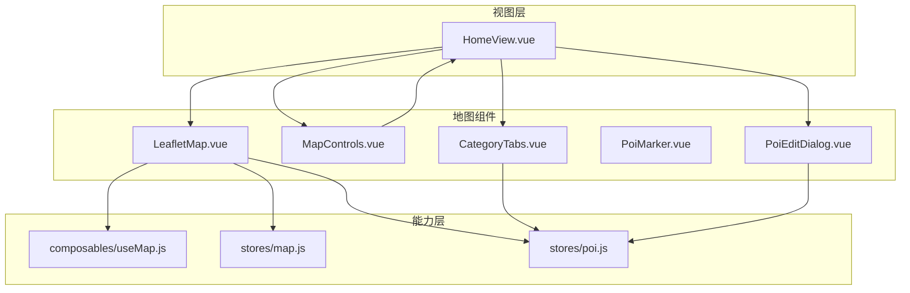
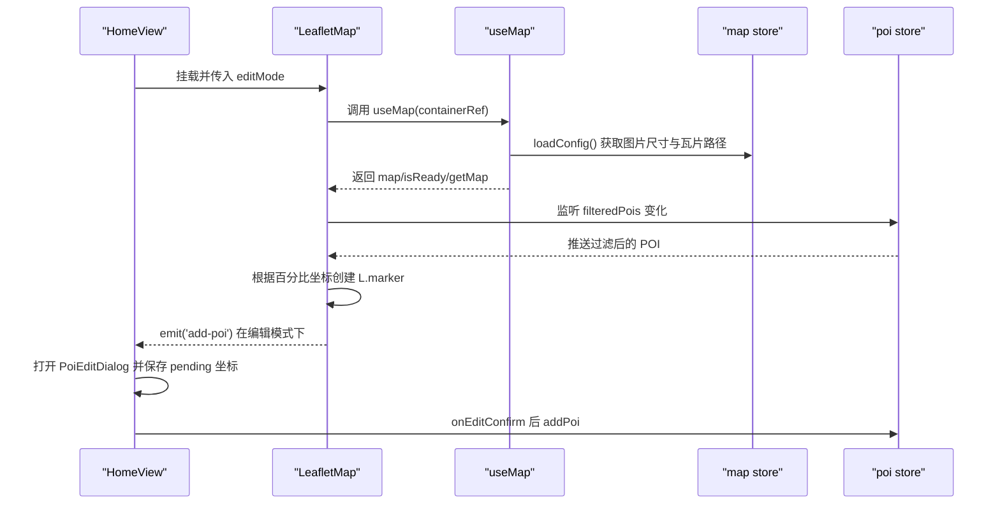
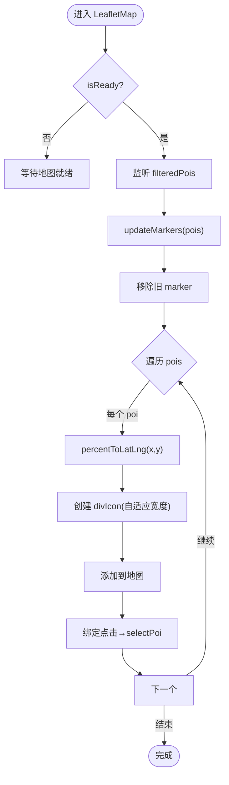
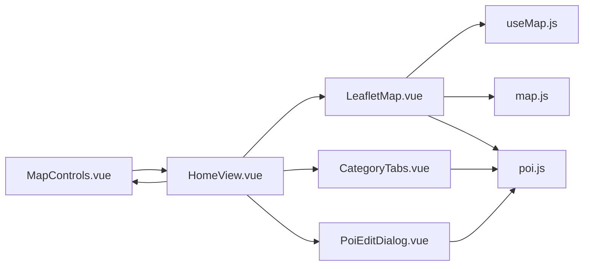

# 地图组件

<cite>
**本文引用的文件**
- [LeafletMap.vue](file://src/components/map/LeafletMap.vue)
- [MapControls.vue](file://src/components/map/MapControls.vue)
- [CategoryTabs.vue](file://src/components/map/CategoryTabs.vue)
- [PoiMarker.vue](file://src/components/map/PoiMarker.vue)
- [PoiEditDialog.vue](file://src/components/map/PoiEditDialog.vue)
- [useMap.js](file://src/composables/useMap.js)
- [map.js](file://src/stores/map.js)
- [poi.js](file://src/stores/poi.js)
- [HomeView.vue](file://src/views/HomeView.vue)
- [config.json](file://public/map/config.json)
- [README.md](file://README.md)
</cite>

## 目录
1. [简介](#简介)
2. [项目结构](#项目结构)
3. [核心组件](#核心组件)
4. [架构总览](#架构总览)
5. [详细组件分析](#详细组件分析)
6. [依赖关系分析](#依赖关系分析)
7. [性能考量](#性能考量)
8. [故障排查指南](#故障排查指南)
9. [结论](#结论)
10. [附录](#附录)

## 简介
本文档围绕 FunMapUI 的地图子系统，系统性说明 LeafletMap、MapControls、CategoryTabs、PoiMarker、PoiEditDialog 五个组件的功能实现与使用方法。内容涵盖：
- 地图初始化配置（基于 Leaflet CRS.Simple 像素坐标系）
- 标记点交互（点击选中 POI、编辑模式添加 POI）
- 分类标签切换（按类别筛选并实时渲染）
- 地图控件操作（缩放、编辑模式切换）
- POI 编辑对话框（表单校验、分类选择、提交新 POI）
- 组件间通信机制与数据流（Pinia store + 组合式函数）
- 响应式设计与移动端优化实践
- 常见问题与性能优化建议

## 项目结构
地图相关代码集中在 src/components/map 下，配合 composables 与 stores 提供地图能力与状态管理；视图层 HomeView 将各组件组合为完整页面。

图表来源
- [HomeView.vue:1-46](file://src/views/HomeView.vue#L1-L46)
- [LeafletMap.vue:1-141](file://src/components/map/LeafletMap.vue#L1-L141)
- [MapControls.vue:1-48](file://src/components/map/MapControls.vue#L1-L48)
- [CategoryTabs.vue:1-59](file://src/components/map/CategoryTabs.vue#L1-L59)
- [PoiMarker.vue:1-35](file://src/components/map/PoiMarker.vue#L1-L35)
- [PoiEditDialog.vue:1-173](file://src/components/map/PoiEditDialog.vue#L1-L173)
- [useMap.js:1-174](file://src/composables/useMap.js#L1-L174)
- [map.js:1-122](file://src/stores/map.js#L1-L122)
- [poi.js:1-84](file://src/stores/poi.js#L1-L84)

章节来源
- [README.md:42-99](file://README.md#L42-L99)
- [HomeView.vue:1-46](file://src/views/HomeView.vue#L1-L46)

## 核心组件
- LeafletMap：封装 Leaflet 地图实例、瓦片加载、自定义双指缩放、POI 标记渲染、编辑模式点击添加 POI。
- MapControls：提供放大/缩小按钮，触发缩放事件。
- CategoryTabs：展示 POI 分类 Tab，点击切换当前分类，驱动 POI 列表过滤。
- PoiMarker：可复用的圆形标记点样式（用于详情或辅助 UI）。
- PoiEditDialog：底部弹窗表单，支持名称、分类、描述、地址、电话、标签等字段，确认后提交新 POI。

章节来源
- [LeafletMap.vue:1-141](file://src/components/map/LeafletMap.vue#L1-L141)
- [MapControls.vue:1-48](file://src/components/map/MapControls.vue#L1-L48)
- [CategoryTabs.vue:1-59](file://src/components/map/CategoryTabs.vue#L1-L59)
- [PoiMarker.vue:1-35](file://src/components/map/PoiMarker.vue#L1-L35)
- [PoiEditDialog.vue:1-173](file://src/components/map/PoiEditDialog.vue#L1-L173)

## 架构总览
整体采用“视图层 + 能力层 + 状态层”的分层设计：
- 视图层：HomeView 组合地图、控件、分类、编辑弹窗等。
- 能力层：useMap 负责地图初始化、CRS 配置、缩放控制、触摸手势处理。
- 状态层：map store 管理图片尺寸、瓦片路径、坐标转换；poi store 管理 POI 数据、分类、搜索与选中态。

图表来源
- [HomeView.vue:10-45](file://src/views/HomeView.vue#L10-L45)
- [LeafletMap.vue:27-46, 61-95, 108-129:27-46](file://src/components/map/LeafletMap.vue#L27-L46)
- [useMap.js:14-128](file://src/composables/useMap.js#L14-L128)
- [map.js:40-85](file://src/stores/map.js#L40-L85)
- [poi.js:27-31, 65-68:27-31](file://src/stores/poi.js#L27-L31)

## 详细组件分析

### LeafletMap 组件
功能要点
- 使用 useMap 初始化 Leaflet 地图，配置 CRS.Simple 像素坐标系与瓦片层。
- 监听 poi store 的 filteredPois，动态创建/移除 L.marker。
- 支持编辑模式：在地图上点击空白处，计算百分比坐标并通过事件上抛给父组件。
- 暴露 getMap 方法供父组件直接控制缩放。

Props
- editMode: Boolean，默认 false，开启后绑定地图点击以添加 POI。

Events
- add-poi: 携带 { x, y } 百分比坐标，由父组件打开编辑弹窗。

插槽
- 无显式插槽，通过事件与 props 进行扩展。

样式定制
- 容器类名 leaflet-map，占满父级宽高。
- 标记点 HTML 模板包含圆点与标签，可通过 CSS 变量与全局样式覆盖。

关键流程
- 地图就绪后更新标记：watch isReady → updateMarkers。
- 标记点击：选中 POI（poiStore.selectPoi）。
- 编辑模式：watch editMode → 绑定/解绑地图 click。

图表来源
- [LeafletMap.vue:31-46, 61-95:31-46](file://src/components/map/LeafletMap.vue#L31-L46)
- [map.js:87-103](file://src/stores/map.js#L87-L103)

章节来源
- [LeafletMap.vue:1-141](file://src/components/map/LeafletMap.vue#L1-L141)
- [useMap.js:14-128](file://src/composables/useMap.js#L14-L128)
- [map.js:87-103](file://src/stores/map.js#L87-L103)
- [poi.js:27-31](file://src/stores/poi.js#L27-L31)

### MapControls 组件
功能要点
- 提供放大/缩小两个按钮，分别触发 zoomIn / zoomOut 事件。
- 样式使用 CSS 变量，适配主题与间距。

Props
- 无。

Events
- zoomIn：父组件接收后调用地图实例的放大方法。
- zoomOut：父组件接收后调用地图实例的缩小方法。

插槽
- 无。

样式定制
- 按钮尺寸、背景、阴影、激活态均可通过 CSS 变量调整。

章节来源
- [MapControls.vue:1-48](file://src/components/map/MapControls.vue#L1-L48)
- [HomeView.vue:17-27](file://src/views/HomeView.vue#L17-L27)

### CategoryTabs 组件
功能要点
- 渲染 poi store 中的 categories，点击切换 activeCategory。
- 通过 computed filteredPois 驱动地图标记与详情面板。

Props
- 无。

Events
- 无（内部直接修改 store 状态）。

插槽
- 无。

样式定制
- 横向滚动 Tab，选中态高亮，图标与字号可调。

章节来源
- [CategoryTabs.vue:1-59](file://src/components/map/CategoryTabs.vue#L1-L59)
- [poi.js:6-16, 21-41:6-16](file://src/stores/poi.js#L6-L16)

### PoiMarker 组件
功能要点
- 纯展示型圆形标记点，支持颜色定制。

Props
- color: String，默认主色。

Events
- 无。

插槽
- 无。

样式定制
- 外圈边框与内圆填充均受 color 影响，阴影与尺寸固定。

章节来源
- [PoiMarker.vue:1-35](file://src/components/map/PoiMarker.vue#L1-L35)

### PoiEditDialog 组件
功能要点
- 底部弹出表单，支持必填校验（名称）、分类选择器、可选字段（描述、地址、电话、标签）。
- 确认时生成唯一 id，并将 x/y 百分比坐标与表单数据一并上抛。

Props
- show: Boolean，控制弹窗显示。
- x: Number，新增 POI 的百分比 X。
- y: Number，新增 POI 的百分比 Y。

Events
- update:show：双向绑定弹窗显隐。
- confirm：提交新 POI 对象，包含 name、category、description、address、phone、tags、x、y 等。

插槽
- 无。

样式定制
- 弹窗高度限制、安全区域适配、按钮间距等。

章节来源
- [PoiEditDialog.vue:1-173](file://src/components/map/PoiEditDialog.vue#L1-L173)
- [HomeView.vue:36-42](file://src/views/HomeView.vue#L36-L42)

## 依赖关系分析
- LeafletMap 依赖：
  - useMap：地图初始化、CRS 配置、缩放、flyTo、getMap。
  - map store：图片尺寸、瓦片路径、坐标转换、maxZoom。
  - poi store：分类、过滤后的 POI、选中态。
- MapControls 依赖：
  - 父组件 HomeView：通过事件回调调用地图实例方法。
- CategoryTabs 依赖：
  - poi store：activeCategory 与 setCategory。
- PoiEditDialog 依赖：
  - poi store：categories 列表用于分类选择。
  - 父组件 HomeView：传递 x/y 坐标与确认回调。

图表来源
- [LeafletMap.vue:6-21](file://src/components/map/LeafletMap.vue#L6-L21)
- [useMap.js:1-11](file://src/composables/useMap.js#L1-L11)
- [map.js:1-35](file://src/stores/map.js#L1-L35)
- [poi.js:1-26](file://src/stores/poi.js#L1-L26)
- [HomeView.vue:50-64](file://src/views/HomeView.vue#L50-L64)

章节来源
- [LeafletMap.vue:6-21](file://src/components/map/LeafletMap.vue#L6-L21)
- [useMap.js:1-11](file://src/composables/useMap.js#L1-L11)
- [map.js:1-35](file://src/stores/map.js#L1-L35)
- [poi.js:1-26](file://src/stores/poi.js#L1-L26)
- [HomeView.vue:50-64](file://src/views/HomeView.vue#L50-L64)

## 性能考量
- 瓦片层级与缓存
  - 使用 maxNativeZoom 限制瓦片请求级别，超出级别由 CSS 放大，减少网络请求与内存占用。
  - 建议在开发阶段观察控制台日志，统计 tiles 数量与失败数，定位缺失瓦片或跨域问题。
- 标记渲染优化
  - 每次更新前先移除旧 marker，避免重复 DOM 节点堆积。
  - 文本宽度测量复用 canvas 上下文，降低开销。
- 触摸缩放
  - 自定义双指缩放阈值，避免频繁缩放抖动；关闭内置 touchZoom，统一行为。
- 地图实例生命周期
  - 组件卸载时移除地图实例，防止内存泄漏。
- 状态更新粒度
  - 通过 computed filteredPois 精准响应分类切换，减少不必要的重渲染。

[本节为通用性能建议，不直接分析具体文件]

## 故障排查指南
常见问题与定位思路
- 地图不显示或瓦片为空
  - 检查 public/map/config.json 中 image 与 tilesPath 是否正确。
  - 确认瓦片目录结构与命名 z/x/y.png 是否匹配。
  - 查看 useMap 中 getTileUrl 的 y 翻转逻辑是否与瓦片生成一致。
- 标记位置偏移
  - 确认 POI 的 x/y 为百分比坐标，并由 mapStore.percentToLatLng 转换为像素坐标。
  - 若图片非正方形，确保 paddedDim 与 bounds 设置正确。
- 编辑模式点击无效
  - 检查 editMode 是否为 true，且 watch 已绑定地图 click。
  - 确认父组件正确处理 add-poi 事件并打开编辑弹窗。
- 分类切换无反应
  - 检查 CategoryTabs 是否调用 poiStore.setCategory。
  - 确认 filteredPois 计算逻辑与 activeCategory 联动正常。
- 弹窗表单校验失败
  - 名称必填规则生效，需填写后再确认。
  - 分类未选择时，categoryText 为空，需在确认前选择。

章节来源
- [useMap.js:47-68](file://src/composables/useMap.js#L47-L68)
- [map.js:40-85](file://src/stores/map.js#L40-L85)
- [LeafletMap.vue:108-129](file://src/components/map/LeafletMap.vue#L108-L129)
- [CategoryTabs.vue:3-13](file://src/components/map/CategoryTabs.vue#L3-L13)
- [PoiEditDialog.vue:10-55](file://src/components/map/PoiEditDialog.vue#L10-L55)

## 结论
FunMapUI 的地图组件体系以 Leaflet 为核心，结合 Pinia 状态管理与 Vue 组合式函数，实现了高性能的手绘地图浏览、POI 标注与编辑能力。通过清晰的组件职责划分与数据流设计，开发者可以快速扩展新的 POI 类型、交互方式与可视化样式。建议在大规模 POI 场景下进一步优化标记渲染策略（如虚拟列表或聚合），并结合服务端分页与懒加载提升体验。

[本节为总结性内容，不直接分析具体文件]

## 附录

### 组件 API 速查

- LeafletMap
  - Props: editMode (Boolean)
  - Events: add-poi({ x, y })
  - Expose: getMap()
  - 参考路径: [LeafletMap.vue:12-16, 131-132:12-16](file://src/components/map/LeafletMap.vue#L12-L16)

- MapControls
  - Props: 无
  - Events: zoomIn, zoomOut
  - 参考路径: [MapControls.vue:12-14](file://src/components/map/MapControls.vue#L12-L14)

- CategoryTabs
  - Props: 无
  - Events: 无（内部修改 store）
  - 参考路径: [CategoryTabs.vue:3-13](file://src/components/map/CategoryTabs.vue#L3-L13)

- PoiMarker
  - Props: color (String)
  - 参考路径: [PoiMarker.vue:8-13](file://src/components/map/PoiMarker.vue#L8-L13)

- PoiEditDialog
  - Props: show (Boolean), x (Number), y (Number)
  - Events: update:show(Boolean), confirm(poiObject)
  - 参考路径: [PoiEditDialog.vue:73-79](file://src/components/map/PoiEditDialog.vue#L73-L79)

### 地图初始化配置要点
- 使用 CRS.Simple 自定义像素坐标系，bounds 设置为 paddedDim × paddedDim。
- 瓦片路径来自 config.json，支持自定义 maxZoom。
- 初始视图以图片中心为准，zoom 设为 maxZoom。
- 参考路径: [useMap.js:20-45](file://src/composables/useMap.js#L20-L45), [map.js:40-85](file://src/stores/map.js#L40-L85), [config.json:1-5](file://public/map/config.json#L1-L5)

### 响应式与移动端优化最佳实践
- 使用 dvh/vh 布局，适配移动端视口变化。
- 安全区域适配：safe-area-inset-top/bottom 用于顶部栏与底部弹窗。
- 禁用默认触摸缩放，改用阈值触发的整级缩放，提升操控一致性。
- 横向滚动 Tab 启用 -webkit-overflow-scrolling: touch 以获得流畅滚动。
- 参考路径: [HomeView.vue:99-136](file://src/views/HomeView.vue#L99-L136), [CategoryTabs.vue:22-31](file://src/components/map/CategoryTabs.vue#L22-L31), [useMap.js:72-111](file://src/composables/useMap.js#L72-L111)