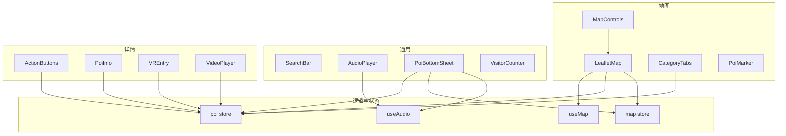
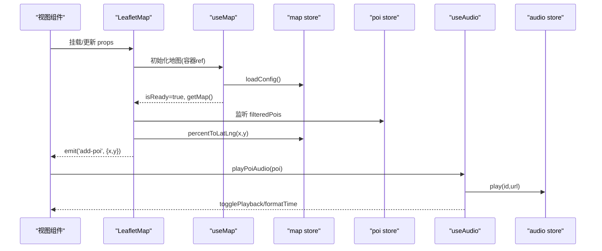
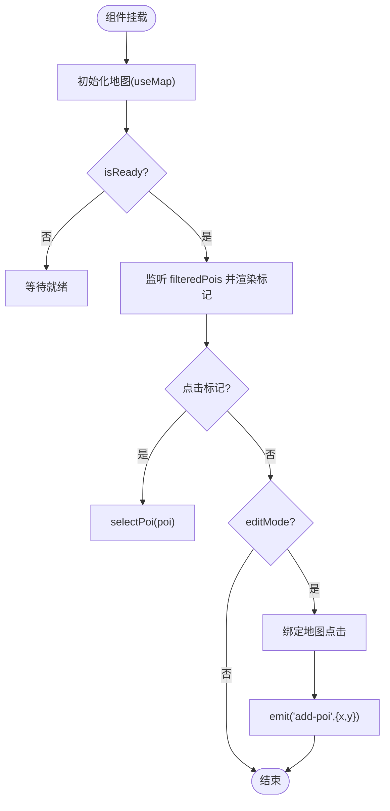
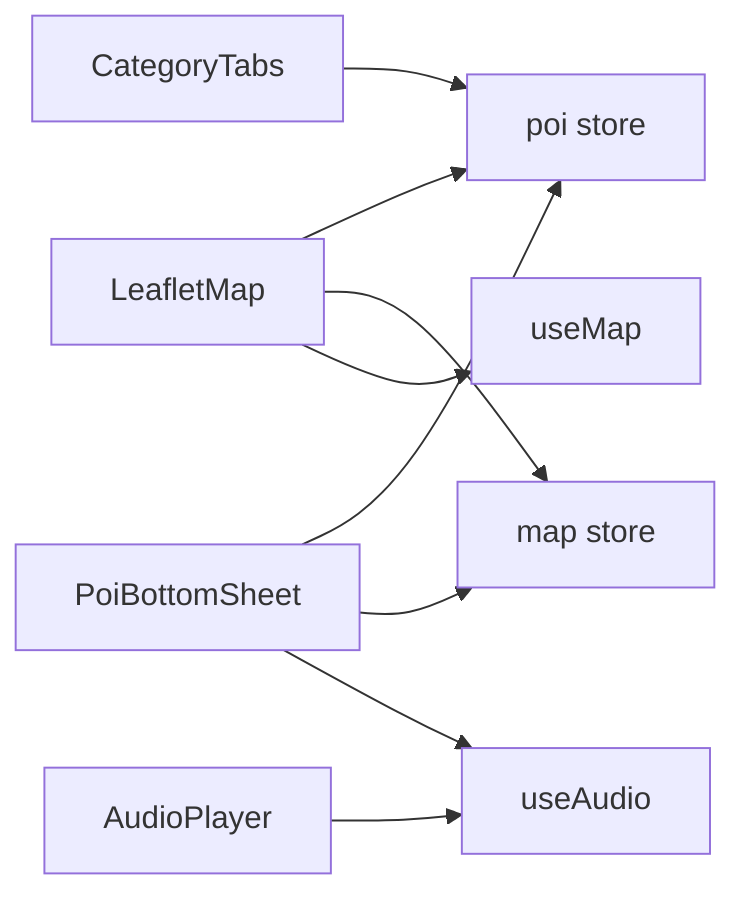

# 组件参考文档

<cite>
**本文引用的文件**
- [LeafletMap.vue](file://src/components/map/LeafletMap.vue)
- [MapControls.vue](file://src/components/map/MapControls.vue)
- [CategoryTabs.vue](file://src/components/map/CategoryTabs.vue)
- [PoiMarker.vue](file://src/components/map/PoiMarker.vue)
- [SearchBar.vue](file://src/components/common/SearchBar.vue)
- [AudioPlayer.vue](file://src/components/common/AudioPlayer.vue)
- [PoiBottomSheet.vue](file://src/components/common/PoiBottomSheet.vue)
- [VisitorCounter.vue](file://src/components/common/VisitorCounter.vue)
- [ActionButtons.vue](file://src/components/detail/ActionButtons.vue)
- [PoiInfo.vue](file://src/components/detail/PoiInfo.vue)
- [VREntry.vue](file://src/components/detail/VREntry.vue)
- [VideoPlayer.vue](file://src/components/detail/VideoPlayer.vue)
- [useMap.js](file://src/composables/useMap.js)
- [useAudio.js](file://src/composables/useAudio.js)
- [poi.js](file://src/stores/poi.js)
- [map.js](file://src/stores/map.js)
</cite>

## 目录
1. [简介](#简介)
2. [项目结构](#项目结构)
3. [核心组件](#核心组件)
4. [架构总览](#架构总览)
5. [详细组件分析](#详细组件分析)
6. [依赖关系分析](#依赖关系分析)
7. [性能考量](#性能考量)
8. [故障排查指南](#故障排查指南)
9. [结论](#结论)
10. [附录：响应式与可访问性](#附录响应式与可访问性)

## 简介
本参考文档面向 FunMapUI 的 Vue 组件库，覆盖地图组件、通用组件与详情组件三类。文档提供每个组件的功能说明、API（属性、事件、插槽）、样式定制建议、使用示例与最佳实践，并解释组件间的组合模式与依赖关系。同时包含响应式设计指导与可访问性支持说明，帮助开发者快速集成与扩展。

## 项目结构
FunMapUI 采用按功能域划分的目录组织方式：
- src/components/map：地图相关组件（LeafletMap、MapControls、CategoryTabs、PoiMarker）
- src/components/common：通用 UI 组件（SearchBar、AudioPlayer、PoiBottomSheet、VisitorCounter）
- src/components/detail：详情展示组件（ActionButtons、PoiInfo、VREntry、VideoPlayer）
- src/composables：可复用逻辑（useMap、useAudio）
- src/stores：状态管理（poi、map）

图表来源
- [LeafletMap.vue:1-141](file://src/components/map/LeafletMap.vue#L1-L141)
- [MapControls.vue:1-48](file://src/components/map/MapControls.vue#L1-L48)
- [CategoryTabs.vue:1-59](file://src/components/map/CategoryTabs.vue#L1-L59)
- [PoiMarker.vue:1-35](file://src/components/map/PoiMarker.vue#L1-L35)
- [SearchBar.vue:1-47](file://src/components/common/SearchBar.vue#L1-L47)
- [AudioPlayer.vue:1-104](file://src/components/common/AudioPlayer.vue#L1-L104)
- [PoiBottomSheet.vue:1-190](file://src/components/common/PoiBottomSheet.vue#L1-L190)
- [VisitorCounter.vue:1-58](file://src/components/common/VisitorCounter.vue#L1-L58)
- [ActionButtons.vue:1-79](file://src/components/detail/ActionButtons.vue#L1-L79)
- [PoiInfo.vue:1-130](file://src/components/detail/PoiInfo.vue#L1-L130)
- [VREntry.vue:1-90](file://src/components/detail/VREntry.vue#L1-L90)
- [VideoPlayer.vue:1-67](file://src/components/detail/VideoPlayer.vue#L1-L67)
- [useMap.js:1-174](file://src/composables/useMap.js#L1-L174)
- [useAudio.js:1-59](file://src/composables/useAudio.js#L1-L59)
- [poi.js:1-84](file://src/stores/poi.js#L1-L84)
- [map.js:1-122](file://src/stores/map.js#L1-L122)

章节来源
- [LeafletMap.vue:1-141](file://src/components/map/LeafletMap.vue#L1-L141)
- [map.js:1-122](file://src/stores/map.js#L1-L122)
- [poi.js:1-84](file://src/stores/poi.js#L1-L84)

## 核心组件
- LeafletMap：基于 Leaflet 的手绘地图容器，负责初始化地图、加载瓦片、渲染 POI 标记、处理编辑模式点击添加 POI。
- MapControls：缩放控制按钮组，触发放大/缩小事件。
- CategoryTabs：分类标签栏，切换当前分类以过滤 POI。
- PoiMarker：POI 圆点标记样式组件。
- SearchBar：搜索入口占位组件，点击触发上层路由或搜索逻辑。
- AudioPlayer：音频播放条，显示进度、播放/暂停、关闭。
- PoiBottomSheet：底部弹窗，展示选中 POI 信息并提供语音讲解、导航、电话等快捷操作。
- VisitorCounter：访客计数动画组件。
- ActionButtons：详情页动作按钮（导航、电话）。
- PoiInfo：POI 详情信息展示（封面图、描述、元数据）。
- VREntry：VR 全景入口卡片，跳转全景页。
- VideoPlayer：视频播放器占位与基础控制。

章节来源
- [LeafletMap.vue:1-141](file://src/components/map/LeafletMap.vue#L1-L141)
- [MapControls.vue:1-48](file://src/components/map/MapControls.vue#L1-L48)
- [CategoryTabs.vue:1-59](file://src/components/map/CategoryTabs.vue#L1-L59)
- [PoiMarker.vue:1-35](file://src/components/map/PoiMarker.vue#L1-L35)
- [SearchBar.vue:1-47](file://src/components/common/SearchBar.vue#L1-L47)
- [AudioPlayer.vue:1-104](file://src/components/common/AudioPlayer.vue#L1-L104)
- [PoiBottomSheet.vue:1-190](file://src/components/common/PoiBottomSheet.vue#L1-L190)
- [VisitorCounter.vue:1-58](file://src/components/common/VisitorCounter.vue#L1-L58)
- [ActionButtons.vue:1-79](file://src/components/detail/ActionButtons.vue#L1-L79)
- [PoiInfo.vue:1-130](file://src/components/detail/PoiInfo.vue#L1-L130)
- [VREntry.vue:1-90](file://src/components/detail/VREntry.vue#L1-L90)
- [VideoPlayer.vue:1-67](file://src/components/detail/VideoPlayer.vue#L1-L67)

## 架构总览
下图展示了关键组件与 Composable/Store 的交互关系，体现“视图层 → 逻辑层 → 状态层”的分层设计。

图表来源
- [LeafletMap.vue:1-141](file://src/components/map/LeafletMap.vue#L1-L141)
- [useMap.js:1-174](file://src/composables/useMap.js#L1-L174)
- [map.js:1-122](file://src/stores/map.js#L1-L122)
- [poi.js:1-84](file://src/stores/poi.js#L1-L84)
- [useAudio.js:1-59](file://src/composables/useAudio.js#L1-L59)

## 详细组件分析

### 地图组件

#### LeafletMap
- 功能：初始化 Leaflet 地图（CRS.Simple），加载瓦片，根据 POI 列表渲染自定义标记，支持编辑模式点击添加 POI。
- Props
  - editMode: Boolean，默认 false，是否启用地图点击添加 POI。
- Events
  - add-poi: 在编辑模式下点击地图时触发，payload 为 { x, y }（百分比坐标）。
- Slots：无显式插槽。
- 样式：根容器类名 leaflet-map，宽高 100%。
- 行为要点
  - 通过 useMap 初始化地图，监听 isReady 后渲染标记。
  - 使用 mapStore.percentToLatLng 将百分比坐标转为像素坐标。
  - 根据 POI 名称动态计算标记宽度，创建 L.divIcon。
  - 点击标记调用 poiStore.selectPoi。
  - 编辑模式开启时绑定地图 click，关闭时解绑。
- 暴露方法：getMap（供父组件获取地图实例）。

图表来源
- [LeafletMap.vue:1-141](file://src/components/map/LeafletMap.vue#L1-L141)
- [useMap.js:1-174](file://src/composables/useMap.js#L1-L174)
- [poi.js:1-84](file://src/stores/poi.js#L1-L84)
- [map.js:1-122](file://src/stores/map.js#L1-L122)

章节来源
- [LeafletMap.vue:1-141](file://src/components/map/LeafletMap.vue#L1-L141)

#### MapControls
- 功能：提供放大/缩小按钮，向父级发射事件。
- Props：无。
- Events
  - zoomIn：点击放大按钮触发。
  - zoomOut：点击缩小按钮触发。
- 样式：垂直排列按钮，圆角、阴影、主题色变量。
- 可访问性：按钮含 aria-label。

章节来源
- [MapControls.vue:1-48](file://src/components/map/MapControls.vue#L1-L48)

#### CategoryTabs
- 功能：展示分类 Tab，点击切换 activeCategory，驱动 POI 过滤。
- Props：无。
- Events：无（直接修改 store）。
- 样式：横向滚动条，激活态高亮。
- 依赖：poi store 的 categories 与 activeCategory。

章节来源
- [CategoryTabs.vue:1-59](file://src/components/map/CategoryTabs.vue#L1-L59)
- [poi.js:1-84](file://src/stores/poi.js#L1-L84)

#### PoiMarker
- 功能：纯展示型圆点标记，支持颜色定制。
- Props
  - color: String，默认 #1989fa。
- 样式：外圈边框 + 内圈实心圆，阴影效果。

章节来源
- [PoiMarker.vue:1-35](file://src/components/map/PoiMarker.vue#L1-L35)

### 通用组件

#### SearchBar
- 功能：搜索入口占位，点击触发上层逻辑。
- Props
  - placeholder: String，默认提示文案。
- Events
  - click：点击时触发。
- 样式：圆角、阴影、图标+占位文本布局。

章节来源
- [SearchBar.vue:1-47](file://src/components/common/SearchBar.vue#L1-L47)

#### AudioPlayer
- 功能：音频播放条，显示当前 POI 名称、时间、进度条，支持播放/暂停、拖拽进度、关闭。
- Props：无（数据来自 composable）。
- Events：无（直接操作 store）。
- 依赖：useAudio（audioStore、togglePlayback、getCurrentPoi、formatTime）。
- 样式：flex 布局，滑块样式通过 deep 选择器适配。

章节来源
- [AudioPlayer.vue:1-104](file://src/components/common/AudioPlayer.vue#L1-L104)
- [useAudio.js:1-59](file://src/composables/useAudio.js#L1-L59)

#### PoiBottomSheet
- 功能：底部弹窗展示选中 POI 基本信息与快捷操作（语音讲解、导航、电话）。
- Props：无（数据来自 store）。
- Events：无（内部路由与 store 操作）。
- 依赖：poi store（selectedPoi）、map store（percentToLatLng）、useAudio（playPoiAudio）、useGeolocation（openNavigation、callPhone）。
- 样式：顶部手柄、标题/描述/标签、操作区按钮。

章节来源
- [PoiBottomSheet.vue:1-190](file://src/components/common/PoiBottomSheet.vue#L1-L190)
- [poi.js:1-84](file://src/stores/poi.js#L1-L84)
- [map.js:1-122](file://src/stores/map.js#L1-L122)
- [useAudio.js:1-59](file://src/composables/useAudio.js#L1-L59)

#### VisitorCounter
- 功能：展示访客数，带数字递增动画。
- Props
  - count: Number，默认 425。
- 样式：半透明背景、毛玻璃效果、主色强调数字。

章节来源
- [VisitorCounter.vue:1-58](file://src/components/common/VisitorCounter.vue#L1-L58)

### 详情组件

#### ActionButtons
- 功能：详情页动作按钮（路线导航、电话咨询）。
- Props
  - poi: Object（必填），包含 phone 等字段。
- Events：无（内部处理导航/电话）。
- 样式：主次按钮风格，圆角与间距。

章节来源
- [ActionButtons.vue:1-79](file://src/components/detail/ActionButtons.vue#L1-L79)

#### PoiInfo
- 功能：展示 POI 封面图、名称、标签、描述、地址/营业时间/电话等元信息。
- Props
  - poi: Object（必填）。
- 样式：封面区域、内容区域、元信息列表。

章节来源
- [PoiInfo.vue:1-130](file://src/components/detail/PoiInfo.vue#L1-L130)

#### VREntry
- 功能：VR 全景入口卡片，点击跳转到全景页面并携带参数。
- Props
  - poiId: String|Number，默认 ''。
  - poiName: String，默认 ''。
- 事件：无（内部路由跳转）。
- 样式：渐变背景、图标与信息区、箭头指示。

章节来源
- [VREntry.vue:1-90](file://src/components/detail/VREntry.vue#L1-L90)

#### VideoPlayer
- 功能：视频播放器，支持 poster 与 controls，移动端 inline 播放。
- Props
  - videoUrl: String，默认 ''。
  - poster: String，默认 ''。
- 样式：黑色背景、最大高度限制、占位图。

章节来源
- [VideoPlayer.vue:1-67](file://src/components/detail/VideoPlayer.vue#L1-L67)

## 依赖关系分析
- 组件与 Store
  - LeafletMap、CategoryTabs、PoiBottomSheet 依赖 poi store 进行 POI 数据与分类状态管理。
  - LeafletMap、PoiBottomSheet 依赖 map store 进行坐标转换与地图配置。
- 组件与 Composable
  - LeafletMap 依赖 useMap 完成地图初始化与生命周期管理。
  - AudioPlayer、PoiBottomSheet 依赖 useAudio 进行音频播放控制。
- 组件间协作
  - 地图点击标记 → 选中 POI → 打开底部弹窗 → 触发语音/导航/电话等操作。
  - 分类切换 → 过滤 POI → 地图标记更新。

图表来源
- [LeafletMap.vue:1-141](file://src/components/map/LeafletMap.vue#L1-L141)
- [PoiBottomSheet.vue:1-190](file://src/components/common/PoiBottomSheet.vue#L1-L190)
- [AudioPlayer.vue:1-104](file://src/components/common/AudioPlayer.vue#L1-L104)
- [CategoryTabs.vue:1-59](file://src/components/map/CategoryTabs.vue#L1-L59)
- [useMap.js:1-174](file://src/composables/useMap.js#L1-L174)
- [useAudio.js:1-59](file://src/composables/useAudio.js#L1-L59)
- [poi.js:1-84](file://src/stores/poi.js#L1-L84)
- [map.js:1-122](file://src/stores/map.js#L1-L122)

章节来源
- [LeafletMap.vue:1-141](file://src/components/map/LeafletMap.vue#L1-L141)
- [PoiBottomSheet.vue:1-190](file://src/components/common/PoiBottomSheet.vue#L1-L190)
- [useMap.js:1-174](file://src/composables/useMap.js#L1-L174)
- [useAudio.js:1-59](file://src/composables/useAudio.js#L1-L59)
- [poi.js:1-84](file://src/stores/poi.js#L1-L84)
- [map.js:1-122](file://src/stores/map.js#L1-L122)

## 性能考量
- 地图瓦片与缩放
  - 使用 CRS.Simple 与自定义 Transformation，避免经纬度投影开销。
  - 设置 maxNativeZoom 与 CSS 放大策略，减少超分辨率瓦片请求。
  - 自定义双指缩放阈值，避免频繁缩放抖动。
- 标记渲染
  - 每次更新前移除旧标记，避免内存泄漏。
  - 根据文字长度动态计算标记尺寸，减少重排。
- 音频播放
  - 使用 store 集中管理播放状态，避免重复实例化。
  - 进度条计算基于 duration，避免高频 DOM 查询。
- 列表与过滤
  - 分类过滤通过 computed 缓存，减少重复计算。
  - 搜索关键字匹配使用 toLowerCase 预优化。

[本节为通用性能建议，不直接分析具体代码行]

## 故障排查指南
- 地图未显示或瓦片空白
  - 检查 map store 的 loadConfig 是否正确加载图片与 tilesPath。
  - 确认瓦片路径与生成脚本输出一致，y 坐标翻转逻辑正确。
  - 查看控制台调试日志（zoomend 事件输出瓦片加载情况）。
- 标记不出现或位置错误
  - 确认 poiStore.filteredPois 已更新且非空。
  - 检查 percentToLatLng 转换结果是否在 bounds 范围内。
- 音频无法播放
  - 确认 audioUrl 存在且可访问。
  - 检查浏览器自动播放策略与用户手势要求。
- 底部弹窗不关闭或状态不同步
  - 确保关闭时调用 clearSelection，保持 store 与 UI 同步。

章节来源
- [useMap.js:1-174](file://src/composables/useMap.js#L1-L174)
- [map.js:1-122](file://src/stores/map.js#L1-L122)
- [LeafletMap.vue:1-141](file://src/components/map/LeafletMap.vue#L1-L141)
- [AudioPlayer.vue:1-104](file://src/components/common/AudioPlayer.vue#L1-L104)
- [PoiBottomSheet.vue:1-190](file://src/components/common/PoiBottomSheet.vue#L1-L190)

## 结论
FunMapUI 通过清晰的组件分层与 Composable/Store 抽象，实现了手绘地图场景下的 POI 展示、交互与多媒体能力。各组件职责明确、耦合度低，便于复用与扩展。结合响应式设计与可访问性实践，可在多端设备上提供一致的体验。

[本节为总结性内容，不直接分析具体代码行]

## 附录：响应式与可访问性
- 响应式设计
  - 使用 CSS 变量统一间距、圆角、阴影与主题色，便于跨设备适配。
  - 地图容器使用 100% 宽高，配合瓦片缩放实现自适应。
  - 底部弹窗与操作区采用 flex 布局，在小屏上保持可用性。
- 可访问性
  - 地图控件按钮提供 aria-label，提升屏幕阅读器体验。
  - 图片提供 alt 文本，增强语义化。
  - 表单与交互元素具备明确的焦点与键盘可达性（由 Vant 组件保障）。

[本节为通用指导，不直接分析具体代码行]