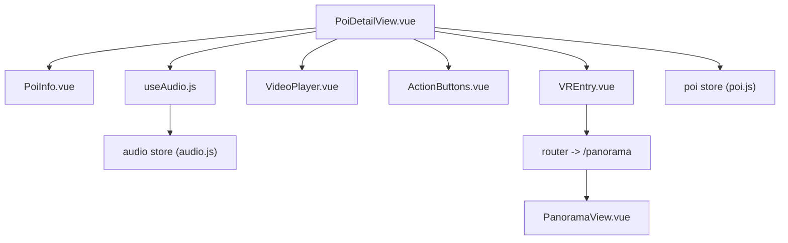
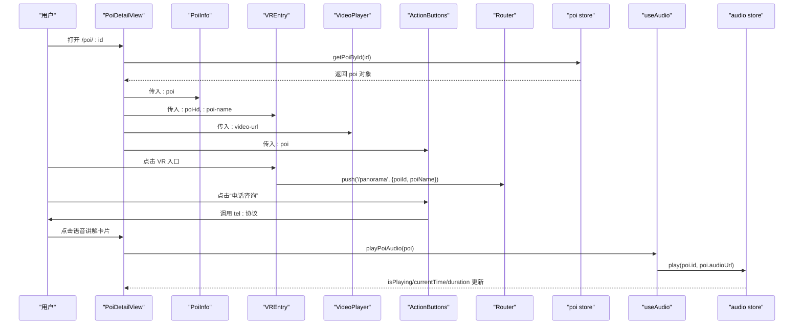
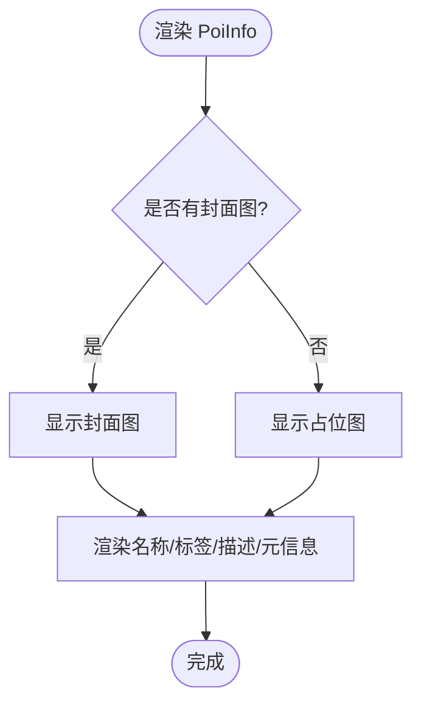
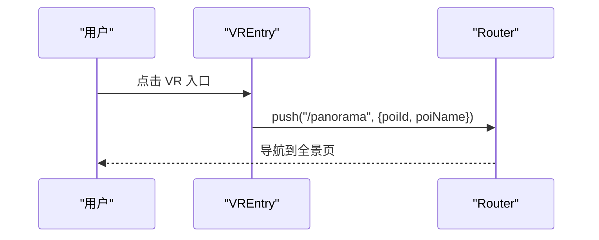
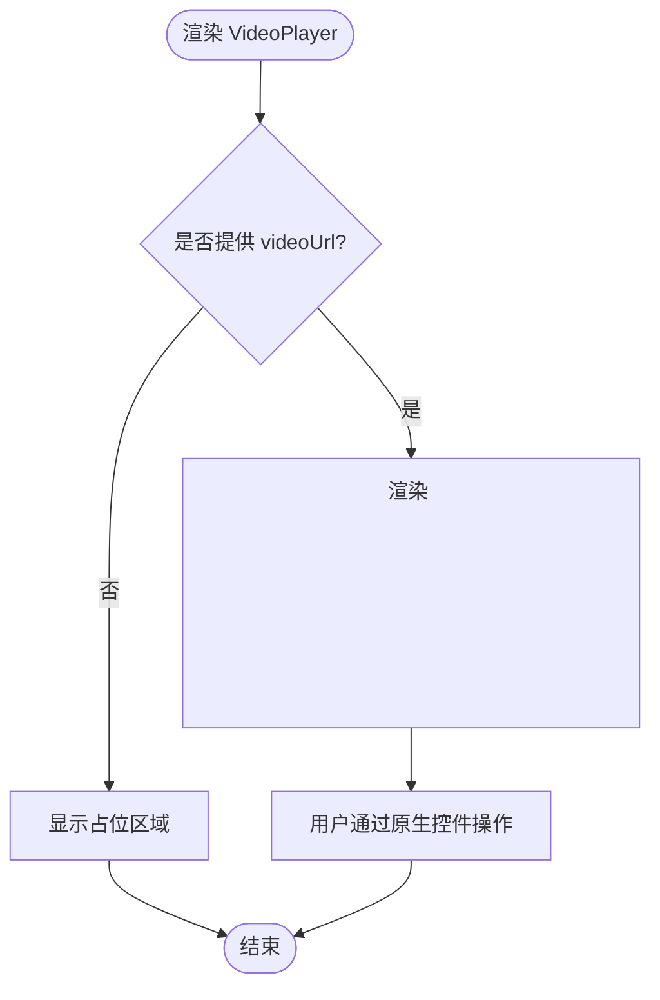
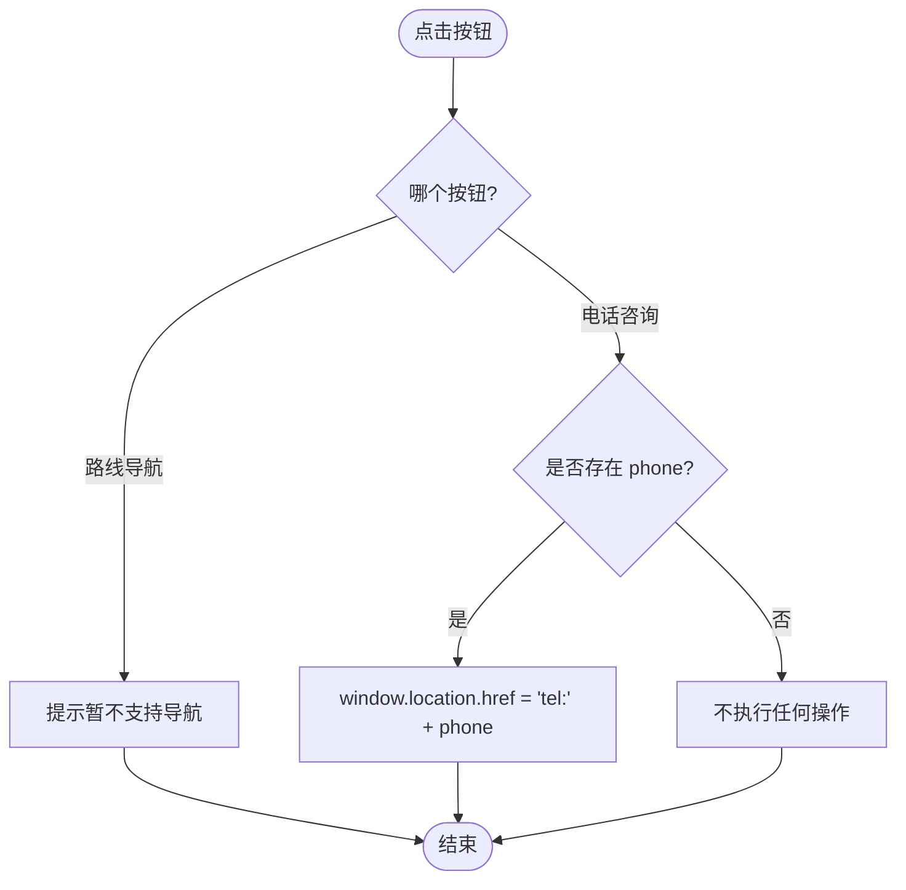
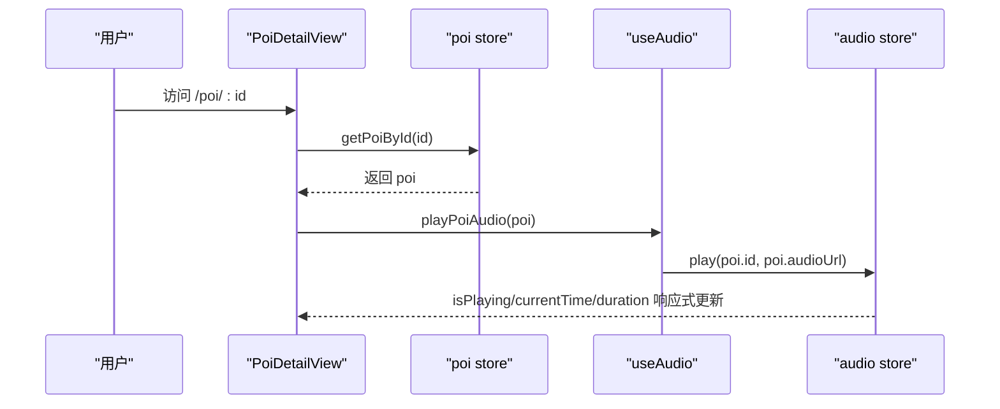
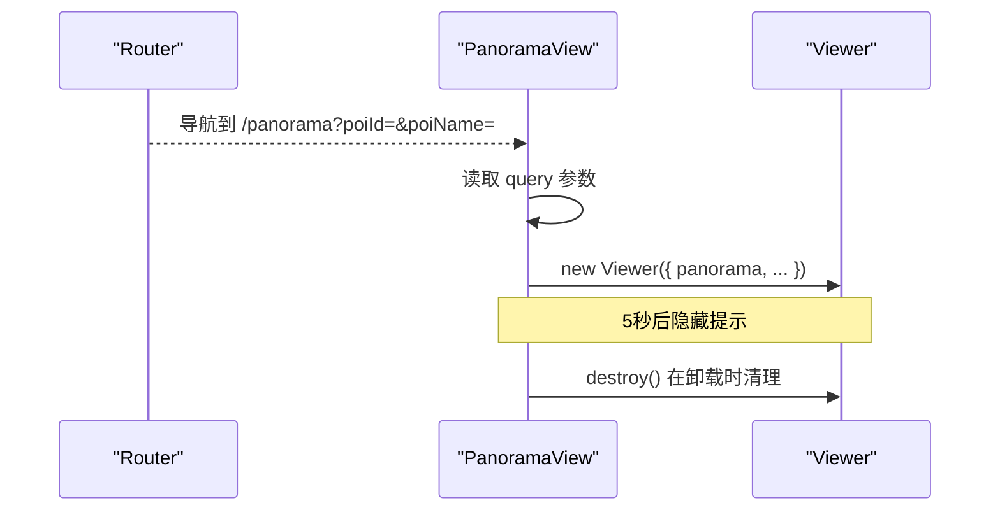
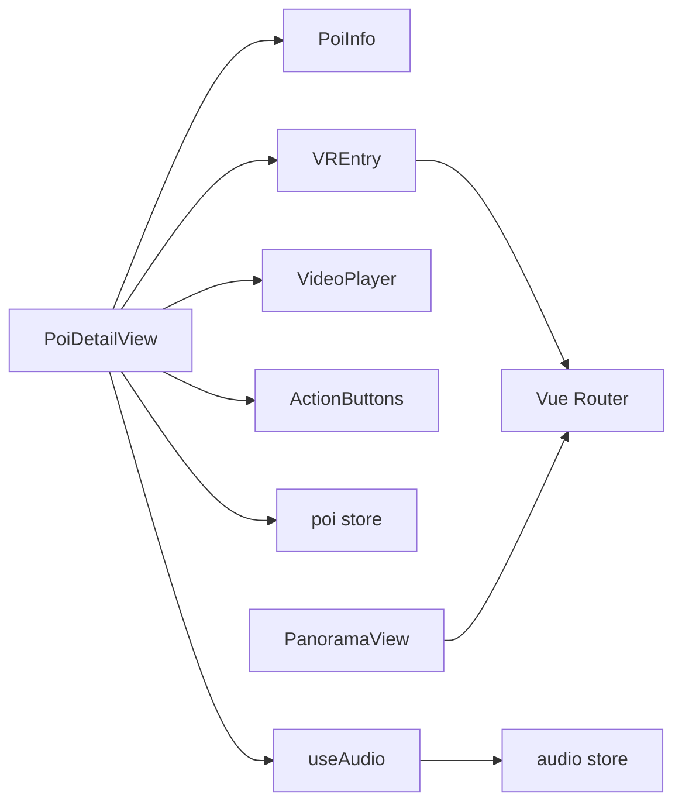

# 详情组件

<cite>
**本文引用的文件**
- [src/components/detail/ActionButtons.vue](file://src/components/detail/ActionButtons.vue)
- [src/components/detail/PoiInfo.vue](file://src/components/detail/PoiInfo.vue)
- [src/components/detail/VREntry.vue](file://src/components/detail/VREntry.vue)
- [src/components/detail/VideoPlayer.vue](file://src/components/detail/VideoPlayer.vue)
- [src/views/PoiDetailView.vue](file://src/views/PoiDetailView.vue)
- [src/views/PanoramaView.vue](file://src/views/PanoramaView.vue)
- [src/stores/poi.js](file://src/stores/poi.js)
- [src/stores/audio.js](file://src/stores/audio.js)
- [src/composables/useAudio.js](file://src/composables/useAudio.js)
- [src/router/index.js](file://src/router/index.js)
- [src/styles/variables.css](file://src/styles/variables.css)
</cite>

## 目录
1. [简介](#简介)
2. [项目结构](#项目结构)
3. [核心组件](#核心组件)
4. [架构总览](#架构总览)
5. [详细组件分析](#详细组件分析)
6. [依赖关系分析](#依赖关系分析)
7. [性能与体验优化](#性能与体验优化)
8. [故障排查指南](#故障排查指南)
9. [结论](#结论)
10. [附录：配置与使用示例](#附录：配置与使用示例)

## 简介
本文件聚焦于 FunMapUI 的“详情”页面及其子组件，系统性说明 ActionButtons、PoiInfo、VREntry、VideoPlayer 的功能实现、数据绑定、事件处理、状态管理与用户交互逻辑。同时阐述与详情页路由、Pinia 状态管理的集成方式，并提供多媒体加载优化、用户体验提升以及错误处理与加载状态的完整方案。

## 项目结构
详情功能由一个视图容器和四个子组件构成，配合 Pinia 状态与 Vue Router 完成数据与导航流转：
- 视图容器：PoiDetailView（负责组装子组件、路由参数解析、音频播放控制）
- 子组件：
  - PoiInfo：展示 POI 基本信息（封面图、名称、标签、描述、地址、营业时间、电话等）
  - VREntry：跳转 VR 全景入口
  - VideoPlayer：视频播放器占位与基础控制
  - ActionButtons：操作按钮组（路线导航、电话咨询）
- 状态管理：
  - poi store：提供 POI 数据查询能力
  - audio store：统一音频播放状态与生命周期管理
- 路由：/poi/:id 进入详情；/panorama 进入全景

图表来源
- [src/views/PoiDetailView.vue:1-49](file://src/views/PoiDetailView.vue#L1-L49)
- [src/components/detail/PoiInfo.vue:1-48](file://src/components/detail/PoiInfo.vue#L1-L48)
- [src/components/detail/VREntry.vue:1-39](file://src/components/detail/VREntry.vue#L1-L39)
- [src/components/detail/VideoPlayer.vue:1-21](file://src/components/detail/VideoPlayer.vue#L1-L21)
- [src/components/detail/ActionButtons.vue:1-19](file://src/components/detail/ActionButtons.vue#L1-L19)
- [src/composables/useAudio.js:1-59](file://src/composables/useAudio.js#L1-L59)
- [src/stores/audio.js:1-111](file://src/stores/audio.js#L1-L111)
- [src/stores/poi.js:1-84](file://src/stores/poi.js#L1-L84)
- [src/router/index.js:1-32](file://src/router/index.js#L1-L32)
- [src/views/PanoramaView.vue:1-96](file://src/views/PanoramaView.vue#L1-L96)

章节来源
- [src/views/PoiDetailView.vue:1-49](file://src/views/PoiDetailView.vue#L1-L49)
- [src/router/index.js:1-32](file://src/router/index.js#L1-L32)

## 核心组件
- PoiInfo：纯展示型组件，接收 poi 对象，渲染封面图、名称、标签、描述、元信息（地址、营业时间、电话）。无副作用，适合懒加载与骨架屏占位。
- VREntry：点击后通过 router.push 跳转到 /panorama，并携带 poiId、poiName 作为 query 参数。
- VideoPlayer：基于原生 video 元素，支持 poster 封面、controls 控件、移动端内联播放属性，默认仅预加载元数据。
- ActionButtons：提供“路线导航”和“电话咨询”两个动作。当前手绘地图模式下导航为提示态；电话拨打通过 tel: 协议触发系统拨号。

章节来源
- [src/components/detail/PoiInfo.vue:1-57](file://src/components/detail/PoiInfo.vue#L1-L57)
- [src/components/detail/VREntry.vue:14-39](file://src/components/detail/VREntry.vue#L14-L39)
- [src/components/detail/VideoPlayer.vue:1-38](file://src/components/detail/VideoPlayer.vue#L1-L38)
- [src/components/detail/ActionButtons.vue:21-40](file://src/components/detail/ActionButtons.vue#L21-L40)

## 架构总览
详情页面作为编排层，组合多个子组件，并通过 Pinia 与 composable 进行状态与业务封装。VR 全景通过路由跳转至独立全屏页面，使用第三方全景库初始化 Viewer。

图表来源
- [src/views/PoiDetailView.vue:51-80](file://src/views/PoiDetailView.vue#L51-L80)
- [src/components/detail/VREntry.vue:14-39](file://src/components/detail/VREntry.vue#L14-L39)
- [src/components/detail/ActionButtons.vue:21-40](file://src/components/detail/ActionButtons.vue#L21-L40)
- [src/composables/useAudio.js:1-59](file://src/composables/useAudio.js#L1-L59)
- [src/stores/audio.js:1-111](file://src/stores/audio.js#L1-L111)
- [src/stores/poi.js:1-84](file://src/stores/poi.js#L1-L84)
- [src/router/index.js:1-32](file://src/router/index.js#L1-L32)

## 详细组件分析

### PoiInfo 组件
- 数据绑定
  - 接收 props.poi，渲染封面图、名称、标签数组、描述、地址、营业时间、电话等字段。
  - 当缺少图片时显示占位符。
- 事件处理
  - 无外部事件，纯展示。
- 状态管理
  - 无内部状态，完全受控于父级传入的 poi。
- 用户交互
  - 可滚动阅读长描述与信息列表。
- 样式与主题
  - 使用 CSS 变量统一间距、圆角、颜色等视觉规范。

图表来源
- [src/components/detail/PoiInfo.vue:1-48](file://src/components/detail/PoiInfo.vue#L1-L48)
- [src/styles/variables.css:1-52](file://src/styles/variables.css#L1-L52)

章节来源
- [src/components/detail/PoiInfo.vue:1-57](file://src/components/detail/PoiInfo.vue#L1-L57)
- [src/styles/variables.css:1-52](file://src/styles/variables.css#L1-L52)

### VREntry 组件
- 数据绑定
  - 接收 poiId、poiName 作为 props。
- 事件处理
  - 点击后通过 router.push 跳转到 /panorama，并附带 query 参数。
- 状态管理
  - 无内部状态。
- 用户交互
  - 提供清晰的入口卡片与箭头指示。

图表来源
- [src/components/detail/VREntry.vue:14-39](file://src/components/detail/VREntry.vue#L14-L39)
- [src/router/index.js:19-23](file://src/router/index.js#L19-L23)

章节来源
- [src/components/detail/VREntry.vue:1-39](file://src/components/detail/VREntry.vue#L1-L39)
- [src/router/index.js:1-32](file://src/router/index.js#L1-L32)

### VideoPlayer 组件
- 数据绑定
  - 接收 videoUrl、poster 两个可选 props。
- 事件处理
  - 使用浏览器原生 video 控件，无需自定义事件。
- 状态管理
  - 无内部状态，ref 引用用于后续扩展控制。
- 用户交互
  - 支持播放/暂停、进度条、音量等原生控制。
- 加载策略
  - 使用 preload="metadata" 减少首屏带宽占用。

图表来源
- [src/components/detail/VideoPlayer.vue:1-38](file://src/components/detail/VideoPlayer.vue#L1-L38)

章节来源
- [src/components/detail/VideoPlayer.vue:1-38](file://src/components/detail/VideoPlayer.vue#L1-L38)

### ActionButtons 组件
- 数据绑定
  - 接收 poi 对象，根据 phone 字段条件渲染“电话咨询”。
- 事件处理
  - “路线导航”在当前手绘地图模式下给出提示。
  - “电话咨询”通过 window.location.href = tel: 触发系统拨号。
- 状态管理
  - 无内部状态。
- 用户交互
  - 主/次按钮样式区分，点击有反馈。

图表来源
- [src/components/detail/ActionButtons.vue:21-40](file://src/components/detail/ActionButtons.vue#L21-L40)

章节来源
- [src/components/detail/ActionButtons.vue:1-79](file://src/components/detail/ActionButtons.vue#L1-L79)

### 详情页编排：PoiDetailView
- 数据获取
  - 通过 useRoute().params.id 从路由参数读取 POI ID，调用 poiStore.getPoiById 获取数据。
- 子组件装配
  - 将 poi 分别传递给 PoiInfo、VREntry、ActionButtons；若有 videoUrl 则渲染 VideoPlayer。
- 音频播放
  - 使用 useAudio composable 提供的 playPoiAudio 方法，结合 audio store 统一管理播放状态。
- 路由集成
  - 顶部导航栏支持返回；VR 入口跳转至 /panorama。

图表来源
- [src/views/PoiDetailView.vue:51-80](file://src/views/PoiDetailView.vue#L51-L80)
- [src/stores/poi.js:33-36](file://src/stores/poi.js#L33-L36)
- [src/composables/useAudio.js:15-19](file://src/composables/useAudio.js#L15-L19)
- [src/stores/audio.js:25-58](file://src/stores/audio.js#L25-L58)

章节来源
- [src/views/PoiDetailView.vue:1-80](file://src/views/PoiDetailView.vue#L1-L80)
- [src/stores/poi.js:1-84](file://src/stores/poi.js#L1-L84)
- [src/composables/useAudio.js:1-59](file://src/composables/useAudio.js#L1-L59)
- [src/stores/audio.js:1-111](file://src/stores/audio.js#L1-L111)

### VR 全景页：PanoramaView
- 路由参数
  - 从 route.query 中读取 poiId、poiName，用于标题与全景资源映射。
- 全景初始化
  - 使用 @photo-sphere-viewer/core 的 Viewer 实例化，配置缩放、触摸、惯性等交互。
- 生命周期
  - onMounted 创建 viewer；onUnmounted 销毁 viewer，避免内存泄漏。
- 提示与导航
  - 底部提示自动隐藏；支持返回上一级或首页。

图表来源
- [src/views/PanoramaView.vue:25-96](file://src/views/PanoramaView.vue#L25-L96)
- [src/router/index.js:19-23](file://src/router/index.js#L19-L23)

章节来源
- [src/views/PanoramaView.vue:1-190](file://src/views/PanoramaView.vue#L1-L190)
- [src/router/index.js:1-32](file://src/router/index.js#L1-L32)

## 依赖关系分析
- 组件耦合
  - PoiDetailView 聚合各子组件，低耦合高内聚；子组件均为单向数据流。
- 状态依赖
  - PoiDetailView 依赖 poi store 获取数据，依赖 audio store 管理音频播放。
  - VREntry 依赖 Vue Router 进行导航。
- 外部依赖
  - Vant 组件库用于图标与标签。
  - @photo-sphere-viewer/core 用于全景展示。
- 样式依赖
  - 全局 CSS 变量统一主题与间距。

图表来源
- [src/views/PoiDetailView.vue:51-80](file://src/views/PoiDetailView.vue#L51-L80)
- [src/components/detail/VREntry.vue:14-39](file://src/components/detail/VREntry.vue#L14-L39)
- [src/composables/useAudio.js:1-59](file://src/composables/useAudio.js#L1-L59)
- [src/stores/audio.js:1-111](file://src/stores/audio.js#L1-L111)
- [src/stores/poi.js:1-84](file://src/stores/poi.js#L1-L84)
- [src/router/index.js:1-32](file://src/router/index.js#L1-L32)

章节来源
- [src/views/PoiDetailView.vue:1-80](file://src/views/PoiDetailView.vue#L1-L80)
- [src/components/detail/VREntry.vue:1-39](file://src/components/detail/VREntry.vue#L1-L39)
- [src/composables/useAudio.js:1-59](file://src/composables/useAudio.js#L1-L59)
- [src/stores/audio.js:1-111](file://src/stores/audio.js#L1-L111)
- [src/stores/poi.js:1-84](file://src/stores/poi.js#L1-L84)
- [src/router/index.js:1-32](file://src/router/index.js#L1-L32)

## 性能与体验优化
- 多媒体加载优化
  - 视频使用 preload="metadata" 仅预加载元数据，降低首屏带宽与延迟。
  - 图片使用 object-fit 保持比例，必要时可引入懒加载与占位骨架屏。
  - 全景资源按需加载，进入全景页再初始化 Viewer，避免无关开销。
- 交互体验
  - 音频播放状态集中管理，避免多端重复播放；播放失败时回退状态。
  - VR 入口提供明确引导与手势提示，减少学习成本。
  - 按钮点击反馈与禁用态清晰，防止误触。
- 可访问性
  - 图片提供 alt 文本；关键操作具备明确的文案与图标。
- 可扩展点
  - 视频播放器可接入 HLS/自适应码率；音频可加入进度拖拽与缓存。
  - VR 全景可增加场景切换、热点标注、分享等功能。

[本节为通用指导，不直接分析具体文件]

## 故障排查指南
- 无法播放音频
  - 检查 audioUrl 是否存在；确认浏览器允许自动播放策略；查看 audio store 的 play 方法是否正确设置 currentPoiId 与 isPlaying。
  - 参考路径：[src/stores/audio.js:25-58](file://src/stores/audio.js#L25-L58)
- 视频不显示
  - 确认 videoUrl 有效且跨域可访问；检查浏览器是否支持该格式；确保 poster 存在以提升感知速度。
  - 参考路径：[src/components/detail/VideoPlayer.vue:1-38](file://src/components/detail/VideoPlayer.vue#L1-L38)
- VR 入口无效
  - 检查路由是否注册 /panorama；确认 query 参数传递正确；查看 PanoramaView 是否正确读取 route.query。
  - 参考路径：[src/router/index.js:19-23](file://src/router/index.js#L19-L23), [src/views/PanoramaView.vue:46-52](file://src/views/PanoramaView.vue#L46-L52)
- 详情页数据为空
  - 确认路由参数 id 存在；检查 poiStore.getPoiById 是否能找到对应 POI；必要时增加空状态与重试机制。
  - 参考路径：[src/stores/poi.js:33-36](file://src/stores/poi.js#L33-L36), [src/views/PoiDetailView.vue:61-67](file://src/views/PoiDetailView.vue#L61-L67)
- 导航提示
  - 当前手绘地图模式不支持路线导航，属于预期行为；如需接入真实导航，替换 handleNavigate 逻辑。
  - 参考路径：[src/components/detail/ActionButtons.vue:31-33](file://src/components/detail/ActionButtons.vue#L31-L33)

章节来源
- [src/stores/audio.js:25-58](file://src/stores/audio.js#L25-L58)
- [src/components/detail/VideoPlayer.vue:1-38](file://src/components/detail/VideoPlayer.vue#L1-L38)
- [src/router/index.js:19-23](file://src/router/index.js#L19-L23)
- [src/views/PanoramaView.vue:46-52](file://src/views/PanoramaView.vue#L46-L52)
- [src/stores/poi.js:33-36](file://src/stores/poi.js#L33-L36)
- [src/views/PoiDetailView.vue:61-67](file://src/views/PoiDetailView.vue#L61-L67)
- [src/components/detail/ActionButtons.vue:31-33](file://src/components/detail/ActionButtons.vue#L31-L33)

## 结论
详情组件以清晰的职责划分与单向数据流组织，实现了 POI 信息展示、VR 全景入口、视频播放与操作按钮的统一编排。通过 Pinia 与 composable 对状态与业务进行解耦，结合路由实现页面间跳转。多媒体内容采用轻量加载策略，兼顾性能与体验。建议在后续迭代中补充更完善的错误边界、加载骨架与无障碍支持，进一步提升健壮性与可维护性。

[本节为总结性内容，不直接分析具体文件]

## 附录：配置与使用示例
- 在详情页中使用各组件
  - 将 poi 对象通过 props 传入 PoiInfo、ActionButtons；若存在 videoUrl，传入 VideoPlayer；若需要 VR 入口，传入 poiId、poiName 给 VREntry。
  - 参考路径：[src/views/PoiDetailView.vue:15-48](file://src/views/PoiDetailView.vue#L15-L48)
- 配置 VR 全景资源
  - 在 PanoramaView 中维护 POI ID 到全景图的映射，或通过后端接口动态获取。
  - 参考路径：[src/views/PanoramaView.vue:40-52](file://src/views/PanoramaView.vue#L40-L52)
- 音频播放配置
  - 使用 useAudio 的 playPoiAudio 方法传入 poi 即可；音频状态由 audio store 统一管理。
  - 参考路径：[src/composables/useAudio.js:15-19](file://src/composables/useAudio.js#L15-L19), [src/stores/audio.js:25-58](file://src/stores/audio.js#L25-L58)
- 主题与样式
  - 通过 CSS 变量统一色彩、间距、圆角等，便于全局换肤与维护。
  - 参考路径：[src/styles/variables.css:1-52](file://src/styles/variables.css#L1-L52)

章节来源
- [src/views/PoiDetailView.vue:15-48](file://src/views/PoiDetailView.vue#L15-L48)
- [src/views/PanoramaView.vue:40-52](file://src/views/PanoramaView.vue#L40-L52)
- [src/composables/useAudio.js:15-19](file://src/composables/useAudio.js#L15-L19)
- [src/stores/audio.js:25-58](file://src/stores/audio.js#L25-L58)
- [src/styles/variables.css:1-52](file://src/styles/variables.css#L1-L52)