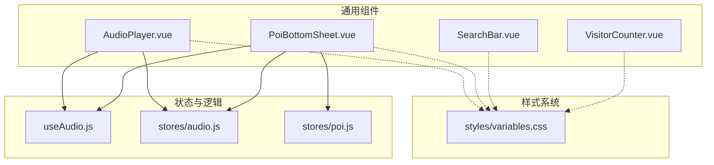
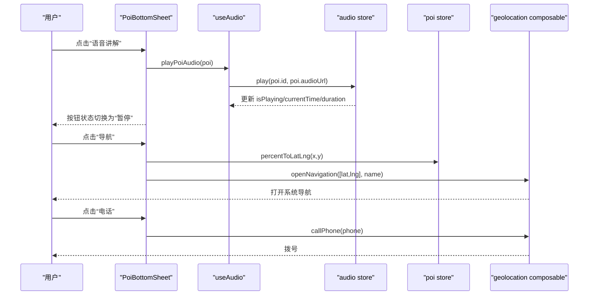
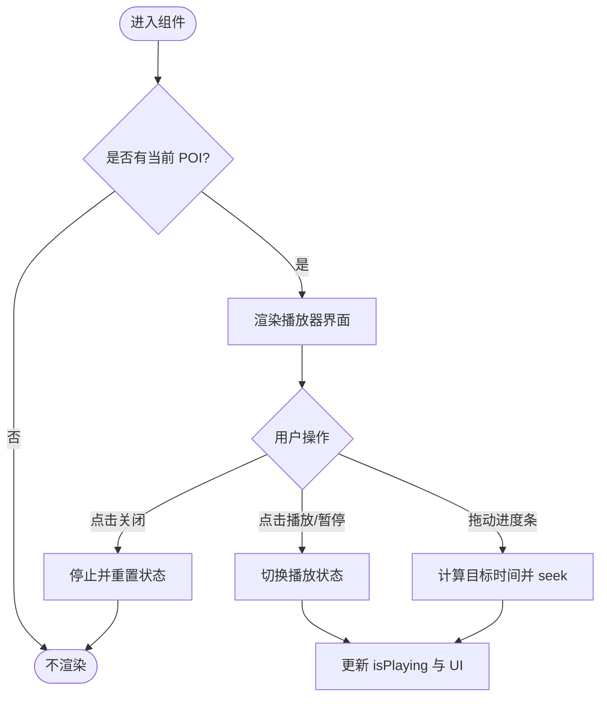
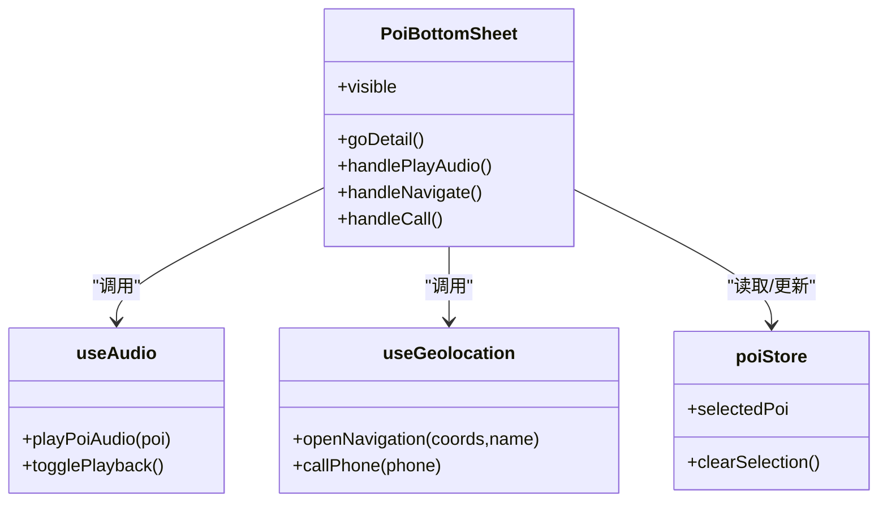
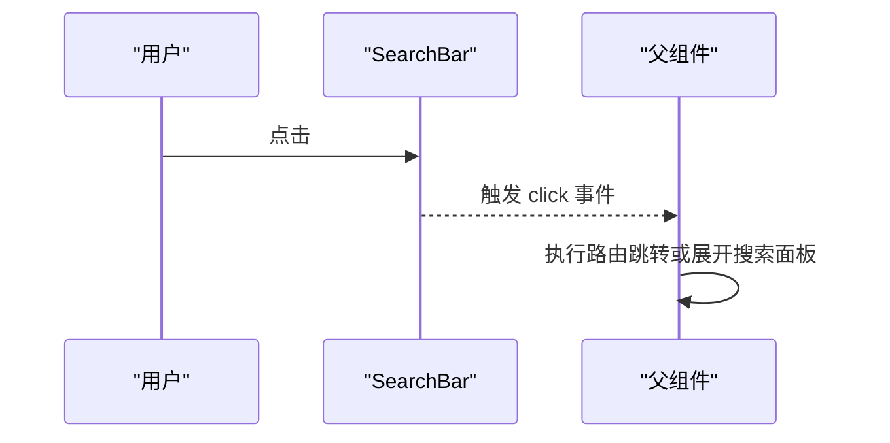
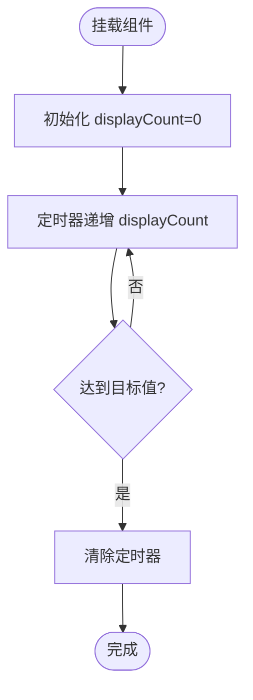
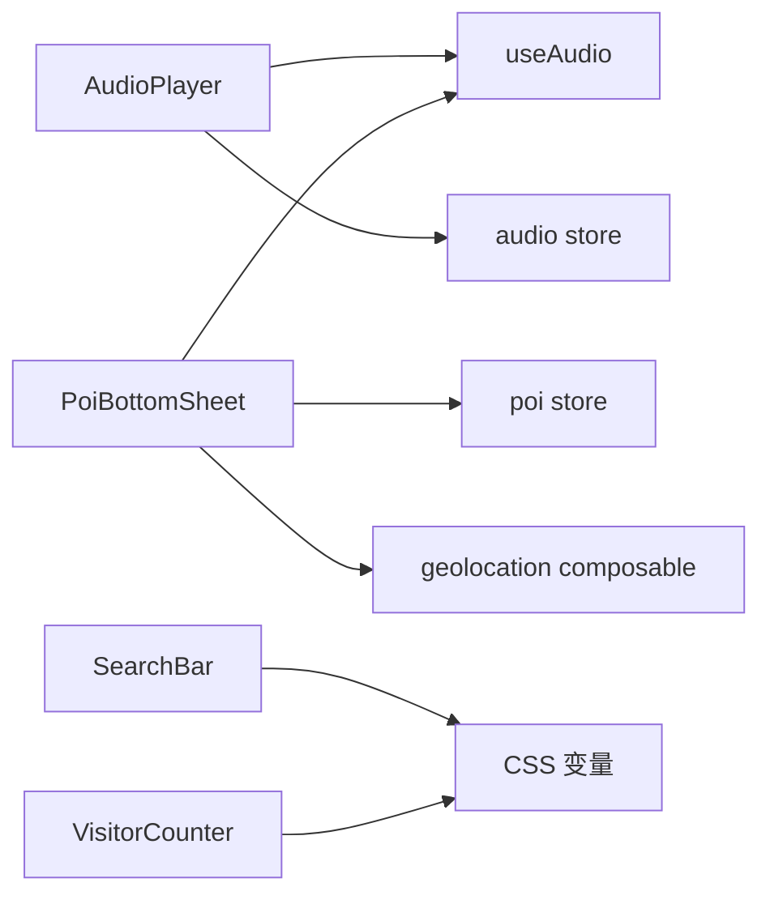

# 通用组件

<cite>
**本文引用的文件**
- [AudioPlayer.vue](file://src/components/common/AudioPlayer.vue)
- [PoiBottomSheet.vue](file://src/components/common/PoiBottomSheet.vue)
- [SearchBar.vue](file://src/components/common/SearchBar.vue)
- [VisitorCounter.vue](file://src/components/common/VisitorCounter.vue)
- [useAudio.js](file://src/composables/useAudio.js)
- [audio.js](file://src/stores/audio.js)
- [poi.js](file://src/stores/poi.js)
- [variables.css](file://src/styles/variables.css)
- [README.md](file://README.md)
- [package.json](file://package.json)
</cite>

## 目录
1. [简介](#简介)
2. [项目结构](#项目结构)
3. [核心组件总览](#核心组件总览)
4. [架构总览](#架构总览)
5. [组件详细分析](#组件详细分析)
6. [依赖关系分析](#依赖关系分析)
7. [性能与可访问性](#性能与可访问性)
8. [移动端适配指南](#移动端适配指南)
9. [错误处理与边界情况](#错误处理与边界情况)
10. [结论](#结论)
11. [附录：使用示例与最佳实践](#附录使用示例与最佳实践)

## 简介
本文件面向 FunMapUI 的四个通用组件：AudioPlayer（音频播放器）、PoiBottomSheet（POI 底部弹窗）、SearchBar（搜索栏）和 VisitorCounter（访客计数器）。文档从配置项、事件接口、样式定制、国际化支持、组合复用、移动端适配、用户体验优化以及错误处理等方面进行全面说明，并提供可视化架构图与流程图，帮助开发者快速集成与扩展。

## 项目结构
- 通用组件位于 src/components/common，分别实现音频播放、POI 详情弹窗、搜索入口与访客计数等能力。
- 状态管理通过 Pinia store（audio、poi）与组合式函数 useAudio 提供跨组件共享能力。
- 主题与间距通过 CSS 变量统一管理，便于全局样式定制。

图表来源
- [AudioPlayer.vue:1-104](file://src/components/common/AudioPlayer.vue#L1-L104)
- [PoiBottomSheet.vue:1-190](file://src/components/common/PoiBottomSheet.vue#L1-L190)
- [SearchBar.vue:1-47](file://src/components/common/SearchBar.vue#L1-L47)
- [VisitorCounter.vue:1-58](file://src/components/common/VisitorCounter.vue#L1-L58)
- [useAudio.js:1-59](file://src/composables/useAudio.js#L1-L59)
- [audio.js:1-111](file://src/stores/audio.js#L1-L111)
- [poi.js:1-84](file://src/stores/poi.js#L1-L84)
- [variables.css:1-52](file://src/styles/variables.css#L1-L52)

章节来源
- [README.md:42-98](file://README.md#L42-L98)
- [package.json:11-21](file://package.json#L11-L21)

## 核心组件总览
- AudioPlayer：全局悬浮音频播放器，展示当前 POI 名称、播放进度、播放/暂停与关闭控制，基于 useAudio 与 audio store 驱动。
- PoiBottomSheet：底部弹窗展示选中 POI 的基本信息、标签、快捷操作（语音讲解、导航、电话），并联动地图坐标与地理定位能力。
- SearchBar：轻量搜索入口，点击触发父级路由或页面跳转，占位文案可配置。
- VisitorCounter：带数字递增动画的访客计数展示，适合在页脚或角落展示“第 N 位访客”。

章节来源
- [AudioPlayer.vue:1-104](file://src/components/common/AudioPlayer.vue#L1-L104)
- [PoiBottomSheet.vue:1-190](file://src/components/common/PoiBottomSheet.vue#L1-L190)
- [SearchBar.vue:1-47](file://src/components/common/SearchBar.vue#L1-L47)
- [VisitorCounter.vue:1-58](file://src/components/common/VisitorCounter.vue#L1-L58)

## 架构总览
组件通过组合式函数与 Pinia store 解耦 UI 与业务逻辑，遵循单一职责与可复用原则。

图表来源
- [PoiBottomSheet.vue:83-102](file://src/components/common/PoiBottomSheet.vue#L83-L102)
- [useAudio.js:16-30](file://src/composables/useAudio.js#L16-L30)
- [audio.js:25-58](file://src/stores/audio.js#L25-L58)
- [poi.js:44-51](file://src/stores/poi.js#L44-L51)

## 组件详细分析

### AudioPlayer 组件
- 功能特性
  - 显示当前 POI 名称与时间进度
  - 播放/暂停切换
  - 拖动进度条跳转播放位置
  - 关闭时停止播放并重置状态
- 配置选项
  - 无显式 props；数据来源于 useAudio 与 audio store
- 事件接口
  - 内部事件：togglePlayback、handleSeek、关闭按钮调用 stop
- 样式定制
  - 使用 CSS 变量统一主题色、间距、圆角与阴影
  - 进度条高度、主色可通过变量覆盖
- 国际化支持
  - 文本来自 POI 名称；如需多语言，可在上层传入 i18n key 或通过 POI 字段本地化
- 可复用性与组合模式
  - 通过 useAudio 抽象播放逻辑，组件仅负责渲染与交互
- 移动端适配
  - 使用触摸友好的图标尺寸与滑动控件
  - 布局采用 flex 自适应宽度，避免溢出
- 错误处理与边界情况
  - 当 duration 为 0 时进度为 0
  - 自动捕获播放失败并将 isPlaying 置为 false
  - 关闭时确保停止播放并清理实例

图表来源
- [AudioPlayer.vue:2-25](file://src/components/common/AudioPlayer.vue#L2-L25)
- [AudioPlayer.vue:37-45](file://src/components/common/AudioPlayer.vue#L37-L45)
- [audio.js:25-58](file://src/stores/audio.js#L25-L58)
- [audio.js:76-97](file://src/stores/audio.js#L76-L97)

章节来源
- [AudioPlayer.vue:1-104](file://src/components/common/AudioPlayer.vue#L1-L104)
- [useAudio.js:1-59](file://src/composables/useAudio.js#L1-L59)
- [audio.js:1-111](file://src/stores/audio.js#L1-L111)
- [variables.css:1-52](file://src/styles/variables.css#L1-L52)

### PoiBottomSheet 组件
- 功能特性
  - 展示 POI 基本信息（名称、描述、标签）
  - 快捷操作：语音讲解、导航、电话
  - 点击头部跳转到详情页
- 配置选项
  - 无显式 props；数据来源于 poi store 选中的 POI
- 事件接口
  - 关闭时清空选中
  - 导航：将百分比坐标转换为经纬度后调用地理定位
  - 电话：直接拨号
- 样式定制
  - 使用 CSS 变量控制间距、颜色、圆角与层级
  - 安全区域适配（safe-area-inset-bottom）
- 国际化支持
  - 按钮文案固定中文；如需多语言，可在上层注入翻译或使用 i18n key
- 可复用性与组合模式
  - 通过 useGeolocation 与 useAudio 组合外部能力，保持组件聚焦于 UI 与交互
- 移动端适配
  - 底部弹窗最大高度 45vh，适配小屏设备
  - 按钮区域触控友好，间距合理
- 错误处理与边界情况
  - 无 audioUrl 时隐藏语音按钮
  - 无 phone 时隐藏电话按钮
  - 导航前校验坐标转换结果

图表来源
- [PoiBottomSheet.vue:56-103](file://src/components/common/PoiBottomSheet.vue#L56-L103)
- [useAudio.js:16-30](file://src/composables/useAudio.js#L16-L30)
- [poi.js:44-51](file://src/stores/poi.js#L44-L51)

章节来源
- [PoiBottomSheet.vue:1-190](file://src/components/common/PoiBottomSheet.vue#L1-L190)
- [useAudio.js:1-59](file://src/composables/useAudio.js#L1-L59)
- [poi.js:1-84](file://src/stores/poi.js#L1-L84)
- [variables.css:1-52](file://src/styles/variables.css#L1-L52)

### SearchBar 组件
- 功能特性
  - 展示搜索图标与占位文案
  - 点击触发父级 click 事件，由父组件决定跳转或展开搜索框
- 配置选项
  - placeholder：占位文案，默认提示语
- 事件接口
  - click：由父组件监听并处理路由跳转或搜索面板展开
- 样式定制
  - 使用 CSS 变量控制背景、圆角、阴影与文字颜色
  - 最大宽度与高度固定，保证在顶部工具栏中稳定布局
- 国际化支持
  - 占位文案可通过 i18n 替换；组件本身不绑定具体语言
- 可复用性与组合模式
  - 纯展示型组件，行为完全由父组件控制，易于在不同页面复用
- 移动端适配
  - 紧凑尺寸，适合顶部导航栏或搜索入口
- 错误处理与边界情况
  - 无输入逻辑，不会发生异常；父组件需处理空字符串或无效路由

图表来源
- [SearchBar.vue:1-17](file://src/components/common/SearchBar.vue#L1-L17)

章节来源
- [SearchBar.vue:1-47](file://src/components/common/SearchBar.vue#L1-L47)
- [variables.css:1-52](file://src/styles/variables.css#L1-L52)

### VisitorCounter 组件
- 功能特性
  - 展示“第 N 位访客”，数字从 0 递增到目标值，形成动画效果
- 配置选项
  - count：目标数值，默认 425
- 事件接口
  - 无对外事件
- 样式定制
  - 半透明背景、毛玻璃效果、主色高亮数字
- 国际化支持
  - 文案固定中文；如需多语言，可在外层包装 i18n 或使用插槽
- 可复用性与组合模式
  - 自包含展示组件，适合放在页脚或角落
- 移动端适配
  - 小字号与紧凑内边距，适配各种屏幕
- 错误处理与边界情况
  - 若 count 为负数或非数字，建议在上层做校验；当前实现按数值递增，非正数会立即结束

图表来源
- [VisitorCounter.vue:18-31](file://src/components/common/VisitorCounter.vue#L18-L31)

章节来源
- [VisitorCounter.vue:1-58](file://src/components/common/VisitorCounter.vue#L1-L58)
- [variables.css:1-52](file://src/styles/variables.css#L1-L52)

## 依赖关系分析
- 组件与状态
  - AudioPlayer 依赖 useAudio 与 audio store，用于播放控制与进度同步
  - PoiBottomSheet 依赖 useAudio、useGeolocation 与 poi store，用于语音、导航与 POI 数据
  - SearchBar 与 VisitorCounter 为轻依赖组件，主要依赖样式变量
- 组件耦合度
  - 通过组合式函数与 store 解耦，组件之间无直接耦合，提升可复用性
- 外部依赖
  - Vant 组件库提供图标、滑块、弹窗、标签等基础 UI
  - Leaflet 地图引擎与地理定位能力由其他模块提供，PoiBottomSheet 通过 composable 间接使用

图表来源
- [AudioPlayer.vue:28-45](file://src/components/common/AudioPlayer.vue#L28-L45)
- [PoiBottomSheet.vue:56-103](file://src/components/common/PoiBottomSheet.vue#L56-L103)
- [useAudio.js:1-59](file://src/composables/useAudio.js#L1-L59)
- [audio.js:1-111](file://src/stores/audio.js#L1-L111)
- [poi.js:1-84](file://src/stores/poi.js#L1-L84)
- [variables.css:1-52](file://src/styles/variables.css#L1-L52)

章节来源
- [package.json:11-21](file://package.json#L11-L21)
- [README.md:29-40](file://README.md#L29-L40)

## 性能与可访问性
- 性能
  - 音频播放使用原生 Audio API，store 集中管理实例，避免重复创建
  - 进度条通过 computed 计算百分比，减少不必要的重渲染
  - 访客计数器使用 setInterval 与 Math.min 控制增量，避免过度计算
- 可访问性
  - 按钮与图标具备语义化点击区域，建议为关键按钮添加 aria-label
  - 进度条与滑块支持键盘操作（Vant 组件默认支持）
- 资源加载
  - 音频 URL 按需加载，建议在父组件预缓存或懒加载以提升首屏性能

[本节为通用指导，不直接分析具体文件]

## 移动端适配指南
- 布局与尺寸
  - 使用 CSS 变量统一间距与圆角，保证在不同屏幕下的一致性
  - 底部弹窗最大高度 45vh，避免遮挡过多内容
- 触控体验
  - 按钮与图标尺寸适中，点击热区足够大
  - 进度条支持拖拽，反馈清晰
- 安全区域
  - 底部弹窗考虑 safe-area-inset-bottom，适配刘海屏与全面屏
- 字体与可读性
  - 标题与正文字号层次分明，次要信息使用次级颜色
- 横竖屏适配
  - 组件以纵向为主，横向时可适当调整弹窗高度与按钮排列

[本节为通用指导，不直接分析具体文件]

## 错误处理与边界情况
- 音频播放
  - 播放失败时捕获异常并将 isPlaying 置为 false，避免 UI 状态不一致
  - 关闭播放器时停止播放并清理实例，防止内存泄漏
- 导航与电话
  - 导航前进行坐标转换校验，确保经纬度有效
  - 电话仅在存在 phone 字段时显示与可用
- 搜索
  - SearchBar 本身无输入逻辑，父组件应处理空查询与无效路由
- 访客计数
  - 对 count 的非正数情况，建议在上层做校验；当前实现会在非正数时立即结束动画

章节来源
- [audio.js:55-58](file://src/stores/audio.js#L55-L58)
- [audio.js:76-97](file://src/stores/audio.js#L76-L97)
- [PoiBottomSheet.vue:88-102](file://src/components/common/PoiBottomSheet.vue#L88-L102)
- [SearchBar.vue:8-17](file://src/components/common/SearchBar.vue#L8-L17)
- [VisitorCounter.vue:20-31](file://src/components/common/VisitorCounter.vue#L20-L31)

## 结论
FunMapUI 的四个通用组件通过组合式函数与 Pinia store 实现了清晰的职责分离与良好的可复用性。AudioPlayer 专注于播放控制与进度展示，PoiBottomSheet 整合了 POI 信息与快捷操作，SearchBar 提供轻量搜索入口，VisitorCounter 提供友好的计数展示。借助统一的 CSS 变量与 Vant 组件库，组件在移动端具备良好的适配性与一致性。建议在集成时结合业务场景进行 i18n 与样式定制，并完善错误处理与可访问性细节。

[本节为总结，不直接分析具体文件]

## 附录：使用示例与最佳实践
- 音频播放控制
  - 在 POI 列表或详情页调用 useAudio 的 playPoiAudio，传入 POI 对象即可开始播放
  - 使用 AudioPlayer 组件展示播放状态与进度，关闭时自动停止
  - 参考路径：[useAudio.playPoiAudio:16-19](file://src/composables/useAudio.js#L16-L19)、[audio.store.play:25-58](file://src/stores/audio.js#L25-L58)
- 底部弹窗交互
  - 选中 POI 后显示 PoiBottomSheet，点击头部跳转详情页
  - 导航通过 map store 的坐标转换与 geolocation composable 打开系统导航
  - 参考路径：[PoiBottomSheet 导航与电话:93-102](file://src/components/common/PoiBottomSheet.vue#L93-L102)
- 搜索功能实现
  - SearchBar 点击触发父组件路由跳转至搜索页
  - 搜索逻辑可在 poi store 的 searchPois 中实现关键词匹配
  - 参考路径：[SearchBar 事件:1-17](file://src/components/common/SearchBar.vue#L1-L17)、[poi.searchPois:54-63](file://src/stores/poi.js#L54-L63)
- 访客计数器
  - 在页脚或角落插入 VisitorCounter，设置 count 为目标值
  - 数字递增动画在组件挂载时自动执行
  - 参考路径：[VisitorCounter 动画:20-31](file://src/components/common/VisitorCounter.vue#L20-L31)
- 样式定制
  - 通过 variables.css 修改主题色、间距、圆角与阴影，实现品牌化外观
  - 参考路径：[CSS 变量定义:1-52](file://src/styles/variables.css#L1-L52)
- 国际化建议
  - 将固定文案（如“语音讲解”、“导航”、“电话”）抽离为 i18n key，在父组件或应用入口处配置多语言
  - 占位文案与提示信息同样使用 i18n key，便于切换语言

[本节为实践指导，不直接分析具体文件]