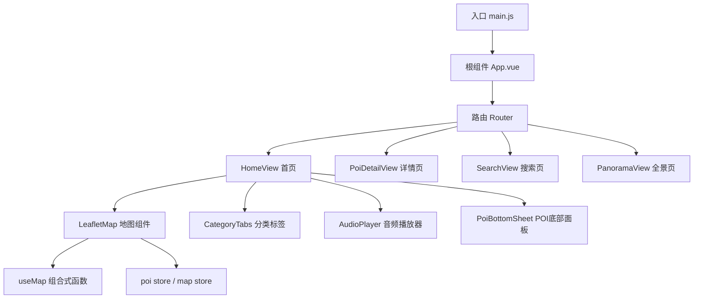
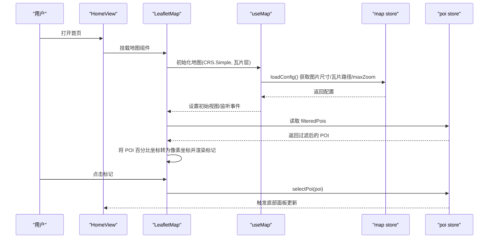
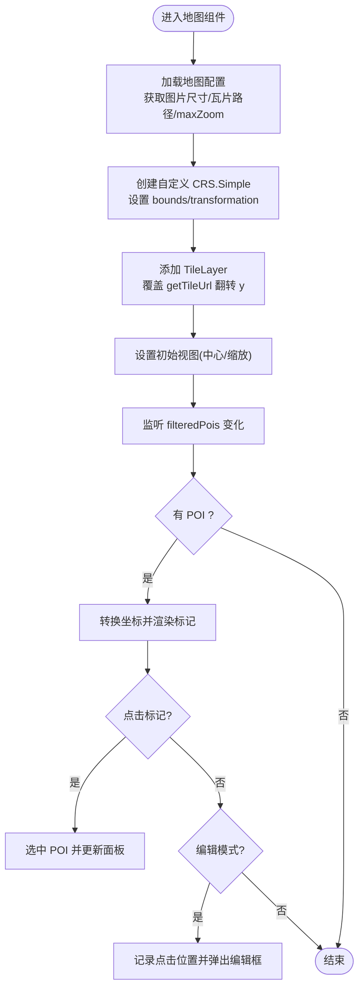
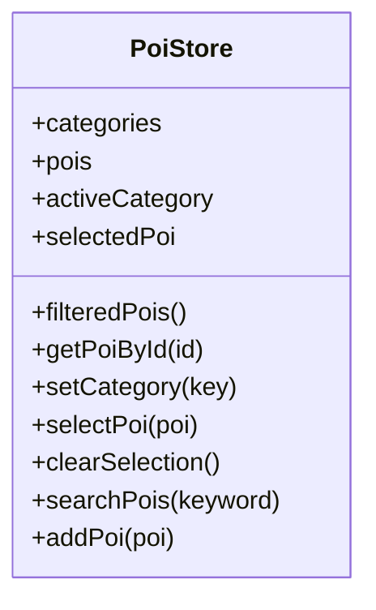
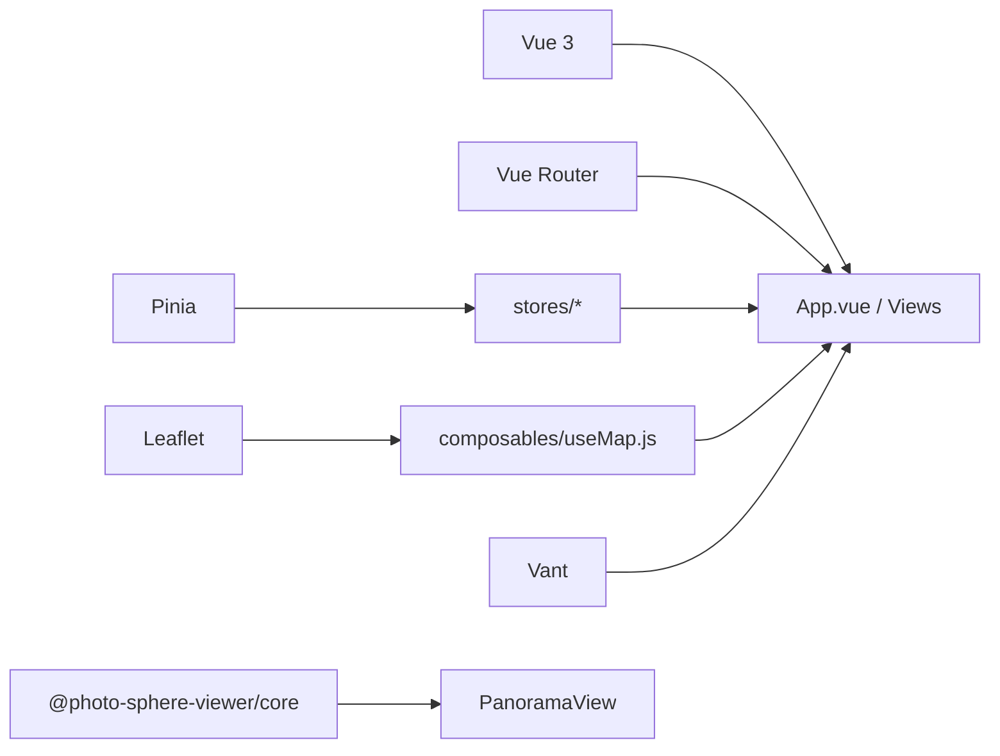

# 项目概述

<cite>
**本文引用的文件**
- [package.json](file://package.json)
- [README.md](file://README.md)
- [vite.config.js](file://vite.config.js)
- [src/main.js](file://src/main.js)
- [src/App.vue](file://src/App.vue)
- [src/router/index.js](file://src/router/index.js)
- [src/stores/poi.js](file://src/stores/poi.js)
- [src/stores/map.js](file://src/stores/map.js)
- [src/stores/audio.js](file://src/stores/audio.js)
- [src/composables/useMap.js](file://src/composables/useMap.js)
- [src/components/map/LeafletMap.vue](file://src/components/map/LeafletMap.vue)
- [src/views/HomeView.vue](file://src/views/HomeView.vue)
- [src/data/mock.js](file://src/data/mock.js)
- [public/map/config.json](file://public/map/config.json)
</cite>

## 目录
1. [简介](#简介)
2. [项目结构](#项目结构)
3. [核心组件](#核心组件)
4. [架构总览](#架构总览)
5. [详细组件分析](#详细组件分析)
6. [依赖关系分析](#依赖关系分析)
7. [性能考量](#性能考量)
8. [故障排查指南](#故障排查指南)
9. [结论](#结论)
10. [附录](#附录)

## 简介
FunMapUI 是一款基于手绘地图的移动端全域旅游智慧导览应用，以青海大柴旦区域为原型，提供地图浏览、POI 标注与详情、全景查看、语音讲解、搜索等能力。项目采用 Vue 3 + Vite + Pinia + Leaflet 的技术栈，通过自定义像素坐标系（CRS.Simple）将手绘地图切分为瓦片金字塔，实现无级缩放与高性能渲染；结合 Pinia 管理地图、POI、音频状态，配合 Vant 构建移动端界面，形成轻量、可维护、易扩展的前端方案。

## 项目结构
项目采用按功能域划分的目录组织方式：
- public：静态资源（手绘地图配置、瓦片、全景图片等）
- src：源码
  - components：按 common/detail/map 划分通用、详情、地图相关组件
  - composables：组合式函数（地图初始化、音频播放、地理定位）
  - stores：Pinia 状态（map/poi/audio）
  - views：页面视图（首页、详情页、搜索页、全景页）
  - router：路由配置
  - styles：全局样式变量
- scripts：开发期脚本（瓦片生成）

图表来源
- [src/main.js:1-21](file://src/main.js#L1-L21)
- [src/App.vue:1-59](file://src/App.vue#L1-L59)
- [src/router/index.js:1-32](file://src/router/index.js#L1-L32)
- [src/views/HomeView.vue:1-136](file://src/views/HomeView.vue#L1-L136)
- [src/components/map/LeafletMap.vue:1-141](file://src/components/map/LeafletMap.vue#L1-L141)
- [src/composables/useMap.js:1-174](file://src/composables/useMap.js#L1-L174)

章节来源
- [README.md:42-99](file://README.md#L42-L99)
- [package.json:1-28](file://package.json#L1-L28)

## 核心组件
- 地图系统
  - 使用 Leaflet CRS.Simple 自定义像素坐标，动态计算 paddedDim、bounds、maxZoom，并通过 TileLayer 加载瓦片；支持无级缩放与双指手势控制。
  - 标记点根据 POI 百分比坐标转换为像素坐标后渲染，并支持点击选择与编辑模式添加新 POI。
- POI 管理
  - 通过 Pinia store 集中管理 POI 数据、分类筛选、搜索、选中态；支持内存中新增 POI。
- 全景查看
  - 基于 @photo-sphere-viewer/core 的全景查看器，支持触摸旋转、双指缩放、惯性滑动与全屏。
- 语音讲解
  - 全局悬浮播放器，统一管理当前 POI 音频、播放/暂停/跳转进度等状态。

章节来源
- [src/stores/poi.js:1-84](file://src/stores/poi.js#L1-L84)
- [src/stores/map.js:1-122](file://src/stores/map.js#L1-L122)
- [src/stores/audio.js:1-111](file://src/stores/audio.js#L1-L111)
- [src/components/map/LeafletMap.vue:1-141](file://src/components/map/LeafletMap.vue#L1-L141)
- [src/composables/useMap.js:1-174](file://src/composables/useMap.js#L1-L174)
- [README.md:5-28](file://README.md#L5-L28)

## 架构总览
整体采用“视图层 + 组合式逻辑 + 状态管理”的分层架构：
- 视图层：Vue 组件负责 UI 与交互
- 组合式逻辑：useMap 封装地图生命周期、CRS、瓦片、手势等
- 状态管理：Pinia store 管理地图配置、POI、音频
- 数据流：mock 数据 → poi store → 地图标记与详情展示

图表来源
- [src/views/HomeView.vue:1-136](file://src/views/HomeView.vue#L1-L136)
- [src/components/map/LeafletMap.vue:1-141](file://src/components/map/LeafletMap.vue#L1-L141)
- [src/composables/useMap.js:1-174](file://src/composables/useMap.js#L1-L174)
- [src/stores/map.js:1-122](file://src/stores/map.js#L1-L122)
- [src/stores/poi.js:1-84](file://src/stores/poi.js#L1-L84)

## 详细组件分析

### 地图系统（LeafletMap + useMap）
- 坐标系统与瓦片
  - 使用 CRS.Simple 覆盖 bounds 为 paddedDim×paddedDim，transformation 无 y-flip；TileLayer 在 getTileUrl 中翻转 y 以匹配瓦片存储约定。
  - maxNativeZoom 限制瓦片级别，超出由 CSS 放大，避免无效请求。
- 交互与手势
  - 禁用内置 touchZoom，自定义双指缩放：当张合超过阈值时触发整级缩放，提升移动端体验。
  - 支持滚轮缩放、按钮缩放、flyTo 平滑定位。
- 标记与编辑
  - 标记容器宽度按文字测量自适应；点击标记选中 POI；编辑模式下点击空白处发射 add-poi 事件，用于弹窗录入新 POI。

图表来源
- [src/composables/useMap.js:14-129](file://src/composables/useMap.js#L14-L129)
- [src/components/map/LeafletMap.vue:27-129](file://src/components/map/LeafletMap.vue#L27-L129)
- [src/stores/map.js:40-85](file://src/stores/map.js#L40-L85)

章节来源
- [src/composables/useMap.js:1-174](file://src/composables/useMap.js#L1-L174)
- [src/components/map/LeafletMap.vue:1-141](file://src/components/map/LeafletMap.vue#L1-L141)
- [src/stores/map.js:1-122](file://src/stores/map.js#L1-L122)

### POI 管理（stores/poi + data/mock）
- 数据结构
  - categories：分类定义（含图标、颜色）
  - pois：全部 POI 列表（来自 mock）
  - activeCategory：当前分类
  - selectedPoi：当前选中的 POI
- 核心方法
  - filteredPois：按分类过滤
  - searchPois：按名称/描述/标签关键词搜索
  - selectPoi/clearSelection：选中与清除
  - addPoi：内存中添加（会话级）

图表来源
- [src/stores/poi.js:1-84](file://src/stores/poi.js#L1-L84)
- [src/data/mock.js:1-349](file://src/data/mock.js#L1-L349)

章节来源
- [src/stores/poi.js:1-84](file://src/stores/poi.js#L1-L84)
- [src/data/mock.js:1-349](file://src/data/mock.js#L1-L349)

### 全景查看（PanoramaView）
- 基于 @photo-sphere-viewer/core 的等距柱状投影查看器
- 支持触摸拖拽旋转视角、双指缩放、惯性滑动与全屏
- 可通过 URL query 传入 POI ID 加载对应全景图

章节来源
- [README.md:20-24](file://README.md#L20-L24)

### 语音讲解（AudioPlayer + stores/audio）
- 全局悬浮播放器，统一管理当前 POI 音频、播放/暂停/跳转进度
- 支持同一音频切换、自动更新时长与进度、播放结束重置

章节来源
- [src/stores/audio.js:1-111](file://src/stores/audio.js#L1-L111)

## 依赖关系分析
- 运行时依赖
  - Vue 3、Vue Router：框架与路由
  - Pinia：状态管理
  - Leaflet：地图引擎
  - Vant：移动端 UI 组件库
  - @photo-sphere-viewer/core：全景查看
- 构建与开发
  - Vite：构建工具
  - unplugin-auto-import/unplugin-vue-components：按需导入与组件自动注册
  - sharp：瓦片图片处理（开发脚本）

图表来源
- [package.json:11-26](file://package.json#L11-L26)
- [src/main.js:1-21](file://src/main.js#L1-L21)
- [vite.config.js:1-27](file://vite.config.js#L1-L27)

章节来源
- [package.json:1-28](file://package.json#L1-L28)
- [vite.config.js:1-27](file://vite.config.js#L1-L27)

## 性能考量
- 瓦片策略
  - 使用 maxNativeZoom 限制瓦片级别，超出级别由 CSS 放大，减少无效网络请求。
  - 自定义 getTileUrl 翻转 y 坐标，确保瓦片正确映射。
- 缩放体验
  - 启用 zoomSnap=0 实现无级缩放；wheelPxPerZoomLevel 调整滚轮灵敏度；touchZoom 禁用并使用自定义双指缩放，避免卡顿。
- 渲染优化
  - 标记容器宽度按文本测量自适应，减少多余空间占用。
  - 监听 zoomend 输出调试信息，便于定位瓦片加载问题。
- 资源体积
  - 使用 Vite 按需引入与自动导入，减少打包体积。

[本节为通用性能建议，不直接分析具体文件]

## 故障排查指南
- 瓦片无法加载或错位
  - 检查 public/map/config.json 的 tilesPath 与 image 路径是否正确
  - 确认瓦片目录结构与 z/x/y.png 命名一致
  - 查看浏览器控制台日志，关注 zoomend 输出的瓦片统计
- 地图不显示或白屏
  - 确认图片已正确加载并获取到 imgWidth/imgHeight
  - 检查 CRS bounds 是否为 [0,0] 到 [paddedDim,paddedDim]
- 标记不出现
  - 检查 POI 的 x/y 百分比坐标是否有效
  - 确认 filteredPois 是否包含目标 POI
- 音频无法播放
  - 检查音频 URL 是否可访问
  - 确认浏览器自动播放策略限制，必要时引导用户交互触发播放

章节来源
- [src/stores/map.js:40-85](file://src/stores/map.js#L40-L85)
- [src/composables/useMap.js:113-120](file://src/composables/useMap.js#L113-L120)
- [public/map/config.json:1-5](file://public/map/config.json#L1-L5)

## 结论
FunMapUI 通过“手绘地图 + 瓦片金字塔 + 自定义像素坐标”的方案，实现了移动端高可用的旅游导览体验。Vue 3 + Vite + Pinia + Leaflet 的组合保证了开发效率与运行性能；模块化组件与组合式函数使代码职责清晰、易于扩展。项目提供了从地图浏览、POI 管理、全景查看到语音讲解的一体化能力，适合作为区域性智慧导览应用的基线版本。

[本节为总结性内容，不直接分析具体文件]

## 附录

### 技术栈与作用
- Vue 3：组件化开发与 Composition API
- Vite：快速构建与热更新
- Pinia：轻量状态管理（地图、POI、音频）
- Vue Router：页面路由与导航
- Leaflet：地图渲染与交互
- Vant：移动端 UI 组件
- @photo-sphere-viewer/core：360° 全景查看
- sharp：瓦片图片处理（开发脚本）

章节来源
- [README.md:29-41](file://README.md#L29-L41)
- [package.json:11-26](file://package.json#L11-L26)

### 快速开始
- 安装依赖
  - npm install
- 启动开发服务器
  - npm run dev
  - 访问 http://localhost:5173
- 生成瓦片
  - node scripts/generate-tiles-leaflet.js
  - 读取 public/map/config.json，自动生成瓦片至 public/map/tiles/

章节来源
- [README.md:110-137](file://README.md#L110-L137)

### 路由说明
- /：首页（地图主界面）
- /poi/:id：POI 详情（信息 + VR + 视频 + 语音）
- /search：搜索页
- /panorama?poiId=&poiName=：全景查看页

章节来源
- [README.md:101-109](file://README.md#L101-L109)
- [src/router/index.js:1-32](file://src/router/index.js#L1-L32)

### 浏览器兼容性
- Chrome / Safari / Firefox 最新版
- iOS Safari 14+
- Android Chrome 90+

章节来源
- [README.md:179-184](file://README.md#L179-L184)

### 部署建议
- 静态资源
  - 将 public 目录完整部署至 Web 服务器，确保 /map/config.json、/map/tiles/*、/panorama/* 可访问
- 构建产物
  - 使用 npm run build 生成静态资源，部署到任意静态托管服务
- 环境变量与路径
  - 若部署在非根路径，需调整 base 与资源路径，保证瓦片与全景资源可被正确加载
- 缓存策略
  - 对瓦片与全景图片开启长期缓存，提升首屏与后续访问速度

[本节为通用部署建议，不直接分析具体文件]